# PROJECT_CONTEXT — Faultline Lab

Самостоятельный переносимый контекст для ИИ-агентов и чатов ChatGPT. Полные источники включены ниже; локальный компьютер для чтения не требуется.

Ревизия: **16**. Состояние на: **2026-10-13**, Europe/Moscow. Фаза: **G0_APPROVED_PRE_IMPLEMENTATION**.

## Краткое текущее состояние

| Поле | Фактический статус |
|---|---|
| Текущая задача | REPO-SECURITY-001: EXECUTOR_AUTHENTICATED_PREPARING_SECURITY_PR |
| G0 | APPROVED |
| G1 | NOT_READY |
| G2 | NOT_READY |
| G3 | NOT_READY |
| G4 | NOT_READY |
| Код бизнес-сервисов | NOT_CREATED |
| Инфраструктура Compose | NOT_CREATED |
| Эксперименты | NOT_RUN |
| Следующий пакет | P01: NOT_STARTED |

## Как использовать этот файл в другом чате

Это самостоятельный пакет контекста проекта Faultline Lab. Его можно целиком прикрепить к любому чату ChatGPT или передать другому ИИ-агенту вместе с конкретной промежуточной задачей. Доступ к исходному компьютеру не требуется, чтобы понять цель, согласованную архитектуру, бизнес-правила, этапы, эксперименты, порядок ревью и состояние проекта на дату снимка.

Файл содержит четыре слоя:

1. Краткий статус и правила входа в задачу.
2. Структурированное текущее состояние, согласования, проверки, открытые задачи и история изменений.
3. Реестр источников с SHA-256 для проверки соответствия локальному проекту.
4. Полные тексты проектных документов, включая все архитектурные схемы и шаблон отчёта. Это встроенные приложения, а не ссылки, которые требуют открыть локальные файлы.

Если нужен быстрый вход, прочитай статус, этот вводный раздел, текущее состояние и затем приложения по своей задаче. Если требуется точное архитектурное решение, прочитай полные принятые правила и сценарии, а не только краткую сводку.

### Идентичность проекта и публичный репозиторий

Публичное имя проекта — **Faultline Lab**, репозиторий — `Includeoyasi/faultline-lab`. В прежних материалах проект назывался Microservices Lab; это тот же проект с теми же принятыми бизнес-правилами G0. Владелец проекта выбрал лицензию MIT прямым сообщением «возьми MIT» 13 октября 2026 года.

Публичное введение находится в README.md и README.ru.md. Канонические спецификации перенесены в docs/: docs/ROADMAP.md, docs/architecture/DESIGN.md, docs/architecture/PROCESSES.md, docs/development/WORKFLOW.md и docs/experiments/REPORT_TEMPLATE.md. Правила исполнителя и структурированное состояние остаются в корне. Путь на исходном компьютере не требуется и в публичный снимок не включается.

README объясняет проект посетителю; это не свидетельство работающей реализации. GitHub URL, публикация, Git baseline и CI подтверждаются структурированным состоянием ниже. Поле git_commit обозначает HEAD, доступный на момент подготовки снимка; снимок не может содержать hash собственного коммита. Агент с репозиторием проверяет фактический HEAD командой git rev-parse HEAD.

Инструмент tools/check_docs.mjs проверяет локальные ссылки, Markdown fences, UTF-8 и отсутствие машинных путей. CI выполняет эту проверку и CheckOnly для переносимого контекста. Успех документационного CI не означает успех сервисных тестов. Полные зарегистрированные документы включены в приложения; ссылки между ними преобразованы во внутренние anchors. Вспомогательные файлы и изображения могут быть представлены публичными ссылками и не нужны для понимания принятых бизнес-правил.

### Правила код-ревью

По запросу владельца проекта подготовлен docs/development/CODE_REVIEW.md; его полный текст включается в этот переносимый снимок. Он охватывает Go-стиль, ошибки/context, конкурентность, данные, идемпотентность, тесты и доказательства, наблюдаемость, замечания и критерии слияния. После bootstrap изменения готовятся в отдельных ветках и через PR; ИИ не одобряет и не сливает собственную работу. Для merge нужны решение человека по предъявленному изменению и явное поручение на само действие либо действие владельца проекта.

Статус пакета правил, PR и принятие владельцем проекта указаны в структурированном состоянии ниже. PR #1 с HEAD 214eb34 слит аккаунтом владельца проекта Includeoyasi; это наблюдаемое действие в репозитории, а не придуманное текстовое approval. Подготовленный документ и зелёный CI сами по себе не означают человеческое одобрение. G0 остаётся принятым; G1–G4 не меняют статусы из-за добавления правил. Сейчас Go-модуль отсутствует: Go CI, конфигурация golangci-lint и версии инструментов будут подключены в P01. По последующему прямому поручению main защищён: обязательное независимое approval, актуальный успешный Documentation CI, закрытые обсуждения, сброс старых ревью и применение к администратору; force push и удаление запрещены. Новые PR создаются от AI-Your-Bro, а Includeoyasi ревьюирует и принимает решения. Авторизация AI-Your-Bro проверена через GitHub API; его права write/push без admin подтверждены, приглашение принято. Локальная Git identity переключена только для этого репозитория; новые PR от владельца не создаются. Владелец прямо отказался включать 2FA; статус API не вернул, включение не заявляется. Чат не заменяет обязательное GitHub approval. Подготовленный CODEOWNERS станет действующим после merge в main; фактические значения, ограничения и шаги подключения включены в docs/development/REPOSITORY_SECURITY.md и структурированное состояние.

Готовый текст для первого сообщения другому агенту:

```text
Прочитай приложенный PROJECT_CONTEXT.md как контекст моего проекта Faultline Lab.
Я — владелец проекта и ревьюер; ты выполняешь следующую конкретную задачу: <задача>.
Сначала кратко укажи, на какой ревизии контекста работаешь, как задача связана с roadmap
и какие файлы или сведения необходимы именно для неё. Затем выполни задачу.
Учитывай принятые решения и статусы контрольных точек; G0 уже полностью принят.
Различай предложенное решение, реально применённые изменения и выполненные проверки.
Если у тебя нет репозитория, предоставь полный переносимый результат и изменения контекста,
не утверждая, что код сохранён или тесты запущены на исходном компьютере.
В конце перечисли результат, проверки, ограничения и предложи обновление контекста.
```

### Как читать авторитет и статус информации

Системные правила конкретного ИИ и его реальные разрешения остаются действующими. Внутри проектных решений приоритет имеет последнее явное указание владельца проекта, затем зафиксированные согласования/ADR, затем текущее состояние и принятые спецификации. Гипотезы, примеры и будущие этапы не превращаются в выполненную работу только потому, что подробно описаны.

Если новая задача пользователя меняет старое решение, зафиксируй изменение. Если документы или копии контекста противоречат друг другу, назови конкретное противоречие и доступные даты/ревизии. Не делай вид, что обе несовместимые версии одновременно верны.

G0 полностью принят пользователем; это согласование архитектуры, а не доказательство реализации. Для последующих G1–G4 используй фактический статус в структурированном состоянии. NOT_READY означает, что результат ещё нужно подготовить, а не что запрещено готовить его. Перед следующим зависимым этапом нужна приёмка соответствующей контрольной точки.

## Зачем создаётся проект

Пользователь хочет небольшой стенд, имитирующий современный бизнес, на котором можно воспроизводить проблемы недостаточного масштабирования, придумывать решения, проверять их эффективность и собирать полный отчёт. Главный продукт — лаборатория инженерных экспериментов вокруг работающего бизнес-процесса.

Обязательный стек: Go, PostgreSQL, Kafka, Redis, gRPC, Grafana и централизованные логи. Дополнения принятой архитектуры: Prometheus для метрик и Loki/Alloy для логов в MVP; OpenTelemetry/Tempo для расширенной диагностики позже. Начальная среда — локальный Docker Compose. Kubernetes не входит в обязательный старт.

Бизнес-домен — мини-магазин: заказ → резервирование → симулированная оплата → завершение или отмена. Ровно три бизнес-сервиса:

- **Orders**: приём заказа, сохранённый управляющий процесс, состояния, отмена и компенсации.
- **Inventory**: каталог/цены стенда, складские остатки, резерв, подтверждение продажи и освобождение.
- **Payments**: внутренний симулятор провайдера, платёжный ledger, отказ, запрет позднего списания и возврат.

Воркеры, outbox publishers и управление процессом остаются внутри этих сервисов. Генератор нагрузки, verifier, labctl и инфраструктура — инструменты стенда, а не дополнительные бизнес-сервисы.

Работу выполняет ИИ; пользователь выступает владельцем проекта, задаёт приоритеты, проводит код-ревью и согласует ключевые этапы. Единое обозначение человека — «владелец проекта», в контексте проверки кода — «ревьюер»; по-английски project owner и reviewer. Полномочия и контрольные точки не меняются. Не менять эту модель на самостоятельное принятие собственных решений от лица ревьюера. Работа других агентов используется по конкретному поручению; сам факт существования этого контекста не запускает делегирование.

В голосовом обсуждении владелец проекта подтвердил направление развития: общая лаборатория отделена от адаптера и тестируемой системы; эталонный магазин использует ту же границу через встроенный адаптер бизнес-операций и проверок. По прямому поручению обсуждение сохранено в docs/architecture/LAB_BOUNDARY.md: обязанности частей, цикл эксперимента, предлагаемый контракт адаптера, профиль и доказательство переносимости. Обработка изображений — кандидат второго бизнеса, а мастер автоматической настройки — перспектива. Точные интерфейсы и новые критерии G4 ещё не приняты; согласованные границы трёх сервисов G0 сохраняются.

Владелец проекта явно согласовал Docker как общую среду разработки и запуска на Windows и macOS. План docs/development/ENVIRONMENT.md предусматривает отдельные контейнеры трёх сервисов, общий контейнерный toolchain и Compose с инфраструктурой по этапам. Адаптер — модуль внутри инструментов, без обязательного отдельного контейнера; инструменты запускаются временно. Распределение и число контейнеров — рекомендации по текущему составу, а не измеренные ресурсы. Характеристики Windows-хоста прочитаны и сохранены в docs/development/RESOURCE_PROFILES.md; бюджет Docker и потребление приложения ещё не измерены. macOS — второй основной компьютер, арендуемый сервер — возможный вариант позже, без поручения на аренду. Go-модуль, Dockerfiles, Compose и runtime ещё отсутствуют; Docker в текущем окружении не подтверждён. Детали и доказательства находятся в environment_strategy и environment_facts ниже.

По отдельному поручению подготовлены три пастельные SVG-концепции оформления. Владелец проекта выбрал вариант 2 — «Поток эксперимента»; он применён к общему баннеру README. Название Faultline Lab и бизнес-правила не менялись. Выбор, смысл композиции и ссылки на исходники сохранены в docs/design/BANNER_OPTIONS.md и branding_notes. Кривые баннера декоративные и не изображают фактические измерения. Публикация ветки и документационного PR отражается в структурированном состоянии; до merge новый баннер не появляется на главной странице main.

После сверки roadmap подготовлена явная декомпозиция ближайшего PR с кодом: docs/development/packets/P01.md. Восемь задач имеют зависимости и проверяемые критерии; код NOT_STARTED, завершённых задач 0/8. По прямому поручению владельца проекта GitHub Issues принят как трекер и создан Issue #3: https://github.com/Includeoyasi/faultline-lab/issues/3. Он содержит чеклист восьми задач, зависимости и полные критерии. Стадия TODO, PR с кодом ещё не открыт. docs/development/TASK_TRACKING.md описывает стадии, доказательства и сверку снимков; Projects пока не настроен. Эти документы полностью включены в переносимый снимок. G0 остаётся принятым; P01 — первый PR с каркасом, не вся контрольная точка G1. Документационный PR с планом и баннером не является P01 и не закрывает его карточку.

По уточнению владельца проекта обозначения разделены: G0–G4 — контрольные точки приёмки, P01–P05 — кодовые пакеты. Первый PR P01 выполняется между G0 и G1; после него следуют PR основы данных/заказа/склада, затем приёмка G1. Ранее первый пакет имел неоднозначный префикс контрольной точки; старое название сохраняется только в истории и таблице соответствия review_sequence. Восемь задач и критерии первого PR от переименования не изменились.

## Архитектурные опорные правила

### Владение данными

У каждого сервиса свои таблицы, своя база и отдельная роль PostgreSQL. В стартовом профиле три базы расположены в одном экземпляре PostgreSQL. Прямой SQL-доступ сервисов к чужим данным запрещён. Проверяющая утилита лаборатории может читать экспорт владельцев или отдельные read-only подключения для сверки.

Все долгоживущие бизнес-состояния, ключи операций, inbox/outbox, jobs и ledger хранятся в PostgreSQL. Redis — кеш чтений доступности Inventory. Reserve никогда не доверяет кешу как основанию для продажи. Промежуточное значение доступности может устареть; успешный Reserve обязан опираться на атомарный результат PostgreSQL.

Цена и сумма фиксируются Inventory при резервировании и сохраняются Orders. Payments использует доверенную сумму из события Orders. В MVP одна валюта и целые суммы в минимальных денежных единицах; реальные платежи отсутствуют.

### gRPC и Kafka

gRPC используется для непосредственных команд/чтений: Create/Get/Cancel заказа; Reserve/GetReservation/Commit/Release склада; Get/Cancel/Refund платежа. Kafka запускает асинхронную платёжную обработку и переносит результаты бизнес-операций.

Ключевые события: OrderAwaitingPayment, PaymentSucceeded, PaymentDeclined, PaymentCancelled, PaymentRefunded, InventoryReserved, InventoryCommitted, InventoryReleased, OrderCompleted, OrderCancelled. Принятые топики: orders.events.v1, payments.events.v1, inventory.events.v1; ключ — order_id; стартовая гипотеза — три партиции на топик и обычные consumer groups.

Порядок между разными топиками не предполагается. aggregate_version относится к владельцу конкретного агрегата; нельзя складывать версии Payments и Inventory в одну последовательность. Несколько publishers одного агрегата не должны переставлять его версии. В MVP допустим один активный publisher сервиса под lease с возможностью takeover.

### Сохранённая работа и повторы

CreateOrder подтверждает принятие после commit заказа, request key и reserve job. Уход клиента не удаляет принятую работу. Воркер продолжает её со своим контекстом и бюджетом шага.

Outbox атомарно сохраняется с изменением владельца; отправленным событие помечается после подтверждения Kafka. Crash между publish и sent marker приводит к повторной доставке. Inbox и изменение/создание продолжения работы фиксируются одной транзакцией потребителя. Offset подтверждается после долговечного сохранения. Долгая обработка идёт из job и может завершаться позже подтверждения offset.

Идемпотентность использует устойчивые бизнес-ключи: client_request_id для заказа, operation_id для мутации, event_id для события и уникальность ledger-эффекта. Повтор с тем же ключом и другим существенным payload — конфликт. Подтверждённый бизнес-отказ тоже сохраняется: повтор отказанного Reserve не создаёт резерв после пополнения склада.

Timeout после мутации означает неизвестный результат. Повторять нужно тот же operation_id либо сверять прежний эффект, а не создавать новую операцию. NOT_FOUND при ещё выполняющемся RPC не гарантирует, что эффект не появится позже. Короткие SQL-транзакции, условные состояния, отмена, operation keys и сохранённые повторные попытки имеют разные роли и не заменяют друг друга.

Сквозная общая exactly-once между Kafka и PostgreSQL не обещается. Проект проверяет конкретные идемпотентные эффекты и бизнес-инварианты в явно описанной модели отказов.

### Завершение и отмена

Заказ проходит ACCEPTED → RESERVING → PAYMENT_PENDING → FINALIZING → COMPLETED. Нехватка товара даёт REJECTED. Отмена или отказ оплаты ведёт через CANCELLING к CANCELLED после подтверждения компенсаций.

Принятие отмены и переход по успешной оплате в FINALIZING конкурируют за один условный переход актуальной версии Orders. Если отмена принята, поздний PaymentSucceeded компенсируется и не запускает Commit. Если уже выбрана FINALIZING, CancelOrder отклоняется; процесс доводится до завершения.

CANCELLED требует двух подтверждённых условий: активного резерва нет, а списания нет либо оно возвращено. Запрос на возврат, deadline, намерение отмены или сообщение «возврат начат» недостаточны. Release и Cancel сохраняют запрет будущей операции для order_id даже при отсутствии первоначальной записи, чтобы старый запрос/событие не воскресил отменённый процесс.

У резерва в MVP нет независимого TTL, который сам освобождает товар во время оплаты. Срок обработки и намерение отмены контролирует Orders. Возврат уже проданного/доставленного товара вне MVP; нельзя подменять Release обратной продажей.

## Инварианты для любой промежуточной задачи

Для ссылок в ревью использовать следующие краткие идентификаторы; полные определения есть в roadmap:

| ID | Обязательное свойство |
|---|---|
| INV-01 | available ≥ 0, reserved ≥ 0, on_hand ≥ reserved |
| INV-02 | Баланс склада учитывает available, reserved, sold и явные пополнения; повтор не меняет ledger дважды |
| INV-03 | На order_id максимум один успешный debit; возвраты не превышают списание |
| INV-04 | COMPLETED имеет оплату ожидаемой суммы и COMMITTED резерв |
| INV-05 | CANCELLED не имеет активного резерва и невозвращённого debit; поздние операции не меняют этот смысл |
| INV-06 | Один client_request_id соответствует одному неизменному заказу; несовместимый повтор отклоняется |
| INV-07 | Каждый принятый заказ учтён как терминальный, незавершённый или неизвестный при недоступности данных |

Межсервисная временная рассогласованность допускается в нетерминальных состояниях и измеряется по длительности. Отрицательный склад, лишний debit и ложный COMPLETED не становятся допустимыми из-за нагрузки или скорости восстановления. NEEDS_REVIEW и зависший процесс не считаются успехом.

## Что входит в MVP и следующие этапы

MVP — этапы 0–2: работающие три сервиса, весь обязательный стек, сквозной успех/отказ, минимальные компенсации, outbox/inbox, durable jobs и идемпотентность, Redis для чтений, логи/базовые дашборды, генератор/верификатор и первый вручную собранный отчёт.

Дальше: расширенная диагностика/алерты/трассировка, crash windows и replay, нагрузочные решения, несколько реплик и партиции, автоматизация отчётов. Kubernetes допускается отдельным согласованным этапом ради конкретного предмета эксперимента.

Вне MVP: реальный платёжный провайдер, авторизация, доставка, налоги, скидки, полноценный UI магазина и возврат доставленных товаров. Нельзя незаметно расширять MVP этими направлениями.

Контрольные точки: G0 — архитектура; G1 — основа заказа/склада; G2 — сквозной MVP; G3 — устойчивость; G4 — готовая лаборатория. Следующие точки принимаются по готовому проверяемому результату. Перечень первых пакетов и текущий следующий шаг находятся в структурированном состоянии.

Часы/дни в roadmap — исходная оценка ручной разработки, не обещание календарного срока выполнения ИИ. Численные SLO, RPS, TTL, deadlines, размеры пулов и повторов имеют статус принятых стартовых гипотез/ориентиров, а не измеренных свойств будущей реализации.

## Как выполнять промежуточную задачу

### С репозиторием

1. Прочитать текущую ревизию и последнее поручение владельца проекта.
2. Сверить файловое состояние, Git diff и действующие инструкции; контекст не заменяет чтение кода, который меняется.
3. Ограничить задачу одним понятным пакетом и перечислить затрагиваемые инварианты/API.
4. Выполнить работу в рамках принятого этапа. Технические детали внутри архитектуры выбирать самостоятельно; существенную смену границ, семантики или инфраструктуры представить конкретным предложением для согласования.
5. Запустить необходимые смысловые проверки. Представить точные команды и наблюдаемые результаты; невыполненное обозначить явно.
6. Обновить контекст и связанные документы, затем передать результат на ревью согласно контрольной точке.

### Без репозитория и компьютера

По этому файлу можно анализировать архитектуру, проектировать контракты, SQL и тестовые сценарии, готовить отдельные полные файлы, ревьюировать предоставленный код, планировать эксперименты и уточнять отчёты. Встроенные приложения содержат исходную спецификацию.

Если задача требует менять существующий код, его фактический текст должен быть предоставлен отдельно или встроен в обновлённый пакет. Не восстанавливать отсутствующий код по догадке и не объявлять предположенную структуру существующей. Запрашивать только конкретные недостающие материалы для текущей задачи; доступ к исходному компьютеру не является обязательным условием для концептуальной работы.

Результат без доступа к файлам должен включать переносимое содержание: полный предлагаемый файл/patch/контракт, основание решения, проверки, которые действительно выполнены в доступной среде, проверки, оставшиеся для локального запуска, и дельту контекста. Для предложенных изменений использовать статус PROPOSED/NOT_APPLIED, для неисполненных проверок — NOT_RUN. Код, написанный в сообщении, ещё не является применённым кодом локального проекта.

Рекомендуемая форма результата другому исполнителю:

```text
Основа: project_id и context_revision.
Задача: конкретный ID/цель и границы.
Результат: применено / предложено без применения; полные файлы или patch.
Затронутые решения и инварианты: список.
Проверки: команда, среда, наблюдаемый результат; отдельно NOT_RUN.
Новые предположения, ограничения и вопросы: список.
Дельта контекста: что нужно добавить/исправить в статусе, документах и следующем шаге.
Нужное решение владельца проекта: только если затронута контрольная точка или существенная смена G0.
```

## Методика экспериментов: что нельзя потерять

Цикл: baseline → проблема → гипотеза → одно изменение → повтор → сравнение → вывод. Нагрузочные проблемы и намеренно внесённые отказы разделяются. Цель измерения — завершённый бизнес при корректных данных, а не только количество быстрых ответов CreateOrder.

Генератор должен уметь open-loop arrival rate, seed, профиль SKU, чтения, долю отказов и timeline. Фиксировать плановую/фактическую отправку и пропущенные запуски; насыщение генератора нельзя скрывать снижением нагрузки. Число завершённых и latency показываются рядом с rejected/unresolved/unknown.

Для каждого прогона сохранять код/dirty diff, конфигурацию, image digests, общий ресурсный бюджет, replicas/worker/pool caps, Kafka partitions/groups, dataset/stock/seed, warmup/measure/drain, фактические воздействия и полноту телеметрии. Сравнивать одинаковые начальные условия. Изменение ресурсов — отдельный фактор.

После нагрузки выполнить drain до лимита и сверку request keys/ledger/состояний. Неразрешённые исходы не удаляются из данных. Повторять A/B парами с фиксированными seeds внутри пары и заранее заданным набором между парами. Показывать разброс и недостаточность выборки; не заявлять статистическую значимость без оснований.

Не усреднять p95/p99 между репликами. Объединять подходящие histogram buckets/сырые наблюдения либо прямо показывать статистику отдельных прогонов. Измерять Kafka lag и durable job backlog отдельно. Увеличение реплик проверять вместе с распределением gRPC и суммарным давлением SQL-пулов.

Отчёт должен содержать гипотезу, условия, фактическое изменение, результаты A/B, графики, инварианты, ресурсы, регрессии, ограничения, решение и следующий эксперимент. В приложениях есть полный каталог из 12 сценариев и точный шаблон отчёта.

## Актуальность, версии и обновление

Этот файл является **снимком на указанную дату и ревизию**. Актуальность локального пакета поддерживается обязательным обновлением после содержательной работы и проверкой источников. Переданная копия в другом чате не может автоматически узнать о более поздних изменениях без их передачи.

Локальный порядок обновления:

1. Обновить затронутые спецификации, ADR и фактические сведения.
2. В CONTEXT_STATE.json обновить статусы, approvals, результаты проверок, доступные версии/commit, блокеры, следующий шаг и историю изменений.
3. Увеличить context_revision; context_updated_on брать из актуального пользовательского контекста Europe/Moscow. Не подменять дату произвольным временем хоста.
4. Если меняется вводная сводка, обновить tools/context_intro.md.
5. Если появился существенный новый ADR/контракт, который нужен агенту без компьютера, добавить его в source_documents. При появлении реализации включить точные внешние контракты и модели данных; для работы с конкретным кодом подготовить релевантные файлы.
6. Запустить из корня проекта:

```powershell
.\tools\update_context.ps1
.\tools\update_context.ps1 -CheckOnly
```

7. Передать последнюю проверенную PROJECT_CONTEXT.md вместе с пакетом ревью. Изменение только генерируемого локального файла будет потеряно при следующей сборке; менять нужно источники.

Инструмент не требует Go, Docker, сети, Python или зависимостей Node.js. Он использует стандартный PowerShell, собирает полные документы и записывает UTF-8. CheckOnly ничего не изменяет и сообщает несовпадение снимка с текущими источниками. Он не подтверждает истинность человеческих утверждений, не запускает сервисные тесты и не проверяет новую кодовую реализацию.

Удалённый порядок: другой агент получает ревизию N, выполняет свою задачу и возвращает результат с basis_revision=N и предложением обновления. Если локально уже существует ревизия N+1, сравнить изменения, объединить совместимые результаты и проверить конфликтующие решения. Не заменять более свежий контекст старой копией. Принятие архитектурной смены или следующей точки подтверждает владелец проекта.

История изменений должна сохранять факт принятия G0 и важные дальнейшие решения. Старые сведения о реализации заменяются текущим статусом, но история и основания решений остаются доступными. Закрытые блокеры/замечания отмечаются решёнными либо переносятся в историю, а не продолжают выглядеть активными.

## Что агент обязан отличать

- **APPROVED** — прямое согласование владельца проекта с зафиксированным основанием.
- **PLANNED / PROPOSED** — намеченное поведение или предложение, ещё не реализация.
- **IMPLEMENTED / APPLIED** — изменения действительно существуют в указанном рабочем состоянии.
- **VERIFIED / PASS** — приведённая проверка реально выполнена и имеет наблюдаемый результат.
- **NOT_RUN / NOT_CHECKED / UNKNOWN** — проверка не выполнена или факт недоступен.
- **NOT_READY** у контрольной точки — результат ещё не готов для приёмки.
- **INCONCLUSIVE** у эксперимента — данные не дают достаточного основания принять/отклонить гипотезу.

В контекст не включать пароли, токены, реальные платёжные данные или секреты среды. Синтетические данные, логические имена, версии, параметры ресурсов и обезличенные результаты достаточны для передачи задачи.

Ни один перечень будущих файлов, CLI-команд или метрик в приложениях не доказывает, что они уже созданы. Источником фактического прогресса служит следующий раздел со структурированным состоянием и доказательствами.

## Структурированное состояние, проверки и история

JSON ниже является частью этого файла и достаточен для чтения без отдельного CONTEXT_STATE.json. Null/NOT_CHECKED/NOT_CREATED означают отсутствие подтверждённых сведений, а не нулевые значения или успешное завершение.

```json
{
  "schema_version": 1,
  "project_id": "faultline-lab",
  "context_revision": 16,
  "context_created_on": "2026-10-13",
  "context_updated_on": "2026-10-13",
  "user_timezone": "Europe/Moscow",
  "language": "ru",
  "current_phase": "G0_APPROVED_PRE_IMPLEMENTATION",
  "current_task": {
    "id": "REPO-SECURITY-001",
    "description": "Разделить GitHub identity владельца и исполнителя и включить защиту main",
    "status": "EXECUTOR_AUTHENTICATED_PREPARING_SECURITY_PR",
    "authorization": "Владелец поручил отдельный аккаунт исполнителя для всех новых PR и защиту main; затем предоставил логин AI-Your-Bro",
    "result": {
      "main_protection": "APPLIED_AND_READ_BACK",
      "executor_login": "AI-Your-Bro",
      "profile": "VERIFIED_EXISTS",
      "invitation": "ACCEPTED_WRITE_ACCESS_VERIFIED",
      "authentication": "VERIFIED_AI_YOUR_BRO_GCM_OAUTH_DEVICE_FLOW",
      "two_factor_authentication": "USER_DECLINED_ENABLEMENT_API_STATUS_NOT_RETURNED",
      "branch": "chore/executor-security",
      "base_commit": "8c392b8ed4145d8b2b9efa93c5be14d9fdf113d1",
      "local_docs": "PREPARED",
      "codeowners": "LOCAL_ONLY_NOT_IN_MAIN",
      "local_validation": "PASS",
      "new_commit_created": false,
      "pushed": false,
      "pull_request_url": null,
      "publication_dependency": "LOCAL_CHECKS_AND_EXECUTOR_PR_PUBLICATION",
      "business_implementation": "NOT_STARTED",
      "go_checks": "NOT_RUN_NO_GO_MODULE",
      "git_identity": "CONFIGURED_LOCALLY_FOR_AI_YOUR_BRO"
    }
  },
  "roles": {
    "human": "Владелец проекта; ревьюер при проверке кода",
    "ai": "Исполнитель разработки, проверок, экспериментов и документации",
    "terminology_confirmed_on": "2026-10-13",
    "authority_changed": false,
    "github_owner": "Includeoyasi",
    "github_executor": "AI-Your-Bro",
    "github_identity_transition_confirmed_on": "2026-10-13"
  },
  "gates": [
    {
      "id": "G0",
      "status": "APPROVED",
      "approved_on": "2026-10-13",
      "approval_evidence": "Прямое сообщение пользователя: G0 полностью принят.",
      "conditions": []
    },
    {
      "id": "G1",
      "status": "NOT_READY",
      "meaning": "Основа заказа и склада; согласование после реализации этапа 1"
    },
    {
      "id": "G2",
      "status": "NOT_READY",
      "meaning": "Сквозной MVP и первый эксперимент после этапа 2"
    },
    {
      "id": "G3",
      "status": "NOT_READY",
      "meaning": "Устойчивость после этапа 4"
    },
    {
      "id": "G4",
      "status": "NOT_READY",
      "meaning": "Готовая лаборатория после этапа 7"
    }
  ],
  "implementation_status": {
    "business_service_code": "NOT_CREATED",
    "go_module": "NOT_CREATED",
    "protobuf_files": "NOT_CREATED",
    "sql_migrations": "NOT_CREATED",
    "docker_compose": "NOT_CREATED",
    "load_generator": "NOT_CREATED",
    "business_verifier": "NOT_CREATED",
    "dashboards_alerts": "NOT_CREATED",
    "experiments": "NOT_RUN",
    "measured_capacity": null,
    "actual_runtime_versions": null,
    "git_repository": "INITIALIZED",
    "git_commit": "8c392b8ed4145d8b2b9efa93c5be14d9fdf113d1",
    "git_remote": "https://github.com/Includeoyasi/faultline-lab.git",
    "pull_requests": [
      {
        "number": 1,
        "url": "https://github.com/Includeoyasi/faultline-lab/pull/1",
        "state": "MERGED",
        "head_ref": "docs/go-review-policy",
        "base_ref": "main",
        "head_at_merge": "214eb34a160a2e331ecb45bca3f5f11fdeb5a73b",
        "human_review": "ACCEPTED_BY_PROJECT_OWNER_ACCOUNT_MERGE",
        "merged": true,
        "merge_commit": "c1e55fdfca98e12e518f722300bd85ed85c1d85e"
      },
      {
        "number": 2,
        "url": "https://github.com/Includeoyasi/faultline-lab/pull/2",
        "state": "MERGED",
        "head_ref": "docs/review-policy-handoff",
        "base_ref": "main",
        "scope": "Отражение принятия PR #1 и обновление переносимого контекста",
        "human_review": "MERGED_REPOSITORY_STATE_OBSERVED",
        "merged": true,
        "head_at_merge": "681660a2a659d68c0336d05c0ac11db70d0c76d2",
        "merge_commit": "1a0b3f356529e262fe902a1e419e16169e8c6b08"
      },
      {
        "number": 4,
        "url": "https://github.com/Includeoyasi/faultline-lab/pull/4",
        "state": "MERGED",
        "head_ref": "docs/portable-lab-plan",
        "base_ref": "main",
        "scope": "Согласованные документы, граница лаборатории, Docker-план, ресурсные профили, выбранный баннер и P01 backlog",
        "code_packet": false,
        "human_review": "MERGED_REPOSITORY_STATE_OBSERVED",
        "merged": true,
        "observed_head": "2c28d127764210f1019c114a4b3d5b1cd59b529c",
        "observation_note": "GitHub REST подтвердил merge; ИИ не выполнял approve/merge. Переоформлять этот PR не требуется.",
        "head_at_merge": "83e00760c67f5aa79940bda05444c2c6838e84a0",
        "merge_commit": "8c392b8ed4145d8b2b9efa93c5be14d9fdf113d1",
        "merged_at_utc": "2026-10-13T13:50:50Z"
      }
    ]
  },
  "completed_work": [
    "Подготовлен практический roadmap с этапами, критериями, рисками и оценками объёма",
    "Подготовлен шаблон отчёта об инженерном эксперименте",
    "Описаны архитектура, API на уровне методов, события, состояния, компенсации и инварианты",
    "Определены роли владельца проекта и ИИ-исполнителя и контрольные точки G0–G4",
    "Добавлены 15 подробных схем процессов G0 и 3 обзорные схемы в архитектурном пакете",
    "G0 полностью принят пользователем 2026-10-13; принятие зафиксировано в ADR 0001",
    "Создан самостоятельный PROJECT_CONTEXT.md с быстрым вводным разделом, текущим состоянием и полными проектными приложениями",
    "Добавлены CONTEXT_STATE.json, инструменты генерации/проверки свежести и обязательные правила обновления контекста",
    "Проверены сборка, соответствие источникам, структура приложений/ссылок, кодировка и отсутствие устаревшего ожидания принятия G0",
    "Создан публичный GitHub-репозиторий Includeoyasi/faultline-lab с описанием и темами; локальный Git и origin инициализированы",
    "Документы разложены по docs; добавлены двуязычный README, SVG-обложка, карта документации, MIT по выбору владельца проекта и шаблоны ревью",
    "Добавлены переносимая проверка документации и CI workflow; CI первого опубликованного коммита прошёл на Ubuntu runner",
    "Первый коммит 6897f4a опубликован в main, ветка отслеживает origin/main; GitHub README и структура проверены после публикации",
    "Публичное оформление и актуализация переносимого контекста завершены; реализация G1-P01 остаётся следующим шагом",
    "Подготовлен Go code review standard: стиль, errors/context, concurrency, SQL/контракты/идемпотентность, тесты, наблюдаемость и критерии приёмки",
    "Правила связаны с AGENTS, workflow, CONTRIBUTING, README, шаблоном PR и полным переносимым контекстом; отдельное одобрение владельца проекта пока не получено",
    "Правила опубликованы в ветке docs/go-review-policy и PR #1; локальные проверки и документационный CI исходного коммита прошли; слияние и человеческое принятие ожидаются",
    "PR #1 с правилами Go code review слит аккаунтом владельца проекта Includeoyasi; CI main на merge commit c1e55fd прошёл. Правила действуют; реализация G1 ещё не начата.",
    "Создан отдельный PR #2 для обновления сведений о принятии правил и переносимого контекста; PR #1 уже принят и слит владельцем проекта",
    "Проверено слияние PR #2; актуальная основная ветка получена перед подготовкой изменения терминологии",
    "Роль человека унифицирована в документации, схемах, правилах исполнителя и шаблоне задачи; обновлённый переносимый контекст подготовлен к следующему коммиту",
    "Сохранены детализация общей лаборатории/адаптеров, согласованная контейнерная среда Windows/macOS и наблюдаемый ресурсный снимок Windows; runtime ещё отсутствует",
    "Подготовлены и визуально просмотрены три пастельных SVG-концепции; выбранный владельцем вариант 2 применён к общему баннеру README локально",
    "Подготовлена явная декомпозиция первого PR G1-P01 на восемь задач с зависимостями и критериями; код 0/8. Предложен GitHub Issues, внешние карточки/доска не создавались",
    "Маркеры контрольных точек и пакетов разделены: первый кодовый PR P01 находится после G0 и до G1; переименованы активные задачи и ссылки, критерии сохранены",
    "Создан GitHub Issue #3 для P01 с восемью задачами, зависимостями и полными критериями; стадия TODO, код 0/8. Ссылки добавлены в README, roadmap, workflow, спецификацию и переносимый контекст.",
    "Коммит 2c28d12 опубликован в docs/portable-lab-plan; открыт документационный PR #4 и прикреплён к чату. Его исходный Documentation CI прошёл; человеческое ревью и merge ожидаются. Issue #3 остаётся TODO, 0/8.",
    "Включена и повторно проверена защита main, включая администратора. Профиль исполнителя AI-Your-Bro проверен; приглашение write отправлено и OAuth вход запущен. CODEOWNERS и документы подготовлены локально; приглашение/авторизация ещё ожидаются.",
    "Наблюдено слияние PR #4 в main 8c392b8 с принятым HEAD 83e0076; выбранный баннер и P01 backlog находятся в основной ветке. ИИ не выполнял merge.",
    "OAuth исполнителя AI-Your-Bro завершён через GCM device flow; API подтвердил actor и write/push без admin. Приглашение принято, локальная Git identity/credential username переключены только в этом репозитории. Владелец отказался включать 2FA; API статус 2FA не вернул."
  ],
  "next_implementation_packet": {
    "id": "P01",
    "status": "NOT_STARTED",
    "goal": "Контейнерная основа трёх Go-сервисов: entrypoints, конфигурация, gRPC health, graceful shutdown, JSON-логи, toolchain, образы, минимальный Compose и Go CI",
    "approval_dependency": "G0 уже принят; повторное согласование G0 не требуется",
    "following_packets": [
      "P02: Compose core, отдельные базы/роли, миграции и seed",
      "P03: protobuf, ключи операций, состояния и классификация ошибок",
      "P04: Create/Get/GetByRequestKey и долговечная задача Orders",
      "P05: Reserve/Commit/Release/GetReservation, ledger и cancellation barrier"
    ],
    "decomposition_status": "DOCUMENTED_READY_FOR_IMPLEMENTATION",
    "specification": "docs/development/packets/P01.md",
    "acceptance_status": "DOCUMENTED_NOT_EXECUTED",
    "progress": {
      "completed": 0,
      "total": 8
    },
    "tasks": [
      {
        "id": "P01-01",
        "title": "Go-модуль и закреплённый toolchain",
        "depends_on": [],
        "status": "NOT_STARTED",
        "evidence": "NOT_RUN",
        "acceptance_source": "docs/development/packets/P01.md"
      },
      {
        "id": "P01-02",
        "title": "Конфигурация с проверкой",
        "depends_on": [
          "P01-01"
        ],
        "status": "NOT_STARTED",
        "evidence": "NOT_RUN",
        "acceptance_source": "docs/development/packets/P01.md"
      },
      {
        "id": "P01-03",
        "title": "Структурированные логи",
        "depends_on": [
          "P01-01"
        ],
        "status": "NOT_STARTED",
        "evidence": "NOT_RUN",
        "acceptance_source": "docs/development/packets/P01.md"
      },
      {
        "id": "P01-04",
        "title": "Три entrypoints и gRPC health",
        "depends_on": [
          "P01-02",
          "P01-03"
        ],
        "status": "NOT_STARTED",
        "evidence": "NOT_RUN",
        "acceptance_source": "docs/development/packets/P01.md"
      },
      {
        "id": "P01-05",
        "title": "Graceful shutdown с пределом ожидания",
        "depends_on": [
          "P01-04"
        ],
        "status": "NOT_STARTED",
        "evidence": "NOT_RUN",
        "acceptance_source": "docs/development/packets/P01.md"
      },
      {
        "id": "P01-06",
        "title": "Образы и минимальный Compose",
        "depends_on": [
          "P01-01",
          "P01-02",
          "P01-03",
          "P01-04",
          "P01-05"
        ],
        "status": "NOT_STARTED",
        "evidence": "NOT_RUN",
        "acceptance_source": "docs/development/packets/P01.md"
      },
      {
        "id": "P01-07",
        "title": "Go-проверки и CI",
        "depends_on": [
          "P01-01",
          "P01-02",
          "P01-03",
          "P01-04",
          "P01-05"
        ],
        "status": "NOT_STARTED",
        "evidence": "NOT_RUN",
        "acceptance_source": "docs/development/packets/P01.md"
      },
      {
        "id": "P01-08",
        "title": "Smoke-проверка, инструкция и review packet",
        "depends_on": [
          "P01-06",
          "P01-07"
        ],
        "status": "NOT_STARTED",
        "evidence": "NOT_RUN",
        "acceptance_source": "docs/development/packets/P01.md"
      }
    ],
    "interval": "AFTER_G0_BEFORE_G1",
    "target_review_gate": "G1",
    "github_issue_url": "https://github.com/Includeoyasi/faultline-lab/issues/3",
    "tracker_stage": "TODO"
  },
  "active_blockers": [],
  "open_review_comments": [],
  "lab_evolution_notes": {
    "status": "USER_CONFIRMED_DIRECTION_WITH_REVIEWABLE_DETAIL",
    "discussed_on": "2026-10-13",
    "confirmed_direction": [
      "Лаборатория должна иметь границу с тестируемой бизнес-системой для последующего подключения других проектов",
      "Эталонный магазин подключается через заранее настроенный адаптер с бизнес-операциями и проверками, используя ту же границу, что и будущие проекты"
    ],
    "confirmation_evidence": "Владелец проекта подтвердил границу лаборатории, встроенный адаптер магазина, затем попросил детализацию и сохранение обсуждения",
    "proposals_pending_design": [
      "Точные Go-интерфейсы, capabilities, типы исходов, доказательства и формат профиля по первому работающему срезу",
      "Обработка изображений через HTTP как кандидат второго бизнеса; конкретный проект не выбран",
      "Полный эксперимент на втором бизнесе как предлагаемое доказательство переносимости; дополнение к G4 ещё не принято",
      "Мастер подготовки операций, данных и проверок с подтверждением владельцем целевой системы; перспектива после проверенного профиля"
    ],
    "scope_note": "Детализация сохранена для ревью, не является работающей реализацией или одобрением точных интерфейсов. Три бизнес-сервиса магазина и инварианты G0 сохраняются; второй бизнес подключается как другая тестируемая система.",
    "detail_document": "docs/architecture/LAB_BOUNDARY.md"
  },
  "pending_implementation_choices": [
    "Обеспечить доступные Docker Desktop/Compose и снять фактические лимиты backend; контейнерный toolchain заменяет обязательную установку host Go. Windows-хост измерен, macOS пока нет.",
    "Выбрать и закрепить версии Go, библиотек и контейнерных образов",
    "Создать Go-модуль github.com/Includeoyasi/faultline-lab в P01; Git main/origin уже настроены",
    "Подготовить точные protobuf-схемы, error codes и SQL-модели в рамках G0",
    "Определить конкретную реализацию lease/version fencing, outbox ordering и durable job dispatch",
    "Откалибровать гипотетические SLO и ресурсные лимиты после работающего MVP"
  ],
  "environment_facts": {
    "local_host": "Windows",
    "shell": "PowerShell",
    "user_timezone": "Europe/Moscow",
    "project_path_at_snapshot": null,
    "path_required_to_read_context": false,
    "go_available": "NOT_FOUND_IN_CURRENT_SHELL_PATH",
    "docker_available": "NOT_FOUND_IN_CURRENT_SHELL_PATH",
    "tool_commands_checked_on": "2026-10-13",
    "tool_check_scope": "Go/Docker не обнаружены в текущем PATH и проверенных стандартных расположениях. Команда WSL обнаружена, её работоспособность и конфигурация не проверялись. Другие установки Go/Docker не исключены.",
    "powershell_version": "7.6.5",
    "cpu_ram_disk_budget": "HOST_SNAPSHOT_COLLECTED_DOCKER_BUDGET_NOT_MEASURED",
    "local_directory_name": "faultline-lab",
    "cpu_architecture": "X64",
    "wsl_command_available": true,
    "resource_snapshot": {
      "observed_on": "2026-10-13",
      "source": "Windows CIM: CPU/OS; PowerShell volume capacity/free space",
      "os": "Windows 11 Pro, build 26200, x64",
      "cpu_model": "Intel Core i5-12400F",
      "physical_cores": 6,
      "logical_processors": 12,
      "os_visible_memory_gib": 15.72,
      "available_memory_gib_at_observation": 3.38,
      "workspace_volume_capacity_gib": 930.51,
      "workspace_volume_free_gib_at_observation": 134.32,
      "docker_budget": "NOT_MEASURED",
      "application_consumption": "NOT_MEASURED_NO_RUNTIME",
      "macos_resources": "NOT_MEASURED",
      "future_server_resources": "NOT_SELECTED",
      "note": "Свободные ресурсы изменяются; снимок хоста не равен бюджету Docker и не подтверждает capacity приложения"
    }
  },
  "validation_evidence": [
    {
      "date": "2026-10-13",
      "check": "Inventory of the project files and Git repository status",
      "result": "PASS",
      "detail": "До создания контекста обнаружены только шесть проектных Markdown-файлов. Git rev-parse подтвердил отсутствие репозитория в этом пути и родителях."
    },
    {
      "date": "2026-10-11",
      "check": "Markdown structure and encoding for G0 visuals",
      "result": "PASS",
      "detail": "Проверены кодировка, парные fences и типы Mermaid: 15 схем в docs/architecture/PROCESSES.md, 3 в docs/architecture/DESIGN.md, 1 в docs/ROADMAP.md. Это не проверка рендеринга Mermaid и не тесты сервисов."
    },
    {
      "date": "2026-10-13",
      "check": "Generate portable context and check source freshness",
      "result": "PASS",
      "commands": [
        ".\\tools\\update_context.ps1",
        ".\\tools\\update_context.ps1 -CheckOnly"
      ],
      "detail": "Собраны 7 полных проектных документов и реестр 10 SHA-256 источников. CheckOnly подтвердил соответствие переносимого снимка исходным файлам."
    },
    {
      "date": "2026-10-13",
      "check": "Portable context structure and approval consistency",
      "result": "PASS",
      "detail": "Встроены 19 Mermaid-схем; fences сбалансированы; все 7 внутренних anchors существуют; UTF-8 без replacement characters. Устаревшие утверждения, что принятие G0 ещё не получено, в документах не обнаружены. Рендеринг схем и бизнес-тесты не запускались."
    },
    {
      "date": "2026-10-13",
      "check": "GitHub repository creation and local Git bootstrap",
      "result": "PASS",
      "detail": "GitHub API подтвердил владельца Includeoyasi, публичность, URL и создание репозитория. Git main и origin созданы. Авторство настроено локально с GitHub noreply email. Коммит и push ещё не выполнены."
    },
    {
      "date": "2026-10-13",
      "check": "Repository documentation and portable context checks",
      "result": "PASS",
      "commands": [
        "node tools/check_docs.mjs",
        "tools/update_context.ps1 -CheckOnly",
        "powershell.exe -NoProfile -File tools/update_context.ps1 -CheckOnly"
      ],
      "detail": "Проверены 15 Markdown-файлов, 115 локальных ссылок и 50 Mermaid-блоков вместе с повторениями внутри снимка. Снимок включает 12 документов и 15 SHA-256. CheckOnly проходит в PowerShell 7 и Windows PowerShell 5.1. SVG-обложка отрендерена и визуально проверена. Рендеринг всех Mermaid-схем и тесты сервисов не выполнялись."
    },
    {
      "date": "2026-10-13",
      "check": "Initial commit publication and GitHub Actions",
      "result": "PASS",
      "commands": [
        "git commit",
        "git push -u origin main",
        "GitHub API: workflow runs and job steps"
      ],
      "detail": "Git push создал удалённый main и tracking origin/main. Documentation run 38317062261 завершён success на коммите 6897f4a; оба шага проверки документов и контекста проходят на Ubuntu. Публичный README, MIT, темы и файловая структура доступны в GitHub.",
      "url": "https://github.com/Includeoyasi/faultline-lab/actions/runs/38317062261"
    },
    {
      "date": "2026-10-13",
      "check": "Go review policy documentation and portable snapshot",
      "result": "PASS",
      "commands": [
        "node tools/check_docs.mjs",
        "tools/update_context.ps1 -CheckOnly",
        "powershell.exe -NoProfile -File tools/update_context.ps1 -CheckOnly",
        "git diff --check"
      ],
      "detail": "Проверены 16 Markdown-файлов, 144 локальные ссылки, fences/кодировка и отсутствие машинных путей. Снимок содержит 13 документов и 16 fingerprints; актуальность проходит в PowerShell 7 и Windows PowerShell 5.1. Go-проверки NOT_RUN: модуль и сервисы ещё отсутствуют. Человеческая приёмка правил не заявляется."
    },
    {
      "date": "2026-10-13",
      "check": "Publish Go review policy branch and PR",
      "result": "PASS",
      "detail": "Ветка docs/go-review-policy опубликована, GitHub PR #1 открыт в main с HEAD 214eb34. Documentation push run 38318256118 завершился success. PR не одобрен ИИ и не слит; решение владельца проекта не получено.",
      "pull_request_url": "https://github.com/Includeoyasi/faultline-lab/pull/1",
      "ci_url": "https://github.com/Includeoyasi/faultline-lab/actions/runs/38318256118"
    },
    {
      "date": "2026-10-13",
      "check": "Observe project owner merge and reconcile current main",
      "result": "PASS",
      "detail": "GitHub API подтвердил PR #1 merged=true, merged_by=Includeoyasi, accepted HEAD 214eb34, merge c1e55fd. Main CI run 38318650575 success. Origin/main получен; последующее обновление контекста перенесено на актуальный main без конфликтов. ИИ не выполнял слияние.",
      "pull_request_url": "https://github.com/Includeoyasi/faultline-lab/pull/1",
      "ci_url": "https://github.com/Includeoyasi/faultline-lab/actions/runs/38318650575"
    },
    {
      "date": "2026-10-13",
      "check": "Verify the merged context handoff before preparing local terminology changes",
      "result": "PASS",
      "detail": "GitHub metadata подтвердили слияние PR #2 с HEAD 681660a и merge commit 1a0b3f3. Git fetch получил origin/main; новые правки подготовлены на этой основе. Слияние не выполнялось в этой задаче.",
      "pull_request_url": "https://github.com/Includeoyasi/faultline-lab/pull/2"
    },
    {
      "date": "2026-10-13",
      "check": "Project owner terminology and refreshed portable context",
      "result": "PASS",
      "commands": [
        "node tools/check_docs.mjs",
        "tools/update_context.ps1 -CheckOnly",
        "powershell.exe -NoProfile -ExecutionPolicy Bypass -File tools/update_context.ps1 -CheckOnly",
        "git diff --check",
        "Search canonical documents, templates and generated context for obsolete role terminology"
      ],
      "detail": "Проверены 16 Markdown-файлов, 144 локальные ссылки и структура 50 Mermaid-блоков; снимок ревизии 8 содержит 13 документов и 16 fingerprints. CheckOnly прошёл в PowerShell 7 и Windows PowerShell 5.1. Прежнее название роли и дублированные фразы не обнаружены. Коммит и push ещё не выполнены; CI нового изменения и Go-проверки не запускались."
    },
    {
      "date": "2026-10-13",
      "check": "Initial local tool availability check before G1-P01",
      "result": "OBSERVED",
      "detail": "Get-Command не обнаружил go и docker в текущем PATH; PowerShell 7.6.5 доступен. Go/Docker версии и Docker daemon не проверены, поскольку команды не найдены. Ничего не устанавливалось; ресурсы и другие расположения инструментов ещё не исследованы."
    },
    {
      "date": "2026-10-13",
      "check": "Read Windows host resource snapshot",
      "result": "PASS",
      "detail": "CPU/OS CIM чтение сначала ограничено песочницей; разрешённый повтор дал CPU 6/12, 15.72 GiB видимой памяти, 3.38 GiB свободной и 134.32 GiB свободного места. Нулевые значения неудачного чтения не используются. Лимиты Docker и потребление приложения не измерены."
    },
    {
      "date": "2026-10-13",
      "check": "Render and visually inspect three banner concepts",
      "result": "PASS",
      "detail": "Три SVG отрендерены в PNG через локальный sharp, просмотрен общий лист. Текст не обрезан; владелец выбрал вариант 2. Исходник применён к общему баннеру README. Публикация и просмотр изменённого GitHub README ещё не выполнялись."
    },
    {
      "date": "2026-10-13",
      "check": "Validate saved lab/environment decisions, chosen banner and portable context revision 10",
      "result": "PASS",
      "commands": [
        "node tools/check_docs.mjs",
        "tools/update_context.ps1 -CheckOnly",
        "powershell.exe -NoProfile -ExecutionPolicy Bypass -File tools/update_context.ps1 -CheckOnly",
        "git diff --check",
        "git diff --cached --check",
        "Compare selected SVG with common README banner; render SVG previews"
      ],
      "detail": "Проверены 20 Markdown-файлов, 194 локальные ссылки, UTF-8/LF/fences и структура 56 Mermaid-блоков. Контекст ревизии 10 содержит 17 встроенных документов и 20 fingerprints; CheckOnly проходит в PowerShell 7 и Windows PowerShell 5.1. PNG previews созданы, баннер совпадает с выбранным SVG. Полный Mermaid-render и сервисные проверки не выполнялись; runtime отсутствует. Изменения не закоммичены и не опубликованы."
    },
    {
      "date": "2026-10-13",
      "check": "Inspect existing task tracking",
      "result": "OBSERVED",
      "detail": "GitHub search repo:Includeoyasi/faultline-lab is:issue вернул пустой список. До этой задачи G1-P01 имел общий объём в design/context без явной декомпозиции и отдельных критериев."
    },
    {
      "date": "2026-10-13",
      "check": "G1-P01 decomposition and tracking proposal documentation",
      "result": "PASS",
      "commands": [
        "node tools/check_docs.mjs",
        "tools/update_context.ps1 -CheckOnly",
        "git diff --check"
      ],
      "detail": "Проверены 22 Markdown-файла, 230 локальных ссылок и структура 56 Mermaid-блоков. Снимок ревизии 11 содержит 19 документов и 22 fingerprints. Критерии описаны, но не исполнены: код 0/8 и Go/Docker проверки NOT_RUN. Внешние Issues/Projects не создавались."
    },
    {
      "date": "2026-10-13",
      "check": "Separate gate and packet naming; first code PR P01 between G0 and G1",
      "result": "PASS",
      "commands": [
        "node tools/check_docs.mjs",
        "tools/update_context.ps1 -CheckOnly",
        "git diff --check",
        "Search active documents for obsolete packet labels"
      ],
      "detail": "Активные документы, пути и ID задач используют P01–P05. Старое обозначение сохранено только в истории/таблице соответствия; восемь задач и критерии не изменены. Проверены 22 Markdown-файла, 230 локальных ссылок и актуальность контекста ревизии 12 с 19 документами и 22 fingerprints. Код 0/8, runtime/Go проверки не выполнялись."
    },
    {
      "date": "2026-10-13",
      "check": "GitHub P01 issue creation and body completeness",
      "result": "PASS",
      "detail": "GitHub REST вернул открытый Issue #3; в сохранённом ответе проверены 8 пустых task checkboxes и 8 разделов критериев, текст не усечён. Это создание backlog, а не выполнение задач.",
      "url": "https://github.com/Includeoyasi/faultline-lab/issues/3"
    },
    {
      "date": "2026-10-13",
      "check": "Documentation and context for created P01 backlog",
      "result": "PASS",
      "commands": [
        "node tools/check_docs.mjs",
        "tools/update_context.ps1 -CheckOnly",
        "git diff --check",
        "git diff --cached --check"
      ],
      "detail": "Проверены 22 Markdown-файла, 234 локальные ссылки, структура 56 Mermaid-блоков и актуальность ревизии 13 с 19 документами/22 fingerprints. Активные документы не содержат старых имён пакетов или роли тимлида. Проверки Go/runtime не выполнялись: реализации нет."
    },
    {
      "date": "2026-10-13",
      "check": "Initial documentation PR CI",
      "result": "PASS",
      "head_sha": "2c28d127764210f1019c114a4b3d5b1cd59b529c",
      "url": "https://github.com/Includeoyasi/faultline-lab/actions/runs/38402553170",
      "detail": "GitHub Actions Documentation pull_request run завершён успешно на 2c28d12. Результат не распространяется автоматически на последующий handoff commit и не является тестом Go/runtime."
    },
    {
      "date": "2026-10-13",
      "check": "Published PR and issue handoff documentation",
      "result": "PASS",
      "commands": [
        "node tools/check_docs.mjs",
        "tools/update_context.ps1 -CheckOnly",
        "git diff --check"
      ],
      "detail": "Проверены 22 Markdown-файла, 234 локальные ссылки, структура 56 Mermaid-блоков и актуальность ревизии 14 с 19 документами/22 fingerprints. Снимок содержит созданные Issue #3 и PR #4; code/runtime checks NOT_RUN. Наблюдённый CI указан с точным SHA; новый handoff HEAD проверяется отдельно в PR."
    },
    {
      "date": "2026-10-13",
      "check": "GitHub main protection and executor profile",
      "result": "PASS",
      "detail": "Независимый GET подтвердил administrator enforcement, 1 approval, stale dismissal, last-push approval, CODEOWNERS flag, strict CI с GitHub Actions app 15368, conversation resolution, запрет force push/deletion. branches/main protected=true. Профиль AI-Your-Bro ID 342030453 существует. Приглашение write ID 337527166 создано. Это не проверка принятия приглашения, OAuth или 2FA."
    },
    {
      "date": "2026-10-13",
      "check": "Main protection and executor onboarding documentation",
      "result": "PASS",
      "commands": [
        "node tools/check_docs.mjs",
        "tools/update_context.ps1 -CheckOnly",
        "git diff --check"
      ],
      "detail": "23 Markdown-файла, 244 локальные ссылки, структура 56 Mermaid-блоков, 21 встроенный документ и 24 fingerprints ревизии 15. CODEOWNERS проверен как локально подготовленный; публикация/авторизация исполнителя не заявляются. Go/runtime tests NOT_RUN."
    },
    {
      "date": "2026-10-13",
      "check": "Executor authenticated identity and least privilege",
      "result": "PASS",
      "detail": "GCM login завершён с exit 0. Авторизованный GET /user: AI-Your-Bro ID 342030453. GET collaborators/AI-Your-Bro/permission от исполнителя: write, push=true, admin=false. Локальные user.name, user.email и credential username прочитаны обратно. 2FA не заявляется включённой."
    },
    {
      "date": "2026-10-13",
      "check": "Authenticated executor and protected-main documentation",
      "result": "PASS",
      "commands": [
        "node tools/check_docs.mjs",
        "tools/update_context.ps1 -CheckOnly",
        "git diff --check",
        "git diff --cached --check"
      ],
      "detail": "23 Markdown-файла, 244 локальные ссылки, структура 56 Mermaid-блоков; ревизия 16, 21 встроенный документ и 24 fingerprints. CODEOWNERS назначает все файлы Includeoyasi; авторизация исполнителя и write без admin наблюдены. 2FA не включена этим заданием по решению владельца. Go/runtime tests не запускались."
    }
  ],
  "source_documents": [
    {
      "path": "README.md",
      "anchor": "appendix-readme-en",
      "title": "Публичное введение на английском"
    },
    {
      "path": "README.ru.md",
      "anchor": "appendix-readme-ru",
      "title": "Публичное введение на русском"
    },
    {
      "path": "docs/README.md",
      "anchor": "appendix-docs-index",
      "title": "Карта документации"
    },
    {
      "path": "docs/ROADMAP.md",
      "anchor": "appendix-roadmap",
      "title": "Полный roadmap, архитектура, эксперименты и методика"
    },
    {
      "path": "docs/architecture/DESIGN.md",
      "anchor": "appendix-design-review",
      "title": "Принятый архитектурный пакет G0"
    },
    {
      "path": "docs/architecture/PROCESSES.md",
      "anchor": "appendix-g0-processes",
      "title": "Подробные визуальные схемы G0"
    },
    {
      "path": "docs/development/WORKFLOW.md",
      "anchor": "appendix-development-process",
      "title": "Роли, ревью, контрольные точки и обновление контекста"
    },
    {
      "path": "docs/experiments/REPORT_TEMPLATE.md",
      "anchor": "appendix-report-template",
      "title": "Полный шаблон отчёта"
    },
    {
      "path": "AGENTS.md",
      "anchor": "appendix-agents",
      "title": "Локальные инструкции ИИ-исполнителю"
    },
    {
      "path": "docs/adr/0001-approved-g0.md",
      "anchor": "appendix-adr-0001",
      "title": "Запись принятия архитектуры G0"
    },
    {
      "path": "CONTRIBUTING.md",
      "anchor": "appendix-contributing",
      "title": "Участие, ревью и проверки"
    },
    {
      "path": "LICENSE",
      "anchor": "appendix-license",
      "title": "MIT License"
    },
    {
      "path": "docs/development/CODE_REVIEW.md",
      "anchor": "appendix-code-review",
      "title": "Правила Go code review и критерии принятия изменений"
    },
    {
      "path": "docs/architecture/LAB_BOUNDARY.md",
      "anchor": "appendix-lab-boundary",
      "title": "Общая лаборатория, адаптеры и кандидат второго бизнеса"
    },
    {
      "path": "docs/development/ENVIRONMENT.md",
      "anchor": "appendix-environment",
      "title": "Переносимая Docker-среда и распределение контейнеров"
    },
    {
      "path": "docs/development/RESOURCE_PROFILES.md",
      "anchor": "appendix-resource-profiles",
      "title": "Ресурсный снимок Windows и будущие профили macOS/сервера"
    },
    {
      "path": "docs/design/BANNER_OPTIONS.md",
      "anchor": "appendix-banner-options",
      "title": "Концепции баннера и выбранное оформление"
    },
    {
      "path": "docs/development/packets/P01.md",
      "anchor": "appendix-p01",
      "title": "Первый PR с кодом: задачи, зависимости и критерии приёмки"
    },
    {
      "path": "docs/development/TASK_TRACKING.md",
      "anchor": "appendix-task-tracking",
      "title": "GitHub Issues, статусы и переносимые снимки"
    },
    {
      "path": "docs/development/REPOSITORY_SECURITY.md",
      "anchor": "appendix-repository-security",
      "title": "Защита main, отдельный исполнитель и состояние подключения"
    },
    {
      "path": ".github/CODEOWNERS",
      "anchor": "appendix-codeowners",
      "title": "Подготовленный CODEOWNERS для человеческого ревью"
    }
  ],
  "change_history": [
    {
      "revision": 1,
      "date": "2026-10-13",
      "summary": "Первый переносимый контекст; явное принятие G0; полные проектные приложения; механизм обновления и проверки свежести",
      "trigger": "Пользователь: G0 полностью принят. Создай файл для хранения контекста задачи..."
    },
    {
      "revision": 2,
      "date": "2026-10-13",
      "summary": "Проект получил имя Faultline Lab; создан GitHub-репозиторий, оформлены README/обложка/структура, выбрана MIT. Подготовка первого коммита.",
      "trigger": "Пользователь поручил инициализировать Git, создать публичный репозиторий и первый коммит; затем выбрал MIT."
    },
    {
      "revision": 3,
      "date": "2026-10-13",
      "summary": "Первый коммит опубликован; CI успешно проверен; репозиторий и модель human-led AI development оформлены; переносимый контекст фиксирует завершение bootstrap.",
      "trigger": "Фактические результаты первого push, GitHub Actions и проверки публичного README."
    },
    {
      "revision": 4,
      "date": "2026-10-13",
      "summary": "Подготовлен стандарт Go code review и обновлены инструкции/шаблон PR; создана ветка docs/go-review-policy. Go CI включается с первым модулем; человеческое одобрение не заявляется.",
      "trigger": "Прямое поручение владельца проекта установить современные правила Go code review."
    },
    {
      "revision": 5,
      "date": "2026-10-13",
      "summary": "Зафиксированы PR #1, опубликованная ветка, успешные локальные проверки и CI 214eb34; правила готовы к ревью владельца проекта, слияние не выполнялось.",
      "trigger": "Фактические результаты Git push, GitHub PR creation и Actions."
    },
    {
      "revision": 6,
      "date": "2026-10-13",
      "summary": "Замечено и проверено слияние PR #1 аккаунтом владельца проекта. Правила действуют в main; статусы reconciled с merge c1e55fd и успешным CI. Handoff обновляется отдельной веткой.",
      "trigger": "GitHub PR metadata и фактическое обновление origin/main во время текущей задачи."
    },
    {
      "revision": 7,
      "date": "2026-10-13",
      "summary": "В переносимый снимок добавлен PR #2 для отражения принятия Go review standard; правила уже действуют через PR #1 в main.",
      "trigger": "Создание отдельного handoff PR после наблюдаемого слияния владельцем проекта."
    },
    {
      "revision": 8,
      "date": "2026-10-13",
      "summary": "Унифицировано название роли человека, обновлены исходные документы и переносимый контекст для следующего коммита; отражено слияние PR #2 и сохранено согласованное направление развития лаборатории.",
      "trigger": "Прямое поручение владельца проекта подготовить изменения терминологии к следующему коммиту; предшествующее голосовое обсуждение границы лаборатории и бизнес-системы."
    },
    {
      "revision": 9,
      "date": "2026-10-13",
      "summary": "Зафиксирована первая проверка среды перед G1-P01: Go и Docker не обнаружены как команды текущего терминала; подготовленные документы по-прежнему ожидают следующего коммита.",
      "trigger": "Владелец проекта спросил о необходимых приготовлениях перед следующим пакетом реализации."
    },
    {
      "revision": 10,
      "date": "2026-10-13",
      "summary": "Сохранены граница лаборатории и кандидат второго бизнеса, согласованный Docker-подход, анализ контейнеров и ресурсы Windows; применён выбранный пастельный баннер. Все изменения подготовлены к следующему коммиту, без runtime и публикации.",
      "trigger": "Голосовое обсуждение и прямые поручения сохранить решения/измерить ресурсы/подготовить три обложки; затем выбор владельцем варианта 2"
    },
    {
      "revision": 11,
      "date": "2026-10-13",
      "summary": "Первый кодовый PR G1-P01 декомпозирован на 8 задач с критериями и зависимостями; предложен GitHub Issues и уточнены статусы. Реализация 0/8, внешние карточки и PR с Go-кодом не созданы.",
      "trigger": "Владелец проекта запросил список задач ближайшего MR, статус декомпозиции, критерии приёмки и место учёта выполнения"
    },
    {
      "revision": 12,
      "date": "2026-10-13",
      "summary": "Первый кодовый пакет переименован из G1-P01 в P01. В документах и контексте явно зафиксирован порядок G0 → кодовые PR с ревью → G1; состав первого PR и статусы не изменились.",
      "trigger": "Владелец проекта указал на неоднозначность обозначения и подтвердил место первого PR между G0 и G1"
    },
    {
      "revision": 13,
      "date": "2026-10-13",
      "summary": "Принят GitHub Issues и создан P01 #3. Согласованные документы, новая обложка и разделение G0/P01/G1 подготовлены к документационному PR; первый PR с кодом остаётся будущим P01.",
      "trigger": "Прямое поручение владельца проекта: молодец, фиксируй изменения и заводи задачи"
    },
    {
      "revision": 14,
      "date": "2026-10-13",
      "summary": "Сохранены фактические публикация коммита, PR #4 и успешный CI его исходного HEAD. Переносимый контекст и документы теперь содержат реальные ссылки на tracker и review. Main не изменён; код P01 не начат.",
      "trigger": "Завершение поручения владельца: фиксация изменений и создание задач"
    },
    {
      "revision": 15,
      "date": "2026-10-13",
      "summary": "Main защищён и настройки прочитаны обратно. Владелец предоставил AI-Your-Bro; профиль существует, приглашение write отправлено. Новые PR от Includeoyasi запрещены; публикация локального CODEOWNERS/контекста ждёт авторизации исполнителя. Наблюдено слияние PR #4.",
      "trigger": "Владелец поручил отдельный аккаунт исполнителя для всех новых PR и защиту main; затем предоставил логин AI-Your-Bro"
    },
    {
      "revision": 16,
      "date": "2026-10-13",
      "summary": "Подтверждены OAuth, принятие приглашения и write без admin у AI-Your-Bro. Настроена локальная Git identity, учтён прямой отказ владельца от 2FA. Защита main сохранена; подготовка первого security PR от исполнителя.",
      "trigger": "Владелец завершил device flow и сообщил готово; отдельным ответом отказался включать 2FA"
    }
  ],
  "repository": {
    "name": "Faultline Lab",
    "slug": "faultline-lab",
    "owner": "Includeoyasi",
    "url": "https://github.com/Includeoyasi/faultline-lab",
    "visibility": "PUBLIC",
    "default_branch": "main",
    "status": "PUBLISHED",
    "description": "A Go microservices lab for testing scale, failure and recovery — built through human-led AI collaboration.",
    "license": "MIT",
    "license_approval": "Прямое сообщение владельца проекта 2026-10-13: возьми MIT",
    "context_commit_semantics": "git_commit фиксирует HEAD на момент подготовки снимка; финальный HEAD проверяется через git rev-parse HEAD, поскольку снимок не может содержать hash собственного коммита.",
    "first_commit": "6897f4ae1596c7e9e2b44e64ca8974e78fad54b8",
    "verified_ci": {
      "workflow": "Documentation",
      "head_sha": "c1e55fdfca98e12e518f722300bd85ed85c1d85e",
      "status": "COMPLETED",
      "conclusion": "SUCCESS",
      "url": "https://github.com/Includeoyasi/faultline-lab/actions/runs/38318650575",
      "event": "push",
      "scope": "Документационный CI main после принятия правил; не является проверкой последующего handoff PR или Go-кода."
    },
    "snapshot_ref": "main",
    "current_publication": {
      "branch": "docs/portable-lab-plan",
      "pull_request_url": "https://github.com/Includeoyasi/faultline-lab/pull/4",
      "observed_commit": "2c28d127764210f1019c114a4b3d5b1cd59b529c",
      "merged": true,
      "observed_ci": {
        "workflow": "Documentation",
        "head_sha": "2c28d127764210f1019c114a4b3d5b1cd59b529c",
        "status": "COMPLETED",
        "conclusion": "SUCCESS",
        "url": "https://github.com/Includeoyasi/faultline-lab/actions/runs/38402553170",
        "event": "pull_request",
        "scope": "CI документационного коммита на момент снимка; после обновления контекста проверять актуальный HEAD PR #4"
      },
      "merge_commit": "8c392b8ed4145d8b2b9efa93c5be14d9fdf113d1"
    }
  },
  "review_policy": {
    "document": "docs/development/CODE_REVIEW.md",
    "status": "ACCEPTED_VIA_PROJECT_OWNER_REPOSITORY_MERGE",
    "requested_on": "2026-10-13",
    "request_evidence": "Прямое сообщение владельца проекта: Давай теперь установим классические для современной разработки на Go правила код-ревью",
    "human_approval": {
      "kind": "OBSERVED_REPOSITORY_MERGE",
      "actor": "Includeoyasi",
      "date_local": "2026-10-13",
      "merged_at_utc": "2026-10-12T22:47:27Z",
      "accepted_head": "214eb34a160a2e331ecb45bca3f5f11fdeb5a73b",
      "merge_commit": "c1e55fdfca98e12e518f722300bd85ed85c1d85e",
      "pull_request": "https://github.com/Includeoyasi/faultline-lab/pull/1",
      "detail": "GitHub API подтвердил слияние аккаунтом владельца проекта. ИИ не вызывал merge/approve; текстовое approval не приписывается пользователю."
    },
    "normal_change_delivery": "FOCUSED_BRANCH_AND_PR",
    "merge": "EXPLICIT_HUMAN_DECISION_AND_ACTION_AUTHORIZATION",
    "go_checks_activation": "P01_WITH_FIRST_GO_MODULE",
    "github_branch_protection": "ENABLED_AND_VERIFIED_2026_10_13",
    "pull_request": "https://github.com/Includeoyasi/faultline-lab/pull/1",
    "pull_request_author": "AI-Your-Bro",
    "github_approval_required": true,
    "chat_approval_does_not_bypass_github": true
  },
  "environment_strategy": {
    "status": "USER_APPROVED_APPROACH_NOT_IMPLEMENTED",
    "approved_on": "2026-10-13",
    "confirmation_evidence": "Владелец проекта описал работу на Windows и macOS, согласовал Docker-подход сообщением Да, давай так и сделаем",
    "documents": [
      "docs/development/ENVIRONMENT.md",
      "docs/development/RESOURCE_PROFILES.md"
    ],
    "primary_hosts": [
      "Windows desktop",
      "macOS laptop"
    ],
    "runtime": "Docker Desktop, Linux containers, Docker Compose",
    "toolchain": "Контейнерная сборка Go, тесты и закреплённые инструменты; host Go необязателен",
    "planned_image_platforms": [
      "linux/amd64",
      "linux/arm64"
    ],
    "container_layout_recommendation": {
      "base": "3 бизнес-сервиса + 1 PostgreSQL с 3 базами + 1 Kafka + 1 Redis",
      "observability": "Prometheus, Grafana, Loki, Alloy — 4 дополнительных компонента",
      "tools": "Временные запуски toolchain/lab; адаптер — модуль без отдельного обязательного контейнера",
      "count_scope": "6 постоянных core, 10 с базовой наблюдаемостью при одной реплике; дополнительные exporters/реплики увеличат состав",
      "measured_resource_cost": "NOT_MEASURED"
    },
    "comparison_rule": "По умолчанию A/B на одной машине с одинаковыми лимитами и нативной архитектурой; разные хосты/ресурсы — отдельный фактор",
    "future_server": {
      "status": "FUTURE_OPTION",
      "user_intent": "Владелец проекта может арендовать сервер позже, если понадобятся дополнительные ресурсы и масштабирование",
      "server_selected": false,
      "rental_or_deployment_authorized": false
    },
    "runtime_created": false,
    "windows_container_start_verified": false,
    "macos_container_start_verified": false
  },
  "branding_notes": {
    "status": "USER_SELECTED_MERGED_TO_MAIN",
    "selected_on": "2026-10-13",
    "brief": "Три варианта: технологичность, современность, доступность, мягкие пастельные тона, исследование и будущее",
    "document": "docs/design/BANNER_OPTIONS.md",
    "alternatives": [
      "01-system-map",
      "02-experiment-flow",
      "03-research-horizon"
    ],
    "selected": "02-experiment-flow",
    "selection_evidence": "Прямое сообщение владельца проекта: Мне нравится вариант 2",
    "primary_asset": "docs/assets/banner.svg",
    "source_asset": "docs/assets/banner-concepts/02-experiment-flow.svg",
    "preview": "docs/assets/banner-concepts/02-experiment-flow.png",
    "comparison": "docs/assets/banner-concepts/comparison.png",
    "svg_sha256": "7eb3a6e1ec1176769be56d05c959dd75893d17e7dd27fea0d9767701d6a7d119",
    "published": true,
    "note": "Линии декоративные, не изображают измерения; оба README используют общий SVG",
    "published_branch": "docs/portable-lab-plan",
    "published_to_main": true,
    "pull_request_url": "https://github.com/Includeoyasi/faultline-lab/pull/4",
    "merge_commit": "8c392b8ed4145d8b2b9efa93c5be14d9fdf113d1"
  },
  "task_tracking": {
    "status": "ACTIVE_GITHUB_ISSUE_CREATED",
    "document": "docs/development/TASK_TRACKING.md",
    "current_task_list": "docs/development/packets/P01.md",
    "blocked": "Отдельная причина/требуемое действие; подготовка исходников не запрещена отсутствием Docker",
    "github_issues_url": "https://github.com/Includeoyasi/faultline-lab/issues",
    "current_packet_issue_url": "https://github.com/Includeoyasi/faultline-lab/issues/3",
    "project_board_url": null,
    "github_issue_search": {
      "checked_on": "2026-10-13",
      "returned_issues": 0,
      "query": "repo:Includeoyasi/faultline-lab is:issue",
      "scope_note": "Поиск выполнен до создания Issue #3; пустой ответ не является текущим числом задач"
    },
    "automatic_snapshot_sync": false,
    "completion_rule": "DONE только после выполненных критериев, принятия владельцем конкретного HEAD и merge; draft/зелёный CI не равны приёмке",
    "snapshot_rule": "GitHub Issue — источник текущего выполнения; спецификация и контекст сохраняют датированный снимок с URL, результатами и ограничениями",
    "tracker": "GitHub Issues, один Issue на review packet, чеклист подзадач",
    "stages": [
      "TODO",
      "IN_PROGRESS",
      "IN_REVIEW",
      "DONE"
    ],
    "approved_on": "2026-10-13",
    "approval_evidence": "Прямое поручение владельца проекта: молодец, фиксируй изменения и заводи задачи",
    "current_packet_issue_number": 3,
    "current_packet_stage": "TODO",
    "progress": {
      "completed": 0,
      "total": 8
    },
    "last_issue_observation": {
      "date": "2026-10-13",
      "number": 3,
      "state": "OPEN",
      "unchecked_tasks": 8,
      "acceptance_sections": 8,
      "source": "GitHub REST create response"
    },
    "documentation_pr_url": "https://github.com/Includeoyasi/faultline-lab/pull/4",
    "documentation_pr_closes_packet": false,
    "documentation_pr_merged": true
  },
  "review_sequence": {
    "confirmed_on": "2026-10-13",
    "confirmation_evidence": "Владелец проекта уточнил, что первый PR должен идти между G0 и G1",
    "gates": "G0–G4 обозначают контрольные точки приёмки, не отдельные PR и не номера пакетов",
    "packets": "P01–P05 обозначают небольшие пакеты кода с отдельным ревью до приёмки G1",
    "sequence": [
      "G0: архитектура принята",
      "P01: первый кодовый PR, каркас и ревью",
      "P02–P05: следующие PR основы данных/API/заказа/склада с ревью",
      "G1: приёмка работающей основы заказа и склада"
    ],
    "previous_packet_label": "G1-P01",
    "current_packet_label": "P01",
    "note": "Переименование устраняет неоднозначность; объём кода, восемь задач и критерии не меняются. Старые метки в истории относятся к тому же пакету."
  },
  "repository_security": {
    "observed_on": "2026-10-13",
    "document": "docs/development/REPOSITORY_SECURITY.md",
    "main_protected": true,
    "source": "GitHub REST PUT branch protection followed by independent GET; branches/main confirms protected=true",
    "enforce_admins": true,
    "required_status_checks": {
      "strict": true,
      "checks": [
        {
          "context": "Links and portable context",
          "app_id": 15368
        }
      ]
    },
    "required_pull_request_reviews": {
      "required_approving_review_count": 1,
      "dismiss_stale_reviews": true,
      "require_last_push_approval": true,
      "require_code_owner_reviews": true
    },
    "required_conversation_resolution": true,
    "allow_force_pushes": false,
    "allow_deletions": false,
    "codeowners": {
      "path": ".github/CODEOWNERS",
      "owner": "Includeoyasi",
      "status": "PREPARED_LOCALLY_NOT_IN_MAIN",
      "effective_after": "HUMAN_REVIEW_AND_MERGE_INTO_MAIN",
      "interim_review": "One independent approval required; owner-specific CODEOWNERS rule has no file in main yet"
    },
    "go_checks": "ADD_REQUIRED_CHECKS_AFTER_P01_WORKFLOW_EXISTS",
    "bypasses_added": false,
    "destructive_probes": "NOT_PERFORMED_CONFIGURATION_READ_BACK_ONLY",
    "executor_has_admin": false
  },
  "executor_identity": {
    "login": "AI-Your-Bro",
    "github_user_id": 342030453,
    "profile_url": "https://github.com/AI-Your-Bro",
    "profile_status": "VERIFIED_EXISTS_USER_PROVIDED_LOGIN",
    "profile_created_at_utc": "2026-10-13T13:58:33Z",
    "registered_by_ai": false,
    "machine_account_control": "PROJECT_OWNER",
    "terms": "GitHub requires human registration of machine accounts; automatic registration was not performed",
    "invitation": {
      "id": 337527166,
      "status": "ACCEPTED_WRITE_ACCESS_VERIFIED",
      "permissions": "write",
      "url": "https://github.com/Includeoyasi/faultline-lab/invitations"
    },
    "observed_repository_permission_before_invitation": "read",
    "authentication": "VERIFIED_GET_USER_AI_YOUR_BRO",
    "two_factor_authentication": {
      "status": "USER_DECLINED_ENABLEMENT",
      "api_status": "NOT_RETURNED_FOR_CURRENT_OAUTH_TOKEN",
      "date": "2026-10-13",
      "evidence": "Прямой ответ владельца: я не хочу ее включать"
    },
    "credentials_storage": "Windows Credential Manager; OAuth device flow completed; credentials not written to Git/context",
    "connector_actor": "Includeoyasi; do not create new PRs through this connector until executor authentication is available",
    "git_identity": {
      "scope": "LOCAL_REPOSITORY_ONLY",
      "name": "AI-Your-Bro",
      "email": "342030453+AI-Your-Bro@users.noreply.github.com",
      "credential_username": "AI-Your-Bro",
      "global_identity_changed": false
    },
    "new_pr_policy": "AUTHOR_MUST_BE_AI_YOUR_BRO; OWNER_REVIEWS; AI_NEVER_APPROVES_OWN_WORK",
    "verified_access": {
      "permission": "write",
      "push": true,
      "admin": false,
      "source": "GET repo collaborator permission authenticated as AI-Your-Bro"
    },
    "api_write_transport": "Executor credential requested by username; GET /user actor checked before every API mutation. Owner-connected GitHub integration not used to create new PRs."
  }
}
```

## Реестр включённых источников

SHA-256 относится к исходному файлу на момент сборки. Генерируемый PROJECT_CONTEXT.md исключён из реестра, чтобы не создавать циклическую контрольную сумму. Проверка CheckOnly сравнивает весь снимок с результатом повторной сборки из актуальных источников.

| Источник | SHA-256 |
|---|---|
| `CONTEXT_STATE.json` | `3764b04162e7cdba9803c37b5b578115d715e1656684d653c530bc4e53127578` |
| `tools/context_intro.md` | `65baaf59029447ecc4d64c1fb278c92c643cde18f3f373a9b1c58b5ebe8f8787` |
| `tools/update_context.ps1` | `a0c3c6d4a2f84cc143bd670600218ca6cfa7ce30b7a770608f9aa06be8934b26` |
| `README.md` | `b7d60eb7a0712d74d6b707fb44cb315d529494feba63c75b27d083930e1e9aa5` |
| `README.ru.md` | `2dde0bace4cf95289e5f4ca21a3dca4c8f153fd4a5e866a09f7dc2a699ea49d5` |
| `docs/README.md` | `a1a05488cd847608f79ae413eee70b31f8565f7ecd9427f9d324741e74a978bc` |
| `docs/ROADMAP.md` | `06fae590b2859ade4f9a0d6705f9fb482ab38d45a3a4125ac4da38b4d907e915` |
| `docs/architecture/DESIGN.md` | `6db3d3ff87a24520ff2c7205051db0056251e2c867ee0d093fe8e4fc78aa14dd` |
| `docs/architecture/PROCESSES.md` | `dd6d00ee9d169236fe0f0d14de4b6f54d778a7cf79489f6b6a3354357e2e9ec6` |
| `docs/development/WORKFLOW.md` | `d7620ce2e3871d436eb389946aa13610a4ef2283b4b128fbcb54929fac30d84b` |
| `docs/experiments/REPORT_TEMPLATE.md` | `4f569aab52ba34a68bb2e8b4551c6a3bf4932277c26c3b4206dbb505781a2cab` |
| `AGENTS.md` | `2ace8ed086ae8d0a881d838799cde2c2f7a0dbdd827719fbeb15d8863927e283` |
| `docs/adr/0001-approved-g0.md` | `b8518c5c49cdefea3dbf0bf2a79ab40459dba2b565e71a6c534a555cbafa20df` |
| `CONTRIBUTING.md` | `b805939c170ddf7036212bd9c880597f6172076216996d36cb742833e992eaa0` |
| `LICENSE` | `26a8432e65ef8fc4a2fbb6f4170ee2c31f0cacd3d2696bb678fb0ab7fd14ad1e` |
| `docs/development/CODE_REVIEW.md` | `216c330dcd16f1774b408fe8b4af2f3c1de2a06e5ff7c46250839061feace72a` |
| `docs/architecture/LAB_BOUNDARY.md` | `790709c43d5c2920909a9f5227467bcb77ec4d228024156dd5f69f29a8d92e46` |
| `docs/development/ENVIRONMENT.md` | `0e5dd946a8810c78e2bbe780a44d7944a07b8ae1d01e1144166dc6bb4d9e54a6` |
| `docs/development/RESOURCE_PROFILES.md` | `6b3fc67394485c0b13247d564175f3ecfb2b578a115dffbd252a31247e9bb5a1` |
| `docs/design/BANNER_OPTIONS.md` | `27d7b336acd60aa3106e6498233f2a33eefd2bc37bf8e26cf12d2c0c0d229724` |
| `docs/development/packets/P01.md` | `a2e4b450cc0d4fc11694f8bbc7cb818b8f431c510c5831755d48010be2dfedca` |
| `docs/development/TASK_TRACKING.md` | `40e45a5d1641a3c655d0d19b8593c05bac8e0641019ab8d3bab642d17beafceb` |
| `docs/development/REPOSITORY_SECURITY.md` | `2b4f3fd4441ad3bccbe40834221e36849ee4fc47d62bb23a18dd804960a3fbc2` |
| `.github/CODEOWNERS` | `95de6cc3de1ba640d0ab9e2b9bfbdea79b7ce6641a8bcdb0bcef1f7607666415` |

## Полные самостоятельные приложения

- [Публичное введение на английском](#appendix-readme-en) — `README.md`
- [Публичное введение на русском](#appendix-readme-ru) — `README.ru.md`
- [Карта документации](#appendix-docs-index) — `docs/README.md`
- [Полный roadmap, архитектура, эксперименты и методика](#appendix-roadmap) — `docs/ROADMAP.md`
- [Принятый архитектурный пакет G0](#appendix-design-review) — `docs/architecture/DESIGN.md`
- [Подробные визуальные схемы G0](#appendix-g0-processes) — `docs/architecture/PROCESSES.md`
- [Роли, ревью, контрольные точки и обновление контекста](#appendix-development-process) — `docs/development/WORKFLOW.md`
- [Полный шаблон отчёта](#appendix-report-template) — `docs/experiments/REPORT_TEMPLATE.md`
- [Локальные инструкции ИИ-исполнителю](#appendix-agents) — `AGENTS.md`
- [Запись принятия архитектуры G0](#appendix-adr-0001) — `docs/adr/0001-approved-g0.md`
- [Участие, ревью и проверки](#appendix-contributing) — `CONTRIBUTING.md`
- [MIT License](#appendix-license) — `LICENSE`
- [Правила Go code review и критерии принятия изменений](#appendix-code-review) — `docs/development/CODE_REVIEW.md`
- [Общая лаборатория, адаптеры и кандидат второго бизнеса](#appendix-lab-boundary) — `docs/architecture/LAB_BOUNDARY.md`
- [Переносимая Docker-среда и распределение контейнеров](#appendix-environment) — `docs/development/ENVIRONMENT.md`
- [Ресурсный снимок Windows и будущие профили macOS/сервера](#appendix-resource-profiles) — `docs/development/RESOURCE_PROFILES.md`
- [Концепции баннера и выбранное оформление](#appendix-banner-options) — `docs/design/BANNER_OPTIONS.md`
- [Первый PR с кодом: задачи, зависимости и критерии приёмки](#appendix-p01) — `docs/development/packets/P01.md`
- [GitHub Issues, статусы и переносимые снимки](#appendix-task-tracking) — `docs/development/TASK_TRACKING.md`
- [Защита main, отдельный исполнитель и состояние подключения](#appendix-repository-security) — `docs/development/REPOSITORY_SECURITY.md`
- [Подготовленный CODEOWNERS для человеческого ревью](#appendix-codeowners) — `.github/CODEOWNERS`

<a id="appendix-readme-en"></a>

## Приложение: Публичное введение на английском

Полный исходный документ: `README.md`. Текст включён непосредственно ниже; чтение исходного пути не требуется.

<p align="center">
  
</p>

<p align="center">
  <strong>A small business system. A deliberate breaking point. Evidence for every fix.</strong><br>
  A Go microservices lab for studying scale, failure and recovery through human-led AI development.
</p>

<p align="center">
  <a href="https://github.com/Includeoyasi/faultline-lab/actions/workflows/docs.yml"></a>
  · <a href="#appendix-license">MIT License</a>
</p>

<p align="center">
  <a href="#appendix-readme-ru">Русский</a> ·
  <a href="#appendix-docs-index">Documentation</a> ·
  <a href="#appendix-g0-processes">Process atlas</a> ·
  <a href="#appendix-roadmap">Roadmap</a> ·
  <a href="https://github.com/Includeoyasi/faultline-lab/blob/main/PROJECT_CONTEXT.md">Agent handoff</a>
</p>

#### Current state

**Architecture approved · implementation next.** The project owner accepted G0 on **13 October 2026**. The initial repository snapshot contains the design, visual process atlas, development workflow and portable agent context. Service code, runtime infrastructure and measured experiment results are still to come.

| Ready | Next | Later |
| :--- | :--- | :--- |
| Approved architecture and business invariants | Three Go service entrypoints, configuration, health and shutdown | Repeatable load and failure experiments |
| Detailed process diagrams and review gates | PostgreSQL ownership, migrations and gRPC contracts | Grafana dashboards, alerts and experiment reports |
| Portable context with a freshness check | Durable workflows, Kafka and compensation | Scaling comparisons under equal resource budgets |

The first code PR is **P01**, after G0 and before G1. [Issue #3](https://github.com/Includeoyasi/faultline-lab/issues/3) tracks its eight tasks; [the packet specification](#appendix-p01) defines acceptance criteria. Implementation is TODO, 0/8.

No capacity numbers or performance improvements are claimed before measurement. The [roadmap](#appendix-roadmap) distinguishes design hypotheses from acceptance criteria and observed results.

The owner has agreed on container-based development for Windows and macOS and a reusable lab boundary with business adapters. The [environment plan](#appendix-environment) and [boundary proposal](#appendix-lab-boundary) record this direction; runnable containers and a second business integration are still to come.

#### What this project investigates

Faultline Lab models a mini-shop: **order → reservation → simulated payment → completion or cancellation**. Around that business process, the planned lab will generate load, inject faults, verify invariants and compare engineering decisions.

The useful result of an experiment is more than a latency chart: it explains whether the business stayed correct, what failed, which change helped, how much it cost and whether the result can be reproduced.

| Business service | Owns | Critical responsibility |
| :--- | :--- | :--- |
| **Orders** | Order state and durable workflow jobs | Coordinate completion and compensation; account for accepted requests |
| **Inventory** | Stock, reservations and stock ledger | Prevent overselling; commit or release a reservation safely |
| **Payments** | Simulated provider, payment jobs and payment ledger | Prevent duplicate debits; cancel or refund safely |

Exactly three business services. Workflow coordination lives inside Orders; load generators and verifiers are lab tools.

#### Architecture

The diagram shows the approved boundaries. The full transaction sequence, cancellation races and recovery paths are documented in the [process atlas](#appendix-g0-processes).

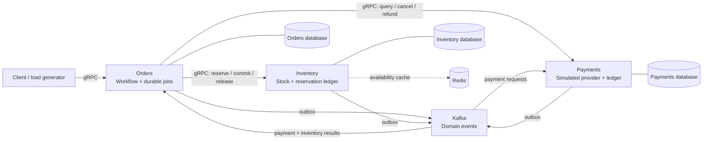

**Planned stack:** Go · gRPC · PostgreSQL · Kafka · Redis · Prometheus · Grafana · Loki · Alloy. Local Docker Compose comes first; distributed tracing is a later extension. A single local PostgreSQL instance hosts three databases with separate roles. Services never read one another's tables. Redis caches availability; PostgreSQL authorizes reservations.

The accepted design makes recovery explicit:

- Business state and its outbox event commit together. Duplicate delivery is expected; inbox deduplication and operation keys preserve meaning.
- An RPC timeout means the outcome is unknown. Recovery reuses the operation key or reconciles authoritative state.
- `COMPLETED` requires confirmed payment and committed inventory. `CANCELLED` requires no active reservation and no unrefunded debit.
- Cancellation and finalization compete for one versioned transition. Persisted cancellation barriers block late reservation or debit.
- Consumer lag and unfinished business work are measured separately. A committed Kafka offset does not prove a workflow has finished.

#### The experiment loop

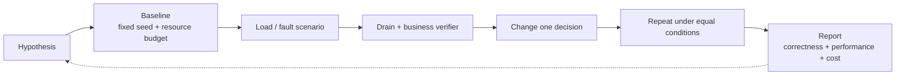

The [experiment catalog](#appendix-roadmap) includes load ramps, bursts, hot products, database contention, Kafka backlog and partition skew, slow dependencies, retry storms, crash windows, Redis failures, late payments and poison events.

Reports retain offered versus actual load, unresolved outcomes, resource limits and repeat variability. The [report template](#appendix-report-template) defines the evidence to collect. There are no completed experiment reports yet.

#### Human-led AI development

The **project owner** directs development and reviews changes. The AI acts as **implementer**: it prepares focused changes, runs available checks, documents evidence and addresses review comments. The human approves architecture and milestone transitions.

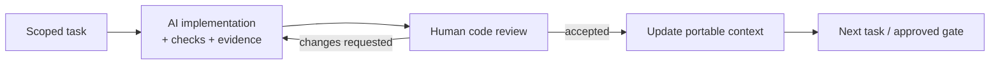

| Gate | Result | Status |
| :--- | :--- | :--- |
| **G0** | Architecture, invariants and development plan | Approved |
| **G1** | Orders and Inventory foundation | Planned |
| **G2** | End-to-end MVP and first experiment | Planned |
| **G3** | Failure recovery and resilience | Planned |
| **G4** | Reproducible engineering lab | Planned |

The [code review standard](#appendix-code-review) covers Go correctness, concurrency, data integrity and evidence. Review expectations and milestone decisions are in the [development workflow](#appendix-development-process). [AGENTS.md](#appendix-agents) gives implementers their working rules; [PROJECT_CONTEXT.md](https://github.com/Includeoyasi/faultline-lab/blob/main/PROJECT_CONTEXT.md) embeds the current state and source documents for agents without repository access.

#### Repository map

```text
faultline-lab/
├── README.md                    # Public overview in English
├── README.ru.md                 # Public overview in Russian
├── CONTRIBUTING.md              # Review and contribution expectations
├── AGENTS.md                    # Instructions for AI implementers
├── CONTEXT_STATE.json           # Status, approvals and validation evidence
├── PROJECT_CONTEXT.md           # Generated, self-contained agent handoff
├── docs/
│   ├── README.md                # Guided reading paths
│   ├── ROADMAP.md               # Stages, experiments and acceptance criteria
│   ├── architecture/           # Approved design and process atlas
│   ├── development/            # Human review and AI implementation workflow
│   ├── experiments/            # Experiment report template
│   ├── adr/                    # Recorded decisions and approvals
│   └── assets/                 # Repository visuals
├── tools/                      # Context generation and documentation checks
└── .github/                    # Documentation CI and review templates
```

Runtime directories will be added with their first working implementation. The [roadmap](#appendix-roadmap) contains the planned code layout.

#### Working with this snapshot

Clone the repository and start with the [documentation index](#appendix-docs-index):

```bash
git clone https://github.com/Includeoyasi/faultline-lab.git
cd faultline-lab
```

Documentation checks require Node.js 20+ and PowerShell 7+; the context generator also runs on Windows PowerShell 5.1:

```powershell
node tools/check_docs.mjs
pwsh -NoProfile -File tools/update_context.ps1 -CheckOnly
```

After changing canonical documents, update `CONTEXT_STATE.json` and its revision, regenerate with `pwsh -NoProfile -File tools/update_context.ps1`, then run the checks again. These commands validate documentation and snapshot freshness. Runtime setup instructions will accompany the implementation.

#### License

[MIT](#appendix-license) · Copyright © 2026 Dmitrii Morozov.

<a id="appendix-readme-ru"></a>

## Приложение: Публичное введение на русском

Полный исходный документ: `README.ru.md`. Текст включён непосредственно ниже; чтение исходного пути не требуется.

<p align="center">
  
</p>

<p align="center">
  <strong>Небольшой бизнес. Управляемые сбои. Доказательства эффективности решений.</strong><br>
  Лаборатория микросервисов на Go, разрабатываемая ИИ под руководством человека.
</p>

<p align="center">
  <a href="https://github.com/Includeoyasi/faultline-lab/actions/workflows/docs.yml"></a>
  · <a href="#appendix-license">MIT License</a>
</p>

<p align="center">
  <a href="#appendix-readme-en">English</a> ·
  <a href="#appendix-docs-index">Документация</a> ·
  <a href="#appendix-g0-processes">Атлас процессов</a> ·
  <a href="#appendix-roadmap">Roadmap</a> ·
  <a href="https://github.com/Includeoyasi/faultline-lab/blob/main/PROJECT_CONTEXT.md">Контекст для агентов</a>
</p>

#### Состояние проекта

**Архитектура принята, реализация впереди.** Владелец проекта полностью согласовал G0 **13 октября 2026 года**. Сейчас репозиторий содержит архитектуру, подробные схемы, roadmap, порядок ревью и переносимый контекст. Код сервисов, запускаемая инфраструктура и результаты экспериментов ещё не созданы.

Ближайший пакет **P01**: три Go entrypoints, конфигурация, health, graceful shutdown и JSON-логи, контейнерный toolchain и Compose-запуск для Windows/macOS. [План среды](#appendix-environment) объясняет состав контейнеров; [граница лаборатории](#appendix-lab-boundary) сохраняет направление подключения других бизнесов. Проверки документации не являются тестами будущих сервисов. Производительность стенда пока не измерялась.

Задачи ближайшего PR с кодом ведутся в [P01 — Issue #3](https://github.com/Includeoyasi/faultline-lab/issues/3): TODO, 0/8. [Спецификация пакета](#appendix-p01) содержит критерии приёмки. P01 идёт после G0 и до G1.

#### Идея

Faultline Lab — мини-магазин и лаборатория инженерных экспериментов вокруг него. Бизнес-процесс: **заказ → резервирование товара → симулированная оплата → завершение или отмена**.

Мы будем воспроизводить перегрузку, сбои зависимостей, задержки событий и ошибки восстановления; затем менять инженерное решение и сравнивать результаты в одинаковых условиях. Отчёт должен отвечать, сохранилась ли корректность бизнеса, что изменилось в производительности и ресурсах и можно ли повторить результат.

| Сервис | Ответственность | Что защищает |
| :--- | :--- | :--- |
| **Orders** | Заказ, сохранённые шаги процесса, отмена и компенсации | Учёт принятых запросов и корректные конечные состояния |
| **Inventory** | Остатки, резервы и складской ledger | Отсутствие перепродажи и безопасное освобождение резерва |
| **Payments** | Симуляция провайдера, платежи и возвраты | Отсутствие повторного списания и поздней оплаты после отмены |

Ровно три бизнес-сервиса. Управление процессом остаётся в Orders; генератор нагрузки и verifier — инструменты лаборатории.

#### Принятая архитектура

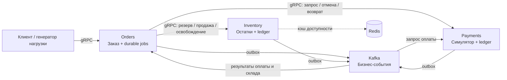

Планируемый стек: **Go, gRPC, PostgreSQL, Kafka, Redis, Prometheus, Grafana, Loki и Alloy**. Первая среда — локальный Docker Compose. У каждого сервиса своя база и роль PostgreSQL; чтение чужих таблиц исключено. Redis помогает читать доступность, а резерв разрешает PostgreSQL.

Принятые опорные правила:

- Бизнес-изменение и outbox-событие сохраняются одной транзакцией. Дубликаты доставки учитываются через inbox и ключи операций.
- Timeout RPC означает неизвестный результат. Восстановление повторяет тот же ключ или сверяет состояние владельца данных.
- `COMPLETED` требует подтверждённой оплаты и продажи товара. `CANCELLED` требует отсутствия активного резерва и невозвращённого списания.
- Отмена и финализация конкурируют за переход версии Orders. Сохранённые запреты отмены блокируют поздний резерв или списание.
- Kafka lag измеряется отдельно от незавершённых бизнес-задач.

В [атласе G0](#appendix-g0-processes) разобраны локальные транзакции, успешная покупка, отказы, гонки, поздние события и восстановление.

#### Цикл эксперимента

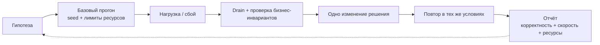

В каталоге roadmap — постепенная нагрузка, всплески, горячий SKU, блокировки PostgreSQL, backlog и перекос партиций Kafka, медленные зависимости, лавина повторов, рестарты, сбои Redis, поздняя оплата и poison events.

Мы учитываем предложенную и фактическую нагрузку, неизвестные исходы и разброс повторов. Цифры эффективности появятся после измерений. [Шаблон отчёта](#appendix-report-template) определяет состав доказательств; готовых результатов пока нет.

#### Человек и ИИ

**Владелец проекта** задаёт направление разработки и проводит код-ревью. ИИ — **исполнитель**: готовит изменения, выполняет проверки, фиксирует доказательства и исправляет замечания. Человек принимает архитектуру и ключевые этапы.

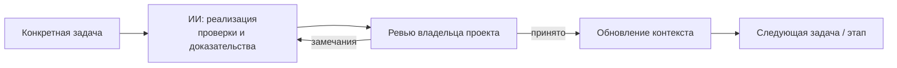

**G0 принят.** G1 — основа заказа и склада; G2 — сквозной MVP; G3 — устойчивость; G4 — воспроизводимая лаборатория. Следующие контрольные точки ещё не достигнуты.

[Правила код-ревью](#appendix-code-review) задают стандарт Go, проверки корректности и критерии слияния. [Порядок разработки](#appendix-development-process) описывает процесс и приёмку этапов. [AGENTS.md](#appendix-agents) задаёт правила исполнителю. [PROJECT_CONTEXT.md](https://github.com/Includeoyasi/faultline-lab/blob/main/PROJECT_CONTEXT.md) включает полные документы, статусы и согласования: его можно передать агенту без доступа к репозиторию.

#### С чего начать

1. [Карта документации](#appendix-docs-index) — выбрать маршрут чтения.
2. [Принятый дизайн](#appendix-design-review) — границы и инварианты.
3. [Процессы G0](#appendix-g0-processes) — подробные визуальные сценарии.
4. [Roadmap](#appendix-roadmap) — этапы, критерии и эксперименты.
5. [CONTRIBUTING.md](#appendix-contributing) — как подготовить проверяемое изменение.

Структура репозитория показана в [English README](#appendix-readme-en). Каталоги реализации будут добавляться вместе с работающим содержимым.

```bash
git clone https://github.com/Includeoyasi/faultline-lab.git
cd faultline-lab
```

Проверки документации: Node.js 20+ и PowerShell 7+. Генератор контекста также совместим с Windows PowerShell 5.1:

```powershell
node tools/check_docs.mjs
pwsh -NoProfile -File tools/update_context.ps1 -CheckOnly
```

После изменения источников обнови `CONTEXT_STATE.json`, увеличь ревизию и выполни `pwsh -NoProfile -File tools/update_context.ps1`, затем проверки. Инструкции запуска сервисов появятся с реализацией.

#### Лицензия

[MIT](#appendix-license) · Copyright © 2026 Dmitrii Morozov.

<a id="appendix-docs-index"></a>

## Приложение: Карта документации

Полный исходный документ: `docs/README.md`. Текст включён непосредственно ниже; чтение исходного пути не требуется.

### Карта документации

**Faultline Lab** · G0 принят 13 октября 2026 года · Реализация ещё не начата.

#### Маршруты чтения

| Задача читателя | Маршрут |
| :--- | :--- |
| Быстро оценить проект | [README](#appendix-readme-ru) → [Дизайн](#appendix-design-review) → [Roadmap](#appendix-roadmap) |
| Проверить распределённый процесс | [Атлас G0](#appendix-g0-processes) → [Принятие G0](#appendix-adr-0001) |
| Разобрать подключение другого бизнеса | [Граница лаборатории](#appendix-lab-boundary) — согласованное направление и детализация для ревью |
| Подготовить среду Windows/macOS | [Контейнерная среда](#appendix-environment) — состав, профили и статус проверок |
| Проверить исходные ресурсы | [Профили сред](#appendix-resource-profiles) — Windows, macOS и возможный будущий сервер |
| Посмотреть оформление | [Концепции баннера](#appendix-banner-options) — три варианта и выбранное решение |
| Принять участие в разработке | [CONTRIBUTING](#appendix-contributing) → [Правила ревью](#appendix-code-review) → [Workflow](#appendix-development-process) → [AGENTS](#appendix-agents) |
| Проверить ближайший PR | [P01](#appendix-p01) — задачи, зависимости, критерии и фактический прогресс |
| Следить за выполнением | [Учёт задач](#appendix-task-tracking) — GitHub Issues/PR и снимки контекста |
| Проверить права и защиту main | [Безопасность репозитория](#appendix-repository-security) — действующая защита и переход на аккаунт исполнителя |
| Подготовить эксперимент | [Roadmap](#appendix-roadmap) → [Шаблон отчёта](#appendix-report-template) |
| Ввести другого ИИ в задачу | [Переносимый контекст](https://github.com/Includeoyasi/faultline-lab/blob/main/PROJECT_CONTEXT.md) — полный самостоятельный снимок |

#### Источники решений

- [Дизайн](#appendix-design-review): принятые границы сервисов, контракты, состояния и инварианты.
- [Процессы](#appendix-g0-processes): 15 подробных схем транзакций, отказов, гонок и восстановления.
- [Граница лаборатории](#appendix-lab-boundary): общий механизм, адаптеры, кандидат второго бизнеса и доказательство переносимости.
- [Среда](#appendix-environment): Docker для Windows/macOS, распределение контейнеров и ограничения измерений.
- [Ресурсные профили](#appendix-resource-profiles): снимок Windows-хоста и отдельно ещё не измеренные среды/лимиты.
- [Roadmap](#appendix-roadmap): этапы 0–7, критерии готовности, риски и 12 сценариев экспериментов.
- [Workflow](#appendix-development-process): роли человека и ИИ, состав ревью и контрольные точки G0–G4.
- [Правила ревью](#appendix-code-review): стандарт Go, блокирующие замечания, проверки и критерии слияния.
- [ADR 0001](#appendix-adr-0001): свидетельство явного принятия G0.
- [Структурированное состояние](https://github.com/Includeoyasi/faultline-lab/blob/main/CONTEXT_STATE.json): текущая работа, проверки и история ревизий.

`PROJECT_CONTEXT.md` генерируется из источников и содержит их полные тексты. Источники редактируются напрямую; снимок обновляется через `tools/update_context.ps1`. Подробные документы пока ведутся на русском; публичное введение доступно на двух языках.

<a id="appendix-roadmap"></a>

## Приложение: Полный roadmap, архитектура, эксперименты и методика

Полный исходный документ: `docs/ROADMAP.md`. Текст включён непосредственно ниже; чтение исходного пути не требуется.

### Faultline Lab: roadmap лаборатории инженерных экспериментов

Цель проекта — воспроизводимо исследовать, как небольшой бизнес-процесс ведёт себя под нагрузкой и при сбоях, а затем проверять эффективность изменений. Итоговый продукт состоит из трёх бизнес-сервисов и инструментов вокруг них: генератора нагрузки, сценариев отказов, наблюдаемости, проверок корректности и отчётов.

Это план разработки, а не результаты уже проведённых испытаний. Все численные пороги ниже — начальные гипотезы, которые нужно откалибровать на своём компьютере.

Разработку выполняет Codex; пользователь выступает владельцем проекта, проводит код-ревью и согласует ключевые переходы. Порядок работы зафиксирован в `docs/development/WORKFLOW.md`. Архитектурный пакет `docs/architecture/DESIGN.md` и схемы `docs/architecture/PROCESSES.md` полностью приняты пользователем 2026-10-13. Реализация сервисов ещё не начата. Переносимый актуальный контекст находится в `PROJECT_CONTEXT.md`; следующая контрольная точка — G1.

#### 1. Допущения и границы

Обозначения G0–G4 относятся к контрольным точкам приёмки; P01–P05 — к небольшим пакетам кода с отдельным ревью. Первый PR с каркасом — P01, между G0 и G1. G1 принимается позже, после готовности основы заказа и склада; следующий PR не обозначает прохождения этой точки.

- Один исполнитель разработки — Codex, владелец проекта и ревьюер — пользователь. Первоначальные оценки объёма рассчитаны для ручной работы разработчика, знакомого с Go, SQL и Docker: один день равен примерно шести продуктивным часам. Эти оценки не являются сроками выполнения Codex; прогресс оценивается по готовности результатов и согласованным контрольным точкам.
- Первая среда — Linux-контейнеры в Docker Desktop/Compose на Windows и macOS; Go и инструменты сборки/проверок выполняются в контейнерной среде. Этот подход подтверждён владельцем проекта. Планируются нативные образы для x64 и ARM64; ресурсы и ограничения Docker фиксируются в каждом эксперименте. [Состав среды и статус проверок](#appendix-environment).
- Ровно три бизнес-сервиса: Orders, Inventory и Payments. Воркеры, оркестратор процесса и outbox publisher работают внутри соответствующего сервиса. Утилиты лаборатории и инфраструктура не становятся дополнительными бизнес-сервисами.
- Одна валюта, целые суммы в минимальных денежных единицах, один склад, небольшой фиксированный каталог и заранее загруженные остатки.
- В MVP нет авторизации, доставки, налогов, скидок, UI магазина и возвратов уже доставленных товаров. Возврат платежа нужен для компенсации отменённого заказа.
- Платёжный провайдер — модель внутри Payments. Она умеет детерминированно отвечать успехом или отказом, задерживать ответ и моделировать неизвестный результат. Реальные деньги не используются.
- Сначала один PostgreSQL с тремя базами и отдельными ролями. У сервисов нет прав читать чужие базы. Позже базы можно разнести, если именно разделение ресурсов становится предметом эксперимента.
- Один Kafka broker в первом профиле. Этот профиль проверяет обработку событий, backlog и перезапуски, но не отказоустойчивость реплицированного кластера. Для последней нужен отдельный профиль с несколькими брокерами.
- Версии Go, зависимостей и образы контейнеров закрепляются явно. В отчёт попадают теги и digest образов; плавающий `latest` не является описанием воспроизводимой среды.

Достаточный конечный результат: новый сценарий задаётся конфигурацией; один запуск создаёт нагрузку, применяет сбой, собирает данные и проверяет инварианты; сравнение двух вариантов формирует отчёт с выводом, ограничениями и исходными данными.

#### 2. Архитектура

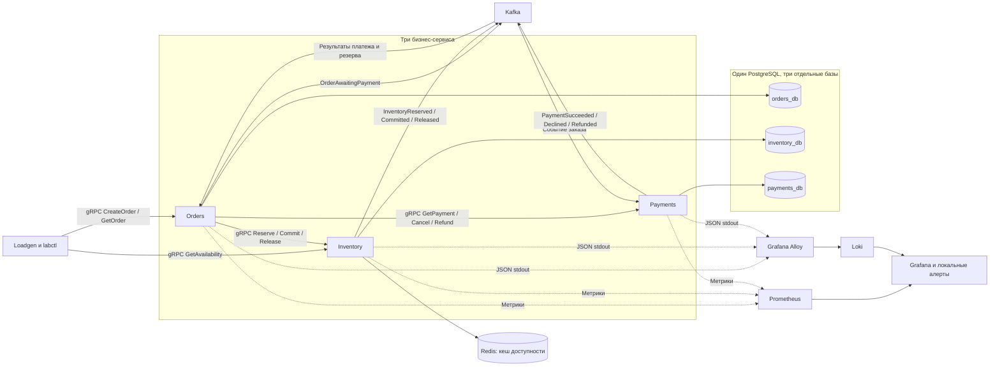

Инфраструктура для MVP: PostgreSQL, Kafka, Redis, Prometheus, Grafana, Loki и Alloy. Prometheus хранит метрики; Loki хранит логи; Grafana показывает оба источника. Сбор Docker-логов через Alloy соответствует официальному примеру Grafana. [Документация Loki и Alloy](https://grafana.com/docs/loki/latest/get-started/quick-start/tutorial/).

На этапе расширенной диагностики добавить OpenTelemetry и Tempo. Они нужны для ответа на конкретный вопрос: где заказ провёл время — в gRPC, очереди, SQL или обработчике событий. Сбор трасс должен иметь одинаковую конфигурацию в сравниваемых прогонах.

##### Владение данными

| Сервис | Ответственность | Основные данные | Что не делает |
|---|---|---|---|
| Orders | Приём заказа, долговечное управление шагами, отмена и компенсации | orders, order_items, workflow_jobs, transition_history, inbox, outbox, request_keys | Не меняет складские и платёжные таблицы |
| Inventory | Остатки, цены каталога для стенда, резервирование, подтверждение продажи, освобождение | products, stock, reservations, reservation_items, operations, inventory_ledger, outbox | Не решает, успешен ли заказ в целом |
| Payments | Симуляция платежа, запрет позднего списания после отмены, возврат | payments, payment_jobs, payment_ledger, inbox, outbox, operation_keys | Не резервирует товар и не завершает заказ |

Цены фиксируются Inventory в момент резервирования; Orders сохраняет этот снимок. Payments получает сумму из события Orders, а не произвольную сумму клиента. Общими могут быть protobuf-контракты и инструменты телеметрии; бизнес-логика и SQL каждого сервиса остаются внутри него.

##### Назначение транспорта

**gRPC** используется там, где нужен непосредственный результат операции: принять заказ, узнать состояние, атомарно зарезервировать товар, подтвердить или освободить резерв, запросить статус платежа и выполнить компенсацию.

**Kafka** переносит факты и отделяет приём заказа от платежной обработки. Payments запускается по `OrderAwaitingPayment`. Orders принимает результаты Payments и Inventory. Inventory подтверждает фиксацию продажи событием `InventoryCommitted`, после которого Orders завершает заказ.

Таким образом, все три сервиса используют и gRPC, и Kafka. Долговечный управляющий процесс находится в Orders; отдельный сервис для него не нужен.

**Redis** — кеш чтения `GetAvailability`, принадлежащий Inventory. Сначала TTL около двух секунд с небольшим случайным разбросом и best-effort invalidation после изменения склада. Кеш может временно показывать устаревшую доступность. `Reserve` всегда проверяет PostgreSQL. Redis не хранит единственную копию идемпотентности, платежей или остатков.

Пользу кеша проверять на смешанном профиле просмотра и заказа. Проверять только создающие записи запросы и ожидать ускорения от кеша чтений было бы неверной постановкой эксперимента.

#### 3. Бизнес-процесс и контракты

##### Успешный путь

1. `Orders.CreateOrder(client_request_id, items)` в одной SQL-транзакции создаёт заказ, ключ запроса и долговечную задачу резервирования. После commit клиент получает `order_id` и `ACCEPTED`. Ответ означает принятие, а не завершение покупки.
2. Внутренний воркер Orders вызывает `Inventory.Reserve(order_id, operation_id, items)`.
3. Inventory атомарно создаёт резерв, обновляет остатки и пишет `InventoryReserved` в outbox. Повтор с тем же ключом возвращает прежний результат. Orders сохраняет резерв, сумму и `OrderAwaitingPayment` в своей транзакции.
4. Publisher Orders доставляет событие в Kafka. Payments записывает inbox и долговечную payment job в своей транзакции, затем подтверждает обработанный Kafka offset.
5. Воркер Payments выполняет симуляцию задержки вне SQL-транзакции. Короткая транзакция проверяет текущее состояние, записывает единственное списание и `PaymentSucceeded` в outbox либо фиксирует отказ и `PaymentDeclined`.
6. Orders атомарно принимает `PaymentSucceeded`, меняет состояние на `FINALIZING` и создаёт задачу `CommitReservation`. Inventory фиксирует продажу и `InventoryCommitted` в одной транзакции.
7. Orders обрабатывает `InventoryCommitted`, проверяет подтверждённую оплату, переводит заказ в `COMPLETED` и публикует `OrderCompleted`.

Если Orders упал после ответа Inventory, повторяется тот же шаг с тем же `operation_id`. Если Kafka временно недоступна, событие остаётся в outbox. Если воркер умер после получения задачи, истечение lease позволяет продолжить её другим экземпляром.

##### Состояния

| Сущность | Основные состояния |
|---|---|
| Заказ | ACCEPTED → RESERVING → PAYMENT_PENDING → FINALIZING → COMPLETED |
| Ветка отказа заказа | REJECTED при нехватке товара; CANCELLING → CANCELLED после завершения компенсаций |
| Резерв | RESERVED → COMMITTED или RELEASED; RELEASED также служит запретом позднего Reserve для отменённого order_id |
| Платёж | PROCESSING → SUCCEEDED или DECLINED; отмена до списания → CANCELLED; возврат списанного платежа → REFUND_PENDING → REFUNDED |

`NEEDS_REVIEW` можно добавить для исчерпанного автоматического восстановления. Это нерешённый бизнес-процесс, который ухудшает результат эксперимента, а не успешный терминальный исход.

В MVP отмена клиентом разрешена до FINALIZING. Переход PAYMENT_PENDING → FINALIZING и принятие CancelOrder конкурируют за один условный переход версии в Orders: выигрывает одна ветка. После FINALIZING отмена отклоняется, процесс доводится до COMPLETED. Это позволяет не моделировать возврат уже проданного товара. Если намерение отмены победило раньше, поздний PaymentSucceeded запускает возврат и не создаёт Commit job. Старый воркер проверяет актуальную версию и разрешённый шаг перед выполнением мутации.

##### Отказы и компенсации

| Ситуация | Действие |
|---|---|
| Недостаточно товара | Атомарно отказать в резервировании всего заказа, завершить как REJECTED, не запускать оплату |
| Платёж отклонён | Зафиксировать отказ, освободить резерв, завершить как CANCELLED |
| gRPC timeout после мутации | Считать результат неизвестным; повторить тот же operation_id или запросить состояние |
| Kafka недоступна | Держать событие в outbox, контролировать возраст и объём накопления; при исчерпании заданного лимита ограничивать новый приём |
| Оплата успешна, Inventory временно недоступен | Оставить FINALIZING, повторять CommitReservation и сверять состояние; временный отказ не является поводом немедленно вернуть деньги |
| Резерв уже освобождён, оплата успешна | Перейти к возврату; CANCELLED выставить после подтверждения возврата |
| Позднее платёжное событие после начала отмены | Продолжить отмену: запретить ещё не выполненное списание либо вернуть выполненное |
| Результат Commit неизвестен | Сначала сверить резерв. Если COMMITTED, завершить заказ; если RELEASED, компенсировать оплату |

`ReleaseReservation(order_id)` должен сохранять терминальный запрет даже если Reserve ещё не успел создать запись. `CancelPayment(order_id)` аналогично сохраняет запрет будущего списания; если списание уже произошло, возвращает состояние для последующего `RefundPayment`. Иначе задержанный запрос или событие могут воскресить отменённый процесс.

В MVP резерв не исчезает по независимому TTL. Срок процесса контролирует Orders, который сохраняет намерение отмены и доводит компенсации до конца. Автоматическое истечение резерва добавить позже как отдельный протокол и проверить гонки с оплатой и Commit.

##### gRPC API

| Сервис | Методы |
|---|---|
| Orders | CreateOrder, GetOrder, GetOrderByRequestKey, CancelOrder |
| Inventory | GetAvailability, Reserve, GetReservation, CommitReservation, ReleaseReservation |
| Payments | GetPayment, CancelPayment, RefundPayment |

Mutating RPC принимают ключ операции и проверяют hash существенных параметров. Повтор ключа с другим payload — конфликт, а не новый заказ. Платёжная симуляция запускается событиями; отдельный публичный `Charge` в MVP не нужен.

Идемпотентность включает подтверждённые бизнес-отказы. Например, недостаток товара сохраняется как результат operation_id без частичных складских изменений. Повтор того же ключа после пополнения склада не превращает завершённый отказ в новый успешный резерв.

##### Kafka

| Топик | События | Consumer group |
|---|---|---|
| orders.events.v1 | OrderAwaitingPayment, OrderCompleted, OrderCancelled | payments-v1, фильтрует только нужные события |
| payments.events.v1 | PaymentSucceeded, PaymentDeclined, PaymentRefunded, PaymentCancelled | orders-payments-v1 |
| inventory.events.v1 | InventoryReserved, InventoryCommitted, InventoryReleased | orders-inventory-v1 |

Envelope: `event_id`, `event_type`, `schema_version`, `order_id`, `aggregate_version`, `occurred_at`, `correlation_id`, `causation_id`, `traceparent`, `payload`. `aggregate_version` относится к владельцу события; нельзя сравнивать версии Inventory и Payments как одну последовательность.

Начать с трёх партиций на топик и ключа `order_id`, затем экспериментировать с другим числом. Использовать обычные consumer groups. Kafka упорядочивает записи внутри партиции; общего порядка между топиками нет. Параллельная обработка в приложении также не должна нарушать требуемый порядок. Kafka-транзакции сами по себе не создают общую атомарную транзакцию с PostgreSQL. [Официальное описание Kafka](https://kafka.apache.org/43/design/design/).

Publisher outbox сохраняет порядок версий одного агрегата: несколько publishers не должны одновременно отправлять разные версии одного order_id в случайном порядке. В MVP допустим один активный publisher на сервис с DB lease; другие экземпляры могут принять lease после его потери. Позже проверить шардирование publishers. State machine обязана безопасно переживать дубликаты и опоздавшие факты даже при корректном порядке публикации.

#### 4. Гарантии корректности

##### Обязательные инварианты

1. `available >= 0`, `reserved >= 0`, `on_hand >= reserved` в Inventory.
2. При отсутствии пополнений `initial_stock = available + reserved + sold`. При пополнениях они учитываются в ledger; одна операция Commit или Release меняет баланс только один раз.
3. На order_id не более одного успешного списания. Сумма возвратов не превышает сумму списания. В MVP один полный возврат.
4. `COMPLETED` означает подтверждённую оплату на ожидаемую сумму и `COMMITTED` резерв.
5. `CANCELLED` означает отсутствие активного резерва и отсутствие невозвращённого списания; поздние операции не могут нарушить этот результат.
6. На client_request_id существует максимум один заказ с неизменным смыслом запроса.
7. Каждый принятый заказ существует в Orders и учтён итоговым verifier как терминальный, незавершённый или неизвестный из-за недоступности данных. Неучтённые заказы недопустимы.

Состояние PAYMENT_PENDING при резерве RESERVED — нормальная временная рассогласованность. Успешная оплата и FINALIZING во время краткого отказа Inventory также допустимы, но их длительность учитывается. Завершённый заказ без оплаты, отрицательные остатки и двойной debit — нарушение безопасности при любой длительности.

Глобальный verifier после прекращения нагрузки читает экспорт данных владельцев или использует отдельные read-only учётные записи трёх баз. Это инструмент лаборатории; сами сервисы не получают доступ к чужим данным. Во время активных изменений глобальная сверка должна учитывать версии и повторно подтверждать подозрительные пары, чтобы разные моменты чтения не выглядели ложным нарушением. После drain выполняется обязательная полная сверка.

##### Механизмы и момент внедрения

| Механизм | Когда | Назначение и проверка |
|---|---|---|
| SQL constraints, уникальные operation keys, условные переходы состояния | Этап 1 | Конкурентные Reserve и повторные запросы не создают лишний резерв или эффект |
| Долговечные шаги Orders, lease, version check | Этапы 1–2 | Перезапуск продолжает сохранённый шаг; старый воркер не перезаписывает новое состояние |
| Transactional outbox у всех трёх сервисов | Этап 2 | Падение между SQL commit и Kafka publish не теряет событие |
| Inbox и durable jobs у Kafka-потребителей | Этап 2 | Дубликат события не создаёт второй job или бизнес-эффект |
| Reconciliation и компенсации | Минимум в этапе 2, расширение в этапе 4 | Неизвестный результат RPC и поздние результаты не оставляют ложный terminal state |
| DLQ/quarantine и управляемый replay | Этап 4 | Некорректное событие диагностируется и воспроизводится без тихой потери процесса |
| Политика circuit breaker и admission control | Этап 5 после измерения | Ограничить каскадное накопление работы; оценить успешный goodput, отказы и восстановление |

Inbox, бизнес-переход и создаваемые jobs/outbox записываются одной транзакцией. Kafka offset подтверждается после неё. Если дальше нужна долгая работа, она уже представлена durable job. При параллельной обработке offset можно продвигать только через непрерывный диапазон завершённых записей, а не сразу до самого высокого готового offset.

Outbox помечается отправленным после подтверждения Kafka; падение перед отметкой приведёт к повторной публикации. Поэтому повторная доставка ожидаема, и защита строится на бизнес-ключах и SQL-транзакциях. Обещание проекта — определённые идемпотентные эффекты и проверяемые инварианты в заданной модели отказов, а не универсальная сквозная exactly-once.

Для склада использовать короткую транзакцию: условное увеличение `reserved` при достаточном `on_hand - reserved`, запись резерва и ledger. Несколько SKU блокировать в стабильном порядке; при недостатке хотя бы одной позиции откатывать весь резерв. PostgreSQL при конкурентном UPDATE в Read Committed повторно проверяет WHERE для изменённой строки. Это полезно для такого условного обновления, но не заменяет проектирование всей транзакции. [Transaction isolation](https://www.postgresql.org/docs/current/transaction-iso.html). Единый порядок блокировок и короткие транзакции уменьшают риск deadlock. [Explicit locking](https://www.postgresql.org/docs/current/explicit-locking.html).

На RPC всегда задавать deadline и передавать отмену в SQL и последующие вызовы. gRPC по умолчанию не устанавливает deadline; приложение должно прекращать запущенную работу после отмены. [gRPC deadlines](https://grpc.io/docs/guides/deadlines/).

Это относится к работе текущего запроса. Уже сохранённая и принятая durable job имеет собственный контекст процесса и бюджет бизнес-шага; уход клиента после CreateOrder не удаляет заказ и не отменяет его обработку. Повтор клиентского запроса разрешает неизвестный результат через тот же request key.

Начальная политика: одна повторная попытка для идемпотентной мутации, только для классифицированной временной ошибки и внутри оставшегося deadline; backoff с jitter. Дальнейшее восстановление делает durable job с сохранённым next_attempt_at. Не включать независимые длинные retry loops одновременно у клиента, gRPC и воркера. Встроенную retry policy gRPC нужно задавать явно и проверять счётчик реальных попыток. [gRPC retry](https://grpc.io/docs/guides/retry/).

Длительные задержки провайдера, ожидание gRPC и Kafka не должны удерживать открытую SQL-транзакцию. Ограниченные пулы и worker queues — исходная управляемая конфигурация; изменение их размеров станет экспериментом.

#### 5. Наблюдаемость

##### Логи и корреляция

JSON-логи в stdout: `timestamp`, `level`, `service`, `instance`, `version`, `run_id`, `order_id`, `operation_id`, `event_id`, `correlation_id`, `trace_id`, `step`, `attempt`, `duration_ms`, `outcome`, `error_code`.

Логировать переход состояния, неизвестный результат операции, повтор, компенсацию, конфликт ключа и помещение в quarantine. Содержимое платёжных данных для стенда — синтетическое. Успешные однотипные чтения можно семплировать; журналы бизнес-операций, на которые опирается проверка, находятся в PostgreSQL, а не только в логах.

`order_id`, `trace_id`, `event_id` и `run_id` — поля логов, не Prometheus labels и не индексные labels Loki. Labels метрик ограничить `service`, `method`, `code`, `step`, `event_type`, `outcome` с заранее ограниченными наборами. Высокая кардинальность увеличивает стоимость хранения и обработки метрик. [Prometheus instrumentation](https://prometheus.io/docs/practices/instrumentation/).

##### Метрики и дашборды

| Дашборд | Показатели | Какой вопрос решает |
|---|---|---|
| Бизнес-процесс | Offered/sent/accepted orders, completed orders/s, business rejects, technical failures, отмены, время до терминального состояния, oldest pending age, незавершённые заказы | Завершает ли система покупки при заданном спросе? |
| gRPC и Go | p50/p95/p99, timeout/error/retry rate, inflight, goroutines, GC, CPU/RSS | Где растёт задержка и сколько работы удерживается? |
| PostgreSQL | Время acquire из пула, занятые/свободные соединения, SQL latency, lock waits, deadlocks, долгие транзакции | База медленно работает или приложение ждёт её допуска? |
| Kafka и jobs | Lag по group/topic/partition, возраст старейшего необработанного события, event completion rate, длительность rebalance, job/outbox depth и oldest age | Где накапливается работа и успевает ли она завершаться? |
| Redis | Hit/miss, ошибки и latency, частота fallback, загрузка SQL при fallback, возраст возвращённых данных | Кеш снижает нагрузку без опасного доверия устаревшим данным? |
| Корректность | Нарушения каждого инварианта, dangling reservations, unmatched payments, failed reconciliation | Не куплено ли ускорение ценой неверных результатов? |

Lag по committed offsets показывает прогресс передачи в durable job, если consumer подтверждает событие на этом этапе. Поэтому низкий Kafka lag не доказывает, что платежи уже обработаны: отдельно нужны возраст и размер payment_jobs.

Метрики сервисов снимает Prometheus. На ранних этапах runner сохраняет `docker stats`, доступные SQL-показатели и Kafka offsets. На этапе 3 добавить инфраструктурные exporters с проверкой совместимости своего Docker окружения. Накладные расходы verifier и exporters также фиксировать и держать одинаковыми в A/B.

##### Начальные SLI/SLO

Профиль для SLO: достаточно товара, симулятор всегда одобряет платёж, нет внесённых отказов, нагрузка R0. R0 — не обещанное число: её определить первым ступенчатым тестом.

| SLI | Начальная гипотеза |
|---|---|
| Приём валидного заказа | Не менее 99% уникальных отправленных заказов получают подтверждение принятия за 300 мс |
| Завершение бизнеса | Не менее 99% уникальных отправленных валидных заказов переходят в COMPLETED за 2 секунды с момента отправки |
| Безопасность данных | Ноль отрицательных остатков, двойных списаний и ложных COMPLETED |
| Полнота обработки после drain | Каждый принятый заказ учтён; в профиле без отказов нет незавершённых процессов |
| Восстановление | После 30 секунд недоступности зависимости backlog и задержки возвращаются в исходный диапазон за 120 секунд; уточнить по baseline |

Доля завершённых среди принятых — полезная диагностическая метрика. Для оценки способности обслужить спрос нужен также знаменатель всех отправленных валидных заказов: иначе отклонение большей части нагрузки искусственно улучшит результат.

Ожидаемые sold-out и payment declines учитывать отдельно от технических ошибок. Правила ожидаемого поведения задаются до запуска. Для fault-сценариев заранее задаются отдельные критерии допустимой деградации и восстановления; нельзя после теста исключать из знаменателя неудачные запросы.

Начальные локальные алерты в Grafana:

- Верификатор подтвердил нарушение инварианта — сразу критический сигнал.
- При положительном входящем потоке нет бизнес-завершений 30 секунд — сигнал остановки процесса.
- Старейший заказ старше 10 секунд либо объём backlog растёт несколько окон подряд — сигнал деградации.
- gRPC p99 превышает 300 мс или доля технических ошибок превышает 1% на достаточной выборке несколько минут — сигнал нарушения начального бюджета.
- Долгое ожидание соединения, рост outbox age, недоступность telemetry collectors — отдельные диагностические сигналы.

Runner фиксирует момент начала проблемы, переход алерта в firing и восстановление. Порог и `for` подбирать по baseline; выбранный `for` ограничивает минимальную скорость обнаружения. Во время запланированных сбоев сигналы не скрывать: они являются частью результата.

#### 6. Генератор и управление экспериментами

Начать с маленького Go CLI `loadgen`, использующего те же protobuf-контракты. Поддержать open-loop запуск заказов с заданной частотой, фиксированный seed, список SKU и независимую сверку результатов. Не создавать для него отдельную постоянную бизнес-платформу.

Open-loop нужен, чтобы рост latency не снижал автоматически предлагаемую системе нагрузку. Такое снижение в закрытой модели способно скрывать перегрузку; различие подробно описано в документации k6. Реализуется оно и в собственном Go-генераторе. [Open and closed load models](https://grafana.com/docs/k6/latest/using-k6/scenarios/concepts/open-vs-closed/).

Для каждой операции сохранять плановое время отправки, фактическую отправку, ответ, ключ запроса и итоговый бизнес-статус. Если генератор исчерпал свой лимит inflight, записать skipped/late launches: не тормозить незаметно расписание. Измерять CPU генератора и расхождение target/sent rate. Результат при насыщении самого генератора маркировать как непригодный для оценки capacity стенда.

Параметры профиля:

- orders/s, ступени роста и burst;
- доля чтений каталога и статуса заказа;
- число товаров в заказе, размер каталога и распределение popular SKU;
- исходный склад: избыточный для capacity-тестов, ограниченный для hot-stock;
- детерминированная доля payment declines и задержек, keyed по order_id и seed;
- лимиты inflight генератора, число воркеров сервисов и pool sizes;
- таймлайн сбоя, длительность, направление сетевого воздействия;
- прогрев, основное окно, drain, повторы и ресурсный бюджет.

Способы внесения отказов: test-only delay/error hooks, управляемая остановка и запуск контейнера, сетевой proxy по нужной зависимости. Задержка SQL в тестовой ветке должна быть отличима от реальной блокировки/плохого плана SQL. Все hooks отключаются обычной конфигурацией, а их активация попадает в manifest.

#### 7. Roadmap

Этапы 0–2 дают MVP. Он содержит весь обязательный стек, сквозной процесс и первый отчёт, собранный вручную. Этапы 3–7 делают лабораторию удобной для более глубоких экспериментов.

Контрольные точки владельца проекта: G0 — архитектура перед кодом; G1 — базовая работа с заказом и складом после этапа 1; G2 — сквозной MVP после этапа 2; G3 — устойчивость после этапа 4; G4 — итоговая лаборатория после этапа 7. G0 полностью принят 2026-10-13; G1–G4 ещё не достигнуты. Внутри этапов изменения готовятся небольшими пакетами для код-ревью. Переход через контрольную точку выполняется после явного согласования пользователя. Существенные изменения ранее согласованной архитектуры выносятся на отдельное согласование.

| Этап | Цель и задачи | Зависит от | Результат и критерий готовности | Демонстрация | Дни | Основной риск |
|---|---|---|---|---|---|---|
| 0. Контракт эксперимента | Описать состояние и инварианты; определить API/события; выбрать baseline data и ресурсный профиль; подготовить monorepo и Compose | — | Контракты и initial manifest сохранены; инфраструктура поднимается; у каждой БД отдельная роль | Проверка доступности и невозможности читать чужую БД | 2–3 | Долгое проектирование вместо первого работающего среза |
| 1. Создание и резерв | Go-сервисы, миграции; Create/Get; атомарный Reserve/Commit/Release; модель платежа; request keys; durable step; JSON-логи и базовые метрики | 0 | Заказ переживает перезапуск в RESERVING; повтор запроса не дублирует заказ; конкуренция не создаёт отрицательный склад | 1000 попыток купить 100 единиц одного SKU | 4–6 | Неверная транзакция или слишком долгие блокировки |
| 2. Сквозной MVP | Kafka workflow; outbox/inbox; payment jobs; минимальные компенсации; кеш чтения Redis; Loki/Alloy/Grafana; loadgen и verifier | 1 | 1000 заказов завершаются; отказы оплаты освобождают товар; повторы и контрольные crash windows не нарушают инварианты; первый baseline отчёт сохранён | Ступени нагрузки и сравнение одного изменения worker limit | 6–9 | Попытка отложить восстановление и потерять доверие к baseline |
| 3. Диагностика | Полные дашборды и алерты; SQL/пул/Kafka/job telemetry; OpenTelemetry и Tempo; учёт overhead | 2 | Для медленного заказа виден участок ожидания; искусственная задержка даёт ожидаемый сигнал и алерт; конфигурация dashboards хранится в репозитории | 500 мс задержки Payments и сравнение таймлайна событий, метрик и trace | 3–5 | Высокая кардинальность и влияние самой телеметрии |
| 4. Устойчивость | Late events, cancel races, timeout-after-commit, DLQ/quarantine и replay; проверки reconciliation; schema compatibility | 2; наблюдаемость из 3 помогает | Сценарии имеют утверждённые результаты; после исправления и replay нет потерь и двойных эффектов; нерешённые заказы явно учтены | Убить publisher после publish до отметки; задержать успех оплаты до отмены | 6–9 | Объявить компенсацию завершённой при неизвестном результате |
| 5. Нагрузка и решения | Прогон каталога узких мест; SQL/pool/workers; retries; cache; backpressure; сравнение гипотез по одной | 3–4 | Минимум четыре сценария имеют baseline, изменение и повторное измерение; улучшение не ухудшает корректность | Short transaction против долгой; ограниченные retries против retry storm | 5–8 | Сменить несколько факторов и потерять причинную связь |
| 6. Масштабирование | gRPC routing, несколько реплик, Kafka partitions/publishers; connection budgets; при необходимости разнести базы; optional multi-broker profile | 5 | Сравнение 1/2/4 реплик при том же суммарном CPU и при увеличенном бюджете; показано ограничение масштабирования | Replicas vs partitions; hot SKU vs равномерная нагрузка | 4–6 | Пиннинг gRPC на одном backend, горячая строка склада или рост суммарного SQL-пула |
| 7. Отчёты и regression suite | labctl автоматизирует setup/run/drain/verify/export/compare; JSON manifest, графики, Markdown report; короткий набор сценариев | 2, шаблон стабилизирован в 5–6 | Одна команда воспроизводит сравнение и выдаёт артефакты; smoke/regression suite находит намеренно внесённую ошибку | Повтор A/B с одинаковым seed и сравнение отчётов | 4–6 | Отчёт скрывает пропуски телеметрии, backlog или различия среды |

Базовая сумма: **34–52 рабочих дня, приблизительно 204–312 часов**. При 20 часах в неделю — ориентировочно 10–16 недель; при 10 часах — 20–31 неделя. Это оценка при принятых допущениях, без времени на изучение Go/Docker с нуля и без Kubernetes. MVP: **12–18 рабочих дней, 72–108 часов**. После MVP уточнить остальные оценки по фактической скорости.

##### Первый полезный эксперимент после MVP

1. При достаточном складе и всегда успешной оплате выполнить ступени 10 → 25 → 50 → 100 orders/s, по 3–5 минут. При необходимости скорректировать диапазон. Снять accepted/completed throughput, e2e latency, oldest job age, pool waits, Kafka и outbox backlog.
2. Найти первый устойчивый узкий участок. Если это последовательная payment processing, проверить изменение `payment_workers: 1 → 4` при тех же CPU/памяти. Если ограничение другое, выбрать изменение по наблюдаемому сигналу.
3. Повторить одинаковый профиль и сравнить goodput, p95/p99, незавершённые заказы, CPU и инварианты. Не менять одновременно pool size, число реплик и профиль отказов.
4. Сохранить первый отчёт. Это диагностический эксперимент; подтверждение предельной capacity требует более долгих и повторных прогонов на этапе 5.

##### Когда нужен Kubernetes

После этапа 7 возможен отдельный этап на 5–10 дней, если предмет исследования — rolling update, readiness, распределение по узлам, лимиты/requests или autoscaling. Он не нужен для первых экспериментов с Kafka, gRPC, SQL, кешем и нагрузкой. Автомасштабирование должно опираться на проверенный сигнал, например возраст работы, а не только CPU. Одноузловый кластер всё ещё не доказывает устойчивость к потере физического узла.

#### 8. Каталог экспериментов

Нагрузочные сценарии растят спрос или меняют его распределение. Fault-сценарии намеренно ломают зависимость. Они имеют разные критерии успеха: максимальный устойчивый goodput против ограниченной деградации и восстановления.

| ID / тип | Проблема и воспроизведение | Сигналы | Гипотеза / изменение | Оценка улучшения | Компромисс |
|---|---|---|---|---|---|
| L1: рост нагрузки | Ступени до выхода из SLO; товар не заканчивается, оплата всегда успешна | offered/accepted/completed, p99, oldest pending, CPU, pool/job waits | Изменить ровно один обнаруженный bottleneck: индекс, короткую транзакцию, число воркеров | Максимальный устойчивый orders/s при одном SLO и бюджете; backlog не имеет устойчивого роста | Латентное накопление работы может выглядеть как высокая скорость приёма |
| L2: burst | После спокойного окна подать 5×R0 на 30 секунд, затем R0 | Peak pending, heap/goroutines, rejects, drain time | Ограниченный inflight, admission control, раздельные worker budgets | Меньше технических ошибок и faster recovery; goodput и доля отказов показаны вместе | Shed requests нельзя исключать из общей оценки спроса |
| L3: горячий товар | 80–90% заказов на один SKU; отдельные тесты с обильным и ограниченным остатком | Lock wait, Reserve latency, business sold-out, inventory ledger | Сократить locked section; стабильный lock order; сравнить сериализацию по SKU как альтернативу | Короткие ожидания и корректный баланс; после terminal/drain для 100 единиц нет более 100 продаж и нет dangling reserve | Больше реплик не устраняет конкурентную запись в одну строку; serialization может снизить параллелизм |
| L4: SQL bottleneck | Отдельно плохой план чтения, долгий lock и маленький pool; не смешивать их | SQL latency/plan, acquire wait, lock wait, deadlocks, query count | Индекс для своего запроса, уменьшение времени транзакции, изменение pool cap | Улучшение e2e и SQL при том же профиле; pool не перегружает общий PostgreSQL | Большой pool способен ухудшить базу; индекс увеличивает цену записи |
| L5: Kafka backlog | Снизить throughput consumer либо processing worker; сохранять поток producer | Lag по партициям, возраст events/jobs, oldest outbox, rebalance | Batching, workers, число обычных consumers и partitions в отдельных тестах | Возраст backlog и время догонки, бизнес goodput | Низкий Kafka lag при большом durable-job backlog — ложный признак здоровья |
| L6: partition skew | Для отдельного профиля большинство ключей направить в одну партицию; держать stock contention отдельным фактором | Lag/throughput по партициям, idle consumers | Изменить ключ или распределение, если бизнес-порядок это допускает | Снижение перекоса и e2e latency при сохранении семантики | Новое число партиций меняет распределение ключей; не менять его на ходу без плана порядка и миграции |
| F1: зависимость медленная/недоступна | 500 мс → 2 с задержки или остановка Inventory/Payments на 30 секунд | Deadlines, job age, accepted/completed, inflight, recovery | Deadline budgets, bounded retries, durable reconciliation; затем breaker | Ограниченная память/очередь, ноль нарушений, recovery target | Слишком короткий deadline увеличивает неизвестные результаты и повторную работу |
| F2: retry storm | Временно возвращать UNAVAILABLE; сравнить агрессивную и ограниченную политику | Attempts/logical request, load amplification, CPU, queue age | Одна retry policy, backoff+jitter и budget | Меньше лишних попыток, выше completed goodput, короче восстановление | Более длинное ожидание единичного клиента; breaker/admission отклоняют часть спроса |
| F3: crash windows | Убить процесс после DB commit до publish, после publish до sent marker, после consumer commit до offset | Replay count, duplicate suppression, outbox/jobs, ledger | Outbox/inbox и устойчивые operation keys; проверяется действующая реализация | Сверка всех заказов после рестарта; ноль лишних списаний и lost events в модели сохранённых дисков | Проверка не включает уничтожение данных БД или исчерпание retention |
| F4: Redis down/stale | Остановить Redis, одновременно истечь ключам, задержать invalidation | Hit rate, stale-read rate, SQL fallback, Reserve correctness | Короткий fallback deadline, TTL jitter, singleflight; сравнить отказ и fallback | Read latency, SQL нагрузка и успешные заказы; ноль Reserve по кешу | Fallback может вызвать stampede в PostgreSQL; отображение остатков может быть устаревшим |
| F5: поздняя оплата/отмена | Задержать PaymentSucceeded до начала отмены; конкурирующие Commit/Release | State transitions, compensations, unmatched debit, terminal state | Durable cancel intent, cancellation barriers, idempotent refund | В итоге корректный COMPLETED или CANCELLED, единственный debit, отсутствие невозвращённых сумм у отменённых | Нужно больше состояний; нельзя объявлять неизвестный результат отменённым |
| F6: poison event / replay | Внести неверную схему или payload в конкретную партицию | Quarantine depth, errors, blocked partition, pending order age | Durable quarantine и контролируемый replay после исправления | Проблема видна, запись сохранена, процесс после replay корректен | Пропуск записи ради доступности ломает бизнес-порядок, если его не учитывает state machine |

Для F6 сначала сохранять проблемное событие и контекст в durable quarantine, затем разрешать продвижение offset согласно явной политике. Если DLQ находится в Kafka, outage Kafka не должен приводить к подтверждению потерянной DLQ-записи. Replay сохраняет исходный event_id/operation semantics и не обходит обычную идемпотентность. После изменения кода отдельно решить, что делать с ранее обработанными результатами: просто новый event_id способен создать второй эффект.

В F5 гонку приёма CancelOrder с PaymentSucceeded проверять через допустимые состояния Orders. Конкурентные Commit/Release — дополнительная проверка примитивов Inventory и внесённых нарушений протокола. В штатном MVP Orders не создаёт Release после начала FINALIZING; иначе для компенсации уже проданного товара понадобился бы отдельный протокол возврата склада.

#### 9. Методика сравнения

##### Протокол запуска

1. **Гипотеза до измерения.** Например: уменьшение времени удержания транзакции увеличит completed orders/s при том же CPU, без роста p99 и нарушений. Задать минимально полезный эффект и допустимые регрессии.
2. **Одинаковое исходное состояние.** Загрузить один seed dataset, очистить тестовые базы/кеш/топики либо создать изолированный namespace запуска. Сервисные operation keys и Kafka offsets не должны переходить из предыдущего прогона. Сброс допустим только для явно выделенного стенда.
3. **Manifest.** Git commit, dirty diff, версии и image digests, конфигурация, ресурсы, replicas, worker/pool caps, topics/partitions/groups, seed, stock, fault timeline, OS/Docker и ограничения машины.
4. **Прогрев.** Начать с двух минут, проверить выход в steady state. Прогревочные заказы обработать до конца и исключить из измеряемой когорты; состояние склада затем привести к одинаковому оговорённому старту. Cold-cache и warm-cache — разные сценарии.
5. **Основное окно.** Первое подтверждающее сравнение: десять минут одинаковой нагрузки. Диагностические ступени могут быть короче. Всё окно сценария, включая burst/fault, включается в анализ; исключаются только заранее оговорённые warmup и cooldown.
6. **Drain.** Прекратить новые заказы, оставить workers и зависимости работать. Ждать исчерпания jobs/outbox и завершения когорты до заданного лимита, например пяти минут. По истечении лимита перечислить unresolved и unknown; не выбрасывать их из данных.
7. **Verifier.** Проверить ledger, состояния, остатки, уникальность операций и полноту по списку request keys генератора. Неизвестные ответы CreateOrder сверить через GetOrderByRequestKey: timeout не означает, что заказ не был создан.
8. **Повторы.** Для первого A/B — минимум три пары, чередуя порядок A/B; для подтверждения предпочтительно пять. Использовать одинаковый seed внутри пары и заранее заданный набор разных seeds между парами. Повторить при нестабильной среде или небольшом эффекте.
9. **Сравнение.** Показать значения каждого прогона, median эффекта, разброс, объём выборки и ресурсную цену. Несколько прогонов не являются доказательством статистической значимости. Для близких результатов увеличить число пар и длительность.

##### Метрики результата

- `goodput = успешно завершённые заказы / длительность измеряемого окна`, с явным указанием, какие завершения относятся к окну. Отдельно показать completed во время drain.
- `business_success_ratio = завершённые ожидаемо успешные заказы когорты / все отправленные ожидаемо успешные заказы когорты` на контрольный момент.
- `accepted_completion_ratio` — вторичная метрика завершений среди принятых. Показывается вместе с accepted/offered, чтобы не скрывать load shedding.
- `recovery_time` — от снятия отказа до возврата backlog age и latency в заранее выбранный baseline диапазон и удержания в нём контрольное окно, например минуту.
- `amplification = физические попытки зависимого вызова / логические операции`.
- `resource_efficiency` — completed orders на CPU-second; также RSS и disk/network объём. Показать отдельно нагрузку сервисов, инфраструктуры и генератора.
- `invariant_violations` и `unresolved_after_drain` — отдельные обязательные результаты, а не примечание к производительности.

E2E latency в отчёте считается для когорты и имеет рядом число успешных, отказанных и незавершённых заказов. Percentile только успешно завершённых заказов без этих чисел может скрыть деградацию. Незавершённым не присваивать выдуманное время завершения; показывать их наблюдаемый возраст и долю цензурированных наблюдений.

Не усреднять p95/p99 между репликами. Для общего percentile объединять подходящие histogram buckets либо сырые наблюдения. Между прогонами можно показывать median их p95, прямо называя это статистикой прогонов, а не percentile всей выборки.

До/после сравнивать при одинаковом суммарном бюджете. Если добавлены CPU/память, выносить отдельный вариант «расширение ресурсов». Для реплик считать суммарные DB pools: четыре пула по 20 соединений дают другое давление на БД, чем один на 20. Проверять, что gRPC resolver/load-balancing policy действительно распределяет вызовы: один долгоживущий канал к одному backend не является тестом равномерного масштабирования.

При росте capacity искать максимальный поток, который выдерживает SLO и не показывает устойчивого роста backlog на всём контрольном окне. Быстрый приём с бесконечно растущей очередью — не устойчивый throughput.

Процент изменения считать только при ненулевом baseline и показывать абсолютную разницу. Если одна из конфигураций нарушает инварианты, её ускорение не принимается как улучшение. Если генератор или сбор данных не обеспечили заданную нагрузку/полноту, результат обозначается `inconclusive` с причиной.

#### 10. Минимальная автоматизация

Предлагаемая структура будущего репозитория:

```text
cmd/orders/
cmd/inventory/
cmd/payments/
cmd/loadgen/
cmd/labctl/
internal/orders/  internal/inventory/  internal/payments/
internal/lab/                  # Общие контракты и механизм экспериментов
internal/adapters/shop/        # Операции, данные и проверки магазина
api/proto/
migrations/orders/  migrations/inventory/  migrations/payments/
deploy/compose/
observability/dashboards/  observability/alerts/
experiments/scenarios/
experiments/targets/           # Профили подключаемых систем
reports/<experiment>/<run>/
docs/adr/
```

Это предлагаемая структура реализации; текущие файлы содержат только план и шаблон отчёта.

Владелец проекта подтвердил разделение общей лаборатории, адаптера и тестируемой системы; магазин проходит через ту же границу. Детализация контрактов и кандидат второго бизнеса описаны в [границе лаборатории](#appendix-lab-boundary). Обработка изображений пока предложение; подключение второго бизнеса не объявляется выполненным или принятым критерием G4.

P01 включает контейнерный toolchain, образы трёх сервисов и минимальный Compose-запуск вместе с Go entrypoints/config/health/shutdown/JSON-логами и Go CI. Основная инфраструктура подключается в P02, наблюдаемость — на соответствующем этапе. Инструменты запускаются по задаче; адаптер не требует отдельного контейнера.

[Спецификация первого PR P01](#appendix-p01) содержит восемь задач, зависимости, критерии приёмки и снимок статуса. Текущее выполнение ведётся в [Issue #3](https://github.com/Includeoyasi/faultline-lab/issues/3), порядок — в [учёте задач](#appendix-task-tracking). Создание списка и карточки не означает начало реализации.

Этап 2: запуск Compose и loadgen вручную, экспорт JSON/CSV, Markdown отчёт по шаблону. Этап 4: hooks и crash scripts. Этап 7: `labctl` объединяет уже проверенные действия.

Проектируемые команды `labctl`:

```text
labctl prepare --scenario baseline --variant A
labctl run --scenario baseline --variant A
labctl verify --run <run_id>
labctl export --run <run_id>
labctl compare --baseline <A_runs> --candidate <B_runs>
```

Контракт scenario должен содержать: seed, dataset, arrival schedule, read/order mix, fault timeline, replicas/resources, worker/pool limits, warmup/measure/drain и критерии оценки. Это собственная схема runner, а не готовый формат какого-либо существующего инструмента.

Артефакты одного запуска:

```text
manifest.json       # Полная конфигурация, версии, среда и dirty diff reference
requests.jsonl      # Расписание, отправка, результат и request keys
business-results.csv
metrics.json        # Экспорт временных рядов и счётчиков
faults.jsonl        # Фактическое, а не только запланированное время воздействий
invariants.json     # Проверки и список unresolved/unknown
logs/               # Выбранные логи вокруг инцидента
charts/             # PNG/SVG throughput, latency, backlog, resources
report.md
```

Report формируется из численных данных, а не только screenshots Grafana. Ссылки на дашборды с окном времени полезны для диагностики; графики и исходные данные сохраняются локально, чтобы отчёт не зависел от retention Grafana/Loki/Prometheus.

Regression suite: короткий успешный процесс, конкуренция за остаток, повтор CreateOrder, повтор события, crash после SQL commit, неизвестный gRPC результат, поздняя оплата при отмене. Проверки направлены на бизнес-инварианты и реальные crash windows; не требуется писать тест на каждый элемент конфигурации.

#### 11. Шаблон отчёта

Отдельный файл `docs/experiments/REPORT_TEMPLATE.md` содержит форму для заполнения. Обязательная последовательность:

1. Проблема, гипотеза и критерии принятия изменения.
2. Среда, ресурсы, версии, данные, профиль нагрузки и fault timeline.
3. Единственное проверяемое изменение и фактический diff.
4. Показатели A/B с выборкой и разбросом; отдельно accepted, completed, rejected, unresolved.
5. Графики по одной шкале времени, включая drain и восстановление.
6. Проверка инвариантов и связь ошибок с order_id/operation_id.
7. Цена ресурсов, регрессии, накладные расходы и ограничения.
8. Вывод `accepted`, `rejected` или `inconclusive` с объяснением.
9. Следующий эксперимент.

#### 12. Первые десять задач

1. **Зафиксировать бизнес-правила.** Написать короткий ADR с состояниями заказа/резерва/платежа, моментом COMPLETED и условиями CANCELLED. Готово: неизвестный платёжный результат имеет явное поведение.
2. **Создать минимальный monorepo.** Три Go entrypoints, отдельные конфигурации, graceful shutdown, gRPC health и JSON logger. Готово: каждый процесс запускается и сообщает версию.
3. **Поднять инфраструктуру Compose.** PostgreSQL, Kafka и Redis в core-профиле; Grafana/Prometheus/Loki/Alloy в obs-профиле. Готово: healthchecks проходят, image versions закреплены, логи видны в Grafana.
4. **Создать базы, роли и миграции.** Отдельные credentials, constraints и ledger/operation keys. Готово: Inventory не может читать orders_db, первичный stock загружается повторяемо.
5. **Описать protobuf и envelope событий.** Ключи операций, ошибки, версии, trace/correlation. Готово: можно сгенерировать клиентов и однозначно классифицировать business reject, temporary error и unknown outcome.
6. **Реализовать CreateOrder/GetOrder/GetOrderByRequestKey.** Durable reserve job и уникальный client_request_id. Готово: повтор возвращает тот же order_id; другой payload с тем же ключом отклоняется.
7. **Реализовать атомарный Inventory.** Reserve, Commit, Release, cancellation barrier, GetReservation. Готово: конкурентные заказы на ограниченный остаток сохраняют баланс; повтор мутации не меняет его второй раз.
8. **Сделать детерминированный Payments.** Durable jobs, approve/decline, задержка вне транзакции, cancel barrier и refund. Готово: одинаковый seed воспроизводит исходы; на order_id максимум один debit.
9. **Соединить сервисы через Kafka.** Outbox/inbox, устойчивые publishers, сохранённые шаги Orders и минимальная сверка неизвестных результатов. Готово: сквозной успех/отказ и контрольный перезапуск дают правильные terminal states.
10. **Запустить первый loadgen + verifier.** JSON/CSV результатов, базовый Grafana dashboard, чтение через Redis и первый отчёт. Готово: один ступенчатый тест воспроизводится, каждый запрос учтён, узкое место выбрано по данным.

Приоритизация: сначала корректный сквозной путь и измеримость, затем дополнительные способы диагностики, затем эксперименты и их автоматизация. Любое добавление инфраструктуры должно помогать ответить на конкретный вопрос или закрывать выявленный пробел в корректности.

<a id="appendix-design-review"></a>

## Приложение: Принятый архитектурный пакет G0

Полный исходный документ: `docs/architecture/DESIGN.md`. Текст включён непосредственно ниже; чтение исходного пути не требуется.

### G0: принятый архитектурный пакет

Статус: **G0 полностью принят владельцем проекта 2026-10-13, Europe/Moscow**. Прямое решение пользователя: «G0 полностью принят». Этот документ фиксирует принятую архитектуру из docs/ROADMAP.md и docs/architecture/PROCESSES.md. Код сервисов ещё не создан; начало согласованной реализации для G1 разрешено.

#### Визуальное описание G0

Подробные схемы находятся в [docs/architecture/PROCESSES.md](#appendix-g0-processes): последовательность успешного заказа и локальные транзакции, состояния трёх сущностей, недостаток товара, отказ оплаты, гонка отмены, поздняя оплата, outbox/inbox, неизвестный результат RPC, Redis и цикл эксперимента.

##### Общий путь и владелец каждого шага

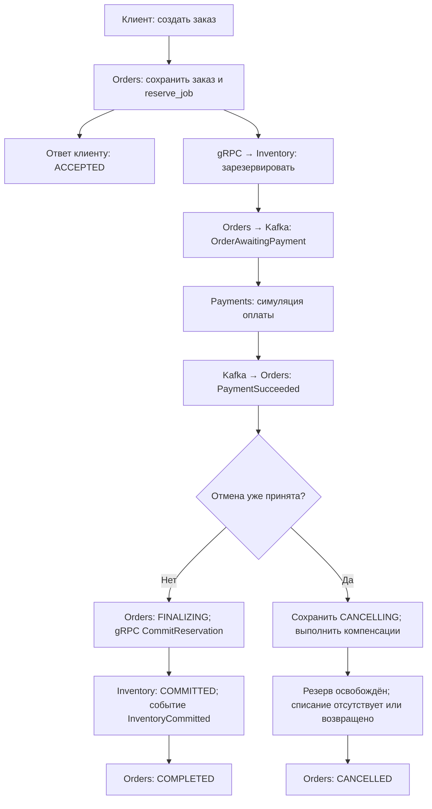

Схема показывает успешное резервирование и оплату. Недостаток товара и PaymentDeclined раскрыты отдельно в разделах 4–5 визуального описания. Ответ ACCEPTED выдаётся после commit в Orders, а дальнейшие шаги выполняются по сохранённым задачам.

##### Состояния заказа и допустимая отмена

```mermaid
stateDiagram-v2
    [*] --> ACCEPTED
    ACCEPTED --> RESERVING
    RESERVING --> PAYMENT_PENDING: Резерв подтверждён
    RESERVING --> REJECTED: Товара недостаточно
    PAYMENT_PENDING --> FINALIZING: Оплата успешна; отмена не принята
    FINALIZING --> COMPLETED: Продажа и оплата подтверждены
    ACCEPTED --> CANCELLING: Отмена принята
    RESERVING --> CANCELLING: Отмена принята
    PAYMENT_PENDING --> CANCELLING: Отмена или отказ оплаты
    CANCELLING --> CANCELLED: Компенсации подтверждены
    REJECTED --> [*]
    COMPLETED --> [*]
    CANCELLED --> [*]
    note right of FINALIZING
        CancelOrder отклоняется.
        Сбой означает ожидание и восстановление.
    end note
```

Успешная оплата и отмена конкурируют за один переход версии Orders. Победа отмены означает компенсацию, победа финализации — доведение покупки до COMPLETED. Timeout сам по себе не создаёт терминальное состояние.

##### Долговечность и очереди

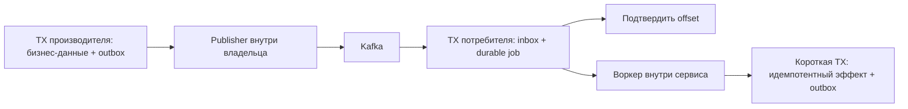

Низкий Kafka lag означает продвижение доставки до сохранённых jobs. Чтобы увидеть реальную обработку, дополнительно измеряются очередь jobs и время завершения заказа. Отдельные crash windows показаны в разделе 8 визуального описания.

#### Принятые решения

| Решение | Принятый вариант | Почему | Как проверяем |
|---|---|---|---|
| Бизнес-модель | Мини-магазин, один склад, одна валюта; заказ → резерв → симулированная оплата → завершение/отмена | Даёт конкуренцию за ресурсы, асинхронный процесс и измеримые бизнес-инварианты | Успех, нехватка товара, отказ и поздний результат оплаты |
| Три сервиса | Orders управляет процессом; Inventory владеет складом; Payments владеет платёжным ledger | У каждого изменения данных есть один владелец; управляющий процесс не требует четвёртого сервиса | Проверка прав БД и запрет чужих SQL-запросов |
| gRPC | Приём/чтение заказа; Reserve/Commit/Release; запрос статуса, отмена и возврат платежа | Непосредственный результат и явные ключи повторяемых операций | Повтор RPC, deadline после commit и сверка неизвестного результата |
| Kafka | Orders запускает оплату фактом OrderAwaitingPayment; Payments и Inventory публикуют результаты; Orders продолжает процесс | Можно отдельно менять производительность приёма и обработки, воспроизводить backlog и повторы | Consumer pause, повторная доставка, накопление durable jobs |
| Согласованность | Локальные SQL-транзакции плюс долговечный процесс в Orders; outbox/inbox в MVP | Сохранённый шаг восстанавливается после перезапуска, повтор события не создаёт второй эффект | Падения до/после publish и consumer commit |
| PostgreSQL | Один экземпляр, три базы и отдельные роли | Малый стартовый объём инфраструктуры при сохранении владения данными | Сервис не может читать чужую базу; измеряется общий ресурсный bottleneck |
| Redis | Кеш чтений Inventory, без авторитетных складских или платёжных записей | Даёт предмет эксперимента с hit rate, stale reads и fallback | Недоступность Redis и устаревшая доступность не позволяют продать лишний товар |
| Наблюдаемость | В MVP Prometheus, Grafana, Loki, Alloy; расширение трассировки на этапе 3 | Нужны как скорость приёма, так и завершения бизнеса, диагностика backlog и ошибок | Искусственная задержка видна в метриках/логах и вызывает ожидаемый сигнал |
| Среда | Локальный Docker Compose, закреплённые версии и manifest ресурсов | Воспроизводимый старт без обязательного отдельного кластера | Повтор прогонов из одной конфигурации |

#### Принятые бизнес-правила

- CreateOrder подтверждает принятие только после сохранения заказа и задачи в PostgreSQL. Уход клиента не отменяет уже принятую работу.
- Ключ клиентского запроса неизменно определяет один заказ. Повтор с другим payload возвращает конфликт.
- Подтверждённый бизнес-отказ тоже сохраняется как результат операции. Повтор отказанного Reserve с тем же operation_id не создаёт новый резерв после изменения остатков.
- COMPLETED возможен только при успешной оплате ожидаемой суммы и подтверждённом COMMITTED резерве.
- Отмена клиентом разрешена до FINALIZING. Начало финализации и принятие отмены конкурируют за один переход версии Orders. После FINALIZING отмена отклоняется; заказ доводится до завершения.
- Если отмена победила, поздняя успешная оплата компенсируется возвратом и не запускает Commit. CANCELLED означает отсутствие активного резерва и невозвращённого списания.
- Release и Cancel сохраняют запрет поздней операции даже если исходный резерв или платёж ещё не был создан. Симулятор платежей перед фиксацией эффекта проверяет актуальное состояние.
- Независимого истечения резерва по TTL в MVP нет. Срок обработки и намерение отмены сохраняет Orders.
- Измерение незавершённых процессов обязательно. NEEDS_REVIEW, неизвестный исход и timeout не считаются успешным завершением.

Полные состояния, контракт событий, операции, crash windows и инварианты описаны в разделах 3–4 docs/ROADMAP.md. Эти правила особенно важны для ревью: они определяют поведение при гонках и границы будущих API.

#### Граница MVP

Включены три Go-сервиса, отдельные базы, весь обязательный стек, сквозной успех/отказ, минимальные компенсации, идемпотентность, outbox/inbox, восстановление сохранённого шага, кеш чтений, базовые дашборды/логи, loadgen, verifier и первый ручной отчёт.

Для следующих этапов оставлены: полная трассировка и набор алертов, quarantine/replay, расширенный каталог отказов, несколько реплик, автоматическое сравнение и генерация отчётов. Kubernetes — отдельный предмет согласования, если появится эксперимент, который требует его возможностей.

Авторизация, доставка, скидки, полноценный магазинный UI и возврат доставленного товара находятся вне согласуемого MVP.

#### Первый пакет реализации после G0

Цель — получить проверяемую основу проекта и затем первый работающий срез «создать заказ → атомарно зарезервировать товар».

Порядок небольших пакетов для код-ревью:

1. **P01 — первый PR после G0, до G1.** Три Go entrypoints, конфигурация, health, shutdown и JSON-логи; контейнерный toolchain, образы сервисов, минимальный Compose и Go CI. Дополнение среды согласовано после G0 для Windows/macOS; детали и статус — в [описании среды](#appendix-environment).
2. **P02:** Compose для PostgreSQL/Kafka/Redis, отдельные БД/роли, миграции и seed.
3. **P03:** Protobuf-контракты с operation keys, состояниями и классификацией ошибок.
4. **P04:** Create/Get/GetByRequestKey и долговечная задача Orders.
5. **P05:** Reserve/Commit/Release/GetReservation с ledger, блокировками и cancellation barrier.

Каждый пакет проходит своё код-ревью. После подготовки и принятия этой основы проводится отдельная приёмка контрольной точки G1; первый PR не называется G1 и не требует предварительного прохождения G1.

К G1 предъявляются код, точные команды запуска, результаты повторного запроса, конкурентной покупки ограниченного остатка и перезапуска на сохранённом шаге. Остальная часть сквозного процесса развивается после G1.

#### Решение по G0 и последующие изменения

G0 принят полностью, без дополнительных условий в сообщении пользователя от 2026-10-13. Решение сохранено также в docs/adr/0001-approved-g0.md и PROJECT_CONTEXT.md. Следующая контрольная точка — G1 после подготовки основы заказа и склада.

Существенные изменения принятой архитектуры по-прежнему согласуются с владельцем проекта отдельно. Обычные детали реализации внутри G0 выбираются самостоятельно и предъявляются в небольших пакетах для код-ревью. Принятие архитектуры не означает, что реализация, испытания или следующие контрольные точки уже завершены.

После G0 подтверждено направление развития общей лаборатории с адаптерами: [детализация границы](#appendix-lab-boundary). Три сервиса и их бизнес-правила сохраняются; второй бизнес и расширение приёмки пока находятся на стадии предложения.

<a id="appendix-g0-processes"></a>

## Приложение: Подробные визуальные схемы G0

Полный исходный документ: `docs/architecture/PROCESSES.md`. Текст включён непосредственно ниже; чтение исходного пути не требуется.

### G0: визуальное описание процессов

Статус: **G0 полностью принят владельцем проекта 2026-10-13, Europe/Moscow**. Схемы раскрывают принятые решения из docs/architecture/DESIGN.md и docs/ROADMAP.md. Они описывают согласованное планируемое поведение; реализация и измерения ещё не выполнены.

Порядок чтения: общий процесс → успешный заказ → состояния → отказы и отмена → восстановление → кеш → цикл эксперимента.

#### Легенда

- В sequence-диаграммах сплошная стрелка — gRPC-запрос; обратная пунктирная — ответ. Для Kafka стрелки подписаны как публикация, доставка или подтверждение offset.
- `TX Orders`, `TX Inventory`, `TX Payments` — отдельные короткие транзакции в базе владельца. Общей транзакции трёх сервисов нет.
- `job` — сохранённая задача внутреннего воркера сервиса; это не четвёртый бизнес-сервис.
- `outbox` — событие, сохранённое вместе с бизнес-изменением; `inbox` — запись о принятом событии, защищающая от повторной обработки.
- `operation_id` идентифицирует бизнес-операцию. Повтор имеет тот же ключ и смысл; новая сетевая попытка не создаёт новую операцию.
- У Kafka-стрелок есть задержка и возможная повторная доставка. Положение стрелки на схеме не обещает мгновенную обработку.

#### 1. Общий бизнес-процесс

Вопрос для ревью: кто владеет каждым шагом и в какой момент заказ можно считать завершённым?

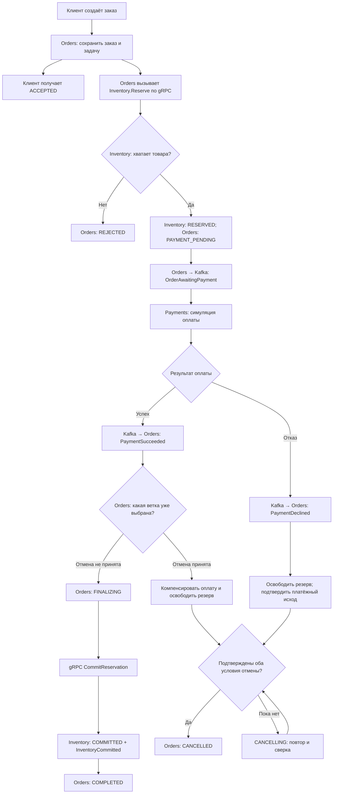

`ACCEPTED` — подтверждение сохранения запроса. `COMPLETED` — подтверждённая покупка: деньги списаны на ожидаемую сумму, резерв превращён в продажу. Ветка клиентской отмены подробно показана в схемах 6–7.

#### 2. Успешный заказ: взаимодействия и транзакции

Вопрос для ревью: какие данные должны пережить падение после каждой стрелки?

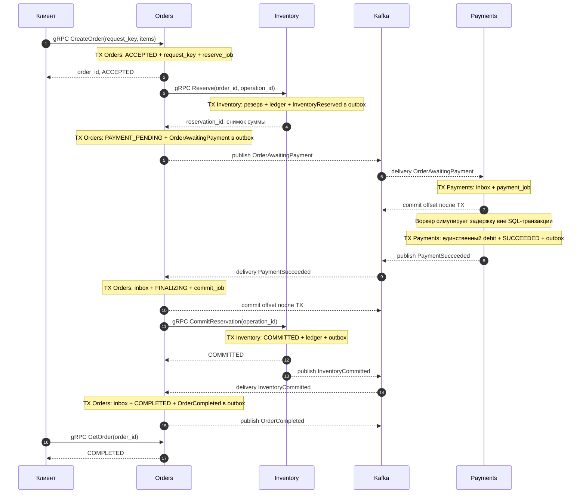

Publisher каждого сервиса работает из его outbox. Воркеры работают из сохранённых jobs. Они изображены внутри своего владельца, чтобы на схеме оставались ровно три бизнес-сервиса.

Inventory также публикует `InventoryReserved` и `InventoryReleased`; Orders использует их для наблюдения и сверки. Они опущены на успешной sequence-схеме, чтобы выделить события, непосредственно продолжающие этот путь.

#### 3. Состояния заказа

Вопрос для ревью: какие переходы являются допустимыми, а какие нужно запретить?


Timeout, недоступность зависимости и рост Kafka lag не превращают заказ автоматически в REJECTED или CANCELLED. Пока результат не разрешён, заказ остаётся в соответствующем нетерминальном состоянии. Если позже добавляется NEEDS_REVIEW, он тоже учитывается как нерешённый процесс.

##### 3.1. Состояния резерва

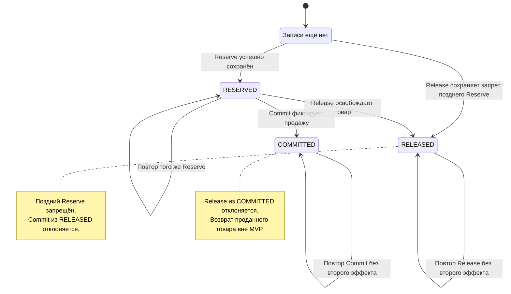

##### 3.2. Состояния платежа

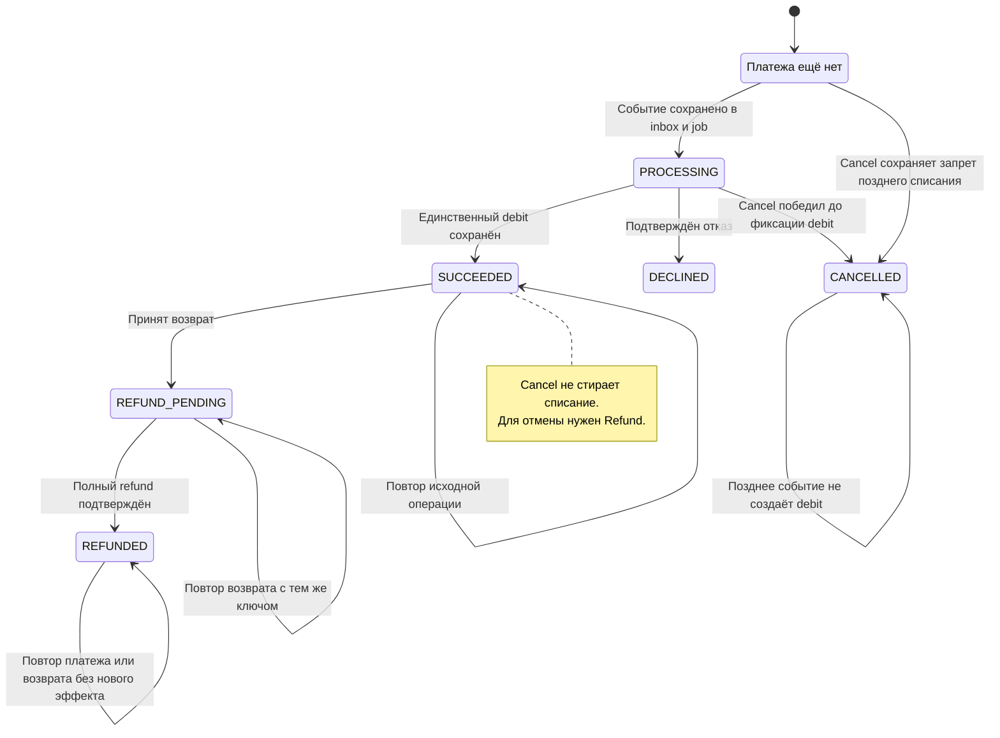

Задержка симулятора происходит вне SQL-транзакции. Перед фиксацией debit воркер проверяет актуальное состояние: сохранённая отмена имеет силу и для уже начатой симуляции.

#### 4. Недостаточно товара

Вопрос для ревью: может ли оплата начаться до гарантированного резерва?

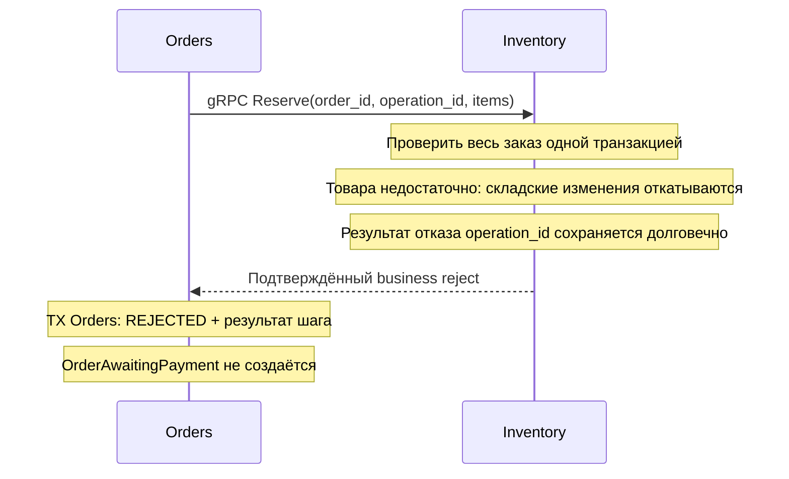

Для многопозиционного заказа недостаток одной позиции отменяет весь резерв. При этом подтверждённый результат операции сохраняется: повтор того же operation_id возвращает тот же отказ, даже если остатки позже изменились. Это достигается проверкой всех заблокированных позиций до мутаций либо откатом складской части к savepoint с последующей фиксацией результата операции. Технический timeout при Reserve не равен подтверждённой нехватке товара.

#### 5. Платёж отклонён

Вопрос для ревью: когда можно завершить отмену, если освобождение склада временно не работает?

```mermaid
sequenceDiagram
    participant P as Payments
    participant K as Kafka
    participant O as Orders
    participant I as Inventory

    Note over P: TX Payments: DECLINED + PaymentDeclined в outbox
    P-->>K: publish PaymentDeclined
    K-->>O: delivery PaymentDeclined
    Note over O: TX Orders: inbox + CANCELLING + release_job
    O->>I: gRPC ReleaseReservation(order_id, operation_id)

    alt Release подтверждён
        Note over I: TX Inventory: RELEASED + ledger + outbox
        I-->>O: RELEASED
        Note over O: Списания нет; резерв освобождён
        Note over O: TX Orders: CANCELLED + outbox
    else Timeout или временная недоступность
        I-->>O: Результат неизвестен или временная ошибка
        Note over O: Оставить CANCELLING; сохранить следующий повтор
        O->>I: Повтор Release с тем же operation_id
        I-->>O: Прежний или вновь подтверждённый RELEASED
        Note over O: TX Orders: CANCELLED после проверки условий
    end
```

Ветка повторов на схеме сокращена. Если зависимость остаётся недоступной, новые попытки не объявляются успешными: процесс остаётся CANCELLING и попадает в отчёт о незавершённых заказах.

#### 6. Гонка отмены и успешной оплаты

Вопрос для ревью: где принимается решение, исключающее одновременные Commit и компенсацию?

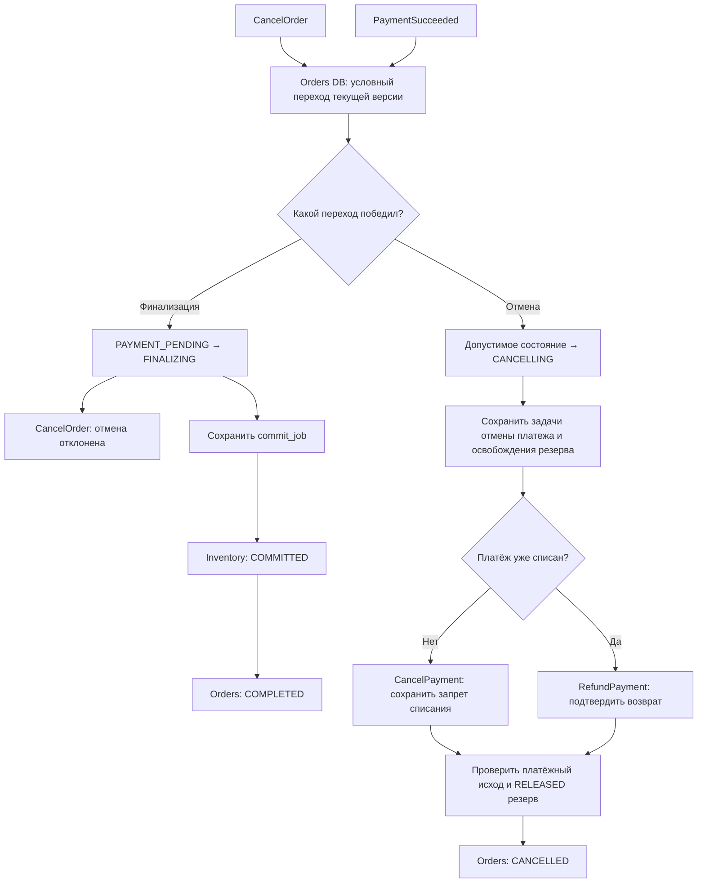

Условный переход — короткая транзакция в Orders по актуальному состоянию/версии. Проигравший обработчик перечитывает результат и следует выбранной ветке. Принятая отмена не создаёт commit_job; выбранная FINALIZING не создаёт release_job.

На практике CANCELLING может начинаться и до PAYMENT_PENDING. Запрет позднего Reserve в Inventory и позднего списания в Payments защищает от запросов и событий, отправленных старым воркером до отмены.

#### 7. Поздняя успешная оплата после принятой отмены

Вопрос для ревью: достаточно ли игнорировать запоздавшее событие, если деньги уже были списаны?

```mermaid
sequenceDiagram
    participant C as Клиент
    participant O as Orders
    participant P as Payments
    participant I as Inventory
    participant K as Kafka

    Note over P: Платёж SUCCEEDED; debit уже сохранён
    P-->>K: publish PaymentSucceeded
    Note over K,O: Доставка в Orders задержана

    C->>O: gRPC CancelOrder(order_id)
    Note over O: TX Orders: CANCELLING + cancellation jobs
    O-->>C: Отмена принята; компенсации ещё выполняются
    O->>P: gRPC CancelPayment(order_id, operation_id)
    P-->>O: SUCCEEDED: нужен возврат
    O->>I: gRPC ReleaseReservation(order_id, operation_id)
    I-->>O: RELEASED подтверждён
    O->>P: gRPC RefundPayment(order_id, operation_id)
    Note over P: Возврат выполняется через сохранённый шаг
    Note over P: TX Payments: refund ledger + REFUNDED + outbox
    P-->>O: REFUNDED подтверждён
    Note over O: TX Orders: оба условия подтверждены; CANCELLED + outbox

    K-->>O: delivery старого PaymentSucceeded
    Note over O: Записать inbox; сохранить ветку отмены
    Note over O: Не создавать Commit; возврат уже подтверждён
    P-->>K: publish PaymentRefunded
    K-->>O: delivery PaymentRefunded
    Note over O: Идемпотентно подтвердить уже известный исход
```

На этой схеме Refund успевает подтвердиться через gRPC. При неизвестном результате возврата Orders остаётся CANCELLING и использует повтор с тем же ключом, GetPayment или событие PaymentRefunded. Одного намерения возврата недостаточно для CANCELLED.

#### 8. События и падения: outbox, inbox и jobs

Вопрос для ревью: что уже сохранено в каждом crash window и что будет повторено?

##### 8.1. Запись и публикация

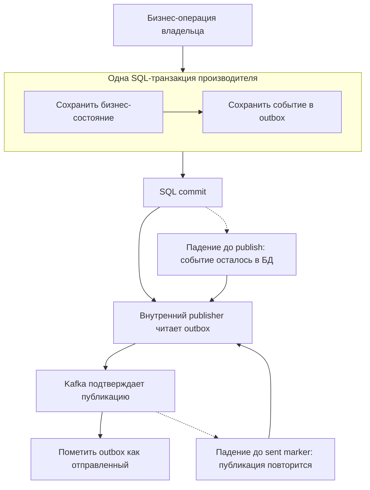

Crash до SQL commit не сохраняет ни бизнес-изменение, ни событие. Crash после commit оставляет событие для publisher. Повторная публикация после успешной Kafka-записи ожидаема; event_id сохраняется.

##### 8.2. Приём события и долгая работа

```mermaid
flowchart TB
    K["Kafka доставляет event_id"] --> CHECK{"event_id уже в inbox?"}
    CHECK -->|Да| OLD["Нового job нет; прежний результат сохранён"]
    CHECK -->|Нет| TX
    subgraph TX["Одна SQL-транзакция потребителя"]
        IN["Вставить inbox с unique event_id"] --> JOB["Сохранить переход и durable job"]
    end
    TX --> COMMIT["SQL commit"]
    COMMIT --> OFF["Подтвердить Kafka offset"]
    OLD --> OFF
    COMMIT --> WORK["Внутренний воркер забирает job по lease"]
    WORK --> RUN["Долгая работа вне SQL-транзакции"]
    RUN --> EFFECT["Короткая TX: проверить состояние и operation_id; сохранить эффект и outbox"]
    EFFECT --> DONE["Job завершён; результат долговечен"]

    COMMIT -.-> CR["Падение до offset: Kafka доставит дубликат"]
    CR --> K
    WORK -.-> WCR["Падение воркера: lease истечёт"]
    WCR --> WORK
```

Ромб inbox — логическая схема, а не отдельный небезопасный SELECT перед INSERT. Проверка дубликата и создание job защищены unique constraint и одной транзакцией, включая конкурентную доставку.

Offset подтверждает, что продолжение работы сохранено, а не что платёж уже завершён. Поэтому нужны два вида наблюдаемости: Kafka lag и возраст/размер durable jobs. Повтор job использует прежний operation_id и повторно проверяет актуальное состояние перед эффектом.

#### 9. Неизвестный результат gRPC

Вопрос для ревью: означает ли timeout, что Inventory не успел изменить остатки?

```mermaid
sequenceDiagram
    participant O as Orders
    participant I as Inventory
    participant D as Inventory DB

    O->>I: Reserve(order_id, operation_id)
    I->>D: TX: резерв + операция + ledger + outbox
    D-->>I: COMMIT выполнен
    I--xO: Ответ потерян или deadline истёк
    Note over O: Результат неизвестен; не считать Reserve неуспешным

    O->>I: Повтор Reserve с тем же operation_id
    I->>D: Найти сохранённый результат операции
    D-->>I: Прежний reservation_id и сумма
    I-->>O: Тот же подтверждённый результат
    Note over O: Продолжить сохранённый шаг
```

Вместо повтора можно начать со сверки GetReservation. Но NOT_FOUND во время ещё выполняющегося запроса не доказывает отсутствие будущего эффекта. Безопасность обеспечивают прежний ключ операции, атомарность и cancellation barrier, если уже выбран путь отмены.

Точно так же timeout CreateOrder не означает, что заказа нет: клиент повторяет request_key или вызывает GetOrderByRequestKey. Timeout Commit и Refund требует сверки прежнего эффекта, а не новой операции с новым ключом.

#### 10. Чтение через Redis и запись в PostgreSQL

Вопрос для ревью: где допустима устаревшая информация и где нужен авторитетный результат?

```mermaid
flowchart TB
    READ["gRPC GetAvailability"] --> CACHE{"Redis: кеш доступен и ключ найден?"}
    CACHE -->|Да| ADVICE["Вернуть ориентировочную доступность"]
    CACHE -->|Нет или ошибка| DBREAD["Прочитать Inventory DB"]
    DBREAD --> FILL["Best-effort записать кеш с TTL"]
    FILL --> ADVICE

    WRITE["gRPC Reserve"] --> DBTX["Inventory DB: атомарно проверить и зарезервировать"]
    DBTX --> ANSWER["Авторитетный результат Reserve"]
    DBTX -.-> INVALID["Best-effort invalidation кеша после commit"]
```

Устаревший кеш может показать товар доступным, а Reserve затем корректно откажет. Это измеряемый stale read, не продажа лишнего товара. Ошибка кеша не должна отменять уже выполненную складскую транзакцию; fallback и его нагрузка на SQL становятся отдельным экспериментом.

#### 11. Цикл инженерного эксперимента

Вопрос для ревью: какие данные позволяют принять решение об эффективности изменения?

```mermaid
flowchart TB
    H["Проблема → гипотеза → критерии до запуска"] --> FIX["Зафиксировать версии, данные, seed и ресурсы"]
    FIX --> A["Прогон A: baseline"]
    A --> CHANGE["Изменить один проверяемый фактор"]
    CHANGE --> B["Прогон B: candidate"]
    B --> REPEAT["Повторить пары A/B; собрать разброс"]
    REPEAT --> DRAIN["Остановить вход; дождаться обработки или лимита drain"]
    DRAIN --> VER["Сверить все request keys, ledger и состояния"]
    VER --> DATA{"Данные и нагрузка достаточны?"}
    DATA -->|Нет| INC["INCONCLUSIVE: объяснить пробел и повторить"]
    DATA -->|Да| INV{"Инварианты соблюдены?"}
    INV -->|Нет| BAD["REJECTED: исправить нарушение"]
    INV -->|Да| MET["Сравнить goodput, latency, backlog, recovery и ресурсы"]
    MET --> REPORT["Отчёт: принять, отклонить или продолжить измерение"]
    REPORT --> NEXT["Следующий эксперимент"]
```

Каждый отдельный прогон A или B включает свой прогрев, измеряемое окно, drain и verifier. На схеме общие шаги после серии обозначают сбор уже проверенных результатов. Незавершённые заказы не исчезают из знаменателя; они остаются отдельным результатом.

#### 12. Процесс ревью G0

```mermaid
flowchart LR
    P["Предложение G0: архитектура и схемы"] --> R["Ревью владельца проекта"]
    R --> D{"Решение"}
    D -->|Изменить| C["Уточнить решения и обновить схемы"]
    C --> R
    D -->|Согласовано| G["Зафиксировать принятую версию G0"]
    G --> CODE["Первые небольшие пакеты кода для ревью"]
    CODE --> G1["G1: основа заказа и склада"]
```

G0 прошёл ветку согласования: пользователь полностью принял его 2026-10-13. Схема остаётся описанием процесса ревью и для последующих изменений. После замечаний схемы, контракты и бизнес-правила обновляются вместе; существенные изменения согласуются отдельно.

#### Контрольные вопросы владельцу проекта

| Область | Что должно быть однозначно после ревью |
|---|---|
| Успех | ACCEPTED отличается от COMPLETED; завершение требует оплаты и продажи |
| Отмена | Понятна точка FINALIZING и ветка позднего успеха оплаты |
| Корректность | Повторы не создают второй эффект; отменённый процесс не воскресает |
| Долговечность | Видно, что сохраняется перед ответом клиента и Kafka offset |
| Восстановление | Timeout остаётся неизвестным исходом до сверки; jobs/outbox переживают рестарт |
| Масштабирование | Приём, Kafka delivery и processing jobs имеют отдельные очереди и показатели |
| Кеш | Redis ускоряет чтения; складская запись проверяет PostgreSQL |
| Эксперимент | Вывод учитывает незавершённые процессы, инварианты и ресурсный бюджет |

<a id="appendix-development-process"></a>

## Приложение: Роли, ревью, контрольные точки и обновление контекста

Полный исходный документ: `docs/development/WORKFLOW.md`. Текст включён непосредственно ниже; чтение исходного пути не требуется.

### Порядок разработки и ревью

#### Роли

Пользователь — владелец проекта: определяет приоритеты, утверждает ключевые решения, проводит код-ревью и согласует переходы между основными этапами.

Единое название роли человека во всех материалах — «владелец проекта»; при описании проверки кода используется «ревьюер». Эти обозначения сохраняют прежние полномочия и порядок согласования.

Codex — исполнитель разработки: готовит проектные решения, реализует согласованный объём, выполняет необходимые проверки, собирает доказательства корректности и эффективности, документирует результат и исправляет замечания.

Это распределение ролей задано пользователем. Архитектура и процесс G0 полностью приняты владельцем проекта 13 октября 2026 года; контрольные точки ниже входят в текущий согласованный порядок работы и могут быть изменены владельцем проекта.

#### Пакет изменений

Каждый пакет имеет одну понятную цель: например, атомарный Reserve, durable payment job или приём конкретного Kafka-события. Работа внутри согласованного этапа выполняется самостоятельно. Размер пакета выбирается так, чтобы владелец проекта мог проверить бизнес-поведение и существенный diff за одно ревью.

Для каждого пакета Codex представляет:

1. Задачу и соответствующий этап roadmap.
2. Изменённое поведение и существенные проектные решения.
3. Локальный diff либо PR, когда для проекта доступен настроенный remote.
4. Команды воспроизведения и фактические результаты проверок.
5. Известные ограничения и открытые вопросы, влияющие на принятие изменения.
6. Критерии готовности и предложение следующего пакета.

Обычные исправления по ревью выполняются в рамках того же пакета. После исправлений повторяются проверки, затронутые изменением. Невыполненные проверки явно обозначаются как невыполненные; объясняется причина и что необходимо для их запуска.

Ближайший PR с кодом — [P01](#appendix-p01); его критерии и снимок статуса сохраняются в спецификации пакета. Текущее выполнение ведётся в [Issue #3](https://github.com/Includeoyasi/faultline-lab/issues/3), порядок обновления — в [учёте задач](#appendix-task-tracking). Создание карточки не означает начало реализации или принятие G1.

#### Стандарт код-ревью

[Правила код-ревью](#appendix-code-review) определяют Go-стиль, обработку ошибок, context, конкурентность, работу с данными, доказательства тестирования и порядок разбора замечаний. [Шаблон PR](https://github.com/Includeoyasi/faultline-lab/blob/main/.github/pull_request_template.md) содержит краткий применимый чек-лист.

После bootstrap изменения готовятся в отдельных ветках и предъявляются через PR. Исполнитель делает self-review и предоставляет фактические результаты; владелец проекта рассматривает предъявленный HEAD. ИИ не одобряет и не сливает собственный PR. Успешный CI подтверждает выполненные проверки; решение человека фиксируется отдельно. Обычный путь после приёмки — squash merge по явному поручению владельца проекта или действие самого владельца проекта.

По поручению владельца новые PR оформляются от исполнителя AI-Your-Bro, а Includeoyasi проводит ревью и принимает решение. Защита main уже включена; авторизация исполнителя и права write без admin проверены через GitHub API. Новые PR от владельца не создаются; Git author metadata не заменяет проверку API actor. PR #4, созданный до перехода, уже слит (merge 8c392b8); его переоформление не требуется. Подготовленный CODEOWNERS назначает владельца ревьюером всех файлов; он вступит в силу после слияния в main. Точный статус — в [безопасности репозитория](#appendix-repository-security).

Принятие в чате фиксируется в контексте, но не заменяет обязательное GitHub approval на защищённой ветке. Сейчас обязателен Documentation CI; Go-проверки и закреплённая конфигурация инструментов подключаются в P01 с первым модулем и затем добавляются в required checks.

#### Контрольные точки

G0–G4 — контрольные точки приёмки. P01–P05 — небольшие пакеты реализации с отдельными PR и код-ревью. **Первый PR P01 находится между принятым G0 и будущей приёмкой G1.** Последовательность: G0 → P01 и его ревью → следующие PR P02–P05 и их ревью → G1. Приёмка отдельного PR не означает прохождения G1.

| Точка | Когда | Материалы для согласования | Критерий перехода |
|---|---|---|---|
| G0: архитектура | Перед реализацией | docs/architecture/DESIGN.md, схемы docs/architecture/PROCESSES.md, архитектура и состояния из docs/ROADMAP.md, границы MVP, порядок реализации | Владелец проекта согласовал предложенные решения или сформулировал необходимые изменения |
| G1: основа данных и операций | После этапа 1 | Код и миграции; API заказа и склада; повторный запрос; конкуренция за остатки; сохранённый шаг после рестарта | Ревью принято, обязательные проверки проходят, нет нерешённых нарушений складских инвариантов |
| G2: сквозной MVP | После этапа 2 | Сквозной процесс трёх сервисов, Kafka/outbox/inbox, платежи и компенсации, Redis и наблюдаемость, первый эксперимент и отчёт | Подтверждены успешный процесс, отказ оплаты, идемпотентность и контрольный перезапуск; каждый тестовый заказ учтён |
| G3: устойчивость | После этапа 4 | Сценарии неизвестного результата, поздних событий, отмены, replay; объяснение политики ошибок и recovery | Ревью и сценарии приняты; нерешённые процессы явно учитываются; отсутствуют ложные terminal states |
| G4: готовая лаборатория | После этапа 7 | Каталог экспериментов, результаты сравнения решений, масштабирование, автоматический запуск/сверка/отчёты, инструкции | Владелец проекта воспроизвёл или проверил заявленный цикл; отчёты отражают корректность, ресурсы и ограничения |

Статус G0: **полностью принят 2026-10-13, Europe/Moscow**. Прямое решение пользователя: «G0 полностью принят». G1–G4 ещё не достигнуты. Реализация сервисов в текущих файлах отсутствует. Работа над согласованной основой для G1 разрешена; повторное согласование G0 не требуется.

На контрольной точке Codex сначала доводит текущий пакет до проверяемого результата, затем предоставляет его владельцу проекта. Следующий этап, зависящий от согласования, начинается после явного решения. Замечания владельца проекта вносятся в пакет до повторного рассмотрения.

#### Изменения, требующие отдельного согласования

- Изменение ответственности сервисов, бизнес-инвариантов или момента окончательного завершения/отмены заказа.
- Несовместимое изменение API, событий, данных или политики идемпотентности.
- Добавление бизнес-сервиса либо инфраструктуры, существенно меняющей объём или среду запуска.
- Изменение утверждённых критериев эксперимента, которое влияет на вывод об эффективности.

Настройки, рефакторинг и необходимые проверки в рамках согласованного решения выполняются самостоятельно. Если найденный дефект требует смены архитектуры, Codex готовит конкретное предложение и объясняет, какой инвариант или сценарий заставляет пересмотреть решение.

#### Порядок принятия решений

План или гипотеза помечаются как предложенные. Согласование владельцем проекта фиксируется отдельно от фактической реализации и результатов проверки. Успешные тесты подтверждают проверенные свойства, а не заменяют решение ревьюера.

Решения, меняющие проект, сохраняются в ADR с причиной и последствиями. Итог пакета содержит текущий статус контрольной точки, оставшиеся замечания и ссылку на воспроизводимый результат.

Исходные оценки часов в docs/ROADMAP.md описывают объём ручной разработки. Для работы Codex календарный прогноз уточняется по фактическим ограничениям среды, времени проверок и ревью. Контрольная точка достигается по критериям готовности.

#### Актуальность переносимого контекста

PROJECT_CONTEXT.md — самостоятельный пакет для другого ИИ-агента или чата без доступа к рабочему компьютеру. В нём есть краткое введение, точный статус, история решений и полные тексты проектных документов.

Каждый содержательный пакет работы завершать обновлением контекста: что изменено, что реально проверено, какие замечания остаются, состояние G0–G4, версии/commit при наличии, следующие задачи и блокеры. Обновить CONTEXT_STATE.json, соответствующие исходные документы и при необходимости tools/context_intro.md; увеличить revision и поставить дату из актуального пользовательского контекста Europe/Moscow. Затем выполнить tools/update_context.ps1 и проверку tools/update_context.ps1 -CheckOnly.

Проверка выявляет несоответствие переносимого файла его локальным источникам. Достоверность статусов реализации и результатов проверок обеспечивается фактическими данными исполнителя; сама генерация не запускает тесты сервисов.

Перед передачей другому агенту использовать последнюю проверенную ревизию PROJECT_CONTEXT.md. Переданная копия является снимком: изменения, выполненные в другом чате, нужно вернуть вместе с обновлением контекста и согласовать с более новой локальной версией. Агент без доступа к файлам не помечает предложения как применённый код и проверки как выполненные.

<a id="appendix-report-template"></a>

## Приложение: Полный шаблон отчёта

Полный исходный документ: `docs/experiments/REPORT_TEMPLATE.md`. Текст включён непосредственно ниже; чтение исходного пути не требуется.

### Отчёт об инженерном эксперименте

> Шаблон. Значения ниже заполняются после реальных прогонов. Пустые поля не являются измеренными нулевыми значениями.

#### 1. Вывод

- ID эксперимента: `<id>`
- Решение: `<accepted / rejected / inconclusive>`
- Проверяемое изменение: `<одно изменение>`
- Наблюдаемый эффект: `<абсолютная разница, процент при ненулевой базе, разброс>`
- Корректность: `<инварианты; unresolved/unknown; полнота данных>`
- Цена и регрессии: `<ресурсы, отказы, сложность, задержка>`

#### 2. Проблема и гипотеза

**Проблема:** `<бизнес-симптом и подтверждающий технический сигнал>`

**Гипотеза:** `<изменение X должно улучшить показатель Y за счёт механизма Z>`

**Критерии, заданные до запуска:**

- Минимально полезный эффект: `<порог>`
- Допустимые регрессии: `<пороги>`
- Инварианты: `<нулевая терпимость или конкретный проверяемый контракт>`
- Допустимое время восстановления: `<порог и определение восстановления>`
- Условия непригодного измерения: `<насыщение генератора, пропуски данных, различие среды>`

#### 3. Условия

| Параметр | A: baseline | B: candidate |
|---|---|---|
| Commit / dirty diff | `<значение>` | `<значение>` |
| Образы и digests | `<значение>` | `<значение>` |
| Суммарные CPU/RAM и Docker limits | `<значение>` | `<значение>` |
| Реплики, worker limits, SQL pools | `<значение>` | `<значение>` |
| Kafka topics/partitions/groups | `<значение>` | `<значение>` |
| Dataset, stock, seed | `<значение>` | `<значение>` |
| Offered arrival rate и read/order mix | `<значение>` | `<значение>` |
| Fault timeline: план и факт | `<значение>` | `<значение>` |
| Warmup / measure / drain | `<значение>` | `<значение>` |
| Повторы и порядок A/B | `<значение>` | `<значение>` |
| Telemetry / sampling / verifier load | `<значение>` | `<значение>` |

**Точные run IDs и ссылки на manifest:** `<список>`

**Фактический diff:** `<что изменено; подтверждение отсутствия других изменений>`

#### 4. Результаты

Показывать отдельно результаты каждой пары прогонов. Агрегат должен включать объём выборки и разброс. Median p95 отдельных прогонов так и называется; это не p95 всех запросов.

| Показатель | A | B | Разница | Разброс / выборка |
|---|---|---|---|---|
| Offered / sent / skipped unique orders | `<…>` | `<…>` | `<…>` | `<…>` |
| Accepted / unknown ingress result | `<…>` | `<…>` | `<…>` | `<…>` |
| Completed в окне / во время drain | `<…>` | `<…>` | `<…>` | `<…>` |
| Business rejects / technical failures | `<…>` | `<…>` | `<…>` | `<…>` |
| Unresolved / unknown после drain | `<…>` | `<…>` | `<…>` | `<…>` |
| Completed goodput | `<…>` | `<…>` | `<…>` | `<…>` |
| E2E p50 / p95 / p99 для завершённых | `<…>` | `<…>` | `<…>` | `<…>` |
| Business success ratio среди sent eligible | `<…>` | `<…>` | `<…>` | `<…>` |
| gRPC errors / deadlines / retries | `<…>` | `<…>` | `<…>` | `<…>` |
| SQL latency / pool acquire / lock wait | `<…>` | `<…>` | `<…>` | `<…>` |
| Kafka lag и oldest event age | `<…>` | `<…>` | `<…>` | `<…>` |
| Job/outbox backlog и oldest age | `<…>` | `<…>` | `<…>` | `<…>` |
| Recovery time / drain time | `<…>` | `<…>` | `<…>` | `<…>` |
| CPU-seconds / RSS / disk / network | `<…>` | `<…>` | `<…>` | `<…>` |
| Completed orders / CPU-second | `<…>` | `<…>` | `<…>` | `<…>` |

**Определения знаменателей и временных окон:** `<eligible задано заранее; completion cohort; treatment of retries; time origin>`

**Цензурированные наблюдения:** `<число незавершённых и наблюдаемый возраст; они не исключены из success ratio>`

#### 5. Графики

Добавить PNG/SVG с единой шкалой времени и отметками начала/конца fault:

1. Offered/sent/accepted/completed throughput.
2. gRPC и business latency; рядом доля незавершённых.
3. Kafka, durable jobs и outbox backlog/age.
4. CPU, память, SQL pool и lock waits.
5. Восстановление после снятия отказа; firing/resolved алертов.

**Ссылки на сохранённые графики, сырые данные и Grafana time window:** `<ссылки>`

#### 6. Корректность

| Проверка | A | B | Доказательство |
|---|---|---|---|
| Неотрицательные остатки и баланс available/reserved/sold | `<…>` | `<…>` | `<invariants.json / ledger>` |
| Не более одного debit на order_id | `<…>` | `<…>` | `<ledger>` |
| Возвраты не превышают списания | `<…>` | `<…>` | `<ledger>` |
| COMPLETED имеет оплату и committed reserve | `<…>` | `<…>` | `<сверка>` |
| CANCELLED не имеет резерва или невозвращённого debit | `<…>` | `<…>` | `<сверка>` |
| Все request keys учтены, включая unknown ingress | `<…>` | `<…>` | `<requests.jsonl + orders>` |
| Поздние/повторные события не создали повторных эффектов | `<…>` | `<…>` | `<operation keys / history>` |

**Нерешённые процессы:** `<order_id, состояние, возраст, причина; либо подтверждённое отсутствие>`

**Модель отказов и границы проверки:** `<сохранены ли диски, ограничен ли retention, работала ли сверка>`

#### 7. Интерпретация

- Подтверждает ли сигнал предполагаемый механизм улучшения: `<объяснение>`.
- Изменился ли ресурсный бюджет: `<объяснение>`.
- Скрывает ли хороший percentile больше отказов или незавершённых заказов: `<проверка>`.
- Насколько эффект больше межпрогонного разброса: `<оценка без необоснованной статистической уверенности>`.
- Что не удалось доказать: `<ограничения локальной среды, данных и длительности>`.
- Цена поддержки изменения: `<код, эксплуатация, настройка>`.

#### 8. Решение и следующий эксперимент

**Решение:** `<принять / отклонить / увеличить объём измерений>`.

**Причина:** `<сопоставление с заранее выбранными критериями>`.

**Следующий эксперимент:** `<гипотеза, изменяемый фактор, ожидаемый сигнал>`.

<a id="appendix-agents"></a>

## Приложение: Локальные инструкции ИИ-исполнителю

Полный исходный документ: `AGENTS.md`. Текст включён непосредственно ниже; чтение исходного пути не требуется.

### Instructions for this project

- The human user is the project owner and code reviewer. Codex implements the project and prepares reviewable changes.
- Refer to the human as the project owner throughout project materials; use reviewer when describing code review. This terminology does not change decision authority or review gates.
- All new pull requests must be authenticated as AI-Your-Bro, the separate, human-managed executor GitHub account supplied by the project owner. Its authentication and write access were verified on 2026-10-13; it has no admin permission. Before every API mutation or publication verify the authenticated actor, not just Git author metadata. Do not publish new PRs or approve changes under Includeoyasi. Use owner credentials only for explicitly authorized repository administration. See docs/development/REPOSITORY_SECURITY.md for setup, evidence and the owner's decision not to enable 2FA.
- main is protected: independent approval, stale review dismissal, approval after the last push, up-to-date successful Documentation CI, resolved conversations and administrator enforcement. Do not weaken protection or use executor credentials to approve AI changes. The prepared CODEOWNERS assigns all files to Includeoyasi; it becomes effective after merging into main.
- Read PROJECT_CONTEXT.md first for the portable project handoff, current status and approvals. Read docs/development/WORKFLOW.md for review expectations and docs/ROADMAP.md for the project scope when the repository is available.
- G0 was explicitly approved by the human on 2026-10-13 (Europe/Moscow): "G0 полностью принят." The architecture and business rules in docs/architecture/DESIGN.md and docs/architecture/PROCESSES.md are approved. Do not ask for G0 approval again. G1-G4 remain future review gates; prepare the work for a gate before requesting its approval.
- Work autonomously within an approved stage. Keep changes small enough for focused code review and include actual validation results and known limitations.
- G0-G4 are acceptance gates; P01-P05 are code review packets. The first code PR is P01, after approved G0 and before G1. Do not describe P01 as G1 acceptance or work after G1.
- Follow docs/development/CODE_REVIEW.md for Go style, correctness, concurrency, data, tests and review evidence. After repository bootstrap, prepare changes on a focused branch and present a PR when GitHub is available. Do not approve or merge your own changes; merging requires an explicit human decision and authorization for the action. Go checks become executable with P01, not before a Go module exists.
- Stop before progressing through an unapproved review gate. Present a concrete, complete review packet and identify the decision needed from the project owner.
- Significant changes to approved service boundaries, invariants, incompatible contracts or infrastructure scope require a concrete proposal and human approval.
- Keep exactly three business services: Orders, Inventory and Payments. Do not add another business service to host workflow orchestration.
- Never report measurements, tests or approvals that have not actually occurred. Keep proposed decisions, implemented behavior and observed results distinct.
- Keep the portable context current after every substantive task, review resolution, approval, experiment, environment change or newly discovered blocker. Update CONTEXT_STATE.json and the affected source documents, increment the context revision, then run tools/update_context.ps1 and tools/update_context.ps1 -CheckOnly. Include the refreshed PROJECT_CONTEXT.md in the review packet.
- PROJECT_CONTEXT.md is generated from CONTEXT_STATE.json, tools/context_intro.md and the embedded canonical documents. Update those inputs instead of editing only the generated local file. Do not put secrets in any context artifact.
- An agent without the repository works from the dated snapshot and returns an updated context/change proposal with its result. It must distinguish proposed edits from locally applied changes and list checks it could not run. Separate snapshots are reconciled by revision and evidence, not by silently overwriting a newer context.

<a id="appendix-adr-0001"></a>

## Приложение: Запись принятия архитектуры G0

Полный исходный документ: `docs/adr/0001-approved-g0.md`. Текст включён непосредственно ниже; чтение исходного пути не требуется.

### ADR 0001: принятие архитектуры G0

- Дата решения: 2026-10-13, Europe/Moscow.
- Статус: accepted.
- Кто принял: пользователь, владелец проекта.
- Прямое основание: сообщение пользователя «G0 полностью принят».

#### Контекст

Пользователь поручает ИИ разработку pet-проекта и сам проводит код-ревью и согласует ключевые этапы. Подготовлены roadmap, архитектурный пакет и визуальные схемы процессов. Реализация к моменту решения ещё не создана.

#### Принятое решение

Принят G0, описанный в docs/architecture/DESIGN.md, docs/architecture/PROCESSES.md, docs/ROADMAP.md и docs/development/WORKFLOW.md:

- Ровно три бизнес-сервиса Go: Orders, Inventory, Payments.
- Orders хранит долговечный процесс; четвёртый сервис-оркестратор не добавляется.
- gRPC — непосредственные команды/чтения и компенсации; Kafka — бизнес-события и асинхронная платёжная обработка.
- Сначала один PostgreSQL с тремя отдельными базами/ролями и владением данными внутри сервиса.
- Redis кеширует чтения Inventory; резервирование доверяет PostgreSQL.
- Outbox, inbox, operation keys и durable jobs входят в MVP.
- Бизнес-инварианты, граница клиентской отмены FINALIZING и компенсации поздней успешной оплаты приняты в описанном виде.
- Начальная среда — Docker Compose; Prometheus/Grafana и Loki/Alloy входят в MVP, расширенная трассировка — в следующий этап.
- Нагрузка, сбои, verifier, воспроизводимые A/B-эксперименты и отчётность — основная цель проекта.
- Работа предъявляется небольшими пакетами для ревью; следующие точки — G1–G4.

#### Последствия

Повторно запрашивать согласование G0 не нужно. Можно готовить согласованную основу для G1. Принятие G0 не заменяет код-ревью, проверки или согласование последующих точек.

Точные версии библиотек и образов, protobuf-файлы, миграции и конкретные параметры исполнения пока не выбраны или не реализованы. Их выбор выполняется внутри принятой архитектуры и предъявляется на ревью; существенное изменение архитектуры требует нового согласования.

В том же сообщении пользователь запросил подробный, переносимый и регулярно обновляемый файл контекста для других ИИ-агентов. Это отдельная задача документирования, выполненная до начала реализации сервисов.

<a id="appendix-contributing"></a>

## Приложение: Участие, ревью и проверки

Полный исходный документ: `CONTRIBUTING.md`. Текст включён непосредственно ниже; чтение исходного пути не требуется.

### Contributing to Faultline Lab

This repository documents a project built with AI implementation and human technical leadership. Changes should be understandable to a reviewer and supported by reproducible evidence.

#### Before changing anything

Read the [current context](https://github.com/Includeoyasi/faultline-lab/blob/main/PROJECT_CONTEXT.md), [approved design](#appendix-design-review) and [development workflow](#appendix-development-process). AI implementers must also follow [AGENTS.md](#appendix-agents).

The [code review standard](#appendix-code-review) covers idiomatic Go, errors, context, concurrency, data integrity, tests and evidence. It also defines blocking comments, optional suggestions and the baseline Go checks to activate with the first module. The detailed standard is currently written in Russian.

G0 is approved. G1–G4 remain future review gates. Significant changes to approved service boundaries, invariants or incompatible contracts require a concrete proposal and the project owner's decision.

#### A reviewable change

1. Name the problem, intended behavior and roadmap packet.
2. Keep the diff focused; explain decisions that affect correctness or operability.
3. Run checks appropriate to the change. Record exact commands, observed results and checks that could not run.
4. Update affected documentation and `CONTEXT_STATE.json`; increment the context revision and regenerate `PROJECT_CONTEXT.md`.
5. Use the pull request template to present the result. Address review comments before moving through the next gate.

AI assistance should be disclosed in the review packet. The human reviewer remains responsible for accepting decisions. Never claim tests, approvals or measurements that did not occur.

#### Documentation checks

Requires Node.js 20+ and PowerShell 7+ for the commands below. The generator also supports Windows PowerShell 5.1 (`powershell` instead of `pwsh`).

```powershell
node tools/check_docs.mjs
pwsh -NoProfile -File tools/update_context.ps1
pwsh -NoProfile -File tools/update_context.ps1 -CheckOnly
```

The checker validates local links, Markdown fence balance, text encoding and accidental machine-specific paths. The context check compares the generated snapshot with all registered sources. These checks do not validate service behavior or fully parse Mermaid syntax.

#### Branches and commits

Use `main` as the baseline, short descriptive branches such as `feat/orders-bootstrap`, and focused commits with clear intent. After bootstrap, submit changes through a pull request; the AI does not approve or merge its own work. The human reviews the current change and authorizes merging; passing CI alone is insufficient. Prefer squash merge after acceptance. Suggested prefixes: `feat:`, `fix:`, `docs:`, `test:`, `chore:`. Include both canonical document changes and their generated context in the same review packet.

Runtime instructions and required service checks will be added with the first implementation.

<a id="appendix-license"></a>

## Приложение: MIT License

Полный исходный документ: `LICENSE`. Текст включён непосредственно ниже; чтение исходного пути не требуется.

MIT License

Copyright (c) 2026 Dmitrii Morozov

Permission is hereby granted, free of charge, to any person obtaining a copy
of this software and associated documentation files (the "Software"), to deal
in the Software without restriction, including without limitation the rights
to use, copy, modify, merge, publish, distribute, sublicense, and/or sell
copies of the Software, and to permit persons to whom the Software is
furnished to do so, subject to the following conditions:

The above copyright notice and this permission notice shall be included in all
copies or substantial portions of the Software.

THE SOFTWARE IS PROVIDED "AS IS", WITHOUT WARRANTY OF ANY KIND, EXPRESS OR
IMPLIED, INCLUDING BUT NOT LIMITED TO THE WARRANTIES OF MERCHANTABILITY,
FITNESS FOR A PARTICULAR PURPOSE AND NONINFRINGEMENT. IN NO EVENT SHALL THE
AUTHORS OR COPYRIGHT HOLDERS BE LIABLE FOR ANY CLAIM, DAMAGES OR OTHER
LIABILITY, WHETHER IN AN ACTION OF CONTRACT, TORT OR OTHERWISE, ARISING FROM,
OUT OF OR IN CONNECTION WITH THE SOFTWARE OR THE USE OR OTHER DEALINGS IN THE
SOFTWARE.

<a id="appendix-code-review"></a>

## Приложение: Правила Go code review и критерии принятия изменений

Полный исходный документ: `docs/development/CODE_REVIEW.md`. Текст включён непосредственно ниже; чтение исходного пути не требуется.

### Правила код-ревью Faultline Lab

Приняты через слияние [PR #1](https://github.com/Includeoyasi/faultline-lab/pull/1) аккаунтом владельца проекта `Includeoyasi` 13 октября 2026 года, Europe/Moscow. Принятый HEAD: `214eb34`; merge commit: `c1e55fd`. Документ задаёт рабочий стандарт для Go-кода и распределённых процессов проекта. Принятие правил не является приёмкой G1.

**Цель ревью:** понятное, корректное и сопровождаемое изменение с проверяемыми доказательствами. Сначала проверяем бизнес-поведение и отказные сценарии, затем устройство кода. Форматирование выполняют инструменты.

#### 1. Порядок ревью и слияния

1. Одна ветка и один PR решают одну понятную задачу. Связанный рефакторинг допустим; посторонние изменения выносятся отдельно. Для крупной работы сначала показать границы и порядок небольших пакетов, сохраняя работоспособность каждого.
2. После первоначального bootstrap изменения готовятся в ветках от `main`. Обычный путь — PR, проверки, ревью владельца проекта, затем squash merge. ИИ самостоятельно не одобряет и не сливает собственные изменения.
3. До ревью исполнитель проверяет diff, удаляет отладочные фрагменты и предоставляет проблему, результат, решения, команды проверок и ограничения. Исходники, миграции, контракты и соответствующие тесты рассматриваются вместе.
4. Блокирующие замечания устраняются либо явно разрешаются владельцем проекта с причиной. Новые изменения после ревью предъявляются повторно; существенная правка делает прежнее согласование недостаточным. Одобрение и успешные проверки должны относиться к предъявленному HEAD.
5. Слияние требует явного решения человека, успешных применимых проверок и актуального контекста. Не применять auto-merge до такого решения. Если человек поручает ИИ выполнить merge, это отдельное явное поручение.
6. G0 уже принят. Обычный PR не заменяет приёмку G1–G4; переходы через эти точки регулирует [workflow](#appendix-development-process). Существенная смена принятой архитектуры требует решения владельца проекта и ADR.

13 октября 2026 года по прямому поручению владельца включена и повторно проверена защита main: независимое approval, сброс устаревших ревью, одобрение после последнего push, актуальный успешный CI, закрытые обсуждения и применение к администратору; force push и удаление запрещены. Новые PR создаются от исполнителя AI-Your-Bro с подтверждённой авторизацией и правами write без admin; GitHub approval даёт владелец проекта Includeoyasi. Подробности и подготовленный CODEOWNERS — в [безопасности репозитория](#appendix-repository-security). Сообщение в чате сохраняет решение человека, но не заменяет обязательное GitHub approval. ИИ не выдаёт approval от владельца или от второго аккаунта своим изменениям.

#### 2. Как оформлять замечания

| Метка | Смысл | Влияние на слияние |
| :--- | :--- | :--- |
| `blocking` | Дефект, риск потери данных, нарушение контракта/инварианта, существенный пробел проверок | Исправить либо получить конкретное решение владельца проекта |
| `question` | Нужно понять поведение или основание решения | Ответить; если обнаружен риск, явно сделать замечание блокирующим |
| `suggestion` | Улучшение с обоснованным эффектом | Обсудить; само по себе не блокирует |
| `nit` | Необязательная косметика или личное предпочтение | Не блокирует |

Комментарий указывает место, конкретный сценарий, последствие и ожидаемое свойство. Например: `blocking: offset подтверждается до сохранения job; crash в этом окне теряет оплату. Сохранить inbox и job одной транзакцией до ACK и проверить рестарт.` Обсуждаем код и наблюдаемое поведение; спор разрешаем правилами, фактами и воспроизводимым примером. Косметика вне стандарта не становится блокирующей только из-за предпочтения ревьюера.

#### 3. Стиль и простота Go

- Код проходит `gofmt`; импорты обрабатываются `goimports`. Названия пакетов описывают ответственность; избегаем универсальных `utils`, `common` и лишнего повторения имени пакета в типах.
- Приняты обычные Go-имена: `orderID`, `ServeHTTP`, `ErrNotFound`; локальные имена соразмерны области видимости. Идентификаторы и комментарии к Go API — на английском; подробная проектная документация может быть на русском.
- Ранние возвраты делают успешный путь прямым. Не вводим жёсткие лимиты строк, длины функций или числа параметров: блокируем сложность, мешающую понять поведение, и показываем её причину.
- Интерфейс появляется у потребителя, когда ему действительно нужна граница. Предпочитаем небольшой интерфейс и конкретный возвращаемый тип; не добавляем интерфейс для каждой структуры или общий framework ради моков.
- Зависимости передаются явно через конструкторы. Избегаем изменяемых глобальных клиентов, скрытых побочных эффектов `init` и service locator. Допустимые исключения, например регистрация драйвера, должны быть понятны из кода.
- Generics, reflection, дополнительные слои и библиотеки требуют конкретной пользы. Вначале используем простое решение и возможности стандартной библиотеки; не проектируем абстракции для несуществующих задач.
- Комментарии объясняют контракт, причину и ограничение. Экспортируемый API документирован; generated code не редактируется вручную и проверяется воспроизводимой генерацией, когда она появится.

Основа стиля: [Go Code Review Comments](https://go.dev/wiki/CodeReviewComments) и [Google Go Style Guide](https://google.github.io/styleguide/go/guide). Проектные требования здесь являются нашим выбранным стандартом, а не утверждением, что все Go-команды используют одинаковые правила.

#### 4. Ошибки и context

- Значимая ошибка обрабатывается. Осознанно игнорируемый результат объясняется; не скрываем ошибки БД, публикации, сериализации или завершения ресурса. Ошибка очистки не должна незаметно заменить исходную причину сбоя.
- Добавляем полезный контекст через `fmt.Errorf("reserve inventory: %w", err)`, если вызывающему коду нужен исходный тип/сентинел. Проверяем цепочку через `errors.Is`/`errors.As`; не классифицируем ошибки по тексту сообщения.
- Доменные ошибки отделены от ошибок транспорта и временных отказов. gRPC-код, retryability и значение неизвестного результата заданы явно. Нехватка товара не становится `Internal`; timeout не становится доказанным бизнес-отказом.
- `panic` не используется для ожидаемых ошибок клиента, провайдера или БД. Решение завершить процесс находится на границе приложения; библиотечный код не вызывает `os.Exit`/`log.Fatal` и не обходит cleanup.
- `context.Context` передаётся первым аргументом операции и не бывает `nil`. Контекст запроса не сохраняется как состояние доменной сущности. Не заменяем его на `Background` глубоко внутри RPC/SQL, чтобы скрыть отмену.
- Deadline проходит в зависимости; каждый созданный cancel вызывается. Фоновый воркер использует управляемый контекст своего жизненного цикла и ограниченный бюджет попытки. После сохранения принятой работы уход клиента не удаляет job: это правило процесса, а не игнорирование context.
- Ошибка логируется у границы, где принимается решение о её обработке; не печатаем одну цепочку на каждом слое. Осмысленные логи попытки и окончательного исхода различимы.

Семантика отмены и времени жизни: [документация context](https://pkg.go.dev/context).

#### 5. Конкурентность и ресурсы

- У каждой goroutine есть владелец, условие завершения и способ дождаться её остановки. Конкурентная работа, очереди и количество попыток ограничены; overload не создаёт бесконечные goroutines.
- Владение состоянием и синхронизация явны. Не копируем используемые mutex/atomic-значения; указатели сами по себе не делают доступ безопасным. Канал закрывает сторона, владеющая отправкой.
- Блокирующие ожидания, retry/backoff и симулированные задержки учитывают отмену. Нет busy loop и сна в открытой SQL-транзакции. Синхронная функция предпочтительна, если фоновая работа не нужна по контракту.
- Соединения, SQL rows, файлы и таймеры имеют понятный срок жизни. Проверяем `rows.Err()` после итерации; транзакция заканчивается commit или rollback. Connection pool ограничен и учитывается суммарно по репликам.
- Shutdown прекращает приём работы, даёт ограниченное время текущим операциям и оставляет незавершённую принятую работу восстанавливаемой. Readiness и liveness имеют разные смыслы, когда зависимости и фоновые jobs появятся.
- `go test -race` обязателен для применимого Go-пакета изменений на поддерживаемом runner. Успех подтверждает только исполнившиеся пути; он не доказывает отсутствие всех гонок.

Ограничения детектора: [Go race detector](https://go.dev/doc/articles/race_detector). Правила SQL API: [database/sql](https://pkg.go.dev/database/sql); при выборе другого драйвера также проверяем его собственный контракт.

#### 6. Данные и распределённые эффекты

Здесь проверяется соответствие [принятому дизайну](#appendix-design-review) и [процессам G0](#appendix-g0-processes):

| Область | Обязательное свойство ревью |
| :--- | :--- |
| PostgreSQL | Сервис владеет своей БД; SQL параметризован; транзакции короткие; конкурентная мутация защищена условием/версией и ledger |
| Миграция | Понятны совместимость со старым кодом, блокировки, порядок выкладки и восстановление. Обратная миграция не объявляется безопасной без проверки потери данных |
| Деньги и количество | Денежные суммы хранятся в целых минимальных единицах с валютой; проверяются допустимый диапазон, переполнение и согласованная сумма. Количество и остатки не уходят в недопустимое состояние |
| gRPC | Валидируются входы, сроки и размеры; сохранённый отказ и повторный запрос имеют стабильный смысл; timeout означает неизвестный исход |
| Kafka | Схема/версия, event ID и ключ партиции понятны; дубликаты и поздние события ожидаемы; поведение poison event и replay определено |
| Outbox/inbox/jobs | Состояние и outbox записаны атомарно; sent marker следует после Kafka ACK; inbox и продолжение сохранены до offset commit; crash windows проверены |
| Идемпотентность | Один ключ с тем же смыслом даёт прежний результат, включая подтверждённый отказ; иной payload под прежним ключом не создаёт новый эффект |
| Отмена | Version fencing и cancellation barrier блокируют поздние эффекты; `COMPLETED` и `CANCELLED` подтверждены данными владельцев |
| Redis | Кэш не разрешает продажу; miss/stale/unavailable имеют определённое поведение; fallback не создаёт неограниченное давление на БД |

Внешний RPC, Kafka publish и задержка симулятора не выполняются внутри бизнес-транзакции БД. Мок, который всегда отвечает успешно, не подтверждает атомарность PostgreSQL или семантику Kafka. Если изменение затрагивает эти свойства, нужны соответствующие интеграционные сценарии. Низкий Kafka lag не заменяет проверку backlog долговечных задач и бизнес-инвариантов.

#### 7. Тесты и доказательства

- Тест проверяет наблюдаемый контракт и существенный риск. Для нового поведения нужны соответствующие случаи; для исправления дефекта — регрессия, когда её можно воспроизвести. Не добавляем тесты, повторяющие устройство функции, для простой правки текста или форматирования.
- Используем стандартный `testing`, subtests и table-driven cases, когда случаи действительно параллельны по структуре. Тесты изолированы: `t.Parallel` не делит изменяемый fixture/БД; cleanup выполняется через `t.Cleanup` или явного владельца.
- Синхронизация тестов задаётся событиями, каналами и ограниченным ожиданием. Случайный `Sleep` не служит доказательством завершения. Время, seed и симулированные исходы контролируются там, где это влияет на повторяемость.
- SQL-конкуренция, уникальные ограничения, outbox и Kafka ACK проверяются на реальных зависимостях в интеграционных тестах. Unit test и интеграционный прогон имеют отдельные команды и результаты; отсутствие среды обозначается `NOT_RUN`.
- Применимые сценарии: повторный ключ; другой payload под тем же ключом; конфликт за остаток; отмена/deadline; timeout после commit; duplicate/late event; рестарт в изменённом crash window; ошибка или отказ зависимости. Не требуем весь каталог для каждого PR — выбираем затронутые свойства.
- Coverage помогает найти непроверенные ветки, но фиксированный процент не заменяет проверку инвариантов. Fuzzing уместен для парсеров, валидации и кодеков; benchmark и profile — при заявлении об улучшении производительности.
- Результаты нагрузки сравниваются по принятой [методике roadmap](#appendix-roadmap) и [шаблону отчёта](#appendix-report-template): условия, ресурсы, drain, verifier и неизвестные исходы сохраняются. Числа не придумываются и не переносятся из чужих измерений.

Дополнительный инструмент проверки входов: [Go fuzzing](https://go.dev/doc/tutorial/fuzz).

#### 8. Наблюдаемость и безопасность

Конфигурация валидируется при запуске. Секреты, connection strings с паролями и чувствительные payload не попадают в репозиторий или логи. Входные размеры, очереди и сроки ограничены; SQL не собирается конкатенацией пользовательских значений. Fault hooks включаются явно в профиле эксперимента, отключены в обычном профиле и отражены в manifest.

Логи структурированы и позволяют связать заказ, событие, шаг и попытку. `order_id`, `trace_id`, `event_id` и `run_id` остаются полями логов, а не labels с неограниченной кардинальностью. Метрики различают технический ответ и бизнес-исход, Kafka lag и durable job backlog. При появлении алерта ревью проверяет условие, ожидаемое действие и ссылку на диагностику.

Новая зависимость обоснована задачей; `go.mod` и `go.sum` согласованы. Версии Go, инструментов, генераторов и CI actions закрепляются воспроизводимо. Для найденной вызываемой уязвимости показываем исправление либо решение владельца проекта о конкретном риске; техническая ошибка сканера не считается чистым результатом.

Основа проверки зависимостей: [Go security best practices](https://go.dev/doc/security/best-practices) и [govulncheck](https://go.dev/doc/tutorial/govulncheck).

#### 9. Автоматические проверки и момент подключения

**Сейчас:** существует только документационный CI `Links and portable context`. Go-модуль, Go CI, конфигурация линтера и зависимости инструментов ещё не созданы. Команды ниже задают требования для первого работающего Go-пакета P01; они не запускались в текущем документальном пакете.

| Проверка | Требование после появления Go-модуля |
| :--- | :--- |
| Формат и импорты | `gofmt` и `goimports`: CI проверяет отсутствие diff, а не исправляет файлы молча |
| Сборка | `go build ./...` на закреплённой версии Go |
| Статический анализ | `golangci-lint run ./...` с явным набором `govet`, `staticcheck`, `errcheck`, `ineffassign`, `unused` |
| Unit tests | `go test ./...`; чистый обязательный CI прогон использует `-count=1` |
| Гонки | `go test -race -count=1 ./...` на поддерживаемой среде |
| Зависимости | `go mod tidy` без diff в `go.mod`/`go.sum`; `go mod verify` |
| Уязвимости | `govulncheck ./...`; версия инструмента закреплена, результат и ошибки запуска различимы |
| Документация | `node tools/check_docs.mjs` и `tools/update_context.ps1 -CheckOnly` |

`govet` внутри golangci-lint покрывает выбранный запуск vet; отдельный `go vet ./...` можно использовать для диагностики без требования дублировать одинаковый анализ в CI. Не включаем все существующие линтеры. `nolint` имеет узкую область, название линтера и причину; массовое подавление для зелёного CI недопустимо. Набор и версии инструментов фиксируются в первом Go-пакете и проверяются его реальным запуском. Список анализаторов сверяется с [документацией golangci-lint](https://golangci-lint.run/docs/linters/).

Интеграционные тесты и проверка генерации подключаются вместе с соответствующими SQL/протоколами/Kafka; команды и профили будут добавлены при реализации. Результат `SKIPPED`, недоступная зависимость или отсутствие нужного теста не выдаются за успешную проверку. Предлагаемые настройки CI не называются включёнными GitHub required checks, пока настройка репозитория не выполнена и не проверена.

#### 10. Когда изменение готово к принятию

- Цель и поведение ясны, изменение входит в согласованный объём и сохраняет принятую архитектуру.
- Блокирующие дефекты исправлены; существенные отклонения и риски имеют явное решение владельца проекта.
- Применимые проверки прошли на предъявленном изменении; непроведённые проверки и их причины видны ревьюеру.
- Контракты, миграции и операционные последствия понятны; для затронутого риска есть достаточное доказательство.
- Документация и переносимый контекст актуальны. Человек рассмотрел этот результат и явно согласовал слияние.

Стандарт помогает принимать улучшения без стремления к недостижимому совершенству. Основание подхода к обязательным замечаниям и косметике — [Google: The Standard of Code Review](https://google.github.io/eng-practices/review/reviewer/standard.html). Для короткой проверки каждого PR используется [шаблон](https://github.com/Includeoyasi/faultline-lab/blob/main/.github/pull_request_template.md); он ссылается на этот документ и не дублирует всю спецификацию.

<a id="appendix-lab-boundary"></a>

## Приложение: Общая лаборатория, адаптеры и кандидат второго бизнеса

Полный исходный документ: `docs/architecture/LAB_BOUNDARY.md`. Текст включён непосредственно ниже; чтение исходного пути не требуется.

### Лаборатория и подключаемые бизнес-системы

Статус на 13 октября 2026 года: **направление подтверждено владельцем проекта; ниже — детализация для ревью**. Реализации интерфейсов и второго подключения пока нет. Документ сохраняет обсуждение, чтобы следующий исполнитель мог продолжить проектирование по готовой основе.

#### Что уже согласовано

Лаборатория должна подключаться к разным бизнес-системам. Эталонный мини-магазин использует ту же границу через встроенный, заранее настроенный адаптер. Владелец проекта подтвердил этот подход в голосовом обсуждении и поручил его зафиксировать.

Принятые правила [G0](#appendix-design-review) сохраняются: у магазина ровно три бизнес-сервиса — Orders, Inventory и Payments. Другой бизнес будет отдельной тестируемой системой. Он не добавляет четвёртый сервис к магазину.

[Общая среда Docker](#appendix-environment) для Windows и macOS согласована отдельно. Обработка изображений пока кандидат для второго подключения. Точные Go-интерфейсы, формат профиля и расширение критериев G4 требуют ревью; подробность этого документа не означает их принятия или реализации.

#### Три части системы

```mermaid
flowchart TB
    Profile["Профиль эксперимента<br/>нагрузка · данные · ресурсы · критерии"] --> Core
    Core["Общая лаборатория<br/>расписание · цикл запуска · сбор данных · сравнение"] --> ShopAdapter
    Core --> FileAdapter
    ShopAdapter["Адаптер магазина<br/>операции · данные · проверки"] --> Shop
    FileAdapter["Адаптер обработки изображений<br/>кандидат для второго подключения"] --> Files
    Shop["Мини-магазин<br/>Orders · Inventory · Payments"] --> Evidence
    Files["Другой бизнес<br/>свой API и свои правила"] --> Evidence
    Evidence["Наблюдения<br/>исходы операций · метрики · логи"] --> Core
    Core --> Report["Общий отчёт<br/>корректность · скорость · ресурсы · ограничения"]
```

Адаптер здесь — модуль клиентского кода внутри инструментов лаборатории, а не обязательный сетевой сервис или постоянно работающий контейнер. Магазин не импортирует лабораторию и не знает, какой генератор вызывает его API.

| Часть | Ответственность | Пример для магазина | Пример для обработки изображений |
| :--- | :--- | :--- | :--- |
| Общая лаборатория | Расписание нагрузки, лимиты генератора, seed, окна измерения и drain | Подать заданный поток бизнес-операций | Подать заданный поток бизнес-операций |
| Общая лаборатория | Запись фактических запусков, воздействий, исходов и полноты телеметрии | Сохранить наблюдения и manifest | Сохранить наблюдения и manifest |
| Общая лаборатория | Сравнение вариантов и оформление доказательств | Отчёт A/B по общему формату | Отчёт A/B по тому же формату |
| Адаптер | Клиенты API и последовательность бизнес-действий | Создать заказ, получить итог, при необходимости отменить | Отправить изображение, дождаться обработки, скачать результат |
| Адаптер | Подготовка данных и сверка неизвестных исходов | SKU, остатки, request keys и авторитетный итог заказа | Синтетические файлы, ключи задания и авторитетный итог обработки |
| Адаптер | Семантические проверки и бизнес-метрики | Складской и платёжный ledger, завершённые заказы | Доступность результата, формат, размеры, завершённые задания |
| Тестируемая система | Собственная бизнес-логика и долговечные данные | Сервисы и базы магазина | Сервисы и хранилища другого проекта |

В общем механизме не должно быть условий по названиям Orders, SKU, оплате или таблицам магазина. Сборщик знает источник телеметрии и окно времени; значение бизнес-показателя описывает профиль адаптера. Неподдерживаемые метрики не заполняются придуманными нулями.

#### Один цикл эксперимента

```mermaid
flowchart LR
    Prepare["Подготовка<br/>профиль · данные · доступные возможности"] --> Warmup["Прогрев"]
    Warmup --> Run["Измерение<br/>нагрузка + запланированные воздействия"]
    Run --> Drain["Drain<br/>остановить новые операции · дождаться исходов"]
    Drain --> Verify["Проверка<br/>сверить все операции и бизнес-правила"]
    Verify --> Export["Экспорт<br/>manifest · исходные данные · отчёт"]
    Export --> Compare["Сравнение A/B<br/>одни условия · одно изменение"]
```

Runner управляет этапами. Адаптер выполняет предметные действия на этих этапах. Драйвер среды выполняет допустимые воздействия на указанные компоненты: например, остановку контейнера или изменение числа реплик. Сопоставление логического компонента с Compose-сервисом находится в профиле среды; в ядре нет жёсткого списка сервисов магазина.

Перед стартом проверяются необходимые возможности. Сценарий с перезапуском воркера не запускается, если профиль даёт только публичный HTTP API. Дополнительные воздействия на сеть и ресурсы проектируются отдельно, когда появится соответствующий эксперимент.

Прогрев и измеряемая когорта различаются. После остановки новых операций система продолжает обработку до установленного deadline. Оставшиеся операции отражаются как незавершённые или с неизвестным исходом. Cleanup выполняется после сохранения доказательств и затрагивает только данные выделенного тестового запуска.

#### Предлагаемый контракт адаптера

Это описание обязанностей, а не готовые имена Go-методов. Конкретные типы выбираются при реализации первого вертикального среза.

| Обязанность | Что получает лаборатория |
| :--- | :--- |
| Описать возможности | Доступные операции, виды наблюдений, необходимые права, проверки и воздействия |
| Подготовить данные | Изолированный набор данных по seed и параметры, необходимые для операций |
| Выполнить операцию | Ключ логической операции, наблюдения API, подтверждённый отказ или идентификатор принятой работы |
| Наблюдать и сверить итог | Завершённый бизнес-исход либо явное отсутствие достаточных сведений |
| Проверить бизнес-правила | Результаты проверок, нарушения и доказательства по измеряемой когорте |
| Очистить тестовые данные | Результат очистки собственного namespace без уничтожения чужих данных |

Одна бизнес-операция может включать несколько запросов API, повторов и опросов статуса. Их счётчики ведутся отдельно. Быстрый ответ о принятии задачи не считается завершённым бизнесом. Timeout не превращается автоматически в отказ: адаптер сверяет авторитетный результат, если API позволяет это сделать.

Повтор допускается по известному контракту идемпотентности конкретной системы. Лаборатория не добавляет автоматически повторные изменения данных к неизвестному API. Плановая нагрузка, фактическая отправка, пропущенные старты и насыщение генератора сохраняются отдельно; ожидание ответов не должно незаметно менять заданный arrival rate.

Для проверки предлагаются статусы `PASS`, `FAIL`, `NOT_RUN`, `INCONCLUSIVE`. Отсутствующий обязательный способ сверки делает соответствующий вывод неполным. Успех проверки формата ответа не является доказательством корректности бизнеса.

#### Воспроизводимый профиль

Профиль тестируемой системы описывает адаптер и его версию, endpoints, доступные возможности, параметры данных, бизнес-проверки и источники телеметрии. Секреты передаются отдельно; в отчёте сохраняются только ссылки на настройки и обезличенные сведения.

Профиль эксперимента задаёт смесь операций, arrival schedule, seed, warmup/measure/drain, timeline воздействий, ресурсы, критерии достаточности данных и ожидаемый полезный эффект. Это проектируемый собственный формат, не существующий стандарт стороннего инструмента.

Manifest сохраняет фактические версии, image digests, конфигурацию, оборудование, ограничения Docker, workload и выполненные воздействия. Сравнения проводятся при одинаковых исходных условиях. Общий формат отчёта сохраняется, но бизнес-метрики разных доменов не становятся взаимозаменяемыми: заказы в секунду не равны обработанным изображениям в секунду.

Мастер автоматической настройки остаётся перспективой: импорт API, документации и тестов → предложение операций, данных и проверок → подтверждение смысловых правил владельцем системы → пробный запуск → сохранение проверенного профиля. Во время измерения выполняется фиксированный профиль; генерация новых гипотез ИИ не вмешивается в измеряемый цикл.

#### Кандидат второго бизнеса: обработка изображений

Предлагаемый процесс: клиент отправляет синтетическое изображение через HTTP, система принимает фоновое задание, воркер преобразует изображение, клиент получает статус и скачивает результат. Такой процесс отличается от заказа, резерва и оплаты; он проверяет смену протокола, данных и критериев корректности.

Источник второго бизнеса ещё не выбран: это может быть существующий демонстрационный проект или отдельный небольшой пример. Его API и правила нужно изучить перед написанием адаптера. Утверждённый стек магазина не навязывается чужой системе.

| Проверка | Требуемое основание |
| :--- | :--- |
| Каждое принятое задание учтено | Доступный авторитетный статус или экспорт; unresolved перечисляются явно |
| Успешный результат можно скачать и декодировать | Контракт статуса завершения и доступа к результату |
| Размеры и формат соответствуют запросу | Зафиксированные правила преобразования; эталонные синтетические входы |
| Повтор не создаёт лишний эффект | Только если целевая система обещает идемпотентность по ключу |
| После сбоя принятая работа восстанавливается | Только если долговечность и восстановление входят в требования системы |

Первый эксперимент-кандидат: одинаковый набор изображений и профиль поступления; baseline с малым числом воркеров → наблюдаемый backlog → изменение числа воркеров → повтор и проверка результатов. Если вместе с воркерами растёт ресурсный бюджет, это отдельный фактор, а не бесплатное улучшение. Перезапуск воркера и медленное хранилище — следующие сценарии, когда профиль предоставит нужные возможности.

#### Как проверить переносимость

Предлагаемое доказательство: подключить выбранный второй бизнес новым адаптером и профилем, провести полный цикл с нагрузкой, хотя бы одним доступным воздействием, сверкой исходов и сравнением вариантов. При этом общий scheduler, runner, экспорт и структура отчёта сохраняются. Допустимые исправления общего механизма объясняются общей потребностью, а не скрытым условием для конкретного бизнеса.

В review packet входят diff, оба профиля, manifest, исходные наблюдения, результаты предметных проверок и ограничения сравнения. Проверка на mock полезна для разработки runner, но полный запуск второго бизнеса остаётся отдельным свидетельством переносимости. Это предлагаемый будущий критерий, ещё не дополнение к принятой контрольной точке G4.

#### Предлагаемое размещение кода

Основная [структура roadmap](#appendix-roadmap) сохраняется. К ней по мере появления кода предлагаются:

```text
internal/lab/                  # Контракты, scheduler, runner, результаты
internal/adapters/shop/        # Клиенты, данные и проверки магазина
internal/adapters/images/      # Будущий адаптер выбранного второго бизнеса
experiments/targets/           # Профили систем и привязка компонентов к среде
experiments/scenarios/         # Воспроизводимые условия эксперимента
```

Адаптер зависит от контрактов лаборатории и внешних API системы. Ядро зависит от общих контрактов; оно не импортирует бизнес-реализацию или адаптер магазина. Точки запуска `cmd/loadgen` и `cmd/labctl` выбирают нужный адаптер. Пустые каталоги и универсальный framework заранее не создаются.

#### Следующие шаги

1. В P01 подготовить контейнерный каркас трёх сервисов; бизнес-правила и контрольные точки G0 не меняются.
2. При появлении loadgen/verifier реализовать первый срез через адаптер магазина: подготовка → операция → наблюдение → сверка.
3. Уточнить контракт по работающему срезу и сохранить общий цикл без зависимости от магазина.
4. Выбрать второй бизнес и его требования; подготовить конкретный review packet подключения.
5. Доказать переносимость полным экспериментом и затем оценить необходимость мастера настройки.

Открытые вопросы: выбор второго проекта, минимальный набор capabilities, точные типы исходов и доказательств, формат профилей и место проверки второго бизнеса в приёмке. Они не блокируют каркас трёх Go-сервисов.

<a id="appendix-environment"></a>

## Приложение: Переносимая Docker-среда и распределение контейнеров

Полный исходный документ: `docs/development/ENVIRONMENT.md`. Текст включён непосредственно ниже; чтение исходного пути не требуется.

### Переносимая среда разработки и экспериментов

Статус на 13 октября 2026 года: **контейнерный подход для Windows и macOS согласован владельцем проекта**. Dockerfiles, Compose-конфигурация, Go-модуль и runtime-контейнеры ещё не созданы. Ниже описаны план реализации и анализ распределения компонентов; работоспособность не заявляется до проверки.

#### Что согласовано

На Windows и macOS используется Docker Desktop с Linux-контейнерами. Docker Compose объединяет отдельные контейнеры сервисов и инфраструктуры. Сборка Go, тесты и инструменты проверок выполняются в контейнерной среде; установленный на хосте Go не обязателен для основного пути разработки.

Для x64 и Apple Silicon планируются нативные варианты образов `linux/amd64` и `linux/arm64`. Архитектура личного Mac пока не уточнялась. Эмуляция другой архитектуры не используется как основание для сопоставимых замеров производительности. Docker описывает варианты образов и ограничения эмуляции в [руководстве по multi-platform builds](https://docs.docker.com/build/building/multi-platform/).

#### Распределение контейнеров

```mermaid
flowchart TB
    Host["Windows / macOS<br/>Docker Desktop + Compose"] --> Shop
    Host --> Infra
    Host --> Obs
    Host --> Tools
    Shop["3 постоянных контейнера<br/>Orders · Inventory · Payments"]
    Infra["3 постоянных контейнера<br/>PostgreSQL · Kafka · Redis"]
    Obs["4 контейнера по необходимости<br/>Prometheus · Grafana · Loki · Alloy"]
    Tools["Временные контейнеры<br/>сборка / проверки / эксперимент"]
    Tools --> Adapter["Адаптер — модуль в инструменте<br/>отдельный контейнер ему не нужен"]
    Adapter --> Shop
```

Числа относятся к планируемому составу с одной репликой каждого сервиса. Экспортеры, дополнительные реплики и диагностические инструменты могут потребовать дополнительных контейнеров и будут отражены в manifest.

| Компонент | Размещение | Причина |
| :--- | :--- | :--- |
| Orders, Inventory, Payments | По одному контейнеру на сервис и на его реплику | Независимые рестарты, health, логи, ограничения ресурсов и масштабирование |
| Воркеры, outbox, управление заказом | Внутри своего бизнес-сервиса | Это части принятого сервиса G0; отдельный контейнер на каждый внутренний механизм не требуется |
| PostgreSQL | Один контейнер, три базы и отдельные роли | Уже принятый компромисс малого стенда; владение данными сохраняется |
| Kafka | Один брокер в отдельном контейнере на старте | Независимый backlog, рестарт и ресурсный предел; отказоустойчивость кластера этим составом не моделируется |
| Redis | Отдельный контейнер | Можно независимо проверить отказ кеша и нагрузку fallback на SQL |
| Prometheus, Grafana, Loki, Alloy | По одному контейнеру на компонент | Разные задачи, конфигурация, хранение и жизненный цикл; запускаются нужным набором |
| Toolchain | Общий образ с Go и закреплёнными инструментами, временные запуски | Не держать компилятор и линтер работающими всё время |
| Loadgen, verifier, экспорт и отчёт | Общий образ инструментов лаборатории, запуск по задаче | Не требуется отдельный постоянный контейнер для каждой CLI-команды |
| Адаптер бизнеса | Модуль внутри инструментов лаборатории | Обозначение на схеме не означает дополнительный сервис |

Docker рекомендует разделять ответственности по сервисам; несколько процессов внутри контейнера допустимы. Поэтому правило здесь — независимый жизненный цикл и измеряемая ответственность, а не формальное «один процесс». [Docker: несколько процессов в контейнере](https://docs.docker.com/engine/containers/multi-service_container/).

Объединить три бизнес-сервиса в один контейнер технически возможно, но для этого проекта невыгодно: обычные остановка и лимит ресурсов контейнера затронут все три, а масштабирование скопирует весь набор. Раздельные условия придётся воссоздавать дополнительным управлением процессами. Это затруднит эксперименты по поиску узкого места.

Объединение PostgreSQL, Kafka и Redis также не устраняет потребление памяти их процессами и кешами, но усложняет независимые сбои, health и обслуживание данных. Фактический расход ресурсов нужно измерить на готовом стенде; число контейнеров само по себе не определяет требуемую RAM.

Рекомендуемый состав: **6 постоянных контейнеров основного стенда**, **10 с полной базовой наблюдаемостью**, плюс временные инструменты во время выполнения задач. На этапе P01 достаточно каркаса трёх сервисов и toolchain; инфраструктура добавляется в следующих пакетах. Полная наблюдаемость обязательна для соответствующих экспериментов, а не для каждой сборки кода.

#### Профили и запуск по этапам

В roadmap уже предусмотрены `core` и `obs`. Предлагается сохранить их смысл: основной стенд и дополнительная наблюдаемость; конкретное устройство Compose и команды будут предъявлены вместе с реализацией. Toolchain и lab-инструменты запускаются явно по задаче. Не добавляются обязательные admin UI, reverse proxy или постоянный сервис адаптера без потребности эксперимента.

[Профили Compose](https://docs.docker.com/compose/how-tos/profiles/) позволяют включать нужные наборы компонентов. Компоненты без профиля запускаются по умолчанию; при реализации нужно проверить также явный запуск отдельного сервиса и его зависимости.

Дорогие линтеры, сборка и формирование отчёта не выполняются одновременно с измеряемой нагрузкой без специально оговорённого эксперимента. Сам генератор и наблюдаемость потребляют ресурсы: их лимиты, насыщение и влияние отражаются в отчёте. Разделение контейнеров на одном компьютере не создаёт физически независимые машины.

#### Требования к будущей реализации

- Multi-stage сборка: toolchain готовит бинарник, runtime-образ запускает сервис. Go, библиотеки, инструменты и образы закрепляются при реализации; выбранные версии записываются в manifest.
- Относительные пути и переносимые Docker/Compose-команды. Обязательный путь запуска не зависит от Bash, Homebrew или установленного на хосте Go. Внешняя проверка переносимого контекста пока остаётся PowerShell-инструментом.
- Для данных PostgreSQL и других компонентов используются явно описанные volumes; очистка тестового стенда — отдельное действие. В Compose нет абсолютных путей исходного компьютера.
- Каждый сервис корректно обрабатывает остановку, имеет health и пишет структурированные логи. Готовность зависимостей подтверждается проверкой; порядок старта сам по себе не доказывает готовности.
- Контейнеры обращаются друг к другу через имена сервисов Compose. На хост публикуются только нужные точки доступа. [Docker: сеть Compose](https://docs.docker.com/compose/how-tos/networking/).
- Профиль определяет, где выполняется генератор: внутри Compose или вне тестируемой среды. При подключении другого бизнеса это не должно требовать изменения его исходного кода.

В [P01](#appendix-design-review) к трём entrypoints, конфигурации, gRPC health, shutdown, JSON-логам и Go CI добавляются образы сервисов, контейнерный toolchain и минимальный Compose-запуск. PostgreSQL/Kafka/Redis, базы, роли, миграции и seed остаются P02. Сначала готовится рабочий набор файлов, затем выполняются доступные проверки и предъявляются ограничения.

#### Что известно о текущем компьютере

Текущий хост — Windows x64, PowerShell 7.6.5. Команды Go и Docker не обнаружены в текущем PATH; стандартные проверенные расположения установки также отсутствуют. Это не доказывает отсутствия любых иных установок. Docker daemon, WSL, версии Docker/Compose и запуск контейнеров не проверены. Ничего не устанавливалось.

Характеристики Windows-хоста прочитаны и сохранены в [ресурсных профилях](#appendix-resource-profiles). Бюджет Docker, потребление стенда и macOS-окружение ещё не проверены. Возможный арендуемый сервер рассматривается позже при необходимости; он не выбран. Запуск на Windows и macOS будет подтверждён отдельно. Docker делает сборку и конфигурацию переносимыми, но одинаковой производительности разных компьютеров не обещает.

Для A/B по умолчанию используется одна машина с одинаковым бюджетом и нативной архитектурой. Сравнение между Windows и macOS возможно как отдельный эксперимент с явными ограничениями. В manifest сохраняются архитектура CPU, аппаратные ресурсы, OS, Docker, volumes, image digests и фактические лимиты.

Для перехода от плана к проверенному запуску нужны доступные Docker Desktop/Compose и проверка ресурсов машины. Выбор версий и точные команды относятся к пакету реализации, а не к уже выполненной работе.

<a id="appendix-resource-profiles"></a>

## Приложение: Ресурсный снимок Windows и будущие профили macOS/сервера

Полный исходный документ: `docs/development/RESOURCE_PROFILES.md`. Текст включён непосредственно ниже; чтение исходного пути не требуется.

### Ресурсные профили сред

Статус на 13 октября 2026 года: характеристики текущего Windows-хоста прочитаны; Docker-бюджет и потребление приложения ещё не измерены. Владелец проекта подтвердил два основных компьютера и возможный арендуемый сервер позже, когда появится потребность в ресурсах.

#### Три уровня данных

1. **Хост:** CPU, доступная ОС память и свободное место. Это исходные условия; свободные ресурсы меняются с фоновой нагрузкой.
2. **Бюджет:** ресурсы, выделенные Docker и отдельным компонентам. Бюджет задаётся и фиксируется, а не выводится из общего объёма памяти компьютера.
3. **Потребление:** фактические CPU, память, диск, очереди и насыщение во время прогона. Измеряется на работающем стенде вместе с бизнес-результатами.

Профили не обещают одинаковую производительность разных машин. По умолчанию сравнение A/B выполняется на одной машине с одинаковыми лимитами. Изменение ресурсов или перенос на другой хост учитывается как отдельный фактор.

#### Windows: наблюдаемый снимок

| Параметр | Значение |
| :--- | :--- |
| ОС | Windows 11 Pro, build 26200, x64 |
| CPU | Intel Core i5-12400F, 6 физических ядер / 12 логических процессоров |
| Память, видимая ОС | 15.72 GiB |
| Свободная память в момент чтения | 3.38 GiB |
| Ёмкость тома рабочего каталога | 930.51 GiB |
| Свободное место в момент чтения | 134.32 GiB |
| Go / Docker в текущем PATH | Не обнаружены |
| Команда WSL | Обнаружена; работоспособность и конфигурация не проверены |
| Docker daemon и лимиты | Не проверены |
| Потребление стенда | Не измерено; runtime ещё не создан |

Основание: чтение Windows CIM классов процессора/ОС и сведений о томе через PowerShell. Первое чтение CIM было ограничено песочницей; повтор с разрешённым расширенным доступом выполнен успешно. Имена компьютера, серийные номера, идентификаторы оборудования и персональные пути не сохранялись.

Свободная память — снимок, а не постоянный лимит. Нельзя выделять стенду весь объём хоста, предполагая, что он свободен. После появления Docker нужно отдельно зафиксировать его backend, доступный бюджет, лимиты компонентов и потребление при простое/нагрузке. Для WSL2 ограничения виртуальной среды задаются отдельно от настроек других backend Docker Desktop. [Docker: настройки ресурсов](https://docs.docker.com/desktop/settings-and-maintenance/settings/).

#### macOS: основной второй компьютер

Профиль пока `NOT_MEASURED`. Нужны архитектура CPU, число доступных ядер, память, свободный диск, версия macOS, Docker/Compose, backend и лимиты Docker. Нативный вариант образа выбирается по фактической архитектуре ноутбука. Проверка на Windows не подтверждает запуск на macOS.

#### Сервер: возможное последующее расширение

Статус `FUTURE_OPTION`: сервер не выбран и не арендован; характеристики, стоимость и deployment не определены. Владелец проекта рассматривает его при необходимости масштабирования. Покупка, аренда и подключение не поручались.

Предполагается использовать те же образы и профили с конфигурацией среды. Когда появится конкретный сервер, нужно зафиксировать архитектуру, vCPU, RAM, диск, сеть, версии Docker/Compose и лимиты. Перенос на сервер не равен автоматически распределённому кластеру; необходимость нескольких узлов рассматривается отдельным предложением.

#### Следующее измерение

После подготовки каркаса и доступности Docker: проверить daemon/Compose → снять фактический бюджет → запустить минимальный профиль → измерить простой → добавить инфраструктуру → проверить ресурсы под контролируемой нагрузкой. Каждый прогон сохраняет свой снимок условий в manifest; текущая таблица не заменяет данные будущих запусков.

<a id="appendix-banner-options"></a>

## Приложение: Концепции баннера и выбранное оформление

Полный исходный документ: `docs/design/BANNER_OPTIONS.md`. Текст включён непосредственно ниже; чтение исходного пути не требуется.

### Баннер Faultline Lab

Статус на 13 октября 2026 года: **владелец проекта выбрал вариант 2 — «Поток эксперимента»**. Основание: прямое сообщение «Мне нравится вариант 2». Выбранный SVG применяется в обоих README через общий файл [banner.svg](https://github.com/Includeoyasi/faultline-lab/blob/main/docs/assets/banner.svg). Публикация ожидает следующего коммита и ревью.

#### Задание

Подготовить три альтернативных варианта с акцентом на технологичность, современность, доступность, мягкие пастельные тона, исследование и будущее. Сделаны векторные композиции с читаемым названием, тёмным текстом на светлом фоне и встроенными title/description. Внешних шрифтов, скриптов и удалённых графических зависимостей нет.


| Вариант | Образ | Палитра | Статус |
| :--- | :--- | :--- | :--- |
| 1. Карта системы | Сервисы, связи и инженерный стенд | Голубой, мятный, лавандовый | Сохранён как альтернатива |
| 2. Поток эксперимента | Гипотеза → эксперимент → доказательства | Слоновая кость, лаванда, персик, мята | Выбран владельцем проекта |
| 3. Исследовательский горизонт | Любопытство, исследование и будущее | Голубой, лавандовый, мягкий персик | Сохранён как альтернатива |

#### Выбранное решение


Абстрактные линии проходят через область наблюдения. Это метафора исследования поведения системы и сравнения изменений; линии не являются графиком измеренных результатов. Композиция не зависит от домена магазина и подходит будущим подключаемым бизнесам.

Размер SVG — 1280 × 420; README задаёт ширину 100%. Исходник масштабируется, PNG служит предварительным просмотром. Основная подпись: **Explore how systems behave.** Нижняя последовательность: **Hypothesis → Experiment → Evidence**.

Исходники: [карта системы](https://github.com/Includeoyasi/faultline-lab/blob/main/docs/assets/banner-concepts/01-system-map.svg), [поток эксперимента](https://github.com/Includeoyasi/faultline-lab/blob/main/docs/assets/banner-concepts/02-experiment-flow.svg), [исследовательский горизонт](https://github.com/Includeoyasi/faultline-lab/blob/main/docs/assets/banner-concepts/03-research-horizon.svg). Из выбранного исходника копируется общий banner.svg; если его изменяют, исходник концепции и preview обновляются вместе.

Баннеры отрендерены локально и визуально просмотрены на общем листе. Проверены отсутствие обрезанного текста и соответствие композиций заданию. Отдельный preview выбранного варианта используется для проверки основного баннера. Выбранный вариант слит в main через [PR #4](https://github.com/Includeoyasi/faultline-lab/pull/4), merge commit 8c392b8. Проверка отрисовки нового README на GitHub пока не выполнялась.

<a id="appendix-p01"></a>

## Приложение: Первый PR с кодом: задачи, зависимости и критерии приёмки

Полный исходный документ: `docs/development/packets/P01.md`. Текст включён непосредственно ниже; чтение исходного пути не требуется.

### P01 — первый PR с Go-каркасом между G0 и G1

Состояние на 13 октября 2026 года: **декомпозиция подготовлена; реализация NOT_STARTED, проверено 0 из 8 задач**. G0 принят; дополнительной контрольной точки перед первыми строками кода нет. **P01 — первый PR после G0 и до G1.** Он заканчивается проверяемым каркасом и код-ревью; G1 — отдельная более поздняя приёмка основы заказа и склада.

Основа: [первый пакет реализации](#appendix-design-review), [roadmap](#appendix-roadmap), [порядок ревью](#appendix-development-process), [стандарт Go](#appendix-code-review) и согласованный [Docker-подход](#appendix-environment).

#### Цель и границы PR

Три Go-сервиса Orders, Inventory и Payments запускаются в отдельных контейнерах, валидируют конфигурацию, публикуют gRPC health, пишут JSON-логи и корректно завершаются. Сборка и проверки доступны через закреплённый контейнерный toolchain и CI.

PostgreSQL/Kafka/Redis и миграции относятся к P02. Доменные protobuf, заказы, складские операции, платежи, адаптеры и runner здесь не реализуются. Использование стандартного gRPC health не означает готовность бизнес-API.

Терминология, план среды, выбранный баннер и этот backlog слиты в main через [документационный PR #4](https://github.com/Includeoyasi/faultline-lab/pull/4) по отдельному поручению владельца проекта. Он не является P01: первым PR с кодом остаётся каркас, описанный здесь. По последующему поручению новые PR публикуются от исполнителя AI-Your-Bro после проверки его авторизации.

#### Задачи и текущие статусы

Все статусы ниже — датированный локальный снимок. Текущее выполнение ведётся в [GitHub Issue #3](https://github.com/Includeoyasi/faultline-lab/issues/3): TODO, реализация 0/8.

| ID | Задача | Зависит от | Статус | Доказательство приёмки |
| :--- | :--- | :--- | :--- | :--- |
| P01-01 | Go-модуль и закреплённый toolchain | — | NOT_STARTED | Сборка трёх бинарников, dependency checks, записанные версии |
| P01-02 | Конфигурация с проверкой | 01 | NOT_STARTED | Успешный старт с допустимой конфигурацией; отказ на некорректной |
| P01-03 | Структурированные логи | 01 | NOT_STARTED | Разбор стартовых/финальных записей как JSON с ожидаемыми полями |
| P01-04 | Три entrypoints и gRPC health | 02, 03 | NOT_STARTED | Проверки всех трёх endpoints; ошибка занятого адреса |
| P01-05 | Graceful shutdown с пределом ожидания | 04 | NOT_STARTED | Завершение активной работы и принудительное прекращение по deadline |
| P01-06 | Образы и минимальный Compose | 01–05 | NOT_STARTED | Сборка образов, health и остановка трёх контейнеров |
| P01-07 | Go-проверки и CI | 01–05 | NOT_STARTED | Успешные обязательные проверки на предъявленном HEAD |
| P01-08 | Smoke-проверка, инструкция и review packet | 06, 07 | NOT_STARTED | Воспроизводимые команды, результаты, ограничения и открытый PR |

#### Проверяемые критерии по задачам

##### P01-01: модуль и инструменты

- Есть Go-модуль `github.com/Includeoyasi/faultline-lab`, `go.sum` и три точки запуска `cmd/orders`, `cmd/inventory`, `cmd/payments`.
- Создано описание контейнерного toolchain и команды сборки/проверок. Сборка всех трёх бинарников проходит; нет ручной установки Go на хосте в основном документированном пути.
- Версии Go, библиотек, линтера, goimports, govulncheck и образов закреплены; команды сообщают фактически используемые версии. Выбор конкретных версий выполняется при реализации.
- `go mod tidy` не оставляет diff, `go mod verify` проходит. Общая основа запуска не импортирует бизнес-логику одного сервиса в другой и не создаёт пустой framework будущей лаборатории.

##### P01-02: конфигурация

- Настройки слушающего адреса, уровня логирования и shutdown timeout имеют описанные defaults и переопределяются через окружение.
- Некорректный адрес/порт, неизвестный уровень логирования и неположительный timeout отклоняются до объявления готовности; процесс выходит с ненулевым кодом и понятной диагностикой.
- Проверки охватывают defaults, допустимое переопределение и каждый перечисленный ошибочный вход. Чувствительные значения конфигурации не попадают в диагностические записи.

##### P01-03: JSON-логи

- При штатном запуске и остановке прикладные записи разбираются как JSON; есть время, уровень, сообщение и имя сервиса.
- Стартовая запись содержит доступную build/version информацию; неизвестное значение обозначается явно и не подменяется придуманным commit.
- Ошибки конфигурации, bind и завершения позволяют определить сервис и причину. Секреты не выводятся. Реальные записи приводятся в review packet.

##### P01-04: запуск и здоровье

- Каждый из трёх сервисов слушает свой endpoint и отвечает через стандартный `grpc.health.v1.Health/Check`.
- Общая проверка здоровья возвращает `SERVING` после успешной инициализации; не публикуется готовность до открытия listener.
- Занятый адрес приводит к понятной ошибке и ненулевому коду завершения, а не к зависшему процессу.
- Сервисы запускаются независимо; отключение одного не останавливает два других. На этом этапе health подтверждает работоспособность каркаса, без заявлений о готовности БД или бизнеса.

##### P01-05: завершение

- SIGTERM и SIGINT инициируют остановку, убирают готовность и прекращают приём новой работы. Health переход проверяется до закрытия server, когда endpoint ещё доступен.
- Уже выполняемый RPC получает возможность завершиться в пределах shutdown timeout. Проверка использует управляемый тестовый handler, а не выдуманную бизнес-операцию.
- Если RPC не заканчивается, по deadline выполняется принудительная остановка; нет бесконечного ожидания. Проверка ограничена timeout с явно указанным запасом тестового harness.
- Штатная остановка заканчивается без принудительного убийства контейнера; итог и ошибки завершения отражаются в логах. Синхронизация тестов не зависит от случайного Sleep.

##### P01-06: контейнеры и Compose

- Есть воспроизводимая multi-stage сборка образов трёх сервисов с использованием toolchain из задачи 01. Runtime запускает бинарник сервиса, а не держит компилятор работающим.
- Минимальный Compose поднимает только необходимый для каркаса состав; сервисы имеют отдельные healthchecks, настройки и жизненный цикл.
- Сборка образов для `linux/amd64` и `linux/arm64` проходит либо соответствующий обязательный критерий обозначен невыполненным. Один успешный build не объявляется проверкой второй архитектуры.
- На доступном Windows-хосте проверены старт, health и остановка. Сборка ARM64 не выдаётся за запуск на macOS; native smoke на личном Mac отдельно остаётся `NOT_RUN` до доступа к этой машине.
- Конфигурация не содержит абсолютных путей компьютера и обязательных Bash-скриптов на хосте. Точные переносимые команды фиксируются после появления файлов.

##### P01-07: проверки качества

- Проверки соответствуют принятому [стандарту](#appendix-code-review): gofmt/goimports, build, golangci-lint с согласованным набором, unit tests, race detector, tidy/verify и govulncheck.
- Тесты проверяют риски конфигурации, bind/health и остановки; не требуется бизнес-регрессия ещё не реализованных заказов или Kafka.
- CI запускает Go-проверки вместе с существующей проверкой документов/контекста. Результаты относятся к предъявленному HEAD; старый успешный документационный CI не считается доказательством нового кода.
- Версии инструментов и фактические команды воспроизводимы. Невыполненное не отмечается успешным.

##### P01-08: доказательства и ревью

- Инструкция позволяет собрать, проверить, запустить, запросить health и остановить каркас с описанными prerequisites. Проверенный путь не требует установленного на хосте Go.
- Smoke фиксирует исходы каждого сервиса; при ошибке завершает проверку ненулевым кодом и сохраняет диагностические сведения.
- Review packet содержит цель P01, diff, команды и фактические результаты, версии, ограничения Windows/macOS/архитектур, состояние задач и обновлённый переносимый контекст.
- Открыт PR в `main`, выполняется self-review; AI не одобряет и не сливает собственную работу. Принятие пакета фиксирует владелец проекта после ревью конкретного HEAD.

#### Приёмка пакета

**Готово к ревью:** перечисленный код и образы существуют; обязательные проверки выполнены и проходят; PR и инструкции доступны; существенные ограничения перечислены. При отсутствии Docker код можно подготовить и показать draft PR, но запуск/health/stop не получают статус PASS, а пакет не объявляется полностью проверенным.

**Принято:** владелец проекта принял предъявленный HEAD, блокирующие замечания устранены, применимые проверки успешны, PR слит по решению человека. Только тогда пакет получает DONE. Готовность PR к ревью и его приёмка — отдельные состояния.

Тест на личном Mac отражается отдельным результатом совместимости. Его отсутствие не скрывается и не превращает сборку multi-platform в утверждение «запуск на обеих ОС подтверждён». Если владелец требует native smoke на Mac до merge, это фиксируется как дополнительное условие именно этого пакета.

P01 не достигает всей контрольной точки G1: базы, миграции и проверяемые операции заказа/склада остаются следующими пакетами P02–P05.

#### Известные ограничения выполнения

- На текущем хосте Go/Docker не найдены в PATH; runtime ещё не создан. Docker Desktop/Compose, backend и бюджет надо подтвердить для контейнерных проверок. Это prerequisite внутри подготовки первого PR, без нового архитектурного gate.
- Характеристики Windows сохранены в [ресурсном профиле](#appendix-resource-profiles). Ни Docker-лимиты, ни потребление приложения по этим сведениям не измерены.
- Среда macOS и возможный будущий сервер недоступны для проверки; их результаты не придумываются.
- Точные команды пока не приводятся как работающие: они будут записаны после создания Go-модуля, Dockerfiles и Compose.

#### Где следить за задачами

Принятый порядок описан в [учёте задач](#appendix-task-tracking): один GitHub Issue на пакет, чеклист этих восьми задач, связь с PR. [Карточка P01 #3](https://github.com/Includeoyasi/faultline-lab/issues/3) создана; Projects пока не настроен. Этот файл хранит критерии и датированный снимок. Реализация 0/8, а завершённое проектирование списка не повышает прогресс кода.

<a id="appendix-task-tracking"></a>

## Приложение: GitHub Issues, статусы и переносимые снимки

Полный исходный документ: `docs/development/TASK_TRACKING.md`. Текст включён непосредственно ниже; чтение исходного пути не требуется.

### Учёт задач и статусов

Статус на 13 октября 2026 года: **GitHub Issues принят как трекер; карточка P01 создана**. [Issue #3](https://github.com/Includeoyasi/faultline-lab/issues/3) содержит восемь задач, зависимости и полные критерии приёмки. Стадия TODO, реализация NOT_STARTED, прогресс 0/8. [Спецификация P01](#appendix-p01) сохраняет версионируемые требования.

#### Разделение назначений

| Место | Назначение |
| :--- | :--- |
| [Roadmap](#appendix-roadmap) | Этапы, очередность пакетов и контрольные точки |
| `docs/development/packets/<packet>.md` | Версионируемые границы пакета, задачи и критерии приёмки |
| GitHub Issues | Основной трекер выполнения, блокеров и ссылок на PR |
| GitHub PR | Код, diff, результаты проверок, замечания и решение владельца проекта |
| [CONTEXT_STATE.json](https://github.com/Includeoyasi/faultline-lab/blob/main/CONTEXT_STATE.json) и [PROJECT_CONTEXT.md](https://github.com/Includeoyasi/faultline-lab/blob/main/PROJECT_CONTEXT.md) | Датированный переносимый снимок для агентов без доступа к GitHub/компьютеру |

[GitHub Issues](https://docs.github.com/en/issues/tracking-your-work-with-issues/learning-about-issues/about-issues) поддерживает задачи и связь с PR. [Projects](https://docs.github.com/en/issues/planning-and-tracking-with-projects/learning-about-projects/about-projects) даёт таблицы и доски поверх Issues/PR; доску можно подключить при росте backlog, но для первого пакета достаточно одной карточки с чеклистом.

#### Первый пакет в трекере

Создана карточка [P01: Go service skeleton and container development](https://github.com/Includeoyasi/faultline-lab/issues/3) с целью, границами, чеклистом восьми задач, зависимостями, критериями и местом для результатов и PR. Подзадачи внутри одного небольшого PR отдельно в Issues не размножаются; при увеличении самостоятельного объёма их можно выделить.

Исполнитель в описании — Codex; ревьюер и принимающий решение — владелец проекта. Это не означает отдельный GitHub-аккаунт AI и не создаёт фиктивное независимое approval. Каждая следующая единица ревью, например P02, получает собственную карточку.

GitHub — основной источник текущего выполнения; в репозиторий переносится датированный снимок с URL и проверенными результатами. Автоматической синхронизации сейчас нет. Порядок принят прямым поручением владельца проекта «фиксируй изменения и заводи задачи».

#### Статусы

| Статус | Основание перехода |
| :--- | :--- |
| TODO | Задача описана, код не начат |
| IN_PROGRESS | Есть фактически выполняемая реализация или проверка |
| IN_REVIEW | PR готов, доказательства представлены; ждёт ревью человека |
| DONE | Критерии выполнены, ревью принято, PR слит по решению человека |

BLOCKED — отдельный признак с причиной и требуемым действием, а не исчезнувшая задача. Общее ограничение Docker не означает, что запрещено готовить исходники или draft PR. При изменении причины блокера запись обновляется.

Пока Projects не настроен, стадия указывается в описании Issue; при необходимости добавляются метки. Это наш рабочий порядок, а не новые встроенные состояния GitHub Issues. Чекбокс подзадачи означает, что её реализация и применимая проверка закончены; весь пакет закрывается только после человеческого принятия и merge.

#### Обновление и доказательства

Исполнитель обновляет карточку при начале работы, завершении подзадачи, появлении/снятии блокера и перед ревью. В конце содержательной работы обновляются также спецификация пакета и переносимый контекст. При работе без GitHub агент возвращает предложенную дельту; локальные и внешние статусы сверяются явно.

Результат проверки записывается как PASS/FAIL/NOT_RUN вместе с командой, средой и рассматриваемым commit. Готовая декомпозиция не считается завершённой реализацией, успешный CI не заменяет ревью человека, опубликованный draft не равен IN_REVIEW.

Изменение критериев или объёма фиксируется в diff/обсуждении; существенная смена принятой архитектуры требует решения владельца проекта. Нельзя незаметно удалить проваленную проверку и закрыть задачу. При расхождении GitHub и контекста более новая проверенная запись отражается в следующем снимке с основанием.

#### Фактический статус сейчас

- Декомпозиция P01 сохранена; код NOT_STARTED, проверки сервиса NOT_RUN.
- Карточка [P01 #3](https://github.com/Includeoyasi/faultline-lab/issues/3) открыта: TODO, восемь пустых чекбоксов. Доска Projects пока не создана.
- PR с Go-кодом не создан. План, терминология, среда и выбранный баннер слиты в main через [документационный PR #4](https://github.com/Includeoyasi/faultline-lab/pull/4); он не закрывает P01. Новые PR создаются от исполнителя AI-Your-Bro после подтверждения его авторизации.
- Следующее действие по реализации — P01-01, Go-модуль и контейнерный toolchain. При начале работы статус карточки меняется на IN_PROGRESS; G1 остаётся будущей приёмкой.

<a id="appendix-repository-security"></a>

## Приложение: Защита main, отдельный исполнитель и состояние подключения

Полный исходный документ: `docs/development/REPOSITORY_SECURITY.md`. Текст включён непосредственно ниже; чтение исходного пути не требуется.

### Защита main и аккаунт исполнителя

Снимок на 13 октября 2026 года. Владелец проекта прямо поручил перейти на отдельный аккаунт исполнителя и настроить защиту main, затем предоставил логин AI-Your-Bro. Защита применена через GitHub API и проверена отдельным GET. Авторизация исполнителя проверена через GET /user: AI-Your-Bro, GitHub ID 342030453. Его права на репозиторий — write, push=true, admin=false; приглашение принято. Git Credential Manager сохранил OAuth-авторизацию в защищённом хранилище Windows. Владелец прямо отказался включать 2FA; этот выбор записан, а статус 2FA не выдан за подтверждённый API.

#### Действующие настройки main

| Правило | Проверенное значение |
| :--- | :--- |
| Изменения через PR | Включено через обязательное независимое ревью |
| Число обязательных approval | 1 |
| Сброс approval после новых изменений | Включён |
| Approval после последнего push другим участником | Обязателен |
| Ревью CODEOWNERS | Включено; файл владельцев ещё не находится в main |
| Required check | Links and portable context |
| Источник required check | GitHub Actions, app ID 15368 |
| Актуальность ветки относительно main | Обязательна перед merge |
| Закрытие обсуждений | Обязательно |
| Применение правил к администратору | Включено |
| Force push / удаление | Запрещены |

Это проверка фактических настроек, а не попытка выполнить запрещённый push или удалить ветку. Подписанные коммиты и обязательная линейная история не вводились. Go checks добавляются после появления проверенного workflow в P01; отсутствующие проверки не объявляются действующими.

Подготовлен [.github/CODEOWNERS](#appendix-codeowners): все файлы, включая workflow и сам CODEOWNERS, назначены @Includeoyasi. Пока он не слит в main, действует требование одного независимого approval без привязки к этому файлу. После merge GitHub использует CODEOWNERS базовой ветки и требует ревью указанного владельца. [Правила CODEOWNERS](https://docs.github.com/en/repositories/managing-your-repositorys-settings-and-features/customizing-your-repository/about-code-owners).

#### Разделение ролей и авторизации

- Владелец: Includeoyasi, управление репозиторием, человеческое ревью и решение о merge.
- Исполнитель: [AI-Your-Bro](https://github.com/AI-Your-Bro), отдельный machine account под контролем владельца, с подтверждённой авторизацией и правами write без admin. Он публикует ветки и PR; ИИ не использует его для одобрения собственных изменений.
- Административная авторизация владельца использована только для прямо порученной настройки защиты. Новые PR от аккаунта владельца после этого поручения не создаются.

Git author name/email не меняют автора PR: GitHub определяет его по аутентифицированному аккаунту API/UI. Перед первой публикацией надо проверить реальную identity API и scoped Git credentials; изменение подписи коммита само по себе не завершает переход.

GitHub разрешает machine account, зарегистрированный человеком, но запрещает автоматическую регистрацию. Владелец принимает условия и контролирует email; пароль, recovery codes и токены не помещаются в Git, документы или чат. API текущей OAuth-авторизации не вернул поле two_factor_authentication. На предложение включить 2FA владелец ответил «я не хочу ее включать»; ИИ этот выбор не отменяет и не сообщает о включённой 2FA. [Условия аккаунтов GitHub](https://docs.github.com/en/site-policy/github-terms/github-terms-of-service#3-account-requirements).

#### Завершение подключения

1. Владелец предоставляет логин зарегистрированного вручную machine account. Выполнено: AI-Your-Bro, существование публичного профиля проверено.
2. Приглашение AI-Your-Bro в faultline-lab с правами write отправлено и принято (invitation ID 337527166). От имени исполнителя проверен GET collaborators/AI-Your-Bro/permission: write, push=true, admin=false.
3. OAuth через Git Credential Manager device flow выполнен; GET /user подтвердил AI-Your-Bro. Credentials находятся в Windows Credential Manager и не записываются в репозиторий. Администрация владельца и публикация исполнителя используют отдельные credentials; перед мутацией API проверяется фактический actor. Для работы с workflow нужны соответствующие права токена; администрация ради обычных PR не выдаётся.
4. Локальная Git identity этого репозитория: AI-Your-Bro, 342030453+AI-Your-Bro@users.noreply.github.com. Локальная credential.https://github.com.username выбирает AI-Your-Bro. Глобальная Git identity и авторизация других репозиториев не менялись. На macOS нужно отдельно подключить исполнителя и проверить identity; локальные credentials автоматически туда не переносятся.
5. [PR #4](https://github.com/Includeoyasi/faultline-lab/pull/4) уже слит: merge commit 8c392b8, принятый HEAD 83e0076. Переоформлять его не нужно; переход применяется к новым PR. Новая локальная ветка chore/executor-security обновлена до этого main.
6. Открыть PR с CODEOWNERS и документами безопасности от проверенного аккаунта исполнителя. Includeoyasi ревьюирует конкретный HEAD и выполняет approval. Merge — только по его решению; ИИ сам не принимает свои изменения.
7. После merge проверить CODEOWNERS в main, реальные required checks, автора нового PR и обновить контекст. Основная реализация P01 пока TODO, 0/8; G1–G4 не приняты.

#### Текущее ограничение

Защита main действует уже сейчас. Файлы этой настройки, CODEOWNERS и обновлённый контекст подготовлены в chore/executor-security поверх актуального main 8c392b8 и публикуются от проверенного AI-Your-Bro. Новый PR и push от владельца не выполнялись. CODEOWNERS станет действующим в main после человеческого ревью и merge; текущие commit/PR и проверенные результаты находятся в CONTEXT_STATE.json. Основная реализация P01 ещё не начата.

<a id="appendix-codeowners"></a>

## Приложение: Подготовленный CODEOWNERS для человеческого ревью

Полный исходный документ: `.github/CODEOWNERS`. Текст включён непосредственно ниже; чтение исходного пути не требуется.

### The project owner reviews all changes, including CI and this policy.
* @Includeoyasi
