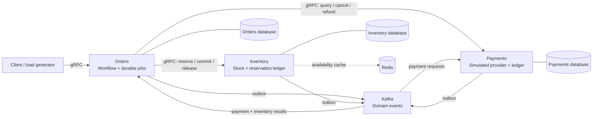
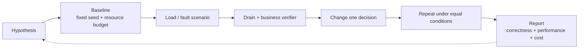
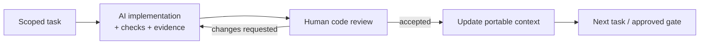

<p align="center">
  
</p>

<p align="center">
  <strong>A small business system. A deliberate breaking point. Evidence for every fix.</strong><br>
  A Go microservices lab for studying scale, failure and recovery through human-led AI development.
</p>

<p align="center">
  <a href="https://github.com/Includeoyasi/faultline-lab/actions/workflows/docs.yml"></a>
  · <a href="LICENSE">MIT License</a>
</p>

<p align="center">
  <a href="README.ru.md">Русский</a> ·
  <a href="docs/README.md">Documentation</a> ·
  <a href="docs/architecture/PROCESSES.md">Process atlas</a> ·
  <a href="docs/ROADMAP.md">Roadmap</a> ·
  <a href="PROJECT_CONTEXT.md">Agent handoff</a>
</p>

## Current state

**Architecture approved · gRPC skeleton under review.** The project owner accepted G0 on **13 October 2026** and merged P01-01. P01-02–04 add validated configuration, JSON logging and three independent gRPC health servers. Business operations and experiment results are still to come. [Build commands](docs/development/TOOLCHAIN.md) · [Service runtime](docs/development/SERVICE_RUNTIME.md).

| Ready | Next | Later |
| :--- | :--- | :--- |
| Approved architecture and business invariants | Review configuration/JSON/health; add bounded shutdown | Repeatable load and failure experiments |
| Detailed process diagrams and review gates | PostgreSQL ownership, migrations and gRPC contracts | Grafana dashboards, alerts and experiment reports |
| Portable context with a freshness check | Durable workflows, Kafka and compensation | Scaling comparisons under equal resource budgets |

The first code [PR #6](https://github.com/Includeoyasi/faultline-lab/pull/6) covers **P01-01**, after G0 and before G1. [Issue #3](https://github.com/Includeoyasi/faultline-lab/issues/3) tracks all eight tasks; [the packet specification](docs/development/packets/P01.md) defines acceptance criteria. P01-01 is accepted and merged; P01-02–04 are verified on native Linux AMD64/ARM64 and under review together in [PR #7](https://github.com/Includeoyasi/faultline-lab/pull/7), at the owner's request. P01-05–08 have not started; the full packet is still incomplete.

No capacity numbers or performance improvements are claimed before measurement. The [roadmap](docs/ROADMAP.md) distinguishes design hypotheses from acceptance criteria and observed results.

The owner has agreed on container-based development for Windows and macOS and a reusable lab boundary with business adapters. The [environment plan](docs/development/ENVIRONMENT.md) and [boundary proposal](docs/architecture/LAB_BOUNDARY.md) record this direction; runnable containers and a second business integration are still to come.

## What this project investigates

Faultline Lab models a mini-shop: **order → reservation → simulated payment → completion or cancellation**. Around that business process, the planned lab will generate load, inject faults, verify invariants and compare engineering decisions.

The useful result of an experiment is more than a latency chart: it explains whether the business stayed correct, what failed, which change helped, how much it cost and whether the result can be reproduced.

| Business service | Owns | Critical responsibility |
| :--- | :--- | :--- |
| **Orders** | Order state and durable workflow jobs | Coordinate completion and compensation; account for accepted requests |
| **Inventory** | Stock, reservations and stock ledger | Prevent overselling; commit or release a reservation safely |
| **Payments** | Simulated provider, payment jobs and payment ledger | Prevent duplicate debits; cancel or refund safely |

Exactly three business services. Workflow coordination lives inside Orders; load generators and verifiers are lab tools.

## Architecture

The diagram shows the approved boundaries. The full transaction sequence, cancellation races and recovery paths are documented in the [process atlas](docs/architecture/PROCESSES.md).



**Planned stack:** Go · gRPC · PostgreSQL · Kafka · Redis · Prometheus · Grafana · Loki · Alloy. Local Docker Compose comes first; distributed tracing is a later extension. A single local PostgreSQL instance hosts three databases with separate roles. Services never read one another's tables. Redis caches availability; PostgreSQL authorizes reservations.

The accepted design makes recovery explicit:

- Business state and its outbox event commit together. Duplicate delivery is expected; inbox deduplication and operation keys preserve meaning.
- An RPC timeout means the outcome is unknown. Recovery reuses the operation key or reconciles authoritative state.
- `COMPLETED` requires confirmed payment and committed inventory. `CANCELLED` requires no active reservation and no unrefunded debit.
- Cancellation and finalization compete for one versioned transition. Persisted cancellation barriers block late reservation or debit.
- Consumer lag and unfinished business work are measured separately. A committed Kafka offset does not prove a workflow has finished.

## The experiment loop



The [experiment catalog](docs/ROADMAP.md) includes load ramps, bursts, hot products, database contention, Kafka backlog and partition skew, slow dependencies, retry storms, crash windows, Redis failures, late payments and poison events.

Reports retain offered versus actual load, unresolved outcomes, resource limits and repeat variability. The [report template](docs/experiments/REPORT_TEMPLATE.md) defines the evidence to collect. There are no completed experiment reports yet.

## Human-led AI development

The **project owner** directs development and reviews changes. The AI acts as **implementer**: it prepares focused changes, runs available checks, documents evidence and addresses review comments. The human approves architecture and milestone transitions.



| Gate | Result | Status |
| :--- | :--- | :--- |
| **G0** | Architecture, invariants and development plan | Approved |
| **G1** | Orders and Inventory foundation | Planned |
| **G2** | End-to-end MVP and first experiment | Planned |
| **G3** | Failure recovery and resilience | Planned |
| **G4** | Reproducible engineering lab | Planned |

The [code review standard](docs/development/CODE_REVIEW.md) covers Go correctness, concurrency, data integrity and evidence. Review expectations and milestone decisions are in the [development workflow](docs/development/WORKFLOW.md). [AGENTS.md](AGENTS.md) gives implementers their working rules; [PROJECT_CONTEXT.md](PROJECT_CONTEXT.md) embeds the current state and source documents for agents without repository access.

## Repository map

```text
faultline-lab/
├── README.md                    # Public overview in English
├── README.ru.md                 # Public overview in Russian
├── CONTRIBUTING.md              # Review and contribution expectations
├── AGENTS.md                    # Instructions for AI implementers
├── CONTEXT_STATE.json           # Status, approvals and validation evidence
├── PROJECT_CONTEXT.md           # Generated, self-contained agent handoff
├── docs/
│   ├── README.md                # Guided reading paths
│   ├── ROADMAP.md               # Stages, experiments and acceptance criteria
│   ├── architecture/           # Approved design and process atlas
│   ├── development/            # Human review and AI implementation workflow
│   ├── experiments/            # Experiment report template
│   ├── adr/                    # Recorded decisions and approvals
│   └── assets/                 # Repository visuals
├── cmd/                        # Orders, Inventory and Payments entrypoints
├── internal/service/           # Shared configuration, logging and gRPC startup
├── configs/env/                # Explicit local/container environment examples
├── tests/smoke/                # Real process health and isolation checks
├── build/                      # Pinned toolchain image
├── compose.yaml                # Temporary toolchain service
├── tools/                      # Go commands, context and documentation checks
└── .github/                    # Documentation CI and review templates
```

Runtime service images will be added in P01-06; the current Compose service is the development toolchain. The [roadmap](docs/ROADMAP.md) contains the planned code layout.

## Working with this snapshot

Clone the repository and start with the [documentation index](docs/README.md):

```bash
git clone https://github.com/Includeoyasi/faultline-lab.git
cd faultline-lab
```

Documentation checks require Node.js 20+ and PowerShell 7+; the context generator also runs on Windows PowerShell 5.1:

```powershell
node tools/check_docs.mjs
pwsh -NoProfile -File tools/update_context.ps1 -CheckOnly
```

After changing canonical documents, update `CONTEXT_STATE.json` and its revision, regenerate with `pwsh -NoProfile -File tools/update_context.ps1`, then run the checks again. These commands validate documentation and snapshot freshness. Service settings and process checks are described in the [runtime guide](docs/development/SERVICE_RUNTIME.md).

## License

[MIT](LICENSE) · Copyright © 2026 Dmitrii Morozov.
