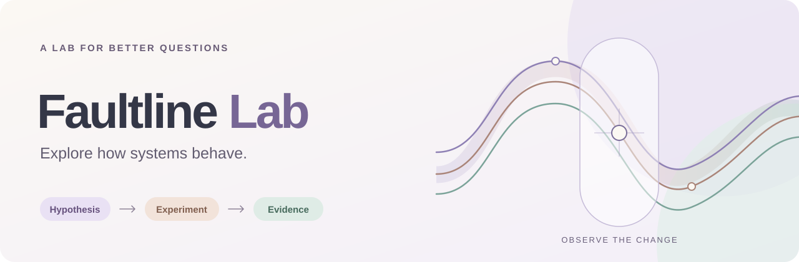
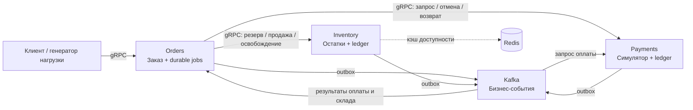
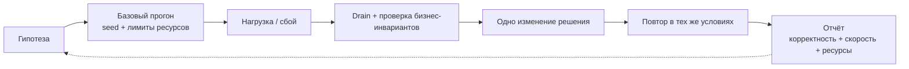
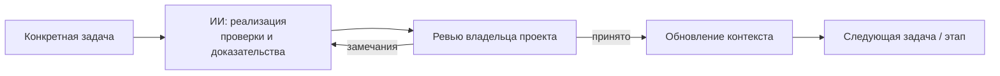

<p align="center">
  
</p>

<p align="center">
  <strong>Небольшой бизнес. Управляемые сбои. Доказательства эффективности решений.</strong><br>
  Лаборатория микросервисов на Go, разрабатываемая ИИ под руководством человека.
</p>

<p align="center">
  <a href="https://github.com/Includeoyasi/faultline-lab/actions/workflows/docs.yml"></a>
  · <a href="LICENSE">MIT License</a>
</p>

<p align="center">
  <a href="README.md">English</a> ·
  <a href="docs/README.md">Документация</a> ·
  <a href="docs/architecture/PROCESSES.md">Атлас процессов</a> ·
  <a href="docs/ROADMAP.md">Roadmap</a> ·
  <a href="PROJECT_CONTEXT.md">Контекст для агентов</a>
</p>

## Состояние проекта

**Архитектура принята, начата Go-основа.** Владелец проекта полностью согласовал G0 **13 октября 2026 года**. P01-01 с модулем и контейнером инструментов принята и слита. P01-02–04 добавляют конфигурацию, JSON-логи и три независимых gRPC health-процесса. [Устройство и запуск](docs/development/SERVICE_RUNTIME.md). Бизнес-операций и результатов экспериментов ещё нет. [Команды сборки и проверок](docs/development/TOOLCHAIN.md).

Ближайший пакет **P01**: три Go entrypoints, конфигурация, health, graceful shutdown и JSON-логи, контейнерный toolchain и Compose-запуск для Windows/macOS. [План среды](docs/development/ENVIRONMENT.md) объясняет состав контейнеров; [граница лаборатории](docs/architecture/LAB_BOUNDARY.md) сохраняет направление подключения других бизнесов. Проверки документации не являются тестами будущих сервисов. Производительность стенда пока не измерялась.

Задачи ведутся в [P01 — Issue #3](https://github.com/Includeoyasi/faultline-lab/issues/3): P01-01 принята и слита в [PR #6](https://github.com/Includeoyasi/faultline-lab/pull/6); P01-02–04 готовятся в следующем PR по прямому поручению владельца. P01-05–08 не начаты. Принято владельцем 1/8. [Спецификация пакета](docs/development/packets/P01.md) содержит критерии. P01 идёт после G0 и до G1.

## Идея

Faultline Lab — мини-магазин и лаборатория инженерных экспериментов вокруг него. Бизнес-процесс: **заказ → резервирование товара → симулированная оплата → завершение или отмена**.

Мы будем воспроизводить перегрузку, сбои зависимостей, задержки событий и ошибки восстановления; затем менять инженерное решение и сравнивать результаты в одинаковых условиях. Отчёт должен отвечать, сохранилась ли корректность бизнеса, что изменилось в производительности и ресурсах и можно ли повторить результат.

| Сервис | Ответственность | Что защищает |
| :--- | :--- | :--- |
| **Orders** | Заказ, сохранённые шаги процесса, отмена и компенсации | Учёт принятых запросов и корректные конечные состояния |
| **Inventory** | Остатки, резервы и складской ledger | Отсутствие перепродажи и безопасное освобождение резерва |
| **Payments** | Симуляция провайдера, платежи и возвраты | Отсутствие повторного списания и поздней оплаты после отмены |

Ровно три бизнес-сервиса. Управление процессом остаётся в Orders; генератор нагрузки и verifier — инструменты лаборатории.

## Принятая архитектура



Планируемый стек: **Go, gRPC, PostgreSQL, Kafka, Redis, Prometheus, Grafana, Loki и Alloy**. Первая среда — локальный Docker Compose. У каждого сервиса своя база и роль PostgreSQL; чтение чужих таблиц исключено. Redis помогает читать доступность, а резерв разрешает PostgreSQL.

Принятые опорные правила:

- Бизнес-изменение и outbox-событие сохраняются одной транзакцией. Дубликаты доставки учитываются через inbox и ключи операций.
- Timeout RPC означает неизвестный результат. Восстановление повторяет тот же ключ или сверяет состояние владельца данных.
- `COMPLETED` требует подтверждённой оплаты и продажи товара. `CANCELLED` требует отсутствия активного резерва и невозвращённого списания.
- Отмена и финализация конкурируют за переход версии Orders. Сохранённые запреты отмены блокируют поздний резерв или списание.
- Kafka lag измеряется отдельно от незавершённых бизнес-задач.

В [атласе G0](docs/architecture/PROCESSES.md) разобраны локальные транзакции, успешная покупка, отказы, гонки, поздние события и восстановление.

## Цикл эксперимента



В каталоге roadmap — постепенная нагрузка, всплески, горячий SKU, блокировки PostgreSQL, backlog и перекос партиций Kafka, медленные зависимости, лавина повторов, рестарты, сбои Redis, поздняя оплата и poison events.

Мы учитываем предложенную и фактическую нагрузку, неизвестные исходы и разброс повторов. Цифры эффективности появятся после измерений. [Шаблон отчёта](docs/experiments/REPORT_TEMPLATE.md) определяет состав доказательств; готовых результатов пока нет.

## Человек и ИИ

**Владелец проекта** задаёт направление разработки и проводит код-ревью. ИИ — **исполнитель**: готовит изменения, выполняет проверки, фиксирует доказательства и исправляет замечания. Человек принимает архитектуру и ключевые этапы.



**G0 принят.** G1 — основа заказа и склада; G2 — сквозной MVP; G3 — устойчивость; G4 — воспроизводимая лаборатория. Следующие контрольные точки ещё не достигнуты.

[Правила код-ревью](docs/development/CODE_REVIEW.md) задают стандарт Go, проверки корректности и критерии слияния. [Порядок разработки](docs/development/WORKFLOW.md) описывает процесс и приёмку этапов. [AGENTS.md](AGENTS.md) задаёт правила исполнителю. [PROJECT_CONTEXT.md](PROJECT_CONTEXT.md) включает полные документы, статусы и согласования: его можно передать агенту без доступа к репозиторию.

## С чего начать

1. [Карта документации](docs/README.md) — выбрать маршрут чтения.
2. [Принятый дизайн](docs/architecture/DESIGN.md) — границы и инварианты.
3. [Процессы G0](docs/architecture/PROCESSES.md) — подробные визуальные сценарии.
4. [Roadmap](docs/ROADMAP.md) — этапы, критерии и эксперименты.
5. [CONTRIBUTING.md](CONTRIBUTING.md) — как подготовить проверяемое изменение.

Структура репозитория показана в [English README](README.md). Каталоги реализации будут добавляться вместе с работающим содержимым.

```bash
git clone https://github.com/Includeoyasi/faultline-lab.git
cd faultline-lab
```

Проверки документации: Node.js 20+ и PowerShell 7+. Генератор контекста также совместим с Windows PowerShell 5.1:

```powershell
node tools/check_docs.mjs
pwsh -NoProfile -File tools/update_context.ps1 -CheckOnly
```

После изменения источников обнови `CONTEXT_STATE.json`, увеличь ревизию и выполни `pwsh -NoProfile -File tools/update_context.ps1`, затем проверки. Настройки сервисов и process smoke описаны в [инструкции запуска](docs/development/SERVICE_RUNTIME.md).

## Лицензия

[MIT](LICENSE) · Copyright © 2026 Dmitrii Morozov.
