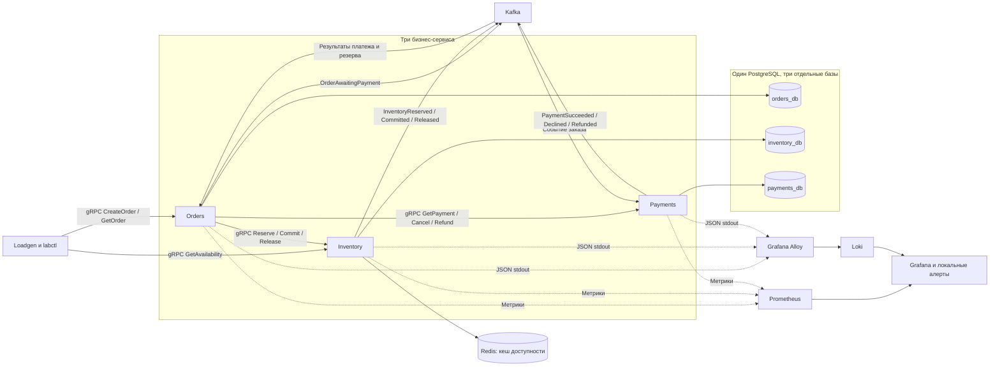

# Faultline Lab: roadmap лаборатории инженерных экспериментов

Цель проекта — воспроизводимо исследовать, как небольшой бизнес-процесс ведёт себя под нагрузкой и при сбоях, а затем проверять эффективность изменений. Итоговый продукт состоит из трёх бизнес-сервисов и инструментов вокруг них: генератора нагрузки, сценариев отказов, наблюдаемости, проверок корректности и отчётов.

Это план разработки, а не результаты уже проведённых испытаний. Все численные пороги ниже — начальные гипотезы, которые нужно откалибровать на своём компьютере.

Разработку выполняет Codex; пользователь выступает владельцем проекта, проводит код-ревью и согласует ключевые переходы. Порядок работы зафиксирован в `docs/development/WORKFLOW.md`. Архитектурный пакет `docs/architecture/DESIGN.md` и схемы `docs/architecture/PROCESSES.md` полностью приняты пользователем 2026-10-13. P01-01–04 приняты и слиты; P01-05–08 завершают реализацию lifecycle и контейнерного каркаса с smoke. Бизнес-операции ещё не реализованы. Переносимый актуальный контекст находится в `PROJECT_CONTEXT.md`; следующая контрольная точка — G1.

## 1. Допущения и границы

Обозначения G0–G4 относятся к контрольным точкам приёмки; P01–P05 — к небольшим пакетам кода с отдельным ревью. Первый PR с каркасом — P01, между G0 и G1. G1 принимается позже, после готовности основы заказа и склада; следующий PR не обозначает прохождения этой точки.

- Один исполнитель разработки — Codex, владелец проекта и ревьюер — пользователь. Первоначальные оценки объёма рассчитаны для ручной работы разработчика, знакомого с Go, SQL и Docker: один день равен примерно шести продуктивным часам. Эти оценки не являются сроками выполнения Codex; прогресс оценивается по готовности результатов и согласованным контрольным точкам.
- Первая среда — Linux-контейнеры в Docker Desktop/Compose на Windows и macOS; Go и инструменты сборки/проверок выполняются в контейнерной среде. Этот подход подтверждён владельцем проекта. Планируются нативные образы для x64 и ARM64; ресурсы и ограничения Docker фиксируются в каждом эксперименте. [Состав среды и статус проверок](development/ENVIRONMENT.md).
- Ровно три бизнес-сервиса: Orders, Inventory и Payments. Воркеры, оркестратор процесса и outbox publisher работают внутри соответствующего сервиса. Утилиты лаборатории и инфраструктура не становятся дополнительными бизнес-сервисами.
- Одна валюта, целые суммы в минимальных денежных единицах, один склад, небольшой фиксированный каталог и заранее загруженные остатки.
- В MVP нет авторизации, доставки, налогов, скидок, UI магазина и возвратов уже доставленных товаров. Возврат платежа нужен для компенсации отменённого заказа.
- Платёжный провайдер — модель внутри Payments. Она умеет детерминированно отвечать успехом или отказом, задерживать ответ и моделировать неизвестный результат. Реальные деньги не используются.
- Сначала один PostgreSQL с тремя базами и отдельными ролями. У сервисов нет прав читать чужие базы. Позже базы можно разнести, если именно разделение ресурсов становится предметом эксперимента.
- Один Kafka broker в первом профиле. Этот профиль проверяет обработку событий, backlog и перезапуски, но не отказоустойчивость реплицированного кластера. Для последней нужен отдельный профиль с несколькими брокерами.
- Версии Go, зависимостей и образы контейнеров закрепляются явно. В отчёт попадают теги и digest образов; плавающий `latest` не является описанием воспроизводимой среды.

Достаточный конечный результат: новый сценарий задаётся конфигурацией; один запуск создаёт нагрузку, применяет сбой, собирает данные и проверяет инварианты; сравнение двух вариантов формирует отчёт с выводом, ограничениями и исходными данными.

## 2. Архитектура



Инфраструктура для MVP: PostgreSQL, Kafka, Redis, Prometheus, Grafana, Loki и Alloy. Prometheus хранит метрики; Loki хранит логи; Grafana показывает оба источника. Сбор Docker-логов через Alloy соответствует официальному примеру Grafana. [Документация Loki и Alloy](https://grafana.com/docs/loki/latest/get-started/quick-start/tutorial/).

На этапе расширенной диагностики добавить OpenTelemetry и Tempo. Они нужны для ответа на конкретный вопрос: где заказ провёл время — в gRPC, очереди, SQL или обработчике событий. Сбор трасс должен иметь одинаковую конфигурацию в сравниваемых прогонах.

### Владение данными

| Сервис | Ответственность | Основные данные | Что не делает |
|---|---|---|---|
| Orders | Приём заказа, долговечное управление шагами, отмена и компенсации | orders, order_items, workflow_jobs, transition_history, inbox, outbox, request_keys | Не меняет складские и платёжные таблицы |
| Inventory | Остатки, цены каталога для стенда, резервирование, подтверждение продажи, освобождение | products, stock, reservations, reservation_items, operations, inventory_ledger, outbox | Не решает, успешен ли заказ в целом |
| Payments | Симуляция платежа, запрет позднего списания после отмены, возврат | payments, payment_jobs, payment_ledger, inbox, outbox, operation_keys | Не резервирует товар и не завершает заказ |

Цены фиксируются Inventory в момент резервирования; Orders сохраняет этот снимок. Payments получает сумму из события Orders, а не произвольную сумму клиента. Общими могут быть protobuf-контракты и инструменты телеметрии; бизнес-логика и SQL каждого сервиса остаются внутри него.

### Назначение транспорта

**gRPC** используется там, где нужен непосредственный результат операции: принять заказ, узнать состояние, атомарно зарезервировать товар, подтвердить или освободить резерв, запросить статус платежа и выполнить компенсацию.

**Kafka** переносит факты и отделяет приём заказа от платежной обработки. Payments запускается по `OrderAwaitingPayment`. Orders принимает результаты Payments и Inventory. Inventory подтверждает фиксацию продажи событием `InventoryCommitted`, после которого Orders завершает заказ.

Таким образом, все три сервиса используют и gRPC, и Kafka. Долговечный управляющий процесс находится в Orders; отдельный сервис для него не нужен.

**Redis** — кеш чтения `GetAvailability`, принадлежащий Inventory. Сначала TTL около двух секунд с небольшим случайным разбросом и best-effort invalidation после изменения склада. Кеш может временно показывать устаревшую доступность. `Reserve` всегда проверяет PostgreSQL. Redis не хранит единственную копию идемпотентности, платежей или остатков.

Пользу кеша проверять на смешанном профиле просмотра и заказа. Проверять только создающие записи запросы и ожидать ускорения от кеша чтений было бы неверной постановкой эксперимента.

## 3. Бизнес-процесс и контракты

### Успешный путь

1. `Orders.CreateOrder(client_request_id, items)` в одной SQL-транзакции создаёт заказ, ключ запроса и долговечную задачу резервирования. После commit клиент получает `order_id` и `ACCEPTED`. Ответ означает принятие, а не завершение покупки.
2. Внутренний воркер Orders вызывает `Inventory.Reserve(order_id, operation_id, items)`.
3. Inventory атомарно создаёт резерв, обновляет остатки и пишет `InventoryReserved` в outbox. Повтор с тем же ключом возвращает прежний результат. Orders сохраняет резерв, сумму и `OrderAwaitingPayment` в своей транзакции.
4. Publisher Orders доставляет событие в Kafka. Payments записывает inbox и долговечную payment job в своей транзакции, затем подтверждает обработанный Kafka offset.
5. Воркер Payments выполняет симуляцию задержки вне SQL-транзакции. Короткая транзакция проверяет текущее состояние, записывает единственное списание и `PaymentSucceeded` в outbox либо фиксирует отказ и `PaymentDeclined`.
6. Orders атомарно принимает `PaymentSucceeded`, меняет состояние на `FINALIZING` и создаёт задачу `CommitReservation`. Inventory фиксирует продажу и `InventoryCommitted` в одной транзакции.
7. Orders обрабатывает `InventoryCommitted`, проверяет подтверждённую оплату, переводит заказ в `COMPLETED` и публикует `OrderCompleted`.

Если Orders упал после ответа Inventory, повторяется тот же шаг с тем же `operation_id`. Если Kafka временно недоступна, событие остаётся в outbox. Если воркер умер после получения задачи, истечение lease позволяет продолжить её другим экземпляром.

### Состояния

| Сущность | Основные состояния |
|---|---|
| Заказ | ACCEPTED → RESERVING → PAYMENT_PENDING → FINALIZING → COMPLETED |
| Ветка отказа заказа | REJECTED при нехватке товара; CANCELLING → CANCELLED после завершения компенсаций |
| Резерв | RESERVED → COMMITTED или RELEASED; RELEASED также служит запретом позднего Reserve для отменённого order_id |
| Платёж | PROCESSING → SUCCEEDED или DECLINED; отмена до списания → CANCELLED; возврат списанного платежа → REFUND_PENDING → REFUNDED |

`NEEDS_REVIEW` можно добавить для исчерпанного автоматического восстановления. Это нерешённый бизнес-процесс, который ухудшает результат эксперимента, а не успешный терминальный исход.

В MVP отмена клиентом разрешена до FINALIZING. Переход PAYMENT_PENDING → FINALIZING и принятие CancelOrder конкурируют за один условный переход версии в Orders: выигрывает одна ветка. После FINALIZING отмена отклоняется, процесс доводится до COMPLETED. Это позволяет не моделировать возврат уже проданного товара. Если намерение отмены победило раньше, поздний PaymentSucceeded запускает возврат и не создаёт Commit job. Старый воркер проверяет актуальную версию и разрешённый шаг перед выполнением мутации.

### Отказы и компенсации

| Ситуация | Действие |
|---|---|
| Недостаточно товара | Атомарно отказать в резервировании всего заказа, завершить как REJECTED, не запускать оплату |
| Платёж отклонён | Зафиксировать отказ, освободить резерв, завершить как CANCELLED |
| gRPC timeout после мутации | Считать результат неизвестным; повторить тот же operation_id или запросить состояние |
| Kafka недоступна | Держать событие в outbox, контролировать возраст и объём накопления; при исчерпании заданного лимита ограничивать новый приём |
| Оплата успешна, Inventory временно недоступен | Оставить FINALIZING, повторять CommitReservation и сверять состояние; временный отказ не является поводом немедленно вернуть деньги |
| Резерв уже освобождён, оплата успешна | Перейти к возврату; CANCELLED выставить после подтверждения возврата |
| Позднее платёжное событие после начала отмены | Продолжить отмену: запретить ещё не выполненное списание либо вернуть выполненное |
| Результат Commit неизвестен | Сначала сверить резерв. Если COMMITTED, завершить заказ; если RELEASED, компенсировать оплату |

`ReleaseReservation(order_id)` должен сохранять терминальный запрет даже если Reserve ещё не успел создать запись. `CancelPayment(order_id)` аналогично сохраняет запрет будущего списания; если списание уже произошло, возвращает состояние для последующего `RefundPayment`. Иначе задержанный запрос или событие могут воскресить отменённый процесс.

В MVP резерв не исчезает по независимому TTL. Срок процесса контролирует Orders, который сохраняет намерение отмены и доводит компенсации до конца. Автоматическое истечение резерва добавить позже как отдельный протокол и проверить гонки с оплатой и Commit.

### gRPC API

| Сервис | Методы |
|---|---|
| Orders | CreateOrder, GetOrder, GetOrderByRequestKey, CancelOrder |
| Inventory | GetAvailability, Reserve, GetReservation, CommitReservation, ReleaseReservation |
| Payments | GetPayment, CancelPayment, RefundPayment |

Mutating RPC принимают ключ операции и проверяют hash существенных параметров. Повтор ключа с другим payload — конфликт, а не новый заказ. Платёжная симуляция запускается событиями; отдельный публичный `Charge` в MVP не нужен.

Идемпотентность включает подтверждённые бизнес-отказы. Например, недостаток товара сохраняется как результат operation_id без частичных складских изменений. Повтор того же ключа после пополнения склада не превращает завершённый отказ в новый успешный резерв.

### Kafka

| Топик | События | Consumer group |
|---|---|---|
| orders.events.v1 | OrderAwaitingPayment, OrderCompleted, OrderCancelled | payments-v1, фильтрует только нужные события |
| payments.events.v1 | PaymentSucceeded, PaymentDeclined, PaymentRefunded, PaymentCancelled | orders-payments-v1 |
| inventory.events.v1 | InventoryReserved, InventoryCommitted, InventoryReleased | orders-inventory-v1 |

Envelope: `event_id`, `event_type`, `schema_version`, `order_id`, `aggregate_version`, `occurred_at`, `correlation_id`, `causation_id`, `traceparent`, `payload`. `aggregate_version` относится к владельцу события; нельзя сравнивать версии Inventory и Payments как одну последовательность.

Начать с трёх партиций на топик и ключа `order_id`, затем экспериментировать с другим числом. Использовать обычные consumer groups. Kafka упорядочивает записи внутри партиции; общего порядка между топиками нет. Параллельная обработка в приложении также не должна нарушать требуемый порядок. Kafka-транзакции сами по себе не создают общую атомарную транзакцию с PostgreSQL. [Официальное описание Kafka](https://kafka.apache.org/43/design/design/).

Publisher outbox сохраняет порядок версий одного агрегата: несколько publishers не должны одновременно отправлять разные версии одного order_id в случайном порядке. В MVP допустим один активный publisher на сервис с DB lease; другие экземпляры могут принять lease после его потери. Позже проверить шардирование publishers. State machine обязана безопасно переживать дубликаты и опоздавшие факты даже при корректном порядке публикации.

## 4. Гарантии корректности

### Обязательные инварианты

1. `available >= 0`, `reserved >= 0`, `on_hand >= reserved` в Inventory.
2. При отсутствии пополнений `initial_stock = available + reserved + sold`. При пополнениях они учитываются в ledger; одна операция Commit или Release меняет баланс только один раз.
3. На order_id не более одного успешного списания. Сумма возвратов не превышает сумму списания. В MVP один полный возврат.
4. `COMPLETED` означает подтверждённую оплату на ожидаемую сумму и `COMMITTED` резерв.
5. `CANCELLED` означает отсутствие активного резерва и отсутствие невозвращённого списания; поздние операции не могут нарушить этот результат.
6. На client_request_id существует максимум один заказ с неизменным смыслом запроса.
7. Каждый принятый заказ существует в Orders и учтён итоговым verifier как терминальный, незавершённый или неизвестный из-за недоступности данных. Неучтённые заказы недопустимы.

Состояние PAYMENT_PENDING при резерве RESERVED — нормальная временная рассогласованность. Успешная оплата и FINALIZING во время краткого отказа Inventory также допустимы, но их длительность учитывается. Завершённый заказ без оплаты, отрицательные остатки и двойной debit — нарушение безопасности при любой длительности.

Глобальный verifier после прекращения нагрузки читает экспорт данных владельцев или использует отдельные read-only учётные записи трёх баз. Это инструмент лаборатории; сами сервисы не получают доступ к чужим данным. Во время активных изменений глобальная сверка должна учитывать версии и повторно подтверждать подозрительные пары, чтобы разные моменты чтения не выглядели ложным нарушением. После drain выполняется обязательная полная сверка.

### Механизмы и момент внедрения

| Механизм | Когда | Назначение и проверка |
|---|---|---|
| SQL constraints, уникальные operation keys, условные переходы состояния | Этап 1 | Конкурентные Reserve и повторные запросы не создают лишний резерв или эффект |
| Долговечные шаги Orders, lease, version check | Этапы 1–2 | Перезапуск продолжает сохранённый шаг; старый воркер не перезаписывает новое состояние |
| Transactional outbox у всех трёх сервисов | Этап 2 | Падение между SQL commit и Kafka publish не теряет событие |
| Inbox и durable jobs у Kafka-потребителей | Этап 2 | Дубликат события не создаёт второй job или бизнес-эффект |
| Reconciliation и компенсации | Минимум в этапе 2, расширение в этапе 4 | Неизвестный результат RPC и поздние результаты не оставляют ложный terminal state |
| DLQ/quarantine и управляемый replay | Этап 4 | Некорректное событие диагностируется и воспроизводится без тихой потери процесса |
| Политика circuit breaker и admission control | Этап 5 после измерения | Ограничить каскадное накопление работы; оценить успешный goodput, отказы и восстановление |

Inbox, бизнес-переход и создаваемые jobs/outbox записываются одной транзакцией. Kafka offset подтверждается после неё. Если дальше нужна долгая работа, она уже представлена durable job. При параллельной обработке offset можно продвигать только через непрерывный диапазон завершённых записей, а не сразу до самого высокого готового offset.

Outbox помечается отправленным после подтверждения Kafka; падение перед отметкой приведёт к повторной публикации. Поэтому повторная доставка ожидаема, и защита строится на бизнес-ключах и SQL-транзакциях. Обещание проекта — определённые идемпотентные эффекты и проверяемые инварианты в заданной модели отказов, а не универсальная сквозная exactly-once.

Для склада использовать короткую транзакцию: условное увеличение `reserved` при достаточном `on_hand - reserved`, запись резерва и ledger. Несколько SKU блокировать в стабильном порядке; при недостатке хотя бы одной позиции откатывать весь резерв. PostgreSQL при конкурентном UPDATE в Read Committed повторно проверяет WHERE для изменённой строки. Это полезно для такого условного обновления, но не заменяет проектирование всей транзакции. [Transaction isolation](https://www.postgresql.org/docs/current/transaction-iso.html). Единый порядок блокировок и короткие транзакции уменьшают риск deadlock. [Explicit locking](https://www.postgresql.org/docs/current/explicit-locking.html).

На RPC всегда задавать deadline и передавать отмену в SQL и последующие вызовы. gRPC по умолчанию не устанавливает deadline; приложение должно прекращать запущенную работу после отмены. [gRPC deadlines](https://grpc.io/docs/guides/deadlines/).

Это относится к работе текущего запроса. Уже сохранённая и принятая durable job имеет собственный контекст процесса и бюджет бизнес-шага; уход клиента после CreateOrder не удаляет заказ и не отменяет его обработку. Повтор клиентского запроса разрешает неизвестный результат через тот же request key.

Начальная политика: одна повторная попытка для идемпотентной мутации, только для классифицированной временной ошибки и внутри оставшегося deadline; backoff с jitter. Дальнейшее восстановление делает durable job с сохранённым next_attempt_at. Не включать независимые длинные retry loops одновременно у клиента, gRPC и воркера. Встроенную retry policy gRPC нужно задавать явно и проверять счётчик реальных попыток. [gRPC retry](https://grpc.io/docs/guides/retry/).

Длительные задержки провайдера, ожидание gRPC и Kafka не должны удерживать открытую SQL-транзакцию. Ограниченные пулы и worker queues — исходная управляемая конфигурация; изменение их размеров станет экспериментом.

## 5. Наблюдаемость

### Логи и корреляция

JSON-логи в stdout: `timestamp`, `level`, `service`, `instance`, `version`, `run_id`, `order_id`, `operation_id`, `event_id`, `correlation_id`, `trace_id`, `step`, `attempt`, `duration_ms`, `outcome`, `error_code`.

Логировать переход состояния, неизвестный результат операции, повтор, компенсацию, конфликт ключа и помещение в quarantine. Содержимое платёжных данных для стенда — синтетическое. Успешные однотипные чтения можно семплировать; журналы бизнес-операций, на которые опирается проверка, находятся в PostgreSQL, а не только в логах.

`order_id`, `trace_id`, `event_id` и `run_id` — поля логов, не Prometheus labels и не индексные labels Loki. Labels метрик ограничить `service`, `method`, `code`, `step`, `event_type`, `outcome` с заранее ограниченными наборами. Высокая кардинальность увеличивает стоимость хранения и обработки метрик. [Prometheus instrumentation](https://prometheus.io/docs/practices/instrumentation/).

### Метрики и дашборды

| Дашборд | Показатели | Какой вопрос решает |
|---|---|---|
| Бизнес-процесс | Offered/sent/accepted orders, completed orders/s, business rejects, technical failures, отмены, время до терминального состояния, oldest pending age, незавершённые заказы | Завершает ли система покупки при заданном спросе? |
| gRPC и Go | p50/p95/p99, timeout/error/retry rate, inflight, goroutines, GC, CPU/RSS | Где растёт задержка и сколько работы удерживается? |
| PostgreSQL | Время acquire из пула, занятые/свободные соединения, SQL latency, lock waits, deadlocks, долгие транзакции | База медленно работает или приложение ждёт её допуска? |
| Kafka и jobs | Lag по group/topic/partition, возраст старейшего необработанного события, event completion rate, длительность rebalance, job/outbox depth и oldest age | Где накапливается работа и успевает ли она завершаться? |
| Redis | Hit/miss, ошибки и latency, частота fallback, загрузка SQL при fallback, возраст возвращённых данных | Кеш снижает нагрузку без опасного доверия устаревшим данным? |
| Корректность | Нарушения каждого инварианта, dangling reservations, unmatched payments, failed reconciliation | Не куплено ли ускорение ценой неверных результатов? |

Lag по committed offsets показывает прогресс передачи в durable job, если consumer подтверждает событие на этом этапе. Поэтому низкий Kafka lag не доказывает, что платежи уже обработаны: отдельно нужны возраст и размер payment_jobs.

Метрики сервисов снимает Prometheus. На ранних этапах runner сохраняет `docker stats`, доступные SQL-показатели и Kafka offsets. На этапе 3 добавить инфраструктурные exporters с проверкой совместимости своего Docker окружения. Накладные расходы verifier и exporters также фиксировать и держать одинаковыми в A/B.

### Начальные SLI/SLO

Профиль для SLO: достаточно товара, симулятор всегда одобряет платёж, нет внесённых отказов, нагрузка R0. R0 — не обещанное число: её определить первым ступенчатым тестом.

| SLI | Начальная гипотеза |
|---|---|
| Приём валидного заказа | Не менее 99% уникальных отправленных заказов получают подтверждение принятия за 300 мс |
| Завершение бизнеса | Не менее 99% уникальных отправленных валидных заказов переходят в COMPLETED за 2 секунды с момента отправки |
| Безопасность данных | Ноль отрицательных остатков, двойных списаний и ложных COMPLETED |
| Полнота обработки после drain | Каждый принятый заказ учтён; в профиле без отказов нет незавершённых процессов |
| Восстановление | После 30 секунд недоступности зависимости backlog и задержки возвращаются в исходный диапазон за 120 секунд; уточнить по baseline |

Доля завершённых среди принятых — полезная диагностическая метрика. Для оценки способности обслужить спрос нужен также знаменатель всех отправленных валидных заказов: иначе отклонение большей части нагрузки искусственно улучшит результат.

Ожидаемые sold-out и payment declines учитывать отдельно от технических ошибок. Правила ожидаемого поведения задаются до запуска. Для fault-сценариев заранее задаются отдельные критерии допустимой деградации и восстановления; нельзя после теста исключать из знаменателя неудачные запросы.

Начальные локальные алерты в Grafana:

- Верификатор подтвердил нарушение инварианта — сразу критический сигнал.
- При положительном входящем потоке нет бизнес-завершений 30 секунд — сигнал остановки процесса.
- Старейший заказ старше 10 секунд либо объём backlog растёт несколько окон подряд — сигнал деградации.
- gRPC p99 превышает 300 мс или доля технических ошибок превышает 1% на достаточной выборке несколько минут — сигнал нарушения начального бюджета.
- Долгое ожидание соединения, рост outbox age, недоступность telemetry collectors — отдельные диагностические сигналы.

Runner фиксирует момент начала проблемы, переход алерта в firing и восстановление. Порог и `for` подбирать по baseline; выбранный `for` ограничивает минимальную скорость обнаружения. Во время запланированных сбоев сигналы не скрывать: они являются частью результата.

## 6. Генератор и управление экспериментами

Начать с маленького Go CLI `loadgen`, использующего те же protobuf-контракты. Поддержать open-loop запуск заказов с заданной частотой, фиксированный seed, список SKU и независимую сверку результатов. Не создавать для него отдельную постоянную бизнес-платформу.

Open-loop нужен, чтобы рост latency не снижал автоматически предлагаемую системе нагрузку. Такое снижение в закрытой модели способно скрывать перегрузку; различие подробно описано в документации k6. Реализуется оно и в собственном Go-генераторе. [Open and closed load models](https://grafana.com/docs/k6/latest/using-k6/scenarios/concepts/open-vs-closed/).

Для каждой операции сохранять плановое время отправки, фактическую отправку, ответ, ключ запроса и итоговый бизнес-статус. Если генератор исчерпал свой лимит inflight, записать skipped/late launches: не тормозить незаметно расписание. Измерять CPU генератора и расхождение target/sent rate. Результат при насыщении самого генератора маркировать как непригодный для оценки capacity стенда.

Параметры профиля:

- orders/s, ступени роста и burst;
- доля чтений каталога и статуса заказа;
- число товаров в заказе, размер каталога и распределение popular SKU;
- исходный склад: избыточный для capacity-тестов, ограниченный для hot-stock;
- детерминированная доля payment declines и задержек, keyed по order_id и seed;
- лимиты inflight генератора, число воркеров сервисов и pool sizes;
- таймлайн сбоя, длительность, направление сетевого воздействия;
- прогрев, основное окно, drain, повторы и ресурсный бюджет.

Способы внесения отказов: test-only delay/error hooks, управляемая остановка и запуск контейнера, сетевой proxy по нужной зависимости. Задержка SQL в тестовой ветке должна быть отличима от реальной блокировки/плохого плана SQL. Все hooks отключаются обычной конфигурацией, а их активация попадает в manifest.

## 7. Roadmap

Этапы 0–2 дают MVP. Он содержит весь обязательный стек, сквозной процесс и первый отчёт, собранный вручную. Этапы 3–7 делают лабораторию удобной для более глубоких экспериментов.

Контрольные точки владельца проекта: G0 — архитектура перед кодом; G1 — базовая работа с заказом и складом после этапа 1; G2 — сквозной MVP после этапа 2; G3 — устойчивость после этапа 4; G4 — итоговая лаборатория после этапа 7. G0 полностью принят 2026-10-13; G1–G4 ещё не достигнуты. Внутри этапов изменения готовятся небольшими пакетами для код-ревью. Переход через контрольную точку выполняется после явного согласования пользователя. Существенные изменения ранее согласованной архитектуры выносятся на отдельное согласование.

| Этап | Цель и задачи | Зависит от | Результат и критерий готовности | Демонстрация | Дни | Основной риск |
|---|---|---|---|---|---|---|
| 0. Контракт эксперимента | Описать состояние и инварианты; определить API/события; выбрать baseline data и ресурсный профиль; подготовить monorepo и Compose | — | Контракты и initial manifest сохранены; инфраструктура поднимается; у каждой БД отдельная роль | Проверка доступности и невозможности читать чужую БД | 2–3 | Долгое проектирование вместо первого работающего среза |
| 1. Создание и резерв | Go-сервисы, миграции; Create/Get; атомарный Reserve/Commit/Release; модель платежа; request keys; durable step; JSON-логи и базовые метрики | 0 | Заказ переживает перезапуск в RESERVING; повтор запроса не дублирует заказ; конкуренция не создаёт отрицательный склад | 1000 попыток купить 100 единиц одного SKU | 4–6 | Неверная транзакция или слишком долгие блокировки |
| 2. Сквозной MVP | Kafka workflow; outbox/inbox; payment jobs; минимальные компенсации; кеш чтения Redis; Loki/Alloy/Grafana; loadgen и verifier | 1 | 1000 заказов завершаются; отказы оплаты освобождают товар; повторы и контрольные crash windows не нарушают инварианты; первый baseline отчёт сохранён | Ступени нагрузки и сравнение одного изменения worker limit | 6–9 | Попытка отложить восстановление и потерять доверие к baseline |
| 3. Диагностика | Полные дашборды и алерты; SQL/пул/Kafka/job telemetry; OpenTelemetry и Tempo; учёт overhead | 2 | Для медленного заказа виден участок ожидания; искусственная задержка даёт ожидаемый сигнал и алерт; конфигурация dashboards хранится в репозитории | 500 мс задержки Payments и сравнение таймлайна событий, метрик и trace | 3–5 | Высокая кардинальность и влияние самой телеметрии |
| 4. Устойчивость | Late events, cancel races, timeout-after-commit, DLQ/quarantine и replay; проверки reconciliation; schema compatibility | 2; наблюдаемость из 3 помогает | Сценарии имеют утверждённые результаты; после исправления и replay нет потерь и двойных эффектов; нерешённые заказы явно учтены | Убить publisher после publish до отметки; задержать успех оплаты до отмены | 6–9 | Объявить компенсацию завершённой при неизвестном результате |
| 5. Нагрузка и решения | Прогон каталога узких мест; SQL/pool/workers; retries; cache; backpressure; сравнение гипотез по одной | 3–4 | Минимум четыре сценария имеют baseline, изменение и повторное измерение; улучшение не ухудшает корректность | Short transaction против долгой; ограниченные retries против retry storm | 5–8 | Сменить несколько факторов и потерять причинную связь |
| 6. Масштабирование | gRPC routing, несколько реплик, Kafka partitions/publishers; connection budgets; при необходимости разнести базы; optional multi-broker profile | 5 | Сравнение 1/2/4 реплик при том же суммарном CPU и при увеличенном бюджете; показано ограничение масштабирования | Replicas vs partitions; hot SKU vs равномерная нагрузка | 4–6 | Пиннинг gRPC на одном backend, горячая строка склада или рост суммарного SQL-пула |
| 7. Отчёты и regression suite | labctl автоматизирует setup/run/drain/verify/export/compare; JSON manifest, графики, Markdown report; короткий набор сценариев | 2, шаблон стабилизирован в 5–6 | Одна команда воспроизводит сравнение и выдаёт артефакты; smoke/regression suite находит намеренно внесённую ошибку | Повтор A/B с одинаковым seed и сравнение отчётов | 4–6 | Отчёт скрывает пропуски телеметрии, backlog или различия среды |

Базовая сумма: **34–52 рабочих дня, приблизительно 204–312 часов**. При 20 часах в неделю — ориентировочно 10–16 недель; при 10 часах — 20–31 неделя. Это оценка при принятых допущениях, без времени на изучение Go/Docker с нуля и без Kubernetes. MVP: **12–18 рабочих дней, 72–108 часов**. После MVP уточнить остальные оценки по фактической скорости.

### Первый полезный эксперимент после MVP

1. При достаточном складе и всегда успешной оплате выполнить ступени 10 → 25 → 50 → 100 orders/s, по 3–5 минут. При необходимости скорректировать диапазон. Снять accepted/completed throughput, e2e latency, oldest job age, pool waits, Kafka и outbox backlog.
2. Найти первый устойчивый узкий участок. Если это последовательная payment processing, проверить изменение `payment_workers: 1 → 4` при тех же CPU/памяти. Если ограничение другое, выбрать изменение по наблюдаемому сигналу.
3. Повторить одинаковый профиль и сравнить goodput, p95/p99, незавершённые заказы, CPU и инварианты. Не менять одновременно pool size, число реплик и профиль отказов.
4. Сохранить первый отчёт. Это диагностический эксперимент; подтверждение предельной capacity требует более долгих и повторных прогонов на этапе 5.

### Когда нужен Kubernetes

После этапа 7 возможен отдельный этап на 5–10 дней, если предмет исследования — rolling update, readiness, распределение по узлам, лимиты/requests или autoscaling. Он не нужен для первых экспериментов с Kafka, gRPC, SQL, кешем и нагрузкой. Автомасштабирование должно опираться на проверенный сигнал, например возраст работы, а не только CPU. Одноузловый кластер всё ещё не доказывает устойчивость к потере физического узла.

## 8. Каталог экспериментов

Нагрузочные сценарии растят спрос или меняют его распределение. Fault-сценарии намеренно ломают зависимость. Они имеют разные критерии успеха: максимальный устойчивый goodput против ограниченной деградации и восстановления.

| ID / тип | Проблема и воспроизведение | Сигналы | Гипотеза / изменение | Оценка улучшения | Компромисс |
|---|---|---|---|---|---|
| L1: рост нагрузки | Ступени до выхода из SLO; товар не заканчивается, оплата всегда успешна | offered/accepted/completed, p99, oldest pending, CPU, pool/job waits | Изменить ровно один обнаруженный bottleneck: индекс, короткую транзакцию, число воркеров | Максимальный устойчивый orders/s при одном SLO и бюджете; backlog не имеет устойчивого роста | Латентное накопление работы может выглядеть как высокая скорость приёма |
| L2: burst | После спокойного окна подать 5×R0 на 30 секунд, затем R0 | Peak pending, heap/goroutines, rejects, drain time | Ограниченный inflight, admission control, раздельные worker budgets | Меньше технических ошибок и faster recovery; goodput и доля отказов показаны вместе | Shed requests нельзя исключать из общей оценки спроса |
| L3: горячий товар | 80–90% заказов на один SKU; отдельные тесты с обильным и ограниченным остатком | Lock wait, Reserve latency, business sold-out, inventory ledger | Сократить locked section; стабильный lock order; сравнить сериализацию по SKU как альтернативу | Короткие ожидания и корректный баланс; после terminal/drain для 100 единиц нет более 100 продаж и нет dangling reserve | Больше реплик не устраняет конкурентную запись в одну строку; serialization может снизить параллелизм |
| L4: SQL bottleneck | Отдельно плохой план чтения, долгий lock и маленький pool; не смешивать их | SQL latency/plan, acquire wait, lock wait, deadlocks, query count | Индекс для своего запроса, уменьшение времени транзакции, изменение pool cap | Улучшение e2e и SQL при том же профиле; pool не перегружает общий PostgreSQL | Большой pool способен ухудшить базу; индекс увеличивает цену записи |
| L5: Kafka backlog | Снизить throughput consumer либо processing worker; сохранять поток producer | Lag по партициям, возраст events/jobs, oldest outbox, rebalance | Batching, workers, число обычных consumers и partitions в отдельных тестах | Возраст backlog и время догонки, бизнес goodput | Низкий Kafka lag при большом durable-job backlog — ложный признак здоровья |
| L6: partition skew | Для отдельного профиля большинство ключей направить в одну партицию; держать stock contention отдельным фактором | Lag/throughput по партициям, idle consumers | Изменить ключ или распределение, если бизнес-порядок это допускает | Снижение перекоса и e2e latency при сохранении семантики | Новое число партиций меняет распределение ключей; не менять его на ходу без плана порядка и миграции |
| F1: зависимость медленная/недоступна | 500 мс → 2 с задержки или остановка Inventory/Payments на 30 секунд | Deadlines, job age, accepted/completed, inflight, recovery | Deadline budgets, bounded retries, durable reconciliation; затем breaker | Ограниченная память/очередь, ноль нарушений, recovery target | Слишком короткий deadline увеличивает неизвестные результаты и повторную работу |
| F2: retry storm | Временно возвращать UNAVAILABLE; сравнить агрессивную и ограниченную политику | Attempts/logical request, load amplification, CPU, queue age | Одна retry policy, backoff+jitter и budget | Меньше лишних попыток, выше completed goodput, короче восстановление | Более длинное ожидание единичного клиента; breaker/admission отклоняют часть спроса |
| F3: crash windows | Убить процесс после DB commit до publish, после publish до sent marker, после consumer commit до offset | Replay count, duplicate suppression, outbox/jobs, ledger | Outbox/inbox и устойчивые operation keys; проверяется действующая реализация | Сверка всех заказов после рестарта; ноль лишних списаний и lost events в модели сохранённых дисков | Проверка не включает уничтожение данных БД или исчерпание retention |
| F4: Redis down/stale | Остановить Redis, одновременно истечь ключам, задержать invalidation | Hit rate, stale-read rate, SQL fallback, Reserve correctness | Короткий fallback deadline, TTL jitter, singleflight; сравнить отказ и fallback | Read latency, SQL нагрузка и успешные заказы; ноль Reserve по кешу | Fallback может вызвать stampede в PostgreSQL; отображение остатков может быть устаревшим |
| F5: поздняя оплата/отмена | Задержать PaymentSucceeded до начала отмены; конкурирующие Commit/Release | State transitions, compensations, unmatched debit, terminal state | Durable cancel intent, cancellation barriers, idempotent refund | В итоге корректный COMPLETED или CANCELLED, единственный debit, отсутствие невозвращённых сумм у отменённых | Нужно больше состояний; нельзя объявлять неизвестный результат отменённым |
| F6: poison event / replay | Внести неверную схему или payload в конкретную партицию | Quarantine depth, errors, blocked partition, pending order age | Durable quarantine и контролируемый replay после исправления | Проблема видна, запись сохранена, процесс после replay корректен | Пропуск записи ради доступности ломает бизнес-порядок, если его не учитывает state machine |

Для F6 сначала сохранять проблемное событие и контекст в durable quarantine, затем разрешать продвижение offset согласно явной политике. Если DLQ находится в Kafka, outage Kafka не должен приводить к подтверждению потерянной DLQ-записи. Replay сохраняет исходный event_id/operation semantics и не обходит обычную идемпотентность. После изменения кода отдельно решить, что делать с ранее обработанными результатами: просто новый event_id способен создать второй эффект.

В F5 гонку приёма CancelOrder с PaymentSucceeded проверять через допустимые состояния Orders. Конкурентные Commit/Release — дополнительная проверка примитивов Inventory и внесённых нарушений протокола. В штатном MVP Orders не создаёт Release после начала FINALIZING; иначе для компенсации уже проданного товара понадобился бы отдельный протокол возврата склада.

## 9. Методика сравнения

### Протокол запуска

1. **Гипотеза до измерения.** Например: уменьшение времени удержания транзакции увеличит completed orders/s при том же CPU, без роста p99 и нарушений. Задать минимально полезный эффект и допустимые регрессии.
2. **Одинаковое исходное состояние.** Загрузить один seed dataset, очистить тестовые базы/кеш/топики либо создать изолированный namespace запуска. Сервисные operation keys и Kafka offsets не должны переходить из предыдущего прогона. Сброс допустим только для явно выделенного стенда.
3. **Manifest.** Git commit, dirty diff, версии и image digests, конфигурация, ресурсы, replicas, worker/pool caps, topics/partitions/groups, seed, stock, fault timeline, OS/Docker и ограничения машины.
4. **Прогрев.** Начать с двух минут, проверить выход в steady state. Прогревочные заказы обработать до конца и исключить из измеряемой когорты; состояние склада затем привести к одинаковому оговорённому старту. Cold-cache и warm-cache — разные сценарии.
5. **Основное окно.** Первое подтверждающее сравнение: десять минут одинаковой нагрузки. Диагностические ступени могут быть короче. Всё окно сценария, включая burst/fault, включается в анализ; исключаются только заранее оговорённые warmup и cooldown.
6. **Drain.** Прекратить новые заказы, оставить workers и зависимости работать. Ждать исчерпания jobs/outbox и завершения когорты до заданного лимита, например пяти минут. По истечении лимита перечислить unresolved и unknown; не выбрасывать их из данных.
7. **Verifier.** Проверить ledger, состояния, остатки, уникальность операций и полноту по списку request keys генератора. Неизвестные ответы CreateOrder сверить через GetOrderByRequestKey: timeout не означает, что заказ не был создан.
8. **Повторы.** Для первого A/B — минимум три пары, чередуя порядок A/B; для подтверждения предпочтительно пять. Использовать одинаковый seed внутри пары и заранее заданный набор разных seeds между парами. Повторить при нестабильной среде или небольшом эффекте.
9. **Сравнение.** Показать значения каждого прогона, median эффекта, разброс, объём выборки и ресурсную цену. Несколько прогонов не являются доказательством статистической значимости. Для близких результатов увеличить число пар и длительность.

### Метрики результата

- `goodput = успешно завершённые заказы / длительность измеряемого окна`, с явным указанием, какие завершения относятся к окну. Отдельно показать completed во время drain.
- `business_success_ratio = завершённые ожидаемо успешные заказы когорты / все отправленные ожидаемо успешные заказы когорты` на контрольный момент.
- `accepted_completion_ratio` — вторичная метрика завершений среди принятых. Показывается вместе с accepted/offered, чтобы не скрывать load shedding.
- `recovery_time` — от снятия отказа до возврата backlog age и latency в заранее выбранный baseline диапазон и удержания в нём контрольное окно, например минуту.
- `amplification = физические попытки зависимого вызова / логические операции`.
- `resource_efficiency` — completed orders на CPU-second; также RSS и disk/network объём. Показать отдельно нагрузку сервисов, инфраструктуры и генератора.
- `invariant_violations` и `unresolved_after_drain` — отдельные обязательные результаты, а не примечание к производительности.

E2E latency в отчёте считается для когорты и имеет рядом число успешных, отказанных и незавершённых заказов. Percentile только успешно завершённых заказов без этих чисел может скрыть деградацию. Незавершённым не присваивать выдуманное время завершения; показывать их наблюдаемый возраст и долю цензурированных наблюдений.

Не усреднять p95/p99 между репликами. Для общего percentile объединять подходящие histogram buckets либо сырые наблюдения. Между прогонами можно показывать median их p95, прямо называя это статистикой прогонов, а не percentile всей выборки.

До/после сравнивать при одинаковом суммарном бюджете. Если добавлены CPU/память, выносить отдельный вариант «расширение ресурсов». Для реплик считать суммарные DB pools: четыре пула по 20 соединений дают другое давление на БД, чем один на 20. Проверять, что gRPC resolver/load-balancing policy действительно распределяет вызовы: один долгоживущий канал к одному backend не является тестом равномерного масштабирования.

При росте capacity искать максимальный поток, который выдерживает SLO и не показывает устойчивого роста backlog на всём контрольном окне. Быстрый приём с бесконечно растущей очередью — не устойчивый throughput.

Процент изменения считать только при ненулевом baseline и показывать абсолютную разницу. Если одна из конфигураций нарушает инварианты, её ускорение не принимается как улучшение. Если генератор или сбор данных не обеспечили заданную нагрузку/полноту, результат обозначается `inconclusive` с причиной.

## 10. Минимальная автоматизация

Предлагаемая структура будущего репозитория:

```text
cmd/orders/
cmd/inventory/
cmd/payments/
cmd/loadgen/
cmd/labctl/
internal/orders/  internal/inventory/  internal/payments/
internal/lab/                  # Общие контракты и механизм экспериментов
internal/adapters/shop/        # Операции, данные и проверки магазина
api/proto/
migrations/orders/  migrations/inventory/  migrations/payments/
deploy/compose/
observability/dashboards/  observability/alerts/
experiments/scenarios/
experiments/targets/           # Профили подключаемых систем
reports/<experiment>/<run>/
docs/adr/
```

Это предлагаемая структура реализации; текущие файлы содержат только план и шаблон отчёта.

Владелец проекта подтвердил разделение общей лаборатории, адаптера и тестируемой системы; магазин проходит через ту же границу. Детализация контрактов и кандидат второго бизнеса описаны в [границе лаборатории](architecture/LAB_BOUNDARY.md). Обработка изображений пока предложение; подключение второго бизнеса не объявляется выполненным или принятым критерием G4.

P01 включает контейнерный toolchain, образы трёх сервисов и минимальный Compose-запуск вместе с Go entrypoints/config/health/shutdown/JSON-логами и Go CI. Основная инфраструктура подключается в P02, наблюдаемость — на соответствующем этапе. Инструменты запускаются по задаче; адаптер не требует отдельного контейнера.

[Спецификация первого PR P01](development/packets/P01.md) содержит восемь задач, зависимости, критерии приёмки и снимок статуса. Текущее выполнение ведётся в [Issue #3](https://github.com/Includeoyasi/faultline-lab/issues/3), порядок — в [учёте задач](development/TASK_TRACKING.md). Создание списка и карточки не означает начало реализации.

Этап 2: запуск Compose и loadgen вручную, экспорт JSON/CSV, Markdown отчёт по шаблону. Этап 4: hooks и crash scripts. Этап 7: `labctl` объединяет уже проверенные действия.

Проектируемые команды `labctl`:

```text
labctl prepare --scenario baseline --variant A
labctl run --scenario baseline --variant A
labctl verify --run <run_id>
labctl export --run <run_id>
labctl compare --baseline <A_runs> --candidate <B_runs>
```

Контракт scenario должен содержать: seed, dataset, arrival schedule, read/order mix, fault timeline, replicas/resources, worker/pool limits, warmup/measure/drain и критерии оценки. Это собственная схема runner, а не готовый формат какого-либо существующего инструмента.

Артефакты одного запуска:

```text
manifest.json       # Полная конфигурация, версии, среда и dirty diff reference
requests.jsonl      # Расписание, отправка, результат и request keys
business-results.csv
metrics.json        # Экспорт временных рядов и счётчиков
faults.jsonl        # Фактическое, а не только запланированное время воздействий
invariants.json     # Проверки и список unresolved/unknown
logs/               # Выбранные логи вокруг инцидента
charts/             # PNG/SVG throughput, latency, backlog, resources
report.md
```

Report формируется из численных данных, а не только screenshots Grafana. Ссылки на дашборды с окном времени полезны для диагностики; графики и исходные данные сохраняются локально, чтобы отчёт не зависел от retention Grafana/Loki/Prometheus.

Regression suite: короткий успешный процесс, конкуренция за остаток, повтор CreateOrder, повтор события, crash после SQL commit, неизвестный gRPC результат, поздняя оплата при отмене. Проверки направлены на бизнес-инварианты и реальные crash windows; не требуется писать тест на каждый элемент конфигурации.

## 11. Шаблон отчёта

Отдельный файл `docs/experiments/REPORT_TEMPLATE.md` содержит форму для заполнения. Обязательная последовательность:

1. Проблема, гипотеза и критерии принятия изменения.
2. Среда, ресурсы, версии, данные, профиль нагрузки и fault timeline.
3. Единственное проверяемое изменение и фактический diff.
4. Показатели A/B с выборкой и разбросом; отдельно accepted, completed, rejected, unresolved.
5. Графики по одной шкале времени, включая drain и восстановление.
6. Проверка инвариантов и связь ошибок с order_id/operation_id.
7. Цена ресурсов, регрессии, накладные расходы и ограничения.
8. Вывод `accepted`, `rejected` или `inconclusive` с объяснением.
9. Следующий эксперимент.

## 12. Первые десять задач

1. **Зафиксировать бизнес-правила.** Написать короткий ADR с состояниями заказа/резерва/платежа, моментом COMPLETED и условиями CANCELLED. Готово: неизвестный платёжный результат имеет явное поведение.
2. **Создать минимальный monorepo.** Три Go entrypoints, отдельные конфигурации, graceful shutdown, gRPC health и JSON logger. Готово: каждый процесс запускается и сообщает версию.
3. **Поднять инфраструктуру Compose.** PostgreSQL, Kafka и Redis в core-профиле; Grafana/Prometheus/Loki/Alloy в obs-профиле. Готово: healthchecks проходят, image versions закреплены, логи видны в Grafana.
4. **Создать базы, роли и миграции.** Отдельные credentials, constraints и ledger/operation keys. Готово: Inventory не может читать orders_db, первичный stock загружается повторяемо.
5. **Описать protobuf и envelope событий.** Ключи операций, ошибки, версии, trace/correlation. Готово: можно сгенерировать клиентов и однозначно классифицировать business reject, temporary error и unknown outcome.
6. **Реализовать CreateOrder/GetOrder/GetOrderByRequestKey.** Durable reserve job и уникальный client_request_id. Готово: повтор возвращает тот же order_id; другой payload с тем же ключом отклоняется.
7. **Реализовать атомарный Inventory.** Reserve, Commit, Release, cancellation barrier, GetReservation. Готово: конкурентные заказы на ограниченный остаток сохраняют баланс; повтор мутации не меняет его второй раз.
8. **Сделать детерминированный Payments.** Durable jobs, approve/decline, задержка вне транзакции, cancel barrier и refund. Готово: одинаковый seed воспроизводит исходы; на order_id максимум один debit.
9. **Соединить сервисы через Kafka.** Outbox/inbox, устойчивые publishers, сохранённые шаги Orders и минимальная сверка неизвестных результатов. Готово: сквозной успех/отказ и контрольный перезапуск дают правильные terminal states.
10. **Запустить первый loadgen + verifier.** JSON/CSV результатов, базовый Grafana dashboard, чтение через Redis и первый отчёт. Готово: один ступенчатый тест воспроизводится, каждый запрос учтён, узкое место выбрано по данным.

Приоритизация: сначала корректный сквозной путь и измеримость, затем дополнительные способы диагностики, затем эксперименты и их автоматизация. Любое добавление инфраструктуры должно помогать ответить на конкретный вопрос или закрывать выявленный пробел в корректности.
