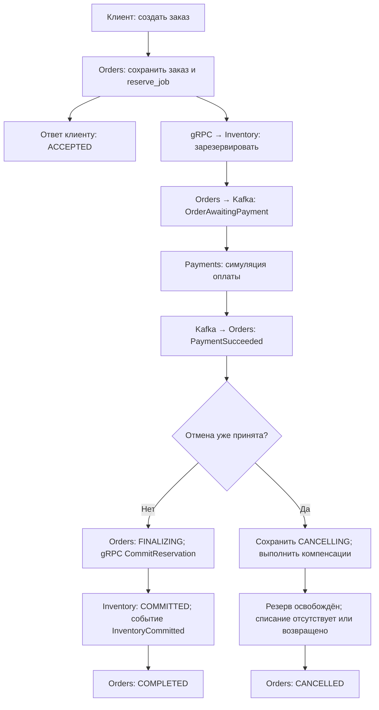
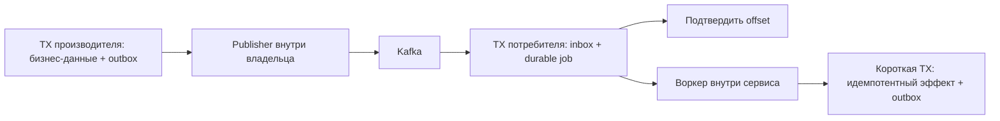

# G0: принятый архитектурный пакет

Статус: **G0 полностью принят владельцем проекта 2026-10-13, Europe/Moscow**. Прямое решение пользователя: «G0 полностью принят». Этот документ фиксирует принятую архитектуру из docs/ROADMAP.md и docs/architecture/PROCESSES.md. Выполнение — в [GitHub Issues](https://github.com/Includeoyasi/faultline-lab/issues) и PR.

## Визуальное описание G0

Подробные схемы находятся в [docs/architecture/PROCESSES.md](PROCESSES.md): последовательность успешного заказа и локальные транзакции, состояния трёх сущностей, недостаток товара, отказ оплаты, гонка отмены, поздняя оплата, outbox/inbox, неизвестный результат RPC, Redis и цикл эксперимента.

### Общий путь и владелец каждого шага

Схема показывает успешное резервирование и оплату. Недостаток товара и PaymentDeclined раскрыты отдельно в разделах 4–5 визуального описания. Ответ ACCEPTED выдаётся после commit в Orders, а дальнейшие шаги выполняются по сохранённым задачам.

### Состояния заказа и допустимая отмена

```mermaid
stateDiagram-v2
    [*] --> ACCEPTED
    ACCEPTED --> RESERVING
    RESERVING --> PAYMENT_PENDING: Резерв подтверждён
    RESERVING --> REJECTED: Товара недостаточно
    PAYMENT_PENDING --> FINALIZING: Оплата успешна; отмена не принята
    FINALIZING --> COMPLETED: Продажа и оплата подтверждены
    ACCEPTED --> CANCELLING: Отмена принята
    RESERVING --> CANCELLING: Отмена принята
    PAYMENT_PENDING --> CANCELLING: Отмена или отказ оплаты
    CANCELLING --> CANCELLED: Компенсации подтверждены
    REJECTED --> [*]
    COMPLETED --> [*]
    CANCELLED --> [*]
    note right of FINALIZING
        CancelOrder отклоняется.
        Сбой означает ожидание и восстановление.
    end note
```

Успешная оплата и отмена конкурируют за один переход версии Orders. Победа отмены означает компенсацию, победа финализации — доведение покупки до COMPLETED. Timeout сам по себе не создаёт терминальное состояние.

### Долговечность и очереди

Низкий Kafka lag означает продвижение доставки до сохранённых jobs. Чтобы увидеть реальную обработку, дополнительно измеряются очередь jobs и время завершения заказа. Отдельные crash windows показаны в разделе 8 визуального описания.

## Принятые решения

| Решение | Принятый вариант | Почему | Как проверяем |
|---|---|---|---|
| Бизнес-модель | Мини-магазин, один склад, одна валюта; заказ → резерв → симулированная оплата → завершение/отмена | Даёт конкуренцию за ресурсы, асинхронный процесс и измеримые бизнес-инварианты | Успех, нехватка товара, отказ и поздний результат оплаты |
| Три сервиса | Orders управляет процессом; Inventory владеет складом; Payments владеет платёжным ledger | У каждого изменения данных есть один владелец; управляющий процесс не требует четвёртого сервиса | Проверка прав БД и запрет чужих SQL-запросов |
| gRPC | Приём/чтение заказа; Reserve/Commit/Release; запрос статуса, отмена и возврат платежа | Непосредственный результат и явные ключи повторяемых операций | Повтор RPC, deadline после commit и сверка неизвестного результата |
| Kafka | Orders запускает оплату фактом OrderAwaitingPayment; Payments и Inventory публикуют результаты; Orders продолжает процесс | Можно отдельно менять производительность приёма и обработки, воспроизводить backlog и повторы | Consumer pause, повторная доставка, накопление durable jobs |
| Согласованность | Локальные SQL-транзакции плюс долговечный процесс в Orders; outbox/inbox в MVP | Сохранённый шаг восстанавливается после перезапуска, повтор события не создаёт второй эффект | Падения до/после publish и consumer commit |
| PostgreSQL | Один экземпляр, три базы и отдельные роли | Малый стартовый объём инфраструктуры при сохранении владения данными | Сервис не может читать чужую базу; измеряется общий ресурсный bottleneck |
| Redis | Кеш чтений Inventory, без авторитетных складских или платёжных записей | Даёт предмет эксперимента с hit rate, stale reads и fallback | Недоступность Redis и устаревшая доступность не позволяют продать лишний товар |
| Наблюдаемость | В MVP Prometheus, Grafana, Loki, Alloy; расширение трассировки на этапе 3 | Нужны как скорость приёма, так и завершения бизнеса, диагностика backlog и ошибок | Искусственная задержка видна в метриках/логах и вызывает ожидаемый сигнал |
| Среда | Локальный Docker Compose, закреплённые версии и manifest ресурсов | Воспроизводимый старт без обязательного отдельного кластера | Повтор прогонов из одной конфигурации |

## Принятые бизнес-правила

- CreateOrder подтверждает принятие только после сохранения заказа и задачи в PostgreSQL. Уход клиента не отменяет уже принятую работу.
- Ключ клиентского запроса неизменно определяет один заказ. Повтор с другим payload возвращает конфликт.
- Подтверждённый бизнес-отказ тоже сохраняется как результат операции. Повтор отказанного Reserve с тем же operation_id не создаёт новый резерв после изменения остатков.
- COMPLETED возможен только при успешной оплате ожидаемой суммы и подтверждённом COMMITTED резерве.
- Отмена клиентом разрешена до FINALIZING. Начало финализации и принятие отмены конкурируют за один переход версии Orders. После FINALIZING отмена отклоняется; заказ доводится до завершения.
- Если отмена победила, поздняя успешная оплата компенсируется возвратом и не запускает Commit. CANCELLED означает отсутствие активного резерва и невозвращённого списания.
- Release и Cancel сохраняют запрет поздней операции даже если исходный резерв или платёж ещё не был создан. Симулятор платежей перед фиксацией эффекта проверяет актуальное состояние.
- Независимого истечения резерва по TTL в MVP нет. Срок обработки и намерение отмены сохраняет Orders.
- Измерение незавершённых процессов обязательно. NEEDS_REVIEW, неизвестный исход и timeout не считаются успешным завершением.

Полные состояния, контракт событий, операции, crash windows и инварианты описаны в разделах 3–4 docs/ROADMAP.md. Эти правила особенно важны для ревью: они определяют поведение при гонках и границы будущих API.

## Граница MVP

Включены три Go-сервиса, отдельные базы, весь обязательный стек, сквозной успех/отказ, минимальные компенсации, идемпотентность, outbox/inbox, восстановление сохранённого шага, кеш чтений, базовые дашборды/логи, loadgen, verifier и первый ручной отчёт.

Для следующих этапов оставлены: полная трассировка и набор алертов, quarantine/replay, расширенный каталог отказов, несколько реплик, автоматическое сравнение и генерация отчётов. Kubernetes — отдельный предмет согласования, если появится эксперимент, который требует его возможностей.

Авторизация, доставка, скидки, полноценный магазинный UI и возврат доставленного товара находятся вне согласуемого MVP.

## Первый пакет реализации после G0

Цель — получить проверяемую основу проекта и затем первый работающий срез «создать заказ → атомарно зарезервировать товар».

Порядок небольших пакетов для код-ревью:

1. **P01 — первый PR после G0, до G1.** Три Go entrypoints, конфигурация, health, shutdown и JSON-логи; контейнерный toolchain, образы сервисов, минимальный Compose и Go CI. Дополнение среды согласовано после G0 для Windows/macOS; детали и статус — в [описании среды](../development/ENVIRONMENT.md).
2. **P02:** Compose для PostgreSQL/Kafka/Redis, отдельные БД/роли, миграции и seed. [Декомпозиция](../development/packets/P02.md) сохраняет инфраструктурный объём; актуальные задачи и приёмка находятся в GitHub.
3. **Inventory и его protobuf-контракт:** Reserve/Commit/Release/GetReservation/GetAvailability с operation keys, ledger, блокировками и cancellation barrier.
4. **Orders и его protobuf-контракт:** Create/Get/GetByRequestKey и долговечная задача, использующая уже проверенный Inventory.

Порядок Inventory → Orders уточнён владельцем в чате 20 октября 2026 года при пересмотре плана после аудита. Контракты вводятся вместе с соответствующим рабочим срезом; границы трёх сервисов и критерии G1 сохраняются.

Каждый пакет проходит своё код-ревью. После подготовки и принятия этой основы проводится отдельная приёмка контрольной точки G1; первый PR не называется G1 и не требует предварительного прохождения G1.

К G1 предъявляются код, точные команды запуска, результаты повторного запроса, конкурентной покупки ограниченного остатка и перезапуска на сохранённом шаге. Остальная часть сквозного процесса развивается после G1.

## Решение по G0 и последующие изменения

G0 принят полностью, без дополнительных условий в сообщении пользователя от 2026-10-13. Решение сохранено также в docs/adr/0001-approved-g0.md и PROJECT_CONTEXT.md. Следующая контрольная точка — G1 после подготовки основы заказа и склада.

Существенные изменения принятой архитектуры по-прежнему согласуются с владельцем проекта отдельно. Обычные детали реализации внутри G0 выбираются самостоятельно и предъявляются в небольших пакетах для код-ревью. Принятие архитектуры не означает, что реализация, испытания или следующие контрольные точки уже завершены.

После G0 подтверждено направление развития общей лаборатории с адаптерами: [детализация границы](LAB_BOUNDARY.md). Три сервиса и их бизнес-правила сохраняются; второй бизнес и расширение приёмки пока находятся на стадии предложения.
