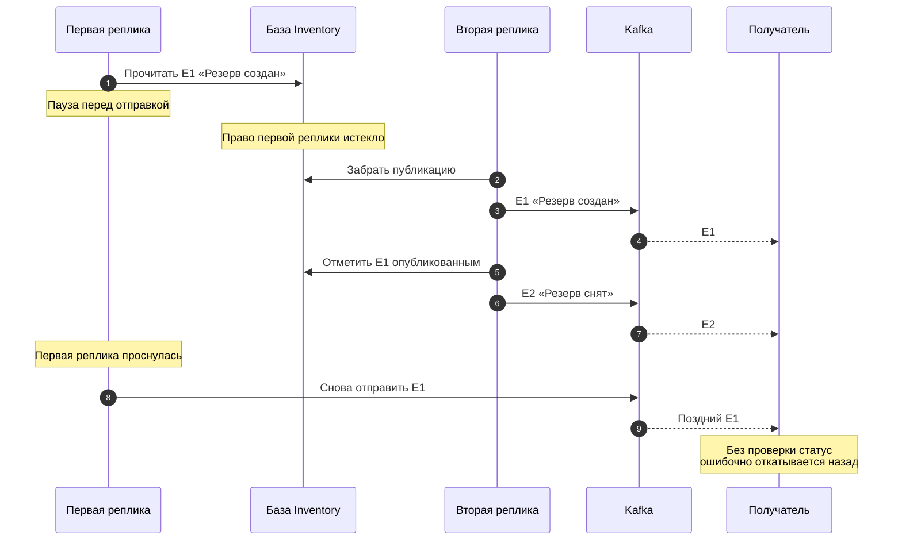
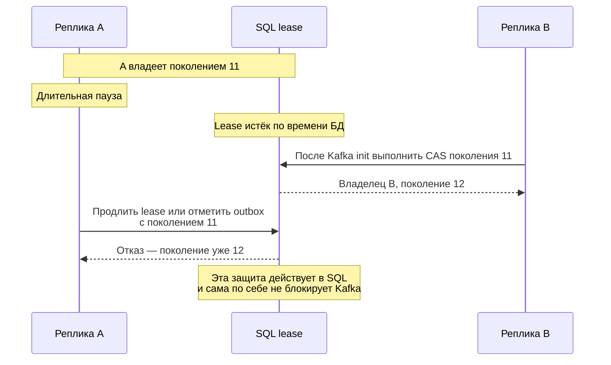
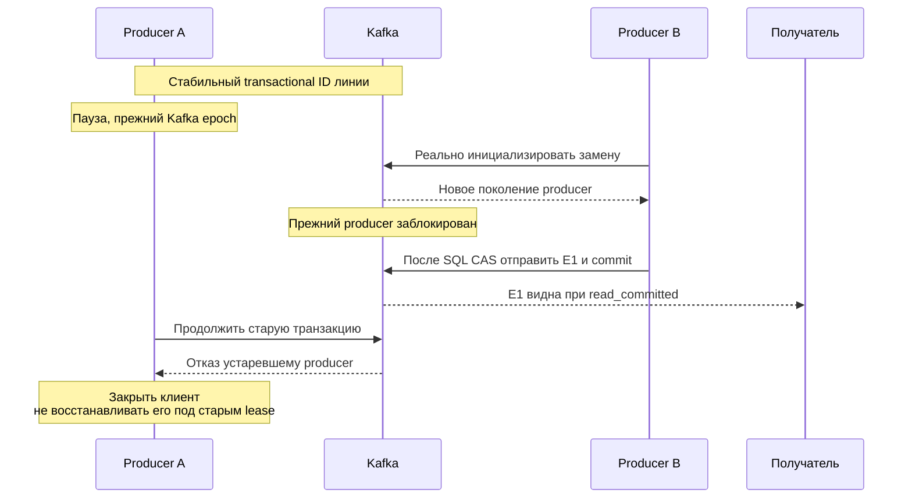
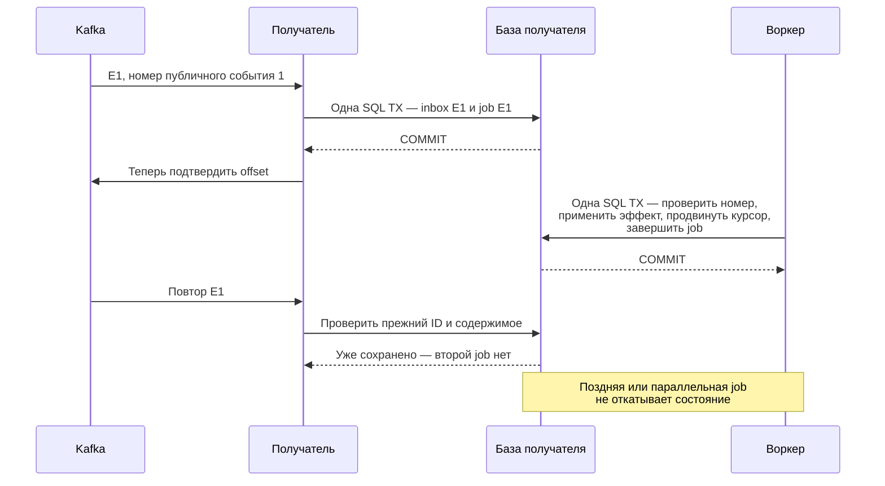
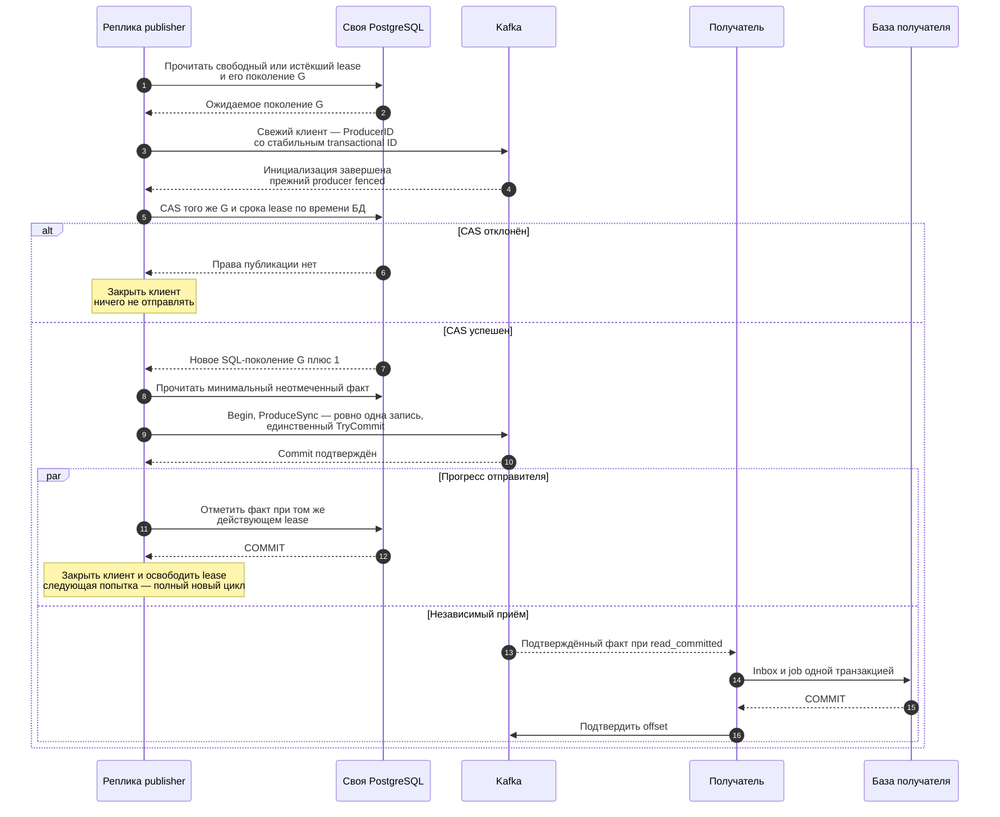

# F09: надёжная публикация событий в Kafka

**Материал для архитектурного решения · 10 ноября 2026 года · предложение.** Основа кода — принятый [Orders PR #29](https://github.com/Includeoyasi/faultline-lab/pull/29), commit `c0fb069ef100698b33b14e05398e4cada42670fb`. Документ задаёт предлагаемый контракт отдельного PR F09 и критерии его проверки.

## 1. Проблема и случаи для проверки

Orders и Inventory уже атомарно сохраняют бизнес-изменение и локальный outbox в своей PostgreSQL-базе, но ещё не публикуют эти факты в Kafka. Если первая реплика зависла перед отправкой, вторая может продолжить работу, после чего первая проснётся со старым событием. Без защиты получатель увидит «резерв создан → резерв снят → резерв создан» и при наивном применении вернёт состояние назад. Нужны сохранение порядка публичных событий и один бизнес-эффект при повторной доставке. Отдельная проблема текущего Orders — его первый публичный факт имеет бизнес-версию 3, поэтому разность бизнес-версий сама по себе не доказывает потерю события.

### Аномалия без защиты

| Случай | Как локализовать | Корректный итог |
|---|---|---|
| Старая реплика проснулась после передачи работы | Остановить A перед produce, дать B опубликовать E1/E2, возобновить A | Поздняя A не завершает старую публикацию |
| Kafka сохранила E1, SQL-отметка потеряна | Прервать отправителя между Kafka commit и отметкой outbox | Допустимо E1, E1, E2, один эффект E1 |
| Получатель упал после сохранения работы | Прервать между inbox/job commit и offset commit | Повтор доставки не создаёт вторую job |
| Orders впервые публикует бизнес-версию 3 | Создать новый заказ и завершить резервирование | Это первое публичное событие, а не потеря двух предыдущих |

## 2. Паттерны и возможные решения

Основа — [Transactional Outbox](https://microservices.io/patterns/data/transactional-outbox.html): намерение отправить событие сохраняется вместе с бизнес-изменением. SQL lease выбирает владельца работы на ограниченный срок, а поколение защищает последующие записи этого владельца в базе. [Producer fencing Kafka](https://kafka.apache.org/43/javadoc/org/apache/kafka/common/errors/ProducerFencedException.html) блокирует прежнего отправителя при инициализации замены с тем же transactional ID. [Идемпотентный получатель](https://microservices.io/patterns/communication-style/idempotent-consumer.html) сохраняет идентификатор события и работу одной транзакцией, затем применяет работу с проверкой порядка. Эти механизмы закрывают разные окна сбоя, поэтому одна проверка lease или одна producer idempotence недостаточна. Их конкретная связка SQL и Kafka в этом документе — проектное решение для Faultline Lab, которое ещё требует реализации и отказных проверок.

### Механизм A — SQL lease и поколение

### Механизм B — Kafka fencing

### Механизм C — inbox и сохранённая работа

| Вариант | За | Против | Оценка |
|---|---|---|---|
| Только SQL lease перед produce | Мало кода | Пауза после проверки оставляет старую отправку возможной | Не обеспечивает требуемый порядок |
| Только защита получателя | Бизнес-эффект можно сделать идемпотентным | Порядок самого журнала при takeover не обеспечен | Более слабая гарантия |
| Один отправитель без автоматического takeover | Простой протокол | Восстановление требует гарантированно остановить прежний процесс | Резервный вариант с простоем |
| Lease + Kafka fencing + inbox | Автоматическая смена реплики и проверяемый порядок | Больше обращений, возможны лишние fencing | Рекомендуемый MVP |
| CDC через отдельный connector | Публикация из журнала БД | Новая инфраструктура и собственный протокол эксплуатации | Отдельный вариант расширения |

## 3. Рекомендуемое решение и его цена

Рекомендую сохранить строгий порядок публичных фактов одного агрегата и добавить отдельный непрерывный `stream_sequence`, сохранив `aggregate_version` как бизнес-ревизию. Номер выделяется транзакционным изменением строки счётчика вместе с новым outbox-фактом, поскольку PostgreSQL [nextval не откатывается вместе с транзакцией](https://www.postgresql.org/docs/18/functions-sequence.html). Для первого PR предлагаю одну фиксированную линию публикации на сервис и ровно одну Kafka-запись, одну транзакцию и свежий клиент на каждую SQL-активацию. Клиент имеет пути автоматического восстановления producer ID, поэтому его повторное использование нельзя считать доказанно совместимым с выбранной SQL-активацией. По проверенным исходникам franz-go выбранное ограничение исключает найденные пути такого восстановления, но этот вывод ещё должен пройти тест трассы запросов и реального takeover. Следующий факт потока ждёт Kafka commit и SQL-отметку предыдущего, а после любой ошибки клиент закрывается и начинается полный новый цикл активации. Цена — инициализация producer и SQL CAS на каждый факт, а также возможный простой из-за конкурента, который успел заблокировать producer и проиграл CAS. Полный журнал растёт до удаления изолированного набора, поэтому адресная очистка тестовых данных входит в приёмку. Эти накладные расходы пока не измерены, поэтому ускорение через batching предлагается рассматривать после доказательства базовой корректности.

### Два счётчика с разным смыслом

| Изменение Orders | aggregate_version — ревизия заказа | stream_sequence — публичный факт |
|---|---|---|
| ACCEPTED | 1 | События нет |
| RESERVING | 2 | События нет |
| PAYMENT_PENDING / OrderAwaitingPayment | 3 | 1 |
| Следующий будущий публичный факт после внутренних переходов | Например 6 | 2 |
| Повтор первого факта | Прежняя 3 | Прежний 1 и прежний event_id |

### Совместная работа — одна попытка публикации

Технический контракт: идентификаторы, клиент, получатель и хранение

| Граница протокола | Предложенное правило |
|---|---|
| Поток и партиция | Dataset + владелец + тип агрегата + ID, Kafka key = order_id, три партиции на топик как в G0, их число фиксировано на жизнь набора |
| Линия и идентификаторы | Одна линия на сервис обслуживает его партиции, transactional ID = dataset + сервис + линия, без PID, случайной попытки или номера lease |
| SQL и Kafka поколения | Разные счётчики, SQL CAS сравнивает именно G, прочитанное до broker init, после отказа CAS прежний клиент не используется |
| Повтор после неизвестного commit или потерянной SQL-отметки | Отправить тот же event_id/sequence/payload через новую активацию, следующий номер этого потока пока ждёт |
| Ошибка клиента | После ошибки produce/commit или потери lease — Close, без нового Begin, повторного End, TryAbort-recovery либо другой produce на этом клиенте |
| Приём и применение | Inbox/job до offset commit, курсор и эффект job атомарны, сериализация по потоку, прогресс offset только по непрерывно сохранённым записям |
| Необходимые и нецелевые события | Все известные факты потока учитываются в порядке, нецелевой тип получает сохранённую no-op job, неизвестный контракт блокирует применение с диагностикой |
| Bootstrap и история | Пустой получатель начинает с sequence 1 и полного журнала, произвольный первый номер не становится базой, пропуск или обрезанная история остаются диагностируемой незавершённой работой |
| Изоляция и хранение | Dataset в envelope, consumer group и transactional ID, проверка активного dataset, отдельный Compose/Kafka на набор в MVP, без TTL защитных записей |
| Топики первого PR | orders.events.v1 и inventory.events.v1, cleanup.policy=delete и retention.ms/retention.bytes=-1 на этих тестовых топиках до удаления набора, существующий общий smoke-профиль не меняется |
| Граница атомарности | Общей транзакции PostgreSQL–Kafka нет, дубли допустимы, потеря диска единственного брокера и восстановление обрезанной истории не входят в гарантию |

## 4. План реализации отдельного PR F09

Первый PR должен связать реальные outbox Orders и Inventory с Kafka и проверить получателя в изолированной тестовой SQL-схеме. Тестовый получатель относится к лаборатории и не добавляет четвёртый бизнес-сервис или платёжное поведение. Новые миграции расширят текущие схемы без изменения старых миграций, а backfill сохранит идентификаторы и содержимое уже записанных фактов. Проверки клиента на трассе запросов выполняются до подключения основного publisher, чтобы найденный автоматический re-init не оказался скрытым свойством готового решения. Итог предъявляется через один отдельный PR с фактическими результатами native AMD64/ARM64 и явно перечисленными границами проверки.

| Шаг | Конкретный результат |
|---|---|
| 1 — Контракт и миграции | Envelope со stream_sequence и dataset, счётчик потока, lease и SQL-отметки, уникальность ID/номера, backfill всех прежних outbox по order_id и aggregate_version при остановленных writers |
| 2 — Ограниченный Kafka-адаптер | Закреплённые franz-go v1.22.2 / Kafka 4.3.1, один факт на свежий клиент и активацию, ограниченные сроки, Close при ошибках, backoff/jitter и остановка без утечки ресурсов |
| 3 — Публикация и тестовый приём | Оба сервиса отправляют свои факты, отдельная тестовая роль сохраняет inbox/jobs/projection, чтение read_committed и проверка потока |
| 4 — Отказные проверки и доказательства | Управляемые барьеры остановки двух процессов, трасса Kafka API, SQL-поколения, видимый журнал, число эффектов, отчёты и адресная очистка |
| Следующие пакеты | Payments и его consumer, бизнес-финализация/F11, CancelOrder, полный reset/F10 и эксперименты остаются в своих пакетах |

Полная матрица приёмки: отказы, порядок и восстановление

| Критерий приёмки | Проверяемый результат |
|---|---|
| Первая запись Orders и внутренний переход без факта | Aggregate version 3 / sequence 1, следующий публичный номер 2, ложного пропуска нет |
| Откат и конкурентная запись бизнес-фактов | Откат не расходует номер, повторы не создают новый факт, committed sequence непрерывен и уникален |
| A приостановлена до produce, B сменила владельца, A возобновлена | A не добавляет поздний committed факт после более нового номера B |
| A приостановлена после produce или при неизвестном commit | Незавершённое не видно при read_committed, возможный состоявшийся commit восстанавливается повтором того же факта |
| Commit E1 без SQL-отметки при готовом E2 | Видим E1, E1, E2 и один эффект каждого номера |
| Запоздалые broker init и SQL CAS | Отказ CAS запрещает отправку, прежний клиент не переиспользуется, лишний fencing диагностируется |
| Клиент получил timeout/fencing/ошибку PID или LogStartOffset | После успешного CAS в трассе одной попытки нет нового InitProducerID, расширять lifecycle до выполнения этого критерия запрещено |
| Crash до offset commit и до/после применения job | Нет второй job, частичного эффекта или отката курсора |
| Нецелевой известный тип, неверный ID/payload/номер, чужой dataset | No-op продвигает законный номер, конфликт и пропуск сохраняют диагностику, чужой набор не меняется |
| Пустой consumer и обрезанная история | Полный журнал начинается с 1, недоступная голова не принимается за корректную базу |
| Работа при Kafka/SQL outage и остановке процесса | Неподтверждённые факты сохранены, попытки и ресурсы ограничены, после восстановления сохраняются порядок и один эффект |

## 5. Решения владельца и отдельные акценты

Предлагаю принять три решения ниже одним архитектурным согласованием F09. Рекомендация ориентирована на проверяемый первый срез, поэтому производительность этого ограничения должна оцениваться последующим измерением. Возможность исправить пробел добавлением stream_sequence и ограниченный lifecycle клиента обоснованы текущими схемами и исходниками, но это ещё не runtime-доказательство. Сверены код после merge Orders, первичные источники механизмов и пути recovery franz-go, а пять схем отрисованы Mermaid и проверены визуально. Приёмка G1, уже согласованные G0/F03/F11 и последующая реализация F09 остаются разными решениями.

| Решение | Рекомендация к принятию | Цена или альтернатива |
|---|---|---|
| D1 — Как выполнить гарантию порядка при смене реплик | SQL lease + Kafka fencing + inbox/job по указанному протоколу | Конкурент может временно остановить исправного publisher, нужен backoff и диагностика |
| D2 — Как отличать пропуск события от внутреннего перехода | Добавить stream_sequence, сохранив aggregate_version | Дополнительный транзакционный счётчик и backfill, альтернатива — цепочка previous_event_id |
| D3 — Граница первого PR | Один факт / одна Kafka TX / свежий клиент / полная активация, оба outbox и тестовый получатель | Больше сетевых и SQL-обращений на факт, журнал растёт до удаления dataset, адресная очистка тестов обязательна, batching — отдельная оптимизация |

**Формулировка решения:** «Согласованы D1–D3» либо конкретные изменения к указанному пункту.

Первичные источники и основание предложения

| Основание | Что в нём проверяется |
|---|---|
| [Orders](../development/ORDERS.md), [его outbox](../../migrations/orders/0002_reservations.sql), [Resolve](../../internal/orders/store/resolve.go) и [Inventory outbox](../../migrations/inventory/0003_reservations.sql) | Существующие факты, бизнес-версии, атомарность и границы текущей реализации |
| [Принятый G0](DESIGN.md), [Roadmap](../ROADMAP.md), [аудит F09](https://github.com/Includeoyasi/faultline-lab/issues/20) | Три сервиса, три партиции, один активный publisher на сервис, отдельный PR |
| [Outbox](https://microservices.io/patterns/data/transactional-outbox.html) и [Idempotent Consumer](https://microservices.io/patterns/communication-style/idempotent-consumer.html) | Общепринятые паттерны, повтор между Kafka commit и SQL-отметкой |
| [Kafka producer](https://kafka.apache.org/43/javadoc/org/apache/kafka/clients/producer/KafkaProducer.html) и [fencing](https://kafka.apache.org/43/javadoc/org/apache/kafka/common/errors/ProducerFencedException.html) | Стабильный transactional ID, замена producer и изоляция подтверждённых транзакций |
| [franz-go v1.22.2 txn.go](https://github.com/twmb/franz-go/blob/v1.22.2/pkg/kgo/txn.go) | Recovery в BeginTransaction, повторный TryAbort после неизвестного EndTxn, запрет повторных вызовов под старым lease |
| [franz-go sink.go](https://github.com/twmb/franz-go/blob/v1.22.2/pkg/kgo/sink.go) и [metadata.go](https://github.com/twmb/franz-go/blob/v1.22.2/pkg/kgo/metadata.go) | Внутренний reload PID при LogStartOffset и ранее подтверждённом batch, начальный lastAckedOffset=-1 у нового клиента |
| [franz-go client.go](https://github.com/twmb/franz-go/blob/v1.22.2/pkg/kgo/client.go) и [producer.go](https://github.com/twmb/franz-go/blob/v1.22.2/pkg/kgo/producer.go) | Согласование TV1/TV2 и реальный ProducerID init, искусственный MaxVersions cap не используется |
| [PostgreSQL sequence](https://www.postgresql.org/docs/18/functions-sequence.html) | Почему nextval не подходит для непрерывного номера committed событий |

