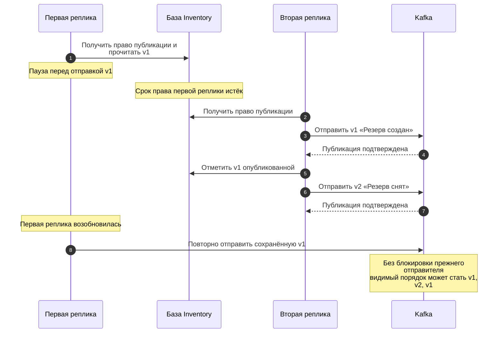
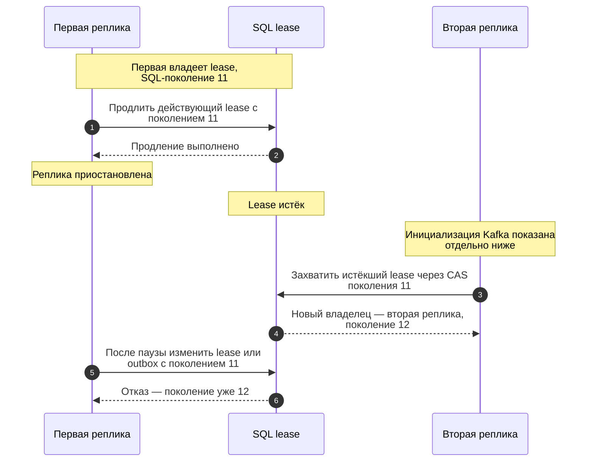
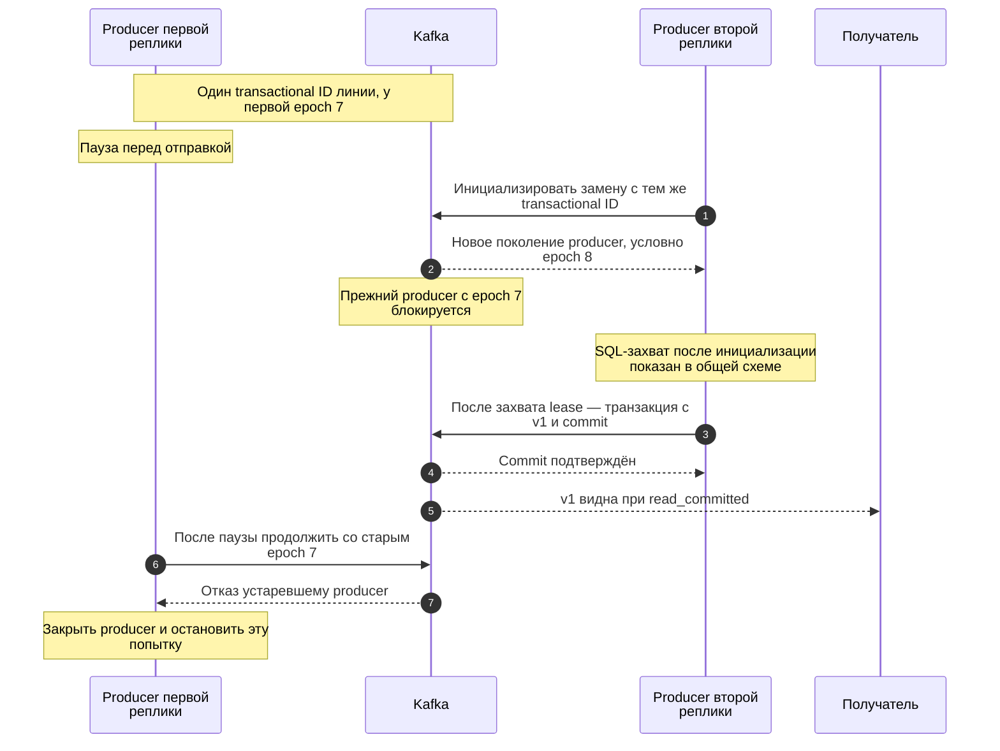
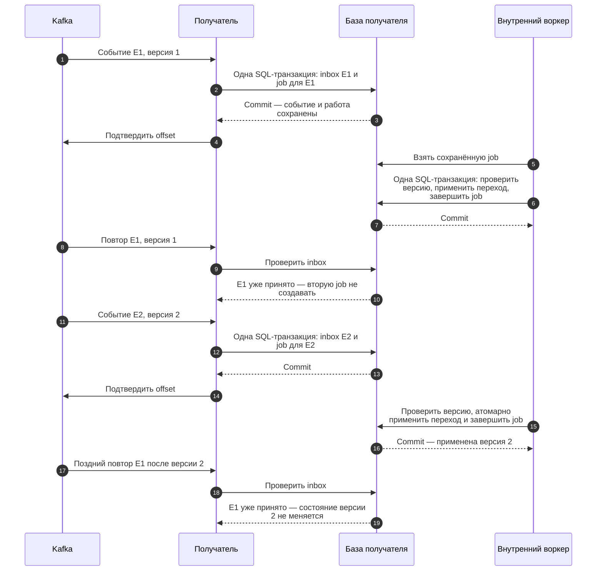
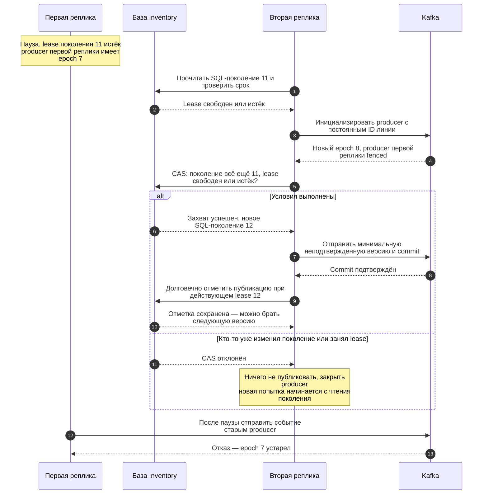
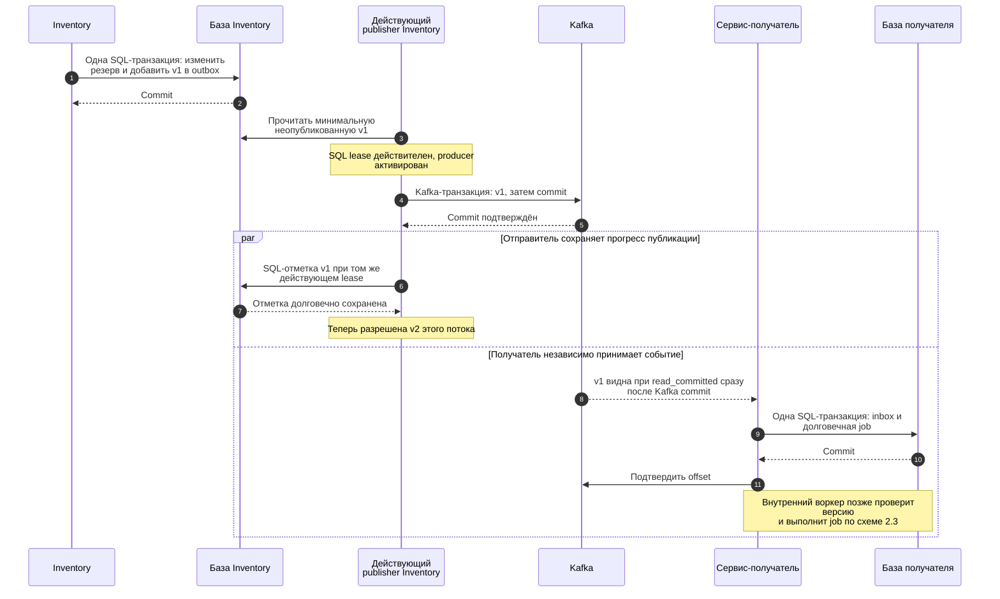
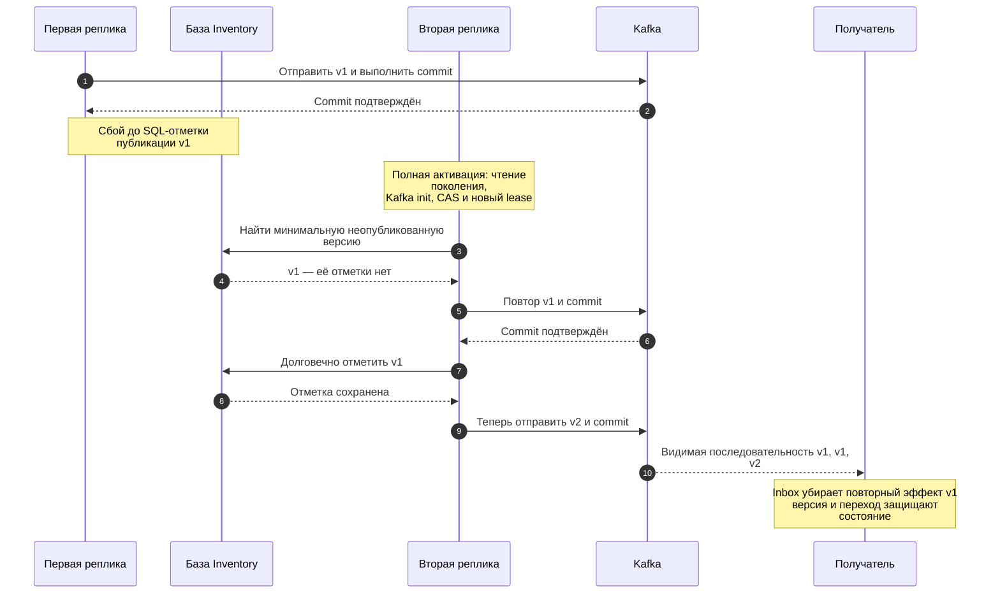

# Публикация событий в Kafka: смена реплик, повторы и порядок

**Проектное предложение для ревью.** Документ относится к F09 из [аудита](https://github.com/Includeoyasi/faultline-lab/issues/20) и [задаче Kafka/Redis](https://github.com/Includeoyasi/faultline-lab/issues/16). Описанные outbox, владение публикацией и обработчик событий ещё не реализованы. Текущий инфраструктурный smoke проверяет запись, чтение и штатный restart; он не доказывает предложенный протокол.

Маршрут чтения: [проблема](#problem) → [три механизма](#mechanisms) → [совместная работа](#together) → [цена и альтернативы](#tradeoffs) → [проверки для принятия](#review).

## 1. Проблема: первая реплика проснулась после передачи работы второй

Возьмём Inventory. Две реплики **одного сервиса** используют его базу и отправляют события резерва в Kafka. В базе уже сохранены два события одного резерва: **v1 «Резерв создан»** и **v2 «Резерв снят»**. Это версии изменений бизнес-объекта, а не версии приложения.

Ниже намеренно убраны защиты, чтобы показать сбой. Отправитель событий называется **publisher**; его клиент Kafka — **producer**.

**Аномалия:** если получатель без проверки применяет последнее прочитанное событие, снятый резерв снова выглядит созданным. Kafka не переставляла сообщения: первая реплика **заново опубликовала старое**. Это модель риска для будущего outbox, а не обнаруженный сбой работающего бизнеса.

Нам нужны две гарантии: прежний отправитель не продолжает публикацию после смены владельца, а повторная доставка не меняет бизнес-данные второй раз.

## 2. Три механизма и их ответственность

| Механизм | На какой вопрос отвечает | Где действует |
| :--- | :--- | :--- |
| **SQL lease с поколением** — временное право работы | Какая реплика сейчас владеет публикацией? | В базе сервиса-отправителя |
| **Kafka producer fencing** — блокировка устаревшего отправителя | Можно ли прежнему producer продолжать после смены? | В Kafka |
| **Идемпотентный consumer: inbox, версия, допустимый переход** | Как применить событие без повторного или устаревшего эффекта? | В базе сервиса-получателя |

Общая предпосылка — **Transactional Outbox**: изменение резерва и запись события сохраняются **одной транзакцией PostgreSQL Inventory**. Publisher отправляет сохранённое событие позже. Так бизнес-изменение не остаётся без записи о необходимости публикации. Общей транзакции PostgreSQL–Kafka здесь нет.

### 2.1. SQL lease: выбрать владельца работы

В строке lease хранятся владелец, срок и монотонное **SQL-поколение**. Реплика получает право на ограниченный срок и продлевает его, пока работает. Получение права проверяет поколение и срок по времени PostgreSQL.

**CAS** (compare-and-swap) здесь означает: «измени строку, только если её поколение всё ещё равно ожидаемому». Захват новым владельцем увеличивает поколение; продление, освобождение и отметка outbox проверяют его. Для работы необходимо также действующее право по сроку.

**Что защищено:** первая реплика не может продлить старое право, снять право второй или поставить SQL-отметку от имени прежнего владельца.

**Чего недостаточно:** проверка SQL lease перед отправкой не блокирует Kafka. Реплика может зависнуть **между проверкой и отправкой**, а брокер не читает таблицу lease. Нужна защита на стороне самого брокера. Эта схема показывает только SQL-часть; полный порядок получения права — в [разделе 3.1](#activation).

### 2.2. Kafka fencing: запретить устаревшему producer продолжать

Для одной **линии публикации** обе реплики при смене используют один стабильный `transactional.id`. Линия — фиксированный набор потоков событий сервиса, закреплённый за партицией. У разных линий разные ID.

Kafka различает поколения producer (**producer epoch**). При инициализации замены с тем же transactional ID предыдущий producer становится устаревшим. Числа в примере условны: **SQL-поколение 11/12 и Kafka epoch 7/8 — разные счётчики**, они не передаются друг другу как один общий токен.

**Что защищено:** прежний producer не может успешно продолжить публикацию своей транзакции после fencing. Если его записи успели попасть в незавершённую транзакцию, получатель с `read_committed` их не применяет.

**Что остаётся:** событие, **уже закоммиченное** до смены реплики, не исчезает. Другая реплика может повторить его при потере SQL-отметки. Идемпотентность самого producer не устраняет такую повторную отправку из приложения.

Fencing — механизм Kafka, а не новый тип бизнес-события. Получатели читают только подтверждённые транзакции (`read_committed`). Заблокированный producer нельзя автоматически пересоздать и продолжить работу под прежним SQL-поколением.

### 2.3. Идемпотентный consumer: не применить событие дважды

В принятой [архитектуре](DESIGN.md) приём события отделён от выполнения работы. Получатель одной SQL-транзакцией сохраняет **inbox** — учёт принятых event ID — и **долговечную задачу (job)**. После commit можно подтвердить offset. Внутренний воркер сервиса выполняет сохранённую работу, проверяя версию и допустимый переход.

Inbox защищается уникальностью event ID в области обработчика; повтор с тем же содержимым не создаёт вторую job. Воркер хранит последнюю применённую версию **каждого входящего потока** и защищает проверку, изменение состояния, продвижение версии и завершение job одной SQL-транзакцией от конкурирующих воркеров. Версии разных владельцев не сравниваются как один общий счётчик.

| Входящее событие или сохранённая job | Действие |
| :--- | :--- |
| Уже принятый event ID с тем же содержимым | Не создавать вторую job |
| Тот же event ID, но другое содержимое | Диагностировать конфликт, не применять как новое |
| Job со следующей ожидаемой версией, допустимый переход | Применить атомарно с продвижением версии и завершением job |
| Устаревшая версия с неизвестным ID или недопустимый переход | Не откатывать состояние; диагностировать нарушение контракта |
| Job версии 3, когда применена только версия 1 | Не применять молча; дождаться/восстановить пропуск по контракту |

Crash после inbox/job commit, но до offset commit даёт повтор без второй job. Crash воркера до его SQL commit не оставляет частично применённого изменения. Внешний RPC или платёж этой транзакцией не охватывается: для него нужны идемпотентная операция и отдельное восстановление неизвестного результата.

При пропуске версии событие не теряется: оно остаётся в долговечной job с явным ожиданием/диагностикой. Альтернативный путь обработки не может подтверждать offset до надёжного сохранения работы. Защитные записи живут вместе с изолированным набором экспериментальных данных; их согласованная очистка не допускает старых сообщений в новый запуск.

## 3. Как механизмы работают вместе

### 3.1. Передача публикации второй реплике

Именно здесь связываются SQL lease и Kafka fencing. **Порядок — часть предложенного протокола:** прочитать SQL-поколение → инициализировать producer в Kafka → захватить lease через CAS **того же прочитанного поколения**.

Если при первоначальном чтении lease занят, кандидат ждёт, не инициализируя producer. При получении права проверяется **время PostgreSQL**. После неудачного CAS нельзя перечитать поколение и использовать уже инициализированный producer. После fencing, потери lease или неизвестного commit попытка останавливается; новая требует полного цикла активации. Старое освобождение не может снять lease нового владельца.

**Почему нельзя сократить до «инициализация → захват»:**

| Шаг | Гонка без чтения поколения до инициализации |
| :--- | :--- |
| 1 | Вторая реплика получает Kafka epoch 7 и замирает до SQL-захвата |
| 2 | Первая получает epoch 8 и SQL lease поколения 11 |
| 3 | Lease первой истекает; вторая просыпается и получает поколение 12 со своим старым epoch 7 |
| Итог | Producer первой с epoch 8 не заблокирован этой передачей права |

При полном протоколе первая меняет SQL-поколение после старого чтения второй. Поэтому CAS второй отклоняется; получить новое право с прежней инициализацией она не сможет. Задержавшаяся broker-инициализация всё ещё может помешать действующему producer, но не даёт права публиковать без успешного CAS.

### 3.2. От бизнес-изменения до одного эффекта у получателя

Каждый сервис обращается к **своей** базе. Прямого доступа получателя к базе Inventory нет. Стрелки ниже показывают порядок операций внутри ветвей. После Kafka commit SQL-отметка отправителя и приём события получателем идут независимо — общей транзакции между ними нет.

**Граница порядка:** поток — события одного агрегата одного владельца, например одного резерва Inventory. Stream key включает сервис-владельца, тип и ID агрегата; все события потока идут в одну партицию одного топика. Общего порядка между разными агрегатами, топиками или версиями Orders и Inventory нет.

Publisher берёт **не более одной неподтверждённой версии каждого потока в Kafka-транзакцию**. Разные потоки можно объединять в batch. Следующая версия одного потока ждёт и подтверждённого Kafka commit, и долговечной SQL-отметки предыдущей. При неизвестном результате записи отметки сначала перечитывается её состояние. Число партиций не меняется незаметно во время эксперимента: для изменения нужен отдельный порядок переноса потоков.

### 3.3. Почему повтор остаётся даже с fencing

Если отправить v1 и v2 вместе, а SQL-отметки потерять, повтор batch даст **v1, v2, v1, v2**. Ограничение одной версии на поток сохраняет последовательность **v1, v1, v2**. Таймаут Kafka commit означает неизвестный исход, а не доказанный abort; восстановление учитывает возможный уже состоявшийся commit.

## 4. Почему предложено это сочетание и какова его цена

Lease выбирает владельца в PostgreSQL, fencing исполняет запрет в Kafka, inbox и версия защищают данные получателя. По отдельности они закрывают разные окна сбоя. **Связка чтения поколения, Kafka init и SQL CAS — наше проектное предложение**, а не готовый стандартный рецепт и не уже принятое решение владельца.

| Упрощение | Что оно оставляет открытым |
| :--- | :--- |
| Проверять только lease перед отправкой | Пауза после проверки позволяет прежней реплике отправить позже |
| Включить только идемпотентность producer | Повтор из outbox после рестарта и SQL-владение не покрываются |
| Оставить только inbox и проверку версий | Получатель может защитить бизнес-данные, но строгого порядка публикации при смене реплик это не даёт |
| Один publisher без автоматической смены | Убирает автоматическую гонку передачи, но требует гарантированно остановить прежний процесс и принять простой на восстановление |

**Цена по доступности:** конкурент с тем же transactional ID может заблокировать действующего producer **до своего неудачного SQL CAS**. Сам он публиковать не будет, но действующий владелец будет вынужден восстановиться. Нужны backoff с jitter, диагностика лишних fencing и отсутствие непрерывного цикла переинициализаций.

**Цена по скорости:** один поток ждёт двух последовательных подтверждений — Kafka и SQL. Это может ограничить скорость публикации этого потока; величина не измерена. Batch разных потоков сохраняется. Увеличение числа worker не означает увеличение числа конкурентов за одну линию.

Гарантия exactly-once между PostgreSQL и Kafka **не заявляется**. Выбор сочетания ещё нужно подтвердить проверками и ревью, отдельно оценив необходимость строгого порядка публикации и допустимый простой.

## 5. Что проверить до принятия и реализации

### Контракт Go-клиента

В инфраструктурной пробе используется **franz-go v1.22.2**. При реализации outbox требуется проверить поведение именно этого клиента, а не переносить пример Java API буквально:

- Постоянный `transactional.id` составляется из изолированного набора данных, сервиса и линии; не содержит случайный ID процесса, PID или номер попытки. SQL-поколение не сбрасывается и не переиспользуется за жизнь набора данных.
- До SQL CAS должна состояться реальная broker-инициализация. В franz-go требуется `ProducerID(ctx)`; одних `NewClient` и `BeginTransaction` недостаточно.
- Все результаты produce проверяются до commit; успешный commit не должен скрывать ошибку части записей.
- Устаревший producer не восстанавливает epoch автоматически под прежним SQL lease, включая внутренние пути библиотеки. В 1.22.2 это зависит от transaction protocol и типа ошибки; общий retry вокруг `BeginTransaction` не подходит.
- При потере lease, fencing или неизвестном commit работа прекращается с ограниченными сроками и закрытием producer. Одна линия обслуживается последовательно.
- Получатели используют `read_committed`. Текущая одноразовая нетранзакционная проба включает `AllowIdempotentProduceCancellation`; эта опция несовместима с transactional ID и не переносится в outbox.

### Будущие сценарии проверки

| Точка остановки первой реплики | Что делает вторая | Что требуется доказать |
| :--- | :--- | :--- |
| После lease, до produce | Полная активация и публикация | Прежний producer fenced; старое SQL-поколение не разрешает отметку или переинициализацию |
| После produce, до commit | Полная активация и публикация | Незавершённая транзакция первой не видна при `read_committed` |
| После commit v1, до SQL-отметки; v2 уже есть | Повтор минимальной версии, отметка, затем v2 | Видимый порядок v1, v1, v2; бизнес-эффект v1 один |
| До первой broker-инициализации | Успевает активироваться | Поздняя инициализация первой может помешать второй, но старый CAS не даёт захватить право; восстановление ограничено и наблюдаемо |
| После init, до CAS; SQL-поколение за паузу сменилось | Получает и затем теряет lease | CAS первой отклоняется даже после истечения нового lease; producer не переиспользуется |
| После fencing, при retry/recreate | Уже владеет новой попыткой | Первая не возобновляет публикацию под прежним SQL-поколением |
| После inbox/job commit, до offset commit | Повторно доставляет событие | Inbox и job сохранены атомарно; повтор не создаёт вторую job |
| Воркер получателя остановлен до/после SQL commit | Другой воркер возобновляет job | Переход, версия и завершение job атомарны; повторного бизнес-эффекта нет |
| Пропуск версии или устаревшее событие с неизвестным ID | Продолжает доставку | Нет молчаливого пропуска/отката состояния; сохранён путь восстановления или диагностики |

Тесты должны останавливаться на явных барьерах и сохранять SQL-поколения, Kafka epochs и видимые записи. Также нужны потеря ACK/commit, истечение lease, отмена и рестарт coordinator. Обычный успешный restart этого не доказывает. F09 остаётся открытой до реализации и проверки.

Для ревью достаточно пройти схемы и оценить три вопроса: нужен ли выбранный строгий порядок публикации; приемлема ли цена смены владельца по доступности; достаточен ли набор проверок для защиты от поздней первой реплики. Согласование предложения, реализация и доказательства проверок фиксируются отдельно.

## Источники механизмов

- [Apache Kafka: KafkaProducer API](https://kafka.apache.org/43/javadoc/org/apache/kafka/clients/producer/KafkaProducer.html) и [ProducerFencedException](https://kafka.apache.org/43/javadoc/org/apache/kafka/common/errors/ProducerFencedException.html) — транзакционный producer и блокировка прежнего producer с тем же transactional ID.
- [Martin Kleppmann: How to do distributed locking](https://martin.kleppmann.com/2016/02/08/how-to-do-distributed-locking.html) — сценарий паузы дольше lease и принцип проверки fencing на стороне защищаемого ресурса. Это объясняет общий приём, но не доказывает нашу связку SQL и Kafka.
- [Transactional Outbox](https://microservices.io/patterns/data/transactional-outbox.html) и [Idempotent Consumer](https://microservices.io/patterns/communication-style/idempotent-consumer.html) — описания паттернов автором каталога Chris Richardson.
- [franz-go v1.22.2](https://github.com/twmb/franz-go/releases/tag/v1.22.2), [transaction API и восстановление](https://github.com/twmb/franz-go/blob/v1.22.2/pkg/kgo/txn.go), [ProducerID](https://github.com/twmb/franz-go/blob/v1.22.2/pkg/kgo/producer.go) — исходники выбранного Go-клиента для будущей проверки протокола.
