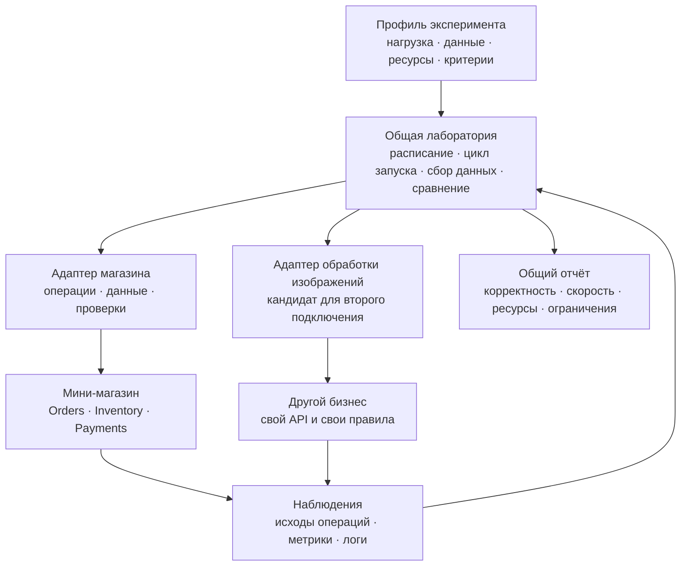

# Лаборатория и подключаемые бизнес-системы

Статус на 13 октября 2026 года: **направление подтверждено владельцем проекта; ниже — детализация для ревью**. Реализации интерфейсов и второго подключения пока нет. Документ сохраняет обсуждение, чтобы следующий исполнитель мог продолжить проектирование по готовой основе.

## Что уже согласовано

Лаборатория должна подключаться к разным бизнес-системам. Эталонный мини-магазин использует ту же границу через встроенный, заранее настроенный адаптер. Владелец проекта подтвердил этот подход в голосовом обсуждении и поручил его зафиксировать.

Принятые правила [G0](DESIGN.md) сохраняются: у магазина ровно три бизнес-сервиса — Orders, Inventory и Payments. Другой бизнес будет отдельной тестируемой системой. Он не добавляет четвёртый сервис к магазину.

[Общая среда Docker](../development/ENVIRONMENT.md) для Windows и macOS согласована отдельно. Обработка изображений пока кандидат для второго подключения. Точные Go-интерфейсы, формат профиля и расширение критериев G4 требуют ревью; подробность этого документа не означает их принятия или реализации.

## Три части системы



Адаптер здесь — модуль клиентского кода внутри инструментов лаборатории, а не обязательный сетевой сервис или постоянно работающий контейнер. Магазин не импортирует лабораторию и не знает, какой генератор вызывает его API.

| Часть | Ответственность | Пример для магазина | Пример для обработки изображений |
| :--- | :--- | :--- | :--- |
| Общая лаборатория | Расписание нагрузки, лимиты генератора, seed, окна измерения и drain | Подать заданный поток бизнес-операций | Подать заданный поток бизнес-операций |
| Общая лаборатория | Запись фактических запусков, воздействий, исходов и полноты телеметрии | Сохранить наблюдения и manifest | Сохранить наблюдения и manifest |
| Общая лаборатория | Сравнение вариантов и оформление доказательств | Отчёт A/B по общему формату | Отчёт A/B по тому же формату |
| Адаптер | Клиенты API и последовательность бизнес-действий | Создать заказ, получить итог, при необходимости отменить | Отправить изображение, дождаться обработки, скачать результат |
| Адаптер | Подготовка данных и сверка неизвестных исходов | SKU, остатки, request keys и авторитетный итог заказа | Синтетические файлы, ключи задания и авторитетный итог обработки |
| Адаптер | Семантические проверки и бизнес-метрики | Складской и платёжный ledger, завершённые заказы | Доступность результата, формат, размеры, завершённые задания |
| Тестируемая система | Собственная бизнес-логика и долговечные данные | Сервисы и базы магазина | Сервисы и хранилища другого проекта |

В общем механизме не должно быть условий по названиям Orders, SKU, оплате или таблицам магазина. Сборщик знает источник телеметрии и окно времени; значение бизнес-показателя описывает профиль адаптера. Неподдерживаемые метрики не заполняются придуманными нулями.

## Один цикл эксперимента


Runner управляет этапами. Адаптер выполняет предметные действия на этих этапах. Драйвер среды выполняет допустимые воздействия на указанные компоненты: например, остановку контейнера или изменение числа реплик. Сопоставление логического компонента с Compose-сервисом находится в профиле среды; в ядре нет жёсткого списка сервисов магазина.

Перед стартом проверяются необходимые возможности. Сценарий с перезапуском воркера не запускается, если профиль даёт только публичный HTTP API. Дополнительные воздействия на сеть и ресурсы проектируются отдельно, когда появится соответствующий эксперимент.

Прогрев и измеряемая когорта различаются. После остановки новых операций система продолжает обработку до установленного deadline. Оставшиеся операции отражаются как незавершённые или с неизвестным исходом. Cleanup выполняется после сохранения доказательств и затрагивает только данные выделенного тестового запуска.

## Предлагаемый контракт адаптера

Это описание обязанностей, а не готовые имена Go-методов. Конкретные типы выбираются при реализации первого вертикального среза.

| Обязанность | Что получает лаборатория |
| :--- | :--- |
| Описать возможности | Доступные операции, виды наблюдений, необходимые права, проверки и воздействия |
| Подготовить данные | Изолированный набор данных по seed и параметры, необходимые для операций |
| Выполнить операцию | Ключ логической операции, наблюдения API, подтверждённый отказ или идентификатор принятой работы |
| Наблюдать и сверить итог | Завершённый бизнес-исход либо явное отсутствие достаточных сведений |
| Проверить бизнес-правила | Результаты проверок, нарушения и доказательства по измеряемой когорте |
| Очистить тестовые данные | Результат очистки собственного namespace без уничтожения чужих данных |

Одна бизнес-операция может включать несколько запросов API, повторов и опросов статуса. Их счётчики ведутся отдельно. Быстрый ответ о принятии задачи не считается завершённым бизнесом. Timeout не превращается автоматически в отказ: адаптер сверяет авторитетный результат, если API позволяет это сделать.

Повтор допускается по известному контракту идемпотентности конкретной системы. Лаборатория не добавляет автоматически повторные изменения данных к неизвестному API. Плановая нагрузка, фактическая отправка, пропущенные старты и насыщение генератора сохраняются отдельно; ожидание ответов не должно незаметно менять заданный arrival rate.

Для проверки предлагаются статусы `PASS`, `FAIL`, `NOT_RUN`, `INCONCLUSIVE`. Отсутствующий обязательный способ сверки делает соответствующий вывод неполным. Успех проверки формата ответа не является доказательством корректности бизнеса.

## Воспроизводимый профиль

Профиль тестируемой системы описывает адаптер и его версию, endpoints, доступные возможности, параметры данных, бизнес-проверки и источники телеметрии. Секреты передаются отдельно; в отчёте сохраняются только ссылки на настройки и обезличенные сведения.

Профиль эксперимента задаёт смесь операций, arrival schedule, seed, warmup/measure/drain, timeline воздействий, ресурсы, критерии достаточности данных и ожидаемый полезный эффект. Это проектируемый собственный формат, не существующий стандарт стороннего инструмента.

Manifest сохраняет фактические версии, image digests, конфигурацию, оборудование, ограничения Docker, workload и выполненные воздействия. Сравнения проводятся при одинаковых исходных условиях. Общий формат отчёта сохраняется, но бизнес-метрики разных доменов не становятся взаимозаменяемыми: заказы в секунду не равны обработанным изображениям в секунду.

Мастер автоматической настройки остаётся перспективой: импорт API, документации и тестов → предложение операций, данных и проверок → подтверждение смысловых правил владельцем системы → пробный запуск → сохранение проверенного профиля. Во время измерения выполняется фиксированный профиль; генерация новых гипотез ИИ не вмешивается в измеряемый цикл.

## Кандидат второго бизнеса: обработка изображений

Предлагаемый процесс: клиент отправляет синтетическое изображение через HTTP, система принимает фоновое задание, воркер преобразует изображение, клиент получает статус и скачивает результат. Такой процесс отличается от заказа, резерва и оплаты; он проверяет смену протокола, данных и критериев корректности.

Источник второго бизнеса ещё не выбран: это может быть существующий демонстрационный проект или отдельный небольшой пример. Его API и правила нужно изучить перед написанием адаптера. Утверждённый стек магазина не навязывается чужой системе.

| Проверка | Требуемое основание |
| :--- | :--- |
| Каждое принятое задание учтено | Доступный авторитетный статус или экспорт; unresolved перечисляются явно |
| Успешный результат можно скачать и декодировать | Контракт статуса завершения и доступа к результату |
| Размеры и формат соответствуют запросу | Зафиксированные правила преобразования; эталонные синтетические входы |
| Повтор не создаёт лишний эффект | Только если целевая система обещает идемпотентность по ключу |
| После сбоя принятая работа восстанавливается | Только если долговечность и восстановление входят в требования системы |

Первый эксперимент-кандидат: одинаковый набор изображений и профиль поступления; baseline с малым числом воркеров → наблюдаемый backlog → изменение числа воркеров → повтор и проверка результатов. Если вместе с воркерами растёт ресурсный бюджет, это отдельный фактор, а не бесплатное улучшение. Перезапуск воркера и медленное хранилище — следующие сценарии, когда профиль предоставит нужные возможности.

## Как проверить переносимость

Предлагаемое доказательство: подключить выбранный второй бизнес новым адаптером и профилем, провести полный цикл с нагрузкой, хотя бы одним доступным воздействием, сверкой исходов и сравнением вариантов. При этом общий scheduler, runner, экспорт и структура отчёта сохраняются. Допустимые исправления общего механизма объясняются общей потребностью, а не скрытым условием для конкретного бизнеса.

В review packet входят diff, оба профиля, manifest, исходные наблюдения, результаты предметных проверок и ограничения сравнения. Проверка на mock полезна для разработки runner, но полный запуск второго бизнеса остаётся отдельным свидетельством переносимости. Это предлагаемый будущий критерий, ещё не дополнение к принятой контрольной точке G4.

## Предлагаемое размещение кода

Основная [структура roadmap](../ROADMAP.md) сохраняется. К ней по мере появления кода предлагаются:

```text
internal/lab/                  # Контракты, scheduler, runner, результаты
internal/adapters/shop/        # Клиенты, данные и проверки магазина
internal/adapters/images/      # Будущий адаптер выбранного второго бизнеса
experiments/targets/           # Профили систем и привязка компонентов к среде
experiments/scenarios/         # Воспроизводимые условия эксперимента
```

Адаптер зависит от контрактов лаборатории и внешних API системы. Ядро зависит от общих контрактов; оно не импортирует бизнес-реализацию или адаптер магазина. Точки запуска `cmd/loadgen` и `cmd/labctl` выбирают нужный адаптер. Пустые каталоги и универсальный framework заранее не создаются.

## Следующие шаги

1. В P01 подготовить контейнерный каркас трёх сервисов; бизнес-правила и контрольные точки G0 не меняются.
2. При появлении loadgen/verifier реализовать первый срез через адаптер магазина: подготовка → операция → наблюдение → сверка.
3. Уточнить контракт по работающему срезу и сохранить общий цикл без зависимости от магазина.
4. Выбрать второй бизнес и его требования; подготовить конкретный review packet подключения.
5. Доказать переносимость полным экспериментом и затем оценить необходимость мастера настройки.

Открытые вопросы: выбор второго проекта, минимальный набор capabilities, точные типы исходов и доказательств, формат профилей и место проверки второго бизнеса в приёмке. Они не блокируют каркас трёх Go-сервисов.
