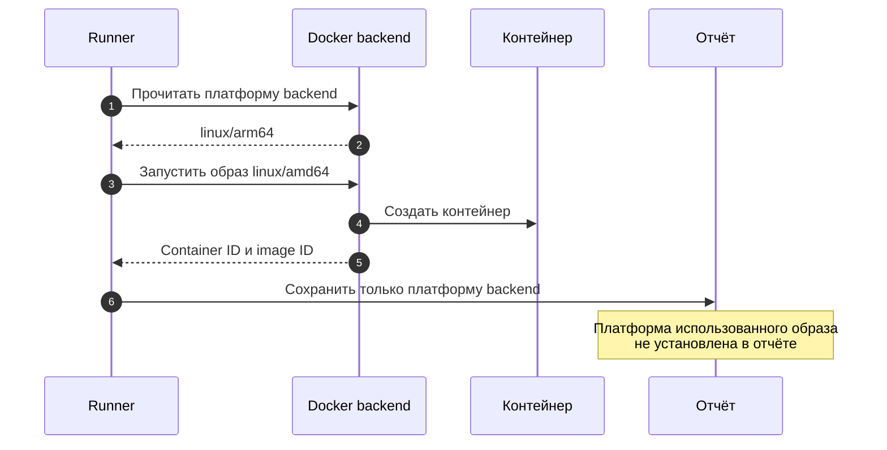
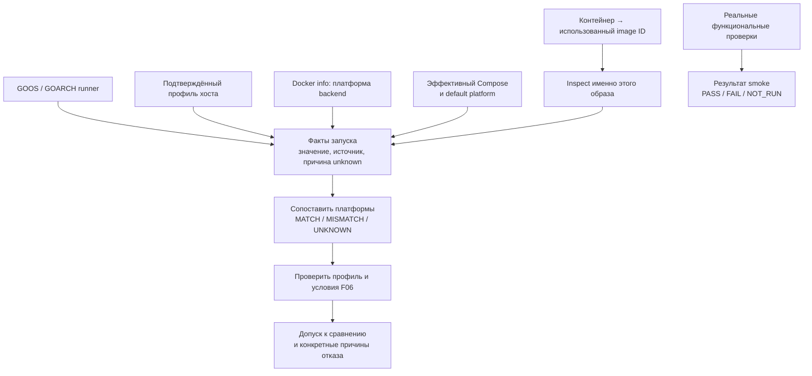
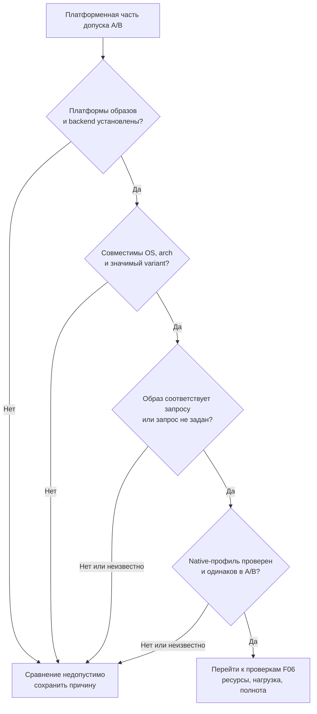

# F03 — происхождение платформы и допустимость сравнения запусков

**Архитектурное решение согласовано владельцем 20 октября 2026 года в чате.** Основание — [F03 и связанный F06 в аудите](https://github.com/Includeoyasi/faultline-lab/issues/20); запись решения — [ADR 0004](../adr/0004-platform-evidence.md). Согласование контракта не означает выполненный сбор полей и проверки допуска.

## 1. Описание проблемы и кейсы для локализации

Текущий smoke уже честно называет `docker_architecture` платформой backend, но не сохраняет платформу образа каждого контейнера. Поэтому одинаковая запись о Docker на ARM64 может скрыть два разных запуска: образ ARM64 и образ AMD64. Если такие результаты сравнить как одинаковые условия, влияние способа исполнения можно ошибочно приписать изменению кода. Ниже модель риска, а не обнаруженное измерение эмуляции или производительности.

| Кейс | Что требуется различить |
| :--- | :--- |
| Backend ARM64, образ ARM64 или AMD64 | Одинаковый backend не означает одинаковую платформу образа |
| Runner на Mac ARM64, Docker на другой машине AMD64 | Место работы CLI не определяет архитектуру исполнения контейнера |
| Тег образа изменился после создания контейнера | Важно описать image ID контейнера, а не новое содержимое тега |

## 2. Паттерны, общепринятые практики и варианты

Это задача происхождения измерительных данных и контроля условий эксперимента. Решение разделяет наблюдение, источник наблюдения и вывод о пригодности результата. Docker предоставляет сведения об образе, backend и эффективной конфигурации, но их нужно связать с конкретным контейнером. Наша классификация пригодности будет правилом лаборатории, а не универсальным детектором эмуляции.

| Вариант | Преимущество | Ограничение |
| :--- | :--- | :--- |
| Запретить явный выбор другой платформы | Простой стартовый запрет | Не доказывает фактическую платформу образа или отсутствие эмуляции |
| Только сохранять раздельные факты | Прозрачный отчёт и полезный smoke | Читатель всё ещё может сравнить несовместимые прогоны |
| **Раздельные факты и отдельный допуск к A/B** | Проверяемые причины допуска/отказа | Нужны версия формата и проверенный профиль исполнения |

| Первичный источник | Что он устанавливает |
| :--- | :--- |
| [Docker image inspect](https://docs.docker.com/reference/cli/docker/image/inspect/), [Compose platform](https://docs.docker.com/reference/compose-file/services/#platform) | Сведения образа и запрошенная runtime-платформа |
| [Compose config](https://docs.docker.com/reference/cli/docker/compose/config/), [Docker contexts](https://docs.docker.com/engine/manage-resources/contexts/) | Эффективная конфигурация и возможность другого Docker daemon |
| [Go runtime](https://pkg.go.dev/runtime#GOARCH), [Docker multi-platform](https://docs.docker.com/build/building/multi-platform/) | Цель компиляции runner, различие native execution, эмуляции и cross-build |

## 3. Обоснованное решение и компромиссы

Согласовано сохранять небольшой версионированный блок фактов одинакового смысла в обоих runners. Фактический образ определяется через image ID созданного контейнера; неполученные сведения остаются неизвестными с причиной. Явный запрос платформы дополнительно сверяется с фактическим образом. Совпадение платформ backend и образа отмечается как `MATCH`, но само по себе не объявляется доказательством native execution. Функциональный результат smoke сохраняется отдельно от пригодности к сравнению производительности. По умолчанию A/B допускается только внутри проверенного native-профиля с известными совместимыми платформами; остальные условия сравнения проверяются по F06. Цена решения — дополнительный сбор метаданных и возможность отклонить сравнение, хотя функциональный smoke прошёл.

| Согласованное поле | Источник и смысл |
| :--- | :--- |
| `runner_platform` | `runtime.GOOS/GOARCH`: цель бинарника, не физическая архитектура компьютера |
| `host_platform` | Проверенные сведения профиля хоста с происхождением; при отсутствии — unknown |
| `backend_platform` | OS/architecture Docker daemon; raw и нормализованное значения |
| `requested_platform` | Значение и источник: эффективный `service.platform` или `DOCKER_DEFAULT_PLATFORM`; явное unset, если оба не заданы |
| `image_id`, `image_platform` | Из контейнера и inspect его образа; OS/architecture/variant и доступный immutable digest |
| `platform_relation` | Сопоставление образа с backend, отдельно для каждого контейнера |
| `requested_actual_relation` | Отдельная проверка запроса против образа; NOT_REQUESTED при unset, явная причина при несовпадении или неизвестности |
| `execution_profile` | Проверенный режим native/эмуляции и основание; неподтверждённое не превращается в native |
| `platform_eligibility` | Допуск только по платформенной части; полный допуск A/B требует также F06 |

## 4. План реализации с учётом текущего этапа

Контракт согласован до начала сравнительных performance-экспериментов. Реализация сбора планируется вместе с текущей частью F06 в общем техническом PR. Версии отчётов обновляем явно, чтобы старое поле не сменило смысл незаметно. Полный допуск A/B подключаем перед первым сравнительным экспериментом; сведения о среде начинаем сохранять уже сейчас.

| Шаг | Результат и проверка будущей реализации |
| :--- | :--- |
| Описать схему и совместимость | Старые отчёты читаются как прежняя версия; в новых различимы unknown и unset |
| Подключить источники к обоим runners | Backend, контейнер и образ связаны по ID; в отчёт попадает только разрешённый список полей |
| Проверить преобразование данных | `x86_64` и `amd64` нормализуются; известный ARM variant сохраняется, неизвестный не угадывается |
| Проверить спорные случаи | Иной image architecture, перемещённый тег, default/override platform, недоступный inspect и частичный запуск; requested ≠ actual отклоняет платформенный допуск даже при backend/image MATCH |
| Проверить реальные доступные среды | Нативные AMD64/ARM64 CI и Windows; macOS остаётся NOT_RUN до фактического запуска |
| Перед первым A/B добавить допуск | Проверенный профиль плюс полнота F06; несовместимый или неполный прогон не даёт вывода об эффективности |

## 5. На что обратить отдельное внимание

Сравнивать образ нужно с исполняющим Docker backend, поскольку runner может работать на другом компьютере или через трансляцию. Указание `build.platforms` и успешная cross-build не доказывают runtime-платформу; сборка и исполнение записываются раздельно. Не публикуем полный Compose config, endpoint Docker context, секреты и домашние пути; отсутствие image-метаданных не должно мешать ограниченной очистке. Для признания native нужны проверенные сведения об исполняющем хосте/VM и режиме запуска со ссылкой на профиль, а не один флаг или `MATCH`. Даже этот допуск не делает Windows и Mac одной A/B-парой и не доказывает достоверность измерений без остальных условий F06.

| Аспект решения | Согласованный вариант |
| :--- | :--- |
| Контракт | Раздельные факты со своим источником; requested и actual не подменяют друг друга |
| Политика сравнения | Native-профиль по умолчанию; эмуляция может быть отдельным функциональным сценарием |
| Граница | Учёт удалённого daemon не означает готовую поддержку remote-запуска: локальные bind mounts требуют отдельной проверки |
