# G0: визуальное описание процессов

Статус: **G0 полностью принят тимлидом 2026-10-13, Europe/Moscow**. Схемы раскрывают принятые решения из docs/architecture/DESIGN.md и docs/ROADMAP.md. Они описывают согласованное планируемое поведение; реализация и измерения ещё не выполнены.

Порядок чтения: общий процесс → успешный заказ → состояния → отказы и отмена → восстановление → кеш → цикл эксперимента.

## Легенда

- В sequence-диаграммах сплошная стрелка — gRPC-запрос; обратная пунктирная — ответ. Для Kafka стрелки подписаны как публикация, доставка или подтверждение offset.
- `TX Orders`, `TX Inventory`, `TX Payments` — отдельные короткие транзакции в базе владельца. Общей транзакции трёх сервисов нет.
- `job` — сохранённая задача внутреннего воркера сервиса; это не четвёртый бизнес-сервис.
- `outbox` — событие, сохранённое вместе с бизнес-изменением; `inbox` — запись о принятом событии, защищающая от повторной обработки.
- `operation_id` идентифицирует бизнес-операцию. Повтор имеет тот же ключ и смысл; новая сетевая попытка не создаёт новую операцию.
- У Kafka-стрелок есть задержка и возможная повторная доставка. Положение стрелки на схеме не обещает мгновенную обработку.

## 1. Общий бизнес-процесс

Вопрос для ревью: кто владеет каждым шагом и в какой момент заказ можно считать завершённым?

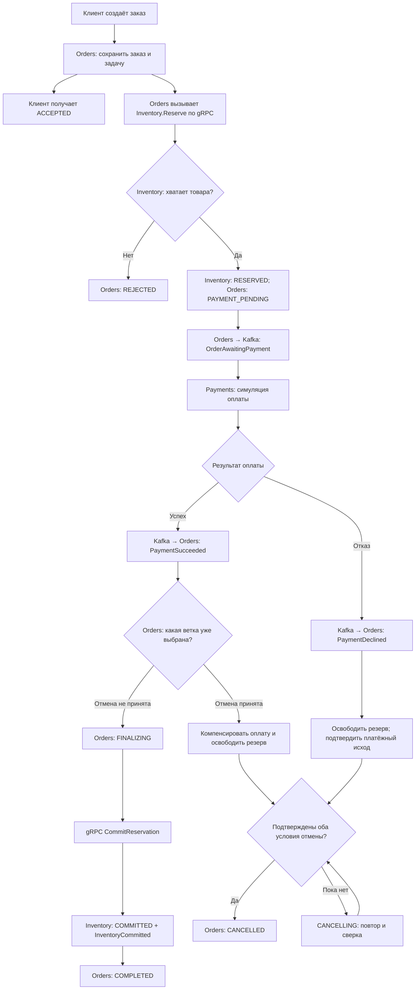

`ACCEPTED` — подтверждение сохранения запроса. `COMPLETED` — подтверждённая покупка: деньги списаны на ожидаемую сумму, резерв превращён в продажу. Ветка клиентской отмены подробно показана в схемах 6–7.

## 2. Успешный заказ: взаимодействия и транзакции

Вопрос для ревью: какие данные должны пережить падение после каждой стрелки?

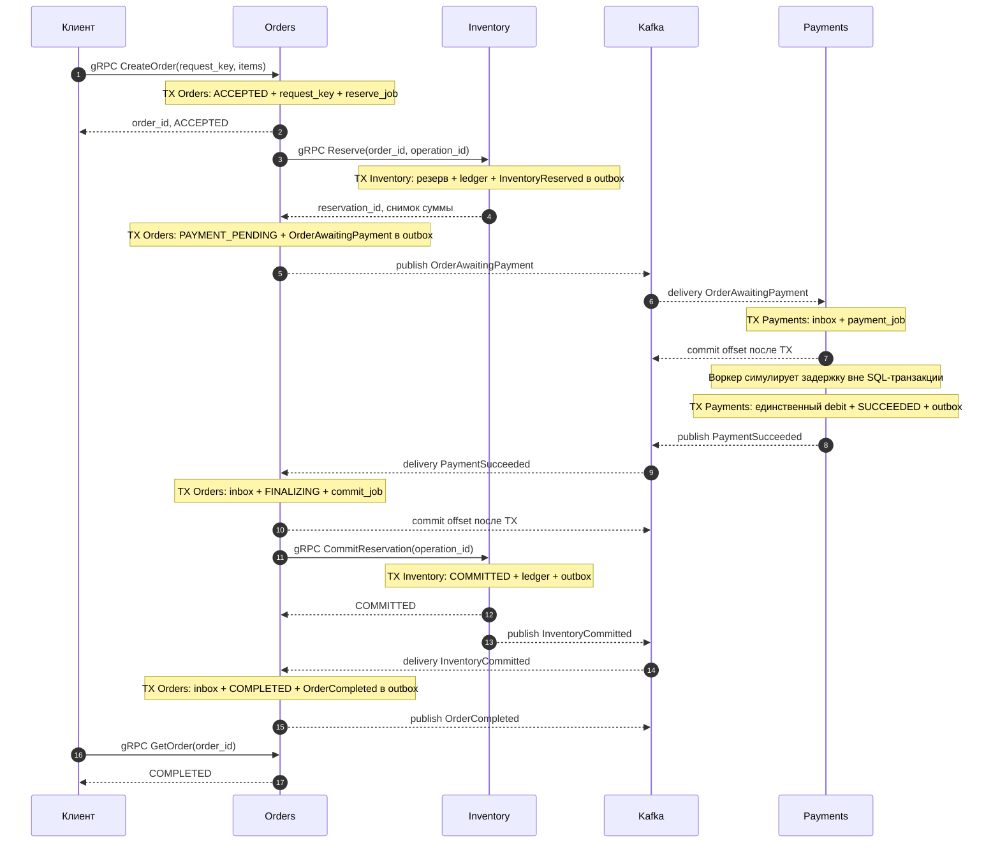

Publisher каждого сервиса работает из его outbox. Воркеры работают из сохранённых jobs. Они изображены внутри своего владельца, чтобы на схеме оставались ровно три бизнес-сервиса.

Inventory также публикует `InventoryReserved` и `InventoryReleased`; Orders использует их для наблюдения и сверки. Они опущены на успешной sequence-схеме, чтобы выделить события, непосредственно продолжающие этот путь.

## 3. Состояния заказа

Вопрос для ревью: какие переходы являются допустимыми, а какие нужно запретить?

```mermaid
stateDiagram-v2
    [*] --> ACCEPTED: Заказ и задача сохранены
    ACCEPTED --> RESERVING: Воркер начал шаг
    RESERVING --> PAYMENT_PENDING: Резерв и сумма подтверждены
    RESERVING --> REJECTED: Подтверждена нехватка товара
    PAYMENT_PENDING --> FINALIZING: Успешная оплата; отмена не принята
    FINALIZING --> COMPLETED: InventoryCommitted; оплата подтверждена

    ACCEPTED --> CANCELLING: Принята отмена
    RESERVING --> CANCELLING: Принята отмена
    PAYMENT_PENDING --> CANCELLING: Отмена или отказ оплаты
    CANCELLING --> CANCELLED: Резерв безопасен; списания нет или оно возвращено

    RESERVING --> RESERVING: Неизвестный RPC; повтор того же ключа
    PAYMENT_PENDING --> PAYMENT_PENDING: Ожидание и сверка платежа
    FINALIZING --> FINALIZING: Повтор Commit и ожидание события
    CANCELLING --> CANCELLING: Повтор компенсации и сверка

    REJECTED --> [*]
    COMPLETED --> [*]
    CANCELLED --> [*]

    note right of FINALIZING
        Точка прекращения клиентской отмены.
        CancelOrder отклоняется.
        Временный сбой сохраняет FINALIZING.
    end note
```

Timeout, недоступность зависимости и рост Kafka lag не превращают заказ автоматически в REJECTED или CANCELLED. Пока результат не разрешён, заказ остаётся в соответствующем нетерминальном состоянии. Если позже добавляется NEEDS_REVIEW, он тоже учитывается как нерешённый процесс.

### 3.1. Состояния резерва

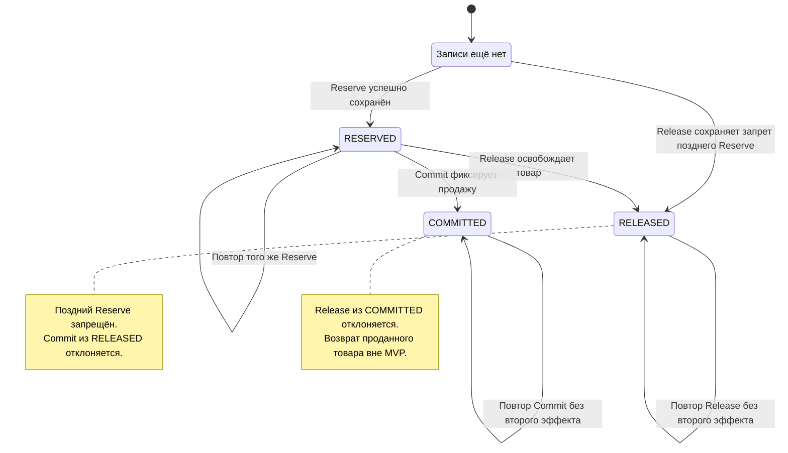

### 3.2. Состояния платежа

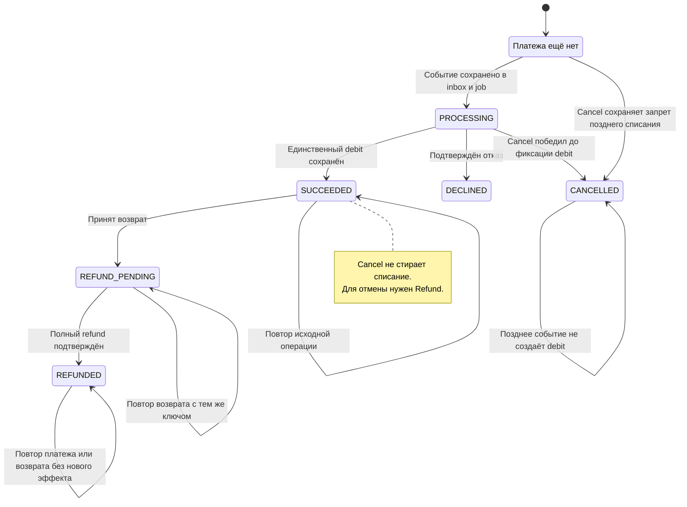

Задержка симулятора происходит вне SQL-транзакции. Перед фиксацией debit воркер проверяет актуальное состояние: сохранённая отмена имеет силу и для уже начатой симуляции.

## 4. Недостаточно товара

Вопрос для ревью: может ли оплата начаться до гарантированного резерва?

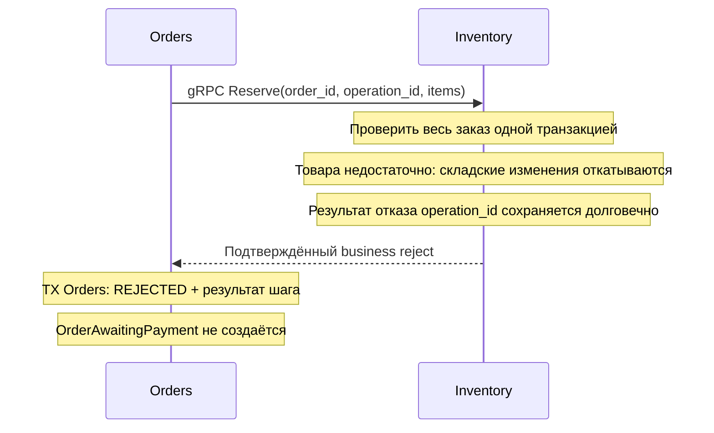

Для многопозиционного заказа недостаток одной позиции отменяет весь резерв. При этом подтверждённый результат операции сохраняется: повтор того же operation_id возвращает тот же отказ, даже если остатки позже изменились. Это достигается проверкой всех заблокированных позиций до мутаций либо откатом складской части к savepoint с последующей фиксацией результата операции. Технический timeout при Reserve не равен подтверждённой нехватке товара.

## 5. Платёж отклонён

Вопрос для ревью: когда можно завершить отмену, если освобождение склада временно не работает?

```mermaid
sequenceDiagram
    participant P as Payments
    participant K as Kafka
    participant O as Orders
    participant I as Inventory

    Note over P: TX Payments: DECLINED + PaymentDeclined в outbox
    P-->>K: publish PaymentDeclined
    K-->>O: delivery PaymentDeclined
    Note over O: TX Orders: inbox + CANCELLING + release_job
    O->>I: gRPC ReleaseReservation(order_id, operation_id)

    alt Release подтверждён
        Note over I: TX Inventory: RELEASED + ledger + outbox
        I-->>O: RELEASED
        Note over O: Списания нет; резерв освобождён
        Note over O: TX Orders: CANCELLED + outbox
    else Timeout или временная недоступность
        I-->>O: Результат неизвестен или временная ошибка
        Note over O: Оставить CANCELLING; сохранить следующий повтор
        O->>I: Повтор Release с тем же operation_id
        I-->>O: Прежний или вновь подтверждённый RELEASED
        Note over O: TX Orders: CANCELLED после проверки условий
    end
```

Ветка повторов на схеме сокращена. Если зависимость остаётся недоступной, новые попытки не объявляются успешными: процесс остаётся CANCELLING и попадает в отчёт о незавершённых заказах.

## 6. Гонка отмены и успешной оплаты

Вопрос для ревью: где принимается решение, исключающее одновременные Commit и компенсацию?

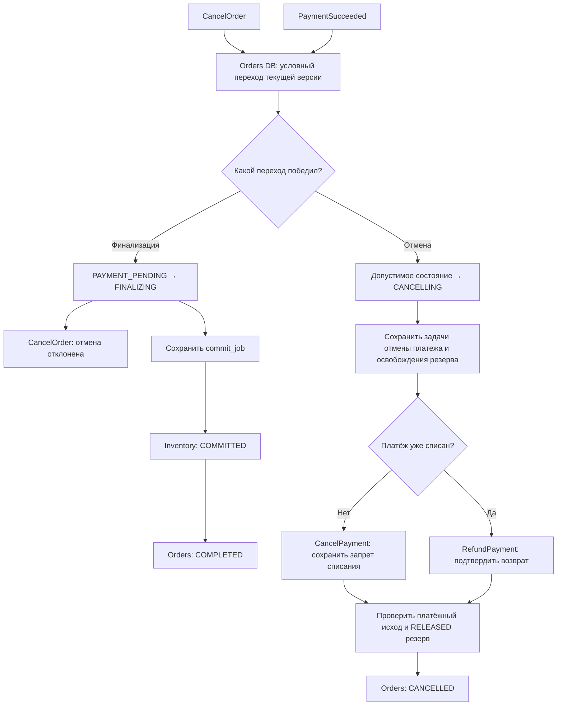

Условный переход — короткая транзакция в Orders по актуальному состоянию/версии. Проигравший обработчик перечитывает результат и следует выбранной ветке. Принятая отмена не создаёт commit_job; выбранная FINALIZING не создаёт release_job.

На практике CANCELLING может начинаться и до PAYMENT_PENDING. Запрет позднего Reserve в Inventory и позднего списания в Payments защищает от запросов и событий, отправленных старым воркером до отмены.

## 7. Поздняя успешная оплата после принятой отмены

Вопрос для ревью: достаточно ли игнорировать запоздавшее событие, если деньги уже были списаны?

```mermaid
sequenceDiagram
    participant C as Клиент
    participant O as Orders
    participant P as Payments
    participant I as Inventory
    participant K as Kafka

    Note over P: Платёж SUCCEEDED; debit уже сохранён
    P-->>K: publish PaymentSucceeded
    Note over K,O: Доставка в Orders задержана

    C->>O: gRPC CancelOrder(order_id)
    Note over O: TX Orders: CANCELLING + cancellation jobs
    O-->>C: Отмена принята; компенсации ещё выполняются
    O->>P: gRPC CancelPayment(order_id, operation_id)
    P-->>O: SUCCEEDED: нужен возврат
    O->>I: gRPC ReleaseReservation(order_id, operation_id)
    I-->>O: RELEASED подтверждён
    O->>P: gRPC RefundPayment(order_id, operation_id)
    Note over P: Возврат выполняется через сохранённый шаг
    Note over P: TX Payments: refund ledger + REFUNDED + outbox
    P-->>O: REFUNDED подтверждён
    Note over O: TX Orders: оба условия подтверждены; CANCELLED + outbox

    K-->>O: delivery старого PaymentSucceeded
    Note over O: Записать inbox; сохранить ветку отмены
    Note over O: Не создавать Commit; возврат уже подтверждён
    P-->>K: publish PaymentRefunded
    K-->>O: delivery PaymentRefunded
    Note over O: Идемпотентно подтвердить уже известный исход
```

На этой схеме Refund успевает подтвердиться через gRPC. При неизвестном результате возврата Orders остаётся CANCELLING и использует повтор с тем же ключом, GetPayment или событие PaymentRefunded. Одного намерения возврата недостаточно для CANCELLED.

## 8. События и падения: outbox, inbox и jobs

Вопрос для ревью: что уже сохранено в каждом crash window и что будет повторено?

### 8.1. Запись и публикация

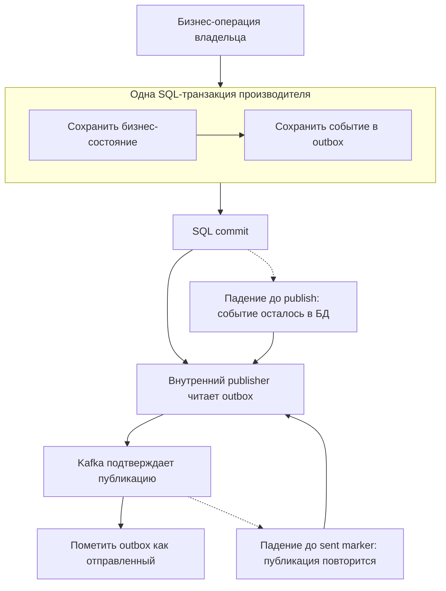

Crash до SQL commit не сохраняет ни бизнес-изменение, ни событие. Crash после commit оставляет событие для publisher. Повторная публикация после успешной Kafka-записи ожидаема; event_id сохраняется.

### 8.2. Приём события и долгая работа

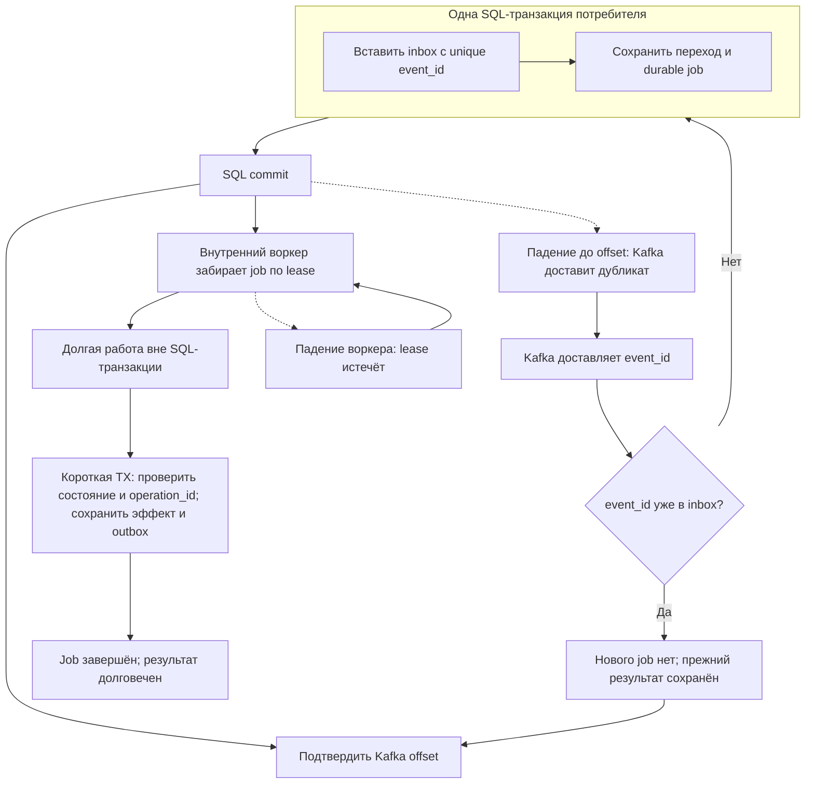

Ромб inbox — логическая схема, а не отдельный небезопасный SELECT перед INSERT. Проверка дубликата и создание job защищены unique constraint и одной транзакцией, включая конкурентную доставку.

Offset подтверждает, что продолжение работы сохранено, а не что платёж уже завершён. Поэтому нужны два вида наблюдаемости: Kafka lag и возраст/размер durable jobs. Повтор job использует прежний operation_id и повторно проверяет актуальное состояние перед эффектом.

## 9. Неизвестный результат gRPC

Вопрос для ревью: означает ли timeout, что Inventory не успел изменить остатки?

```mermaid
sequenceDiagram
    participant O as Orders
    participant I as Inventory
    participant D as Inventory DB

    O->>I: Reserve(order_id, operation_id)
    I->>D: TX: резерв + операция + ledger + outbox
    D-->>I: COMMIT выполнен
    I--xO: Ответ потерян или deadline истёк
    Note over O: Результат неизвестен; не считать Reserve неуспешным

    O->>I: Повтор Reserve с тем же operation_id
    I->>D: Найти сохранённый результат операции
    D-->>I: Прежний reservation_id и сумма
    I-->>O: Тот же подтверждённый результат
    Note over O: Продолжить сохранённый шаг
```

Вместо повтора можно начать со сверки GetReservation. Но NOT_FOUND во время ещё выполняющегося запроса не доказывает отсутствие будущего эффекта. Безопасность обеспечивают прежний ключ операции, атомарность и cancellation barrier, если уже выбран путь отмены.

Точно так же timeout CreateOrder не означает, что заказа нет: клиент повторяет request_key или вызывает GetOrderByRequestKey. Timeout Commit и Refund требует сверки прежнего эффекта, а не новой операции с новым ключом.

## 10. Чтение через Redis и запись в PostgreSQL

Вопрос для ревью: где допустима устаревшая информация и где нужен авторитетный результат?

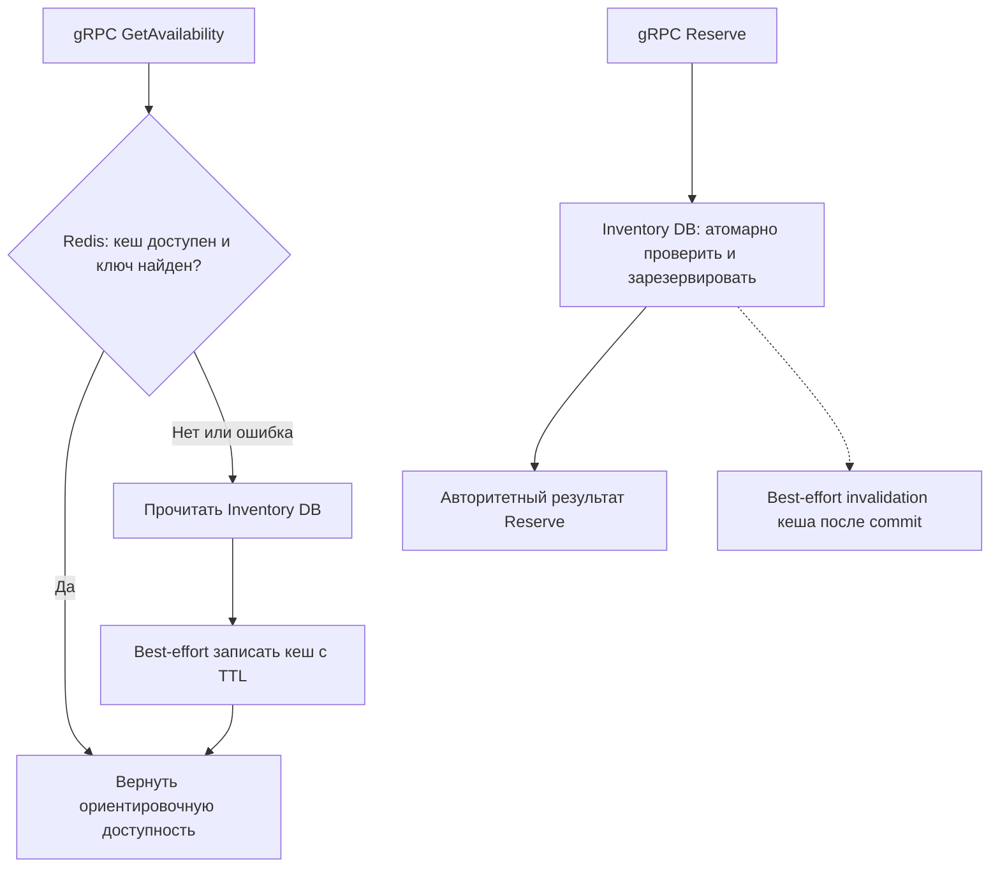

Устаревший кеш может показать товар доступным, а Reserve затем корректно откажет. Это измеряемый stale read, не продажа лишнего товара. Ошибка кеша не должна отменять уже выполненную складскую транзакцию; fallback и его нагрузка на SQL становятся отдельным экспериментом.

## 11. Цикл инженерного эксперимента

Вопрос для ревью: какие данные позволяют принять решение об эффективности изменения?

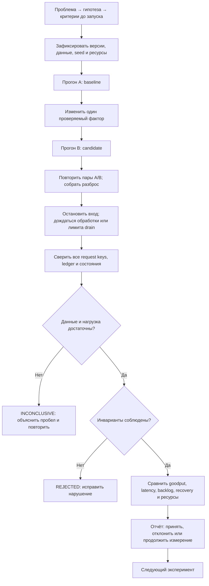

Каждый отдельный прогон A или B включает свой прогрев, измеряемое окно, drain и verifier. На схеме общие шаги после серии обозначают сбор уже проверенных результатов. Незавершённые заказы не исчезают из знаменателя; они остаются отдельным результатом.

## 12. Процесс ревью G0

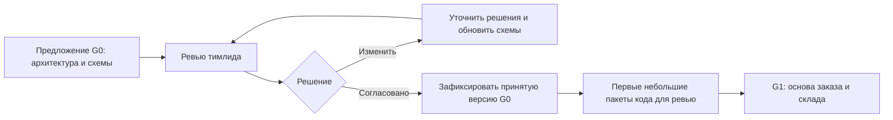

G0 прошёл ветку согласования: пользователь полностью принял его 2026-10-13. Схема остаётся описанием процесса ревью и для последующих изменений. После замечаний схемы, контракты и бизнес-правила обновляются вместе; существенные изменения согласуются отдельно.

## Контрольные вопросы тимлиду

| Область | Что должно быть однозначно после ревью |
|---|---|
| Успех | ACCEPTED отличается от COMPLETED; завершение требует оплаты и продажи |
| Отмена | Понятна точка FINALIZING и ветка позднего успеха оплаты |
| Корректность | Повторы не создают второй эффект; отменённый процесс не воскресает |
| Долговечность | Видно, что сохраняется перед ответом клиента и Kafka offset |
| Восстановление | Timeout остаётся неизвестным исходом до сверки; jobs/outbox переживают рестарт |
| Масштабирование | Приём, Kafka delivery и processing jobs имеют отдельные очереди и показатели |
| Кеш | Redis ускоряет чтения; складская запись проверяет PostgreSQL |
| Эксперимент | Вывод учитывает незавершённые процессы, инварианты и ресурсный бюджет |
