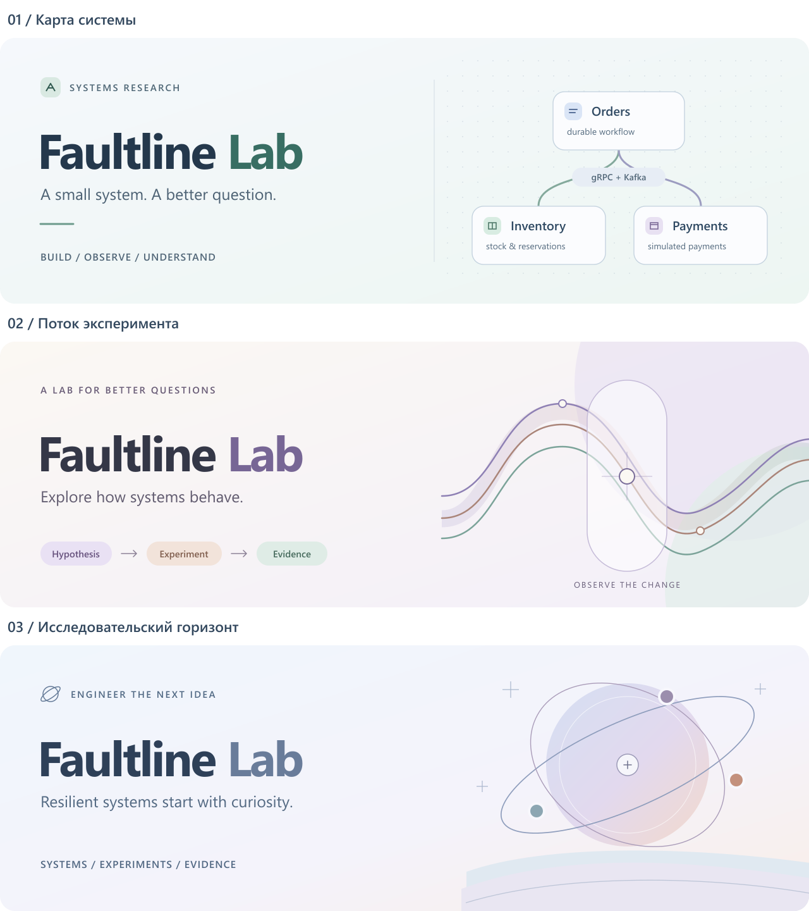
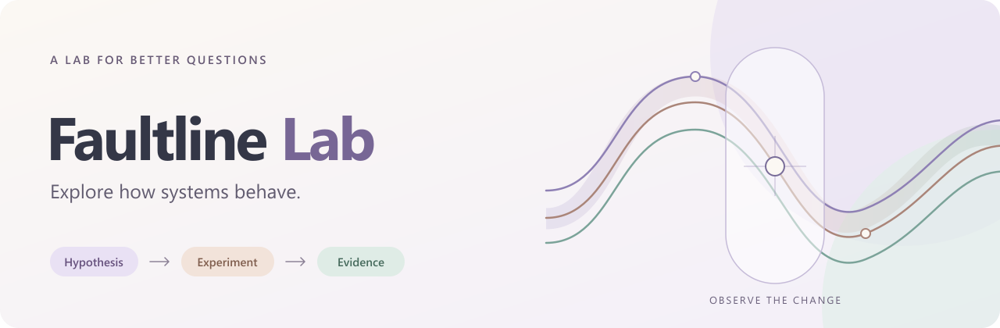

# Баннер Faultline Lab

Статус на 13 октября 2026 года: **владелец проекта выбрал вариант 2 — «Поток эксперимента»**. Основание: прямое сообщение «Мне нравится вариант 2». Выбранный SVG применяется в обоих README через общий файл [banner.svg](../assets/banner.svg). Публикация ожидает следующего коммита и ревью.

## Задание

Подготовить три альтернативных варианта с акцентом на технологичность, современность, доступность, мягкие пастельные тона, исследование и будущее. Сделаны векторные композиции с читаемым названием, тёмным текстом на светлом фоне и встроенными title/description. Внешних шрифтов, скриптов и удалённых графических зависимостей нет.

| Вариант | Образ | Палитра | Статус |
| :--- | :--- | :--- | :--- |
| 1. Карта системы | Сервисы, связи и инженерный стенд | Голубой, мятный, лавандовый | Сохранён как альтернатива |
| 2. Поток эксперимента | Гипотеза → эксперимент → доказательства | Слоновая кость, лаванда, персик, мята | Выбран владельцем проекта |
| 3. Исследовательский горизонт | Любопытство, исследование и будущее | Голубой, лавандовый, мягкий персик | Сохранён как альтернатива |

## Выбранное решение

Абстрактные линии проходят через область наблюдения. Это метафора исследования поведения системы и сравнения изменений; линии не являются графиком измеренных результатов. Композиция не зависит от домена магазина и подходит будущим подключаемым бизнесам.

Размер SVG — 1280 × 420; README задаёт ширину 100%. Исходник масштабируется, PNG служит предварительным просмотром. Основная подпись: **Explore how systems behave.** Нижняя последовательность: **Hypothesis → Experiment → Evidence**.

Исходники: [карта системы](../assets/banner-concepts/01-system-map.svg), [поток эксперимента](../assets/banner-concepts/02-experiment-flow.svg), [исследовательский горизонт](../assets/banner-concepts/03-research-horizon.svg). Из выбранного исходника копируется общий banner.svg; если его изменяют, исходник концепции и preview обновляются вместе.

Баннеры отрендерены локально и визуально просмотрены на общем листе. Проверены отсутствие обрезанного текста и соответствие композиций заданию. Отдельный preview выбранного варианта используется для проверки основного баннера. Выбранный вариант входит в документационный PR; до его слияния главная страница main сохраняет прежнюю обложку. Проверка отрисовки нового README на GitHub пока не выполнялась.
