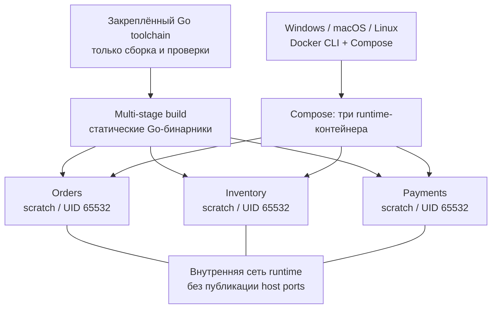

# Контейнерный каркас P01

Этот пакет завершает реализацию P01-05–08: ограниченное graceful shutdown, отдельные runtime-образы трёх сервисов, Compose, CI и smoke с диагностикой. G0 принят; P01 выполняется до G1. Бизнес-операции и инфраструктура PostgreSQL/Kafka/Redis относятся к следующим пакетам.

Исторический источник каркаса — [PR #8](https://github.com/Includeoyasi/faultline-lab/pull/8), принятый владельцем 16 октября 2026 года. Исходные Windows-проверки сохранены в [evidence](evidence/p01/WINDOWS_SMOKE.md); актуальное ревью — в GitHub.

## Состав и границы



[Dockerfile](../../build/Dockerfile) использует закреплённый [toolchain](TOOLCHAIN.md) как stage общего multi-stage Dockerfile. Сервис выбирается build argument, разрешены только orders/inventory/payments. Финальный `scratch` содержит один статический бинарник и запускает его напрямую: без компилятора, shell, root и промежуточного процесса вместо PID 1. CA bundle и timezone database сейчас не требуются; перед появлением TLS-клиентов состав образа пересматривается явно.

[Compose](../../compose.yaml) задаёт read-only root filesystem, `cap_drop: ALL`, `no-new-privileges`, внутреннюю сеть и отсутствие публикации портов. Runtime не получает host mounts или Docker socket. Toolchain остаётся временным сервисом профиля tools. Сборка runtime использует stage toolchain напрямую; активация сервиса профиля tools для неё не требуется. Обычный up запускает только три runtime-сервиса.

## Требования и запуск

Нужны Git, Docker с Linux-контейнерами и Compose v2 с поддержкой up --wait. Для локальной публикации на loopback используйте Docker Engine 28+. Go и Bash на хосте не нужны. Готовый Go smoke не требует Node.js или Go SDK на хосте; [сборка и запуск](SMOKE.md).

Из корня репозитория:

```text
docker compose build orders inventory payments
.\bin\smoke-windows-amd64.exe -check-config
docker compose up -d --wait orders inventory payments
docker compose ps
docker compose exec -T orders /app/service healthcheck
docker compose exec -T inventory /app/service healthcheck
docker compose exec -T payments /app/service healthcheck
docker compose stop orders inventory payments
docker compose down
```

`up --wait` ожидает healthy. Команда `healthcheck` внутри того же бинарника вызывает стандартный gRPC `Health/Check`, молчит при успехе и возвращает 0. Ошибка/NOT_SERVING — безопасная JSON-диагностика и exit 1; неизвестная команда — exit 2. Проба ограничена двумя секундами, Compose даёт ей три секунды. Проба не подтверждает готовность базы или бизнес-процесса.

Окружение задаётся через [container.env.example](../../configs/env/container.env.example). Все три контейнера могут использовать один внутренний порт; адресов/портов по умолчанию в Go-коде нет. `FL_GRPC_ADDR` обязателен для сервера; отдельный `FL_HEALTH_TARGET` обязателен только для команды healthcheck. Wildcard допустим как явно выбранный listener, но отклоняется как цель подключения.

При изменении порта listener обновляйте и target собственной health-пробы. Для нескольких локальных процессов target каждого должен указывать на его listener; в Compose каждый сервис имеет отдельное сетевое пространство.

Для личной конфигурации скопируйте образец в игнорируемый `configs/env/container.env` и задайте в корневом игнорируемом `.env`:

```dotenv
FL_RUNTIME_ENV_FILE=configs/env/container.env
```

Compose выбирает файл и передаёт окружение процессам; приложение dotenv не читает. Личные env исключены из Git и Docker build context. Не печатайте полный конфиг при работе с секретами; для валидации используйте `docker compose config --quiet`.

Порты на хост не публикуются. Если позже понадобится локальный доступ, добавляется отдельная deployment-настройка с явной привязкой к loopback. Endpoint клиента, listener и host port — разные параметры; детали в [описании сервисов](SERVICE_RUNTIME.md). Текущий приватный стенд не заявляет готовность production TLS/mTLS.

## Остановка и её проверка

`SIGINT`/`SIGTERM` переводит health в NOT_SERVING; затем `GracefulStop` закрывает listener и ждёт активные RPC. При успехе процесс пишет `stop_mode=graceful` и выходит с кодом 0. Если `FL_SHUTDOWN_TIMEOUT` истёк, запрашивается принудительный Stop, пишется `stop_mode=forced` и ошибка, entrypoint завершает процесс с кодом 1.

На принудительном пути приложение не ждёт бесконечно goroutine GracefulStop: gRPC может удерживать её на handler, который игнорирует cancellation. Владельцем оставшейся работы становится завершающийся процесс. Все будущие бизнес-handlers обязаны соблюдать context. Unit fixture намеренно нарушает это правило, проверяет ограниченный возврат и затем сам освобождает handler, чтобы не оставлять goroutine в тестах.

Управляемые unit-тесты проверяют завершение активного RPC, deadline, NOT_SERVING через реальный TCP endpoint до закрытия listener и отказ новых соединений. Синхронизация — каналы и ограниченные ожидания. Linux process tests проверяют SIGTERM/SIGINT для настоящих бинарников и forced exit 1 при открытом health Watch. Постоянный Watch может занять весь drain budget; Compose использует короткий unary Check.

Default приложения — 10s; независимый `FL_STOP_GRACE_PERIOD` Compose — 15s. [Preflight Go CLI](SMOKE.md) до запуска проверяет внешний бюджет с минимум 2s запаса; несовместимый профиль отклоняется. Таймауты проверяют свойства завершения; это не результат исследования производительности.

## Автоматический smoke и отчёт

[Go CLI](SMOKE.md) выполняет build → start → health/security → isolation → stop/logs → cleanup на собственном уникальном Compose project. Руководство описывает контейнерную сборку для пяти платформ, отмену дерева процессов, независимый cleanup, формат отчёта и адресное восстановление после аварии.

CI выполняет Go quality checks и этот host-side smoke на нативных Linux AMD64/ARM64, сохраняя JSON/JSONL и диагностику на 14 дней. Сборка macOS не заменяет фактическую проверку на Mac.

## Локальная проверка Windows

15 октября установлены host Go 1.27.2 (официальный MSI), WSL 2.7.13.0 и Docker Desktop 4.95.0 в профиль пользователя. Linux engine 29.8.2 / Compose 5.6.0 успешно выполнили smoke на чистом source d81b51c. [Отчёт, JSONL и подтверждение остановки](evidence/p01/WINDOWS_SMOKE.md) включены в репозиторий и переносимый контекст. Перезагрузка не понадобилась.

## Личный компьютер: запуск по необходимости

WSL ограничен двумя CPU, memory=2GB и swap=1GB; Engine видит 2 CPU и 1996603392 bytes RAM. Это бюджет smoke, не измерение capacity бизнеса. AutoStart Docker выключен и запись из автозагрузки Windows удалена.

После установки откройте новый терминал, чтобы он получил обновлённый PATH. Запуск и остановка:

```text
docker desktop start --timeout 120
.\bin\smoke-windows-amd64.exe
docker desktop stop --timeout 60
wsl --shutdown
```

Последняя команда относится к Windows и завершает виртуальную среду WSL. В этом профиле WSL использует только лаборатория; если появятся другие дистрибутивы с работающими задачами, учитывайте их перед общим shutdown. Smoke удаляет только собственные контейнеры и сеть. Docker Desktop и WSL VM после работы нужно остановить также при ошибке проверки, сохранив диагностику. Программы, образы, библиотеки и кеши оставляем для следующих запусков.

После этого прогона подтверждены: контейнеров нет, Docker Desktop остановлен, wsl --shutdown выполнен, процессов Docker/vmmemWSL нет, автозапуск выключен. Доказательства относятся к этой дате и исходному commit; новые проверки и приёмка изменений фиксируются отдельно.
