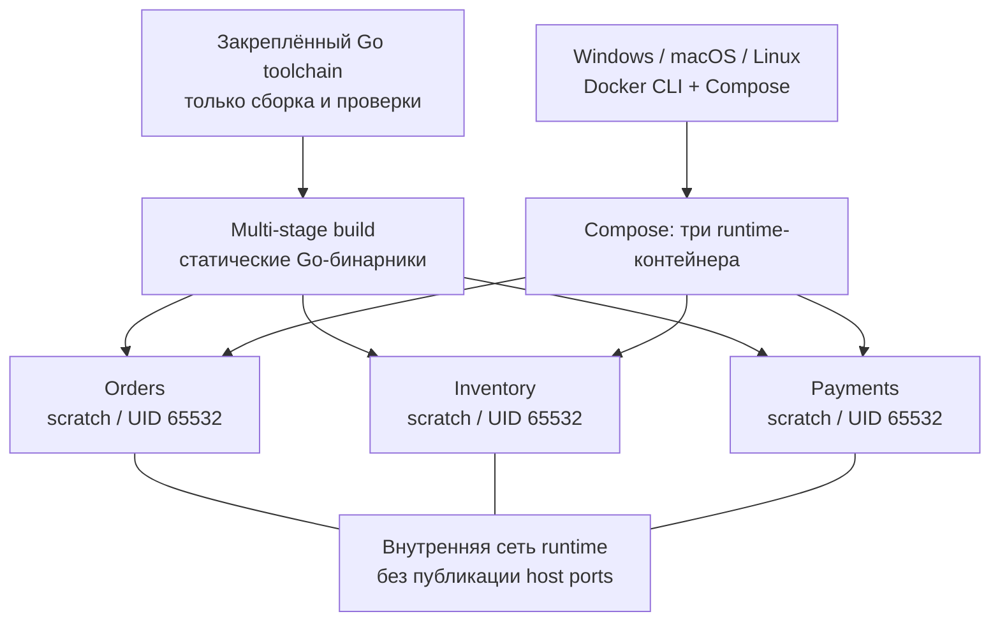

# Контейнерный каркас P01

Этот пакет завершает реализацию P01-05–08: ограниченное graceful shutdown, отдельные runtime-образы трёх сервисов, Compose, CI и smoke с диагностикой. G0 принят; P01 выполняется до G1. Бизнес-операции и инфраструктура PostgreSQL/Kafka/Redis относятся к следующим пакетам.

PR #7 принят и слит владельцем (main `bc09d08`), задачи 01–04 DONE. [Draft PR #8](https://github.com/Includeoyasi/faultline-lab/pull/8) содержит реализацию оставшихся задач. [Полный CI AMD64/ARM64](https://github.com/Includeoyasi/faultline-lab/actions/runs/38744910340) PASS на source HEAD d5e13a9; отчёты [AMD64](https://github.com/Includeoyasi/faultline-lab/actions/runs/38744910340/artifacts/11977328529) и [ARM64](https://github.com/Includeoyasi/faultline-lab/actions/runs/38744910340/artifacts/11977248425) прочитаны и подтверждают health, ограничения, exit 0, изоляцию и cleanup. Актуальные checks итогового HEAD доступны в PR. Текущее выполнение и результаты находятся в [Issue #3](https://github.com/Includeoyasi/faultline-lab/issues/3), [спецификации P01](packets/P01.md) и переносимом контексте. Описание нового PR использует разделы «Что было сделано», «Проверки» и «На что обратить внимание».

## Состав и границы



[Dockerfile](../../build/Dockerfile) использует закреплённый [toolchain](TOOLCHAIN.md) как stage общего multi-stage Dockerfile. Сервис выбирается build argument, разрешены только orders/inventory/payments. Финальный `scratch` содержит один статический бинарник и запускает его напрямую: без компилятора, shell, root и промежуточного процесса вместо PID 1. CA bundle и timezone database сейчас не требуются; перед появлением TLS-клиентов состав образа пересматривается явно.

[Compose](../../compose.yaml) задаёт read-only root filesystem, `cap_drop: ALL`, `no-new-privileges`, внутреннюю сеть и отсутствие публикации портов. Runtime не получает host mounts или Docker socket. Toolchain остаётся временным сервисом профиля tools. Сборка runtime использует stage toolchain напрямую; активация сервиса профиля tools для неё не требуется. Обычный up запускает только три runtime-сервиса.

## Требования и запуск

Нужны Git, Docker с Linux-контейнерами и Compose v2 с поддержкой up --wait. Для локальной публикации на loopback используйте Docker Engine 28+. Go и Bash на хосте не нужны. Node.js 20+ требуется только для автоматического smoke и уже используется проверкой документации.

Из корня репозитория:

```text
docker compose build orders inventory payments
docker compose up -d --wait orders inventory payments
docker compose ps
docker compose exec -T orders /app/service healthcheck
docker compose exec -T inventory /app/service healthcheck
docker compose exec -T payments /app/service healthcheck
docker compose stop orders inventory payments
docker compose down
```

`up --wait` ожидает healthy. Команда `healthcheck` внутри того же бинарника вызывает стандартный gRPC `Health/Check`, молчит при успехе и возвращает 0. Ошибка/NOT_SERVING — безопасная JSON-диагностика и exit 1; неизвестная команда — exit 2. Проба ограничена двумя секундами, Compose даёт ей три секунды. Проба не подтверждает готовность базы или бизнес-процесса.

Окружение задаётся через [container.env.example](../../configs/env/container.env.example). Все три контейнера могут использовать один внутренний порт; адресов/портов по умолчанию в Go-коде нет. `FL_GRPC_ADDR` обязателен для сервера; отдельный `FL_HEALTH_TARGET` обязателен только для команды healthcheck. Wildcard допустим как явно выбранный listener, но отклоняется как цель подключения.

При изменении порта listener обновляйте и target собственной health-пробы. Для нескольких локальных процессов target каждого должен указывать на его listener; в Compose каждый сервис имеет отдельное сетевое пространство.

Для личной конфигурации скопируйте образец в игнорируемый `configs/env/container.env` и задайте в корневом игнорируемом `.env`:

```dotenv
FL_RUNTIME_ENV_FILE=configs/env/container.env
```

Compose выбирает файл и передаёт окружение процессам; приложение dotenv не читает. Личные env исключены из Git и Docker build context. Не печатайте полный конфиг при работе с секретами; для валидации используйте `docker compose config --quiet`.

Порты на хост не публикуются. Если позже понадобится локальный доступ, добавляется отдельная deployment-настройка с явной привязкой к loopback. Endpoint клиента, listener и host port — разные параметры; детали в [описании сервисов](SERVICE_RUNTIME.md). Текущий приватный стенд не заявляет готовность production TLS/mTLS.

## Остановка и её проверка

`SIGINT`/`SIGTERM` переводит health в NOT_SERVING; затем `GracefulStop` закрывает listener и ждёт активные RPC. При успехе процесс пишет `stop_mode=graceful` и выходит с кодом 0. Если `FL_SHUTDOWN_TIMEOUT` истёк, запрашивается принудительный Stop, пишется `stop_mode=forced` и ошибка, entrypoint завершает процесс с кодом 1.

На принудительном пути приложение не ждёт бесконечно goroutine GracefulStop: gRPC может удерживать её на handler, который игнорирует cancellation. Владельцем оставшейся работы становится завершающийся процесс. Все будущие бизнес-handlers обязаны соблюдать context. Unit fixture намеренно нарушает это правило, проверяет ограниченный возврат и затем сам освобождает handler, чтобы не оставлять goroutine в тестах.

Управляемые unit-тесты проверяют завершение активного RPC, deadline, NOT_SERVING через реальный TCP endpoint до закрытия listener и отказ новых соединений. Синхронизация — каналы и ограниченные ожидания. Linux process tests проверяют SIGTERM/SIGINT для настоящих бинарников и forced exit 1 при открытом health Watch. Постоянный Watch может занять весь drain budget; Compose использует короткий unary Check.

Default приложения — 10s; `stop_grace_period` Compose — 15s. При изменении бюджета приложения увеличьте grace period контейнера с запасом, иначе Docker может отправить SIGKILL раньше завершения приложения. Таймауты проверяют свойства завершения; это не результат исследования производительности.

## Автоматический smoke и отчёт

```text
node tools/smoke.mjs
```

[Smoke](../../tools/smoke.mjs) работает на хосте через Docker CLI, без shell-команд и передачи Docker socket в контейнер. Он создаёт уникальный проект `faultline-smoke-*`, явно выбирает compose.yaml и несекретный container.env.example; личные overrides не меняют тестовый профиль.

Проверки по порядку:

1. Доступность Linux Docker/Compose; запись версии и архитектуры backend.
2. Сборка трёх образов, старт и ожидание healthy.
3. Health CLI, UID, read-only root, capabilities, no-new-privileges, внутренняя сеть и отсутствие host ports/mounts.
4. Остановка Orders: exit 0, JSON start → NOT_SERVING → graceful stop; Inventory/Payments продолжают отвечать.
5. Остановка остальных, проверка их exit/logs и удаление только собственного уникального Compose-проекта в finally.

В `artifacts/smoke/<run-id>/` сохраняются report.json, три JSONL-лога и диагностика ошибок команд. Отчёт содержит source revision/dirty, реальные image IDs, платформу, версии, исходы проверок и cleanup. Если prerequisites недоступны, результат NOT_RUN и exit 2; дефект прогона даёт FAIL и exit 1; PASS — exit 0. Секреты, полный inspect Env, hostnames и абсолютные персональные пути в отчёт не включаются.

CI на нативных Linux AMD64/ARM64 выполняет этот smoke после Go format/build/lint/unit/race/tidy/verify/govulncheck и process smoke. Отчёты и логи сохраняются артефактами на 14 дней, отдельно для каждой архитектуры. Внутри образа `.git` отсутствует, поэтому runtime VCS revision может быть `unknown`; traceability обеспечивают реальные image IDs и source revision в отчёте, без подмены build metadata.

## Локальная проверка Windows

15 октября проверено: Docker CLI, стандартная установка Docker Desktop и Docker-служба отсутствуют; WSL сообщает, что подсистема не установлена. Локальный запуск `node tools/smoke.mjs` сохранил NOT_RUN на prerequisites и exit 2. Native Windows Go unit/process tests проходят; Unix-сигналы проверяются отдельно на Linux. Личная macOS недоступна, её container smoke NOT_RUN.

P01-06 требует Windows container smoke. Пока он не выполнен, итоговый PR остаётся draft с конкретным невыполненным критерием; успешный Linux CI не заменяет эту проверку. После установки Docker с Linux backend запускается та же команда smoke, её отчёт добавляется в review evidence. По результату владелец принимает конкретный HEAD; ИИ не выполняет approve/merge.

Установка среды согласована владельцем 15 октября. Официальный Docker Desktop 4.95.0 загружен, SHA256 и подпись Docker Inc проверены. WSL 2.7.13 через winget потребовал admin; запрос UAC завершился отменой до запуска установки. Docker per-user installer завершился precheck: VirtualMachinePlatform выключен. Ни WSL, ни Docker пока не установлены, перезагрузки не было. Для продолжения нужен интерактивный административный допуск; после установки/при необходимости отдельно согласованной перезагрузки выполняется `node tools/smoke.mjs`.
