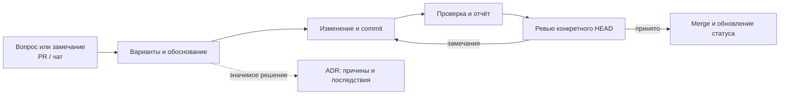

# Инженерные решения и ревью

Короткая подборка обсуждений: какой вопрос поднял владелец, какое решение подготовил исполнитель и чем подтверждён результат. Подробности остаются в PR, ADR и отчётах. Состояние на 16 октября 2026 года; GitHub хранит актуальные обсуждения и приёмку конкретного HEAD.

## Примеры из проекта

| Обсуждение | Решение и результат | Статус | Материалы |
| :--- | :--- | :--- | :--- |
| Владелец заметил сетевые IP/порты в прикладном коде | FL_GRPC_ADDR стал обязательным; окружение, listener и публикация портов разделены. Ошибочная конфигурация проверяется до bind | Принято владельцем в PR #7 | [Сводка исправления](https://github.com/Includeoyasi/faultline-lab/pull/7#issuecomment-6192239609), [конфигурация](../../internal/service/config.go), [описание](SERVICE_RUNTIME.md) |
| Владелец поставил вопрос о Node.js в Go-проекте и поручил вынести перенос в backlog | Предложен Go CLI с сохранением smoke-проверок и отчёта; проверка документации остаётся отдельным Node.js-инструментом | Выбор Go согласован владельцем 16 октября; выполнение — в #9 | [Задача #9](https://github.com/Includeoyasi/faultline-lab/issues/9), [ADR 0003](../adr/0003-go-container-smoke.md), [критерии](backlog/GO_SMOKE.md) |
| Владелец потребовал освобождать ресурсы личного ПК после работы | Исполнитель ограничил WSL до 2 CPU / memory=2GB / swap=1GB; после smoke выключил Docker Desktop/WSL VM и автозапуск, сохранив программы и кеши | Принято владельцем в PR #8 | [Windows evidence](evidence/p01/WINDOWS_SMOKE.md), [cleanup.json](evidence/p01/windows-2026-10-15/cleanup.json), [PR #8](https://github.com/Includeoyasi/faultline-lab/pull/8) |

Замечания в этих примерах получены в чате с владельцем. Их пересказ и ссылки подготовлены исполнителем AI-Your-Bro. Авторство GitHub-комментариев видно в самих PR; пересказ не выдаётся за комментарий, написанный владельцем на GitHub. Принятие PR #7 подтверждено слиянием владельцем проекта; PR #8 также принят через слияние владельцем проекта 16 октября, Europe/Moscow.

## Как сохраняем следующие обсуждения

- **PR** хранит рабочее обсуждение, изменения и результаты проверок. Для замечания из чата исполнитель указывает источник и автора требования. Комментарий сам по себе не означает approval.
- **ADR** сохраняет существенное решение: контекст, варианты, выбор, последствия, статус и основание согласования. Рутинные исправления остаются в PR. Изменение согласованных границ сначала выносится владельцу; в согласованном объёме исполнитель работает самостоятельно.
- **Эта страница** содержит отобранные примеры и ссылки. Добавляем запись при появлении содержательного решения или изменении его статуса; полный чат сюда не переносится.

Для каждого примера достаточно пяти полей: вопрос → варианты/причина выбора → изменение → доказательства → статус и источник приёмки. Исполнитель сохраняет выбранные решения и датированные доказательства в переносимом контексте.

## Как читать статусы

**Proposed** — вариант ещё обсуждается. Стадия задачи и её ревью берутся из GitHub. **Принято** — есть датированное решение владельца; для кода также применяются требования review/merge из [workflow](WORKFLOW.md). Успешный тест подтверждает только проверенное поведение.

## Реестр ADR

| Запись | Предмет | Статус решения |
| :--- | :--- | :--- |
| [0001](../adr/0001-approved-g0.md) | Архитектура G0 | accepted |
| [0002](../adr/0002-record-review-decisions.md) | PR, ADR и обзорная страница для фиксации решений | accepted: порядок согласован в чате, публикация принята в PR #8 |
| [0003](../adr/0003-go-container-smoke.md) | Go вместо Node.js для контейнерного smoke | accepted: выбран Go; выполнение — в #9 |
