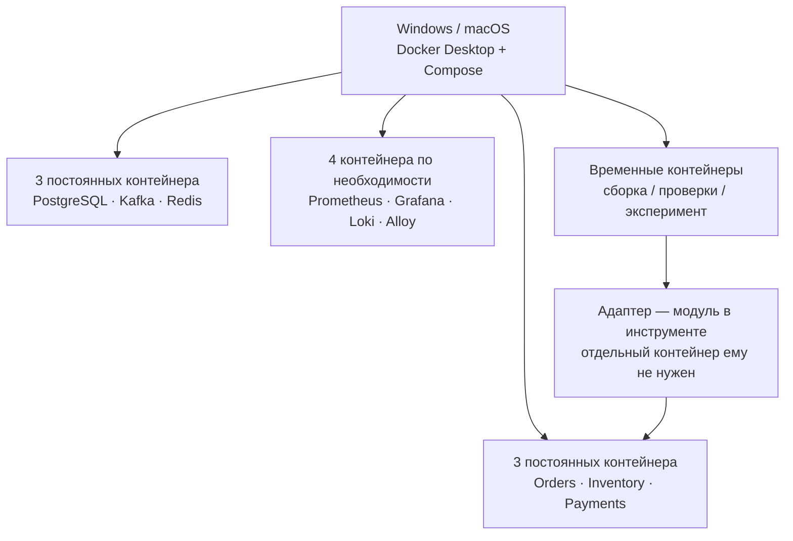

# Переносимая среда разработки и экспериментов

Статус на 15 октября 2026 года: контейнерный подход Windows/macOS согласован. В P01-01 созданы Go-модуль, Dockerfile инструментов и Compose с временным toolchain; [команды и закреплённые версии](TOOLCHAIN.md). Runtime-образы сервисов, health и бизнес-операции ещё не реализованы. Проверенные результаты CI указаны в контексте/PR; Docker на локальном Windows и личный Mac пока не проверены.

## Что согласовано

На Windows и macOS используется Docker Desktop с Linux-контейнерами. Docker Compose объединяет отдельные контейнеры сервисов и инфраструктуры. Сборка Go, тесты и инструменты проверок выполняются в контейнерной среде; установленный на хосте Go не обязателен для основного пути разработки.

Для x64 и Apple Silicon планируются нативные варианты образов `linux/amd64` и `linux/arm64`. Архитектура личного Mac пока не уточнялась. Эмуляция другой архитектуры не используется как основание для сопоставимых замеров производительности. Docker описывает варианты образов и ограничения эмуляции в [руководстве по multi-platform builds](https://docs.docker.com/build/building/multi-platform/).

## Распределение контейнеров

Числа относятся к планируемому составу с одной репликой каждого сервиса. Экспортеры, дополнительные реплики и диагностические инструменты могут потребовать дополнительных контейнеров и будут отражены в manifest.

| Компонент | Размещение | Причина |
| :--- | :--- | :--- |
| Orders, Inventory, Payments | По одному контейнеру на сервис и на его реплику | Независимые рестарты, health, логи, ограничения ресурсов и масштабирование |
| Воркеры, outbox, управление заказом | Внутри своего бизнес-сервиса | Это части принятого сервиса G0; отдельный контейнер на каждый внутренний механизм не требуется |
| PostgreSQL | Один контейнер, три базы и отдельные роли | Уже принятый компромисс малого стенда; владение данными сохраняется |
| Kafka | Один брокер в отдельном контейнере на старте | Независимый backlog, рестарт и ресурсный предел; отказоустойчивость кластера этим составом не моделируется |
| Redis | Отдельный контейнер | Можно независимо проверить отказ кеша и нагрузку fallback на SQL |
| Prometheus, Grafana, Loki, Alloy | По одному контейнеру на компонент | Разные задачи, конфигурация, хранение и жизненный цикл; запускаются нужным набором |
| Toolchain | Общий образ с Go и закреплёнными инструментами, временные запуски | Не держать компилятор и линтер работающими всё время |
| Loadgen, verifier, экспорт и отчёт | Общий образ инструментов лаборатории, запуск по задаче | Не требуется отдельный постоянный контейнер для каждой CLI-команды |
| Адаптер бизнеса | Модуль внутри инструментов лаборатории | Обозначение на схеме не означает дополнительный сервис |

Docker рекомендует разделять ответственности по сервисам; несколько процессов внутри контейнера допустимы. Поэтому правило здесь — независимый жизненный цикл и измеряемая ответственность, а не формальное «один процесс». [Docker: несколько процессов в контейнере](https://docs.docker.com/engine/containers/multi-service_container/).

Объединить три бизнес-сервиса в один контейнер технически возможно, но для этого проекта невыгодно: обычные остановка и лимит ресурсов контейнера затронут все три, а масштабирование скопирует весь набор. Раздельные условия придётся воссоздавать дополнительным управлением процессами. Это затруднит эксперименты по поиску узкого места.

Объединение PostgreSQL, Kafka и Redis также не устраняет потребление памяти их процессами и кешами, но усложняет независимые сбои, health и обслуживание данных. Фактический расход ресурсов нужно измерить на готовом стенде; число контейнеров само по себе не определяет требуемую RAM.

Рекомендуемый состав: **6 постоянных контейнеров основного стенда**, **10 с полной базовой наблюдаемостью**, плюс временные инструменты во время выполнения задач. На этапе P01 достаточно каркаса трёх сервисов и toolchain; инфраструктура добавляется в следующих пакетах. Полная наблюдаемость обязательна для соответствующих экспериментов, а не для каждой сборки кода.

## Профили и запуск по этапам

В roadmap уже предусмотрены `core` и `obs`. Предлагается сохранить их смысл: основной стенд и дополнительная наблюдаемость; конкретное устройство Compose и команды будут предъявлены вместе с реализацией. Toolchain и lab-инструменты запускаются явно по задаче. Не добавляются обязательные admin UI, reverse proxy или постоянный сервис адаптера без потребности эксперимента.

[Профили Compose](https://docs.docker.com/compose/how-tos/profiles/) позволяют включать нужные наборы компонентов. Компоненты без профиля запускаются по умолчанию; при реализации нужно проверить также явный запуск отдельного сервиса и его зависимости.

Дорогие линтеры, сборка и формирование отчёта не выполняются одновременно с измеряемой нагрузкой без специально оговорённого эксперимента. Сам генератор и наблюдаемость потребляют ресурсы: их лимиты, насыщение и влияние отражаются в отчёте. Разделение контейнеров на одном компьютере не создаёт физически независимые машины.

## Требования к будущей реализации

- Multi-stage сборка: toolchain готовит бинарник, runtime-образ запускает сервис. Go, библиотеки, инструменты и образы закрепляются при реализации; выбранные версии записываются в manifest.
- Относительные пути и переносимые Docker/Compose-команды. Обязательный путь запуска не зависит от Bash, Homebrew или установленного на хосте Go. Внешняя проверка переносимого контекста пока остаётся PowerShell-инструментом.
- Для данных PostgreSQL и других компонентов используются явно описанные volumes; очистка тестового стенда — отдельное действие. В Compose нет абсолютных путей исходного компьютера.
- Каждый сервис корректно обрабатывает остановку, имеет health и пишет структурированные логи. Готовность зависимостей подтверждается проверкой; порядок старта сам по себе не доказывает готовности.
- Контейнеры обращаются друг к другу через имена сервисов Compose. На хост публикуются только нужные точки доступа. [Docker: сеть Compose](https://docs.docker.com/compose/how-tos/networking/).
- Профиль определяет, где выполняется генератор: внутри Compose или вне тестируемой среды. При подключении другого бизнеса это не должно требовать изменения его исходного кода.

В [P01](../architecture/DESIGN.md) к трём entrypoints, конфигурации, gRPC health, shutdown, JSON-логам и Go CI добавляются образы сервисов, контейнерный toolchain и минимальный Compose-запуск. PostgreSQL/Kafka/Redis, базы, роли, миграции и seed остаются P02. Сначала готовится рабочий набор файлов, затем выполняются доступные проверки и предъявляются ограничения.

## Что известно о текущем компьютере

Текущий хост — Windows x64, PowerShell 7.6.5. Команды Go и Docker не обнаружены в текущем PATH; стандартные проверенные расположения установки также отсутствуют. Это не доказывает отсутствия любых иных установок. Docker daemon, WSL, версии Docker/Compose и запуск контейнеров не проверены. Ничего не устанавливалось.

Характеристики Windows-хоста прочитаны и сохранены в [ресурсных профилях](RESOURCE_PROFILES.md). Бюджет Docker, потребление стенда и macOS-окружение ещё не проверены. Возможный арендуемый сервер рассматривается позже при необходимости; он не выбран. Запуск на Windows и macOS будет подтверждён отдельно. Docker делает сборку и конфигурацию переносимыми, но одинаковой производительности разных компьютеров не обещает.

Для A/B по умолчанию используется одна машина с одинаковым бюджетом и нативной архитектурой. Сравнение между Windows и macOS возможно как отдельный эксперимент с явными ограничениями. В manifest сохраняются архитектура CPU, аппаратные ресурсы, OS, Docker, volumes, image digests и фактические лимиты.

Для перехода от плана к проверенному запуску нужны доступные Docker Desktop/Compose и проверка ресурсов машины. Выбор версий и точные команды относятся к пакету реализации, а не к уже выполненной работе.
