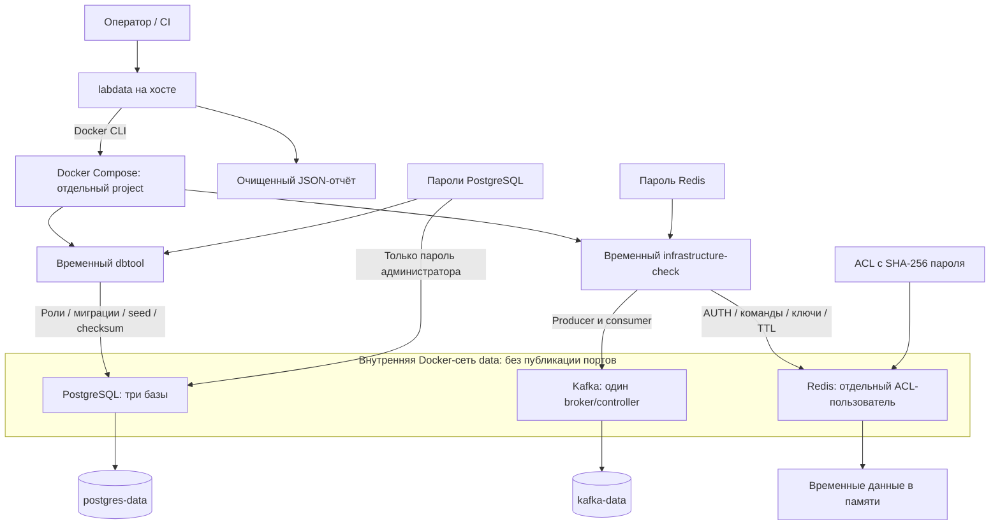

# Kafka и Redis: совместная проверка инфраструктуры

Платформы фактических образов, бюджет Docker, лимиты и стартовый снимок потребления описаны в [метаданных запуска](RUN_METADATA.md).

[Задача #16](https://github.com/Includeoyasi/faultline-lab/issues/16) добавляет Kafka и Redis к [PostgreSQL](POSTGRES.md). Три бизнес-сервиса остаются отдельными gRPC-процессами; этот пакет проверяет инфраструктуру до подключения бизнес-обработчиков. Результаты конкретных запусков и ограничения среды — в [отчёте](evidence/p02/INFRASTRUCTURE.md).

## Состав и границы доступа



Временный `infrastructure-check` использует образ labdata, но не получает конфигурацию и пароли PostgreSQL. Постоянного четвёртого бизнес-сервиса нет. Отключение проверок не является остановкой инфраструктуры.

Состав задают `compose.yaml`, `compose.postgres.yaml` и `compose.infrastructure.yaml`. Последний файл добавляет два постоянных контейнера и временную проверку. Базовый smoke сервисов и PostgreSQL-only `labdata smoke` сохраняют самостоятельный запуск.

| Компонент | Лимит памяти / CPU | Данные и ограничения |
| :--- | :--- | :--- |
| PostgreSQL | 512 MiB / 0.5 | Постоянный volume; три логически изолированные базы |
| Kafka | 640 MiB / 0.75 | Постоянный volume; JVM heap 128–256 MiB; одна партиция и RF=1 |
| Redis | 128 MiB / 0.25 | `maxmemory=64mb`, `allkeys-lru`, без AOF/RDB; содержимое кеша не обязано переживать restart |
| dbtool | 256 MiB / 1 | Временная подготовка и проверки PostgreSQL |
| infrastructure-check | 256 MiB / 0.5 | Временные проверки Kafka/Redis; запускается отдельно от dbtool |

Это ограничения локального функционального стенда. Лимиты постоянных контейнеров составляют 1280 MiB; JVM native memory, health-процессы, файловый кеш и Docker/WSL также расходуют память. Фактический снимок не доказывает достаточность ресурсов под нагрузкой.

Kafka работает в KRaft с явными broker/controller listeners, статическим quorum и постоянным cluster ID. Автоматическое создание топиков выключено. Один broker не обеспечивает репликационную доступность: `acks=all` здесь означает подтверждение единственным ISR. Сохраняется проверка штатного restart, а не аварии диска/хоста.

Redis запускается с выключенным `default` user. Пользователь `lab` имеет только необходимые команды и ключи `faultline:smoke:*`. Сервер получает ACL с хешем пароля, проверка — отдельный файл пароля. Ни пароль, ни хеш не выводятся в отчёт. Каталог секретов и правила прав файлов соответствуют [локальной модели PostgreSQL](POSTGRES.md#подготовка-стенда).

Контейнеры зависимостей и runtime-проверок непривилегированные, с read-only root, без capabilities и с `no-new-privileges`; запись разрешена в явные volume/tmpfs. Временный toolchain имеет отдельные права для сборки в workspace, описанные в [его руководстве](TOOLCHAIN.md). Порты доступны через DNS внутренней сети: `postgres`, `kafka:9092`, `redis:6379`. Kafka PLAINTEXT и Redis без TLS допустимы только в этом изолированном локальном профиле; удалённое размещение требует отдельного профиля аутентификации, TLS и сетевых правил.

## Автоматический прогон

Из корня checkout на Windows AMD64:

```powershell
docker compose build toolchain
docker compose run --rm -e GOOS=windows -e GOARCH=amd64 toolchain data-build
.\bin\labdata-windows-amd64.exe smoke -infrastructure
```

Для macOS/Linux задаются соответствующие `GOOS` и `GOARCH`, результат — `bin/labdata-<os>-<arch>`. Реальный запуск на личном Mac должен подтверждаться отдельно. При установленном Go допустим `go run ./cmd/labdata smoke -infrastructure`.

Прогон создаёт собственный `faultline-data-test-<ID>`, временные секреты и отчёт. Внутри последовательно выполняются:

1. Сборка инструментов, готовность PostgreSQL/Kafka/Redis, фиксация бюджета Docker и лимитов контейнеров.
2. Существующие проверки прав, миграций и seed PostgreSQL; контрольная сумма истории и данных.
3. Redis: правильный пароль; точные отказы `NOAUTH`, `WRONGPASS`, `NOPERM`; разрешённые SET/GET, положительный PTTL, затем реальное истечение ключа и отсутствие значения.
4. Kafka: создание нового изолированного топика, отправка и чтение записи. Сохраняются её фактические topic, partition, offset, key и value.
5. Штатный restart всех трёх зависимостей с прежними volumes. Повторная подготовка PostgreSQL не меняет контрольную сумму. Новый consumer Kafka читает **ту же запись по сохранённому offset**, затем проверяется новая запись. Redis снова проходит проверки, без требования сохранности кеша.
6. Снимок ресурсов, ограниченный сбор логов и удаление контейнеров, сетей, volumes, временных образов и секретов **только этого запуска**. Ошибка или отмена также приводит к cleanup с отдельным контекстом.

Отчёт находится в `artifacts/infrastructure/<project>/report.json`. Он содержит стадии, очищенный вывод, итог и результат cleanup. CI публикует только `report.json`. Диагностика регистрируется перед сборкой/запуском, поэтому доступна и после частичного startup failure. Пароли, их хеши и домашние пути редактируются до записи.

`timeout` и `probe_ttl` задаются в [публичном профиле](../../configs/infrastructure/local.json). У клиентов нет бесконечных повторов; короткий внешний deadline проверяется на TCP-соединении, которое принимает запрос, но не отвечает. Настройки адресов и Redis ACL проверяются до подключения.

У probe-producer явно разрешена отмена in-flight идемпотентной записи: при потере подтверждения тест завершается ошибкой и удаляет свой стенд, не повторяя запись приложением. Это ограничивает ожидание, но не позволяет считать неизвестный результат отсутствием записи. Политика бизнес-outbox должна отдельно учитывать этот исход.

## Постоянный локальный стенд

Подготовить пароли и запустить инфраструктуру без автоматического удаления данных:

```powershell
.\bin\labdata-windows-amd64.exe secrets -infrastructure
$infraCompose = @('compose', '-f', 'compose.yaml', '-f', 'compose.postgres.yaml', '-f', 'compose.infrastructure.yaml', '-p', 'faultline-data-local')
docker @infraCompose build dbtool infrastructure-check
docker @infraCompose up -d --wait postgres kafka redis
docker @infraCompose run --rm --no-deps dbtool bootstrap
docker @infraCompose run --rm --no-deps dbtool migrate
docker @infraCompose run --rm --no-deps dbtool seed
```

`secrets -infrastructure` сохраняет существующие корректные пароли; Redis ACL должен соответствовать профилю и паролю. Несовпадение отклоняется, а не исправляется неявной ротацией. `FL_INFRA_SECRETS_DIR` задаёт Compose каталог, который должен совпадать с `-infrastructure-secrets` при подготовке. Файлы Kafka/Redis находятся в `configs/kafka` и `configs/redis`.

`check-infrastructure` — внутренняя двухфазная команда smoke. `before-restart` требует нового топика; `after-restart` принимает сохранённый JSON через `-checkpoint`. Её нельзя повторно запускать на занятом топике и считать результат новой проверкой. Для регулярных проверок используйте изолированный `smoke -infrastructure`.

Обычная остановка сохраняет оба постоянных volume:

```powershell
docker @infraCompose down --remove-orphans
```

Явное удаление данных указанного стенда требует повторить имя проекта:

```powershell
.\bin\labdata-windows-amd64.exe reset -infrastructure -project faultline-data-local -confirm faultline-data-local
```

Пароли постоянного стенда сохраняются в `.local`. Общие образы зависимостей и полезные build caches не удаляются. После локальных проверок на личном компьютере нужно выключить Docker Desktop и его WSL VM; автоматический smoke удаляет свои ресурсы, но не останавливает Docker других пользователей/задач самостоятельно.

## Границы следующего этапа

В этом пакете нет бизнес-событий, обработчиков Orders/Inventory/Payments, outbox/inbox, отказоустойчивого Kafka-кластера или универсального генератора нагрузки. [Проектирование порядка и fencing F09](../architecture/KAFKA_PUBLISHING.md) задаёт отдельные требования для будущего outbox; текущий producer/consumer smoke их не доказывает.
