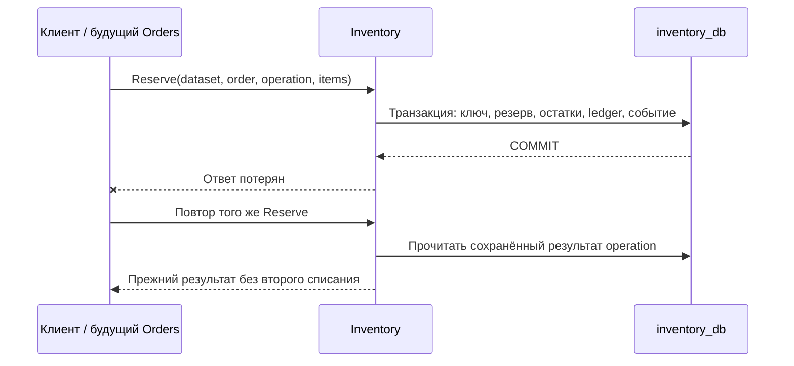
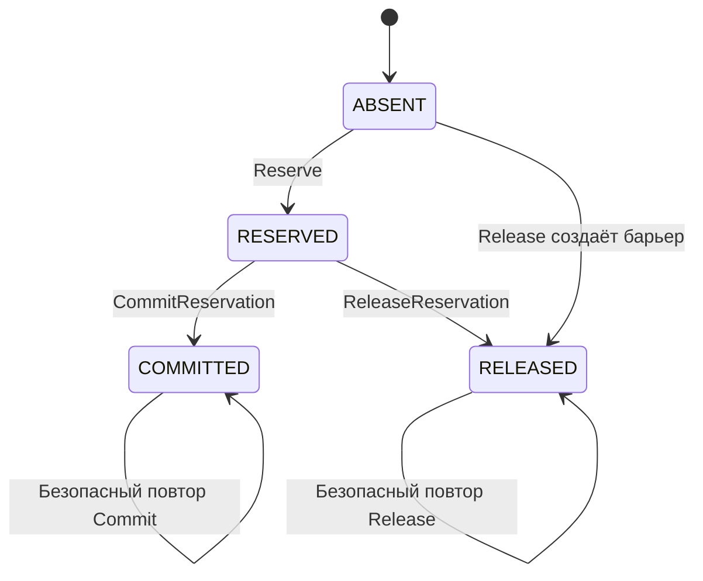
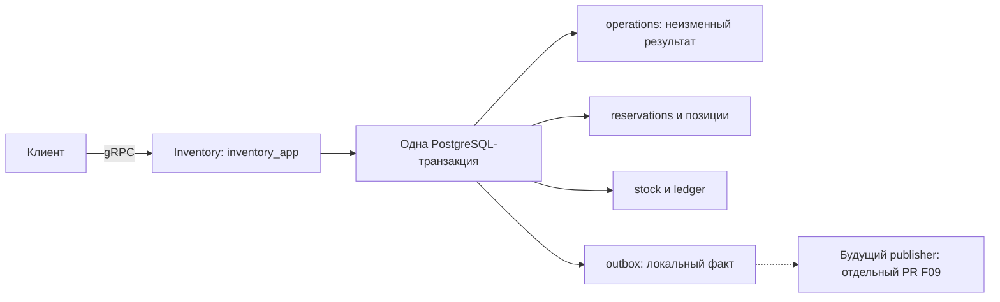

# Склад: резервирование, продажа и освобождение

Inventory обслуживает пять RPC из [контракта v1](../../api/inventory/v1/inventory.proto) и владеет своей PostgreSQL-базой. Это первый рабочий бизнес-срез согласованной архитектуры; Orders и Payments подключаются следующими изменениями. [Issue #26](https://github.com/Includeoyasi/faultline-lab/issues/26) содержит критерии и актуальное ревью.

## 1. Проблема и проверяемые случаи

Два покупателя могут одновременно запросить последний товар, а потерянный ответ может заставить клиента повторить уже выполненную операцию. Отмена может обогнать задержанное резервирование: после завершившегося Release товар нельзя зарезервировать снова для того же заказа. Поэтому нужна атомарная операция склада и долговечная память о запросах, включая подтверждённые отказы. Техническая ошибка или timeout оставляет результат неизвестным; клиент повторяет прежний ключ, а не создаёт новый.



| Случай | Требуемый итог |
|---|---|
| 100 запросов на 10 единиц | 10 успешных резервов, доступность 0 |
| Не хватает второй позиции | Первая позиция также не списана |
| Release выполнен до Reserve | Сохранён RELEASED-барьер, поздний Reserve отклонён |
| Commit и Release одновременно | Один терминальный переход, один эффект |
| Ошибка записи локального события | Вся складская транзакция откачена |

## 2. Паттерны и варианты реализации

Используется автомат состояний одного агрегата и идемпотентная операция с неизменным результатом. PostgreSQL хранит ключ запроса, резерв и движения остатков в одной транзакции; локальный outbox сохраняет предназначенный для дальнейшей публикации факт. Транзакционные advisory-блокировки сериализуют ключ операции и заказ даже тогда, когда резерв ещё не существует; блокировки товарных строк берутся в порядке SKU. Альтернатива — отдельные строки блокировки заказов: они дают ту же защиту отсутствующего резерва, но требуют ещё одной долговечной сущности. Redis остаётся будущим кешем чтения и не участвует в разрешении продажи.



## 3. Решение и его цена

Успешный Reserve фиксирует позиции, цены, валюту и итог; один заказ имеет не больше одного резерва. Ответ `OperationResult` — исторический результат конкретной операции: повтор Reserve после Release вернёт прежний результат Reserve, а `GetReservation` покажет текущее `RELEASED`. Отказы `INSUFFICIENT_STOCK`, `UNKNOWN_SKU`, `INVALID_STATE` и `RESERVATION_EXISTS` также сохраняются, поэтому повтор не меняет смысл после изменения склада. Это требует хранить ключи, отказы, барьеры и события всю жизнь набора данных; TTL и выборочной очистки нет. Один Inventory database принадлежит одному неизменному `dataset_id`, который проверяется в каждом запросе; подключение другого набора к сохранившейся базе отвергается.

| Ответ | Значение для клиента |
|---|---|
| `OUTCOME_APPLIED` | Операция подтверждена; snapshot относится к моменту этой операции |
| Остальные `Outcome` | Подтверждённый и сохранённый бизнес-отказ |
| `INVALID_ARGUMENT` | Некорректный ввод, операция не сохранена |
| `ALREADY_EXISTS` | Прежний operation_id использован с другим методом/заказом/позициями |
| `FAILED_PRECONDITION` | Запрос относится к другому набору данных |
| `UNAVAILABLE`, `DEADLINE_EXCEEDED`, `CANCELLED` | Результат мутации может быть неизвестен; повторить тот же ключ |
| `NOT_FOUND` из GetReservation | Сейчас записи нет; это не барьер для уже выполняющегося Reserve |

## 4. Реализация и запуск текущего среза

Хранилище находится в [internal/inventory/store](../../internal/inventory/store/store.go): конструктор и внутренние функции — в `store.go`, методы `Mutate`, `GetReservation`, `GetAvailability` и `Close` — каждый в своём файле, SQL-запросы — в константах рядом с использующим их кодом. Общие типы и проверка идентичности операции вынесены в [model](../../internal/inventory/model/model.go), который используют хранилище и gRPC-сервер.

Новая [миграция 0003](../../migrations/inventory/0003_reservations.sql) добавляет резервы, позиции, операции, ledger, локальный outbox и привязку базы к набору; старые миграции не изменяются. Сам сервис читает только свой прикладной секрет и не создаёт базы, роли или таблицы. Перед запуском нужно подготовить PostgreSQL командами из [POSTGRES.md](POSTGRES.md), затем задать уникальный идентификатор набора; после удаления набора новый запуск получает новое значение. Контейнерный профиль [compose.inventory.yaml](../../compose.inventory.yaml) включает бизнес-API, а минимальный compose запускает явную команду `health-only` для проверки каркаса. Protobuf-код генерируется закреплёнными protoc 32.1, protoc-gen-go 1.36.11 и protoc-gen-go-grpc 1.6.2; [стандартная генерация gRPC Go](https://grpc.io/docs/languages/go/quickstart/#regenerate-grpc-code) выполняется внутри toolchain.

```powershell
$env:FL_INVENTORY_DATASET_ID = 'dataset-' + [guid]::NewGuid().ToString('N')
docker compose -f compose.yaml -f compose.postgres.yaml -f compose.inventory.yaml -p faultline-data-local up -d --build --wait postgres inventory
docker compose run --rm toolchain generate
```

Для повторного старта существующего набора сохраняйте прежнее значение `FL_INVENTORY_DATASET_ID`. Профиль предназначен для изолированной локальной сети Docker, без публикации бизнес-порта на хост.



## 5. Фокус ревью и проверки

Проверьте различие исторического ответа операции и актуального состояния: старый успешный Reserve не означает, что товар всё ещё зарезервирован. Отдельно важны Release до Reserve, смена ключа при том же заказе и невозможность освобождения уже проданного товара. Интеграционный smoke проверяет настоящую конкуренцию PostgreSQL, откат при сбое outbox, отмену ожидающей блокировки операции, рестарт процесса Inventory и рестарт PostgreSQL. Его команда — `labdata smoke`; совместный запуск с Kafka/Redis — `labdata smoke -infrastructure`, результаты и очистка сохраняются в `artifacts/`. Сохранённое локальное событие пока не означает отправку в Kafka, полный F10 для трёх сервисов и приёмку G1: эти результаты требуют следующих функциональных срезов.
