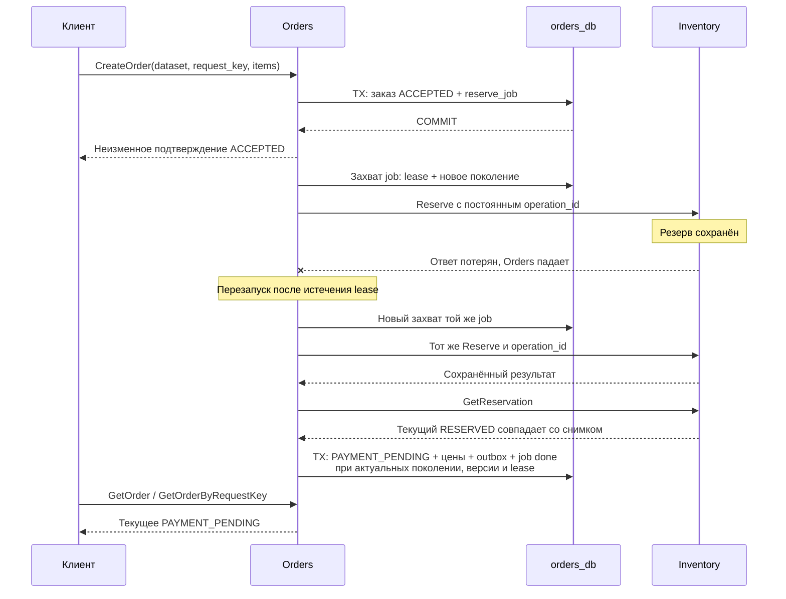

# Orders: приём заказа и устойчивое резервирование

## 1. Проблема и проверяемые случаи

Orders принимает заказ раньше, чем заканчивается резервирование в Inventory. Ответ `ACCEPTED` подтверждает сохранённые заказ и задачу, а текущее состояние читается отдельно. Главный отказный случай — Inventory сохранил резерв, но Orders потерял ответ или упал перед сохранением результата. После перезапуска повторяется прежняя операция, поэтому один заказ не расходует товар дважды. Этот срез заканчивается на `PAYMENT_PENDING`: оплата и завершение покупки требуют следующих пакетов.



| Случай | Требуемый результат |
|---|---|
| Повтор Create с тем же смыслом | Тот же order_id и прежнее подтверждение приёма |
| Тот же ключ с другими позициями | ALREADY_EXISTS без второго заказа |
| Подтверждённая нехватка или неизвестный SKU | REJECTED с сохранённой причиной |
| Timeout или недоступность Inventory | Сохранённый незавершённый шаг и следующая попытка |
| Поздний результат старого worker | Не меняет заказ, job или outbox |
| Исторический RESERVED, текущий RELEASED | Видимая блокировка job; заказ остаётся RESERVING |

## 2. Паттерны и варианты

Используется принятый в G0 durable workflow внутри Orders: одна конкретная задача резервирования в PostgreSQL. Ключ клиентского запроса защищает приём, а постоянный `reserve_operation_id` — внешний эффект в Inventory. Короткий SQL-захват использует `FOR UPDATE SKIP LOCKED`, lease и поколение; завершение дополнительно проверяет версию заказа и время БД. RPC выполняются после завершения транзакции захвата. Это SQL-защита записи результата, а протокол Kafka publisher/F09 реализуется отдельно.

| Вариант | Следствие |
|---|---|
| Reserve только внутри клиентского RPC | После неизвестного исхода нет сохранённого продолжения |
| Очередь только в памяти | Принятая работа теряется с процессом |
| Одна reserve_job в orders_db | Нужны повтор и fencing; принятый шаг переживает рестарт |

Основа: [PostgreSQL locking clause](https://www.postgresql.org/docs/18/sql-select.html#SQL-FOR-UPDATE-SHARE), [gRPC deadlines](https://grpc.io/docs/guides/deadlines/), [принятый процесс](../architecture/PROCESSES.md).

## 3. Решение и компромиссы

Приём одной транзакцией сохраняет канонические позиции, хэш запроса, заказ и job; `request_key` уникален в неизменном наборе данных. Ответ Create всегда описывает первоначальное принятие, даже когда GetOrder уже показывает другой этап. Успех Reserve проверяется по идентификаторам, составу и количеству позиций, валюте, ценам и сумме без переполнения, затем сверяется с GetReservation. Подтверждённый успех атомарно сохраняет снимок цен, `PAYMENT_PENDING`, локальный `OrderAwaitingPayment` и завершённую job. Только `INSUFFICIENT_STOCK` и `UNKNOWN_SKU` завершают заказ как `REJECTED`; противоречия и ошибки контракта блокируют job с диагностическим кодом. Цена восстановления — дополнительные SQL-записи и запрос сверки; SQL-соединение с открытой транзакцией во время RPC не удерживается. Сетевые ошибки повторяются без фиксированного лимита количества попыток, с ограниченными ресурсами и backoff с jitter.

| API / состояние | Семантика |
|---|---|
| CreateOrder → Acceptance | Неизменный ответ ACCEPTED после commit |
| GetOrder / GetOrderByRequestKey | Текущее состояние и причина блокировки, если она есть |
| ACCEPTED → RESERVING | Job взята в работу; её идентичность сохраняется |
| PAYMENT_PENDING | Резерв подтверждён; платежа ещё нет |
| REJECTED | Подтверждённый сохранённый бизнес-отказ Inventory |
| INVALID_ARGUMENT / ALREADY_EXISTS | Неверный ввод / конфликт смысла прежнего ключа |
| FAILED_PRECONDITION / NOT_FOUND | Чужой dataset / заказ сейчас не найден |
| UNAVAILABLE / DEADLINE_EXCEEDED / CANCELLED | Исход приёма может быть неизвестен; повторить прежний ключ |

## 4. Реализация, запуск и критерии G1

API задан в [orders.proto](../../api/orders/v1/orders.proto); SQL находится в [store](../../internal/orders/store/store.go), по одному публичному методу на файл и с запросами в константах. Новая [миграция 0002](../../migrations/orders/0002_reservations.sql) добавляет dataset binding, заказы с каноническими позициями, reserve jobs и локальный outbox, сохраняя прежнюю миграцию. Бизнес-процесс запускается обычной командой Orders, а `health-only` оставляет доступными независимые проверки каркаса. Конфигурация явно задаёт адрес Inventory, прикладную роль orders_app, SQL-пул, workers, RPC/lease/retry-бюджеты. Lease должен покрывать общий RPC-бюджет, фиксацию результата и секундный запас; время владения проверяется в PostgreSQL. Интеграционный `labdata smoke` проверяет приём, конкуренцию, откаты, устаревшие попытки, SIGKILL до и после эффекта Inventory и повтор API после перезапуска PostgreSQL. Состав доказательств и границы фактических прогонов находятся в PR и Actions, а решение о G1 принимает владелец проекта.

После подготовки баз по [POSTGRES.md](POSTGRES.md) один dataset задаётся обоим сервисам:

```powershell
$env:FL_INVENTORY_DATASET_ID = 'dataset-' + [guid]::NewGuid().ToString('N')
$env:FL_ORDERS_DATASET_ID = $env:FL_INVENTORY_DATASET_ID
docker compose -f compose.yaml -f compose.postgres.yaml -f compose.inventory.yaml -f compose.orders.yaml -p faultline-data-local up -d --build --wait postgres inventory orders
docker compose run --rm toolchain generate
```

| Критерий G1: основа заказа и склада | Доказательство для ревью |
|---|---|
| Код, миграции и три API Orders работают с Inventory | Реальные PostgreSQL, TCP gRPC и scratch-контейнеры |
| Повторы не создают новый заказ или складской эффект | Конкурентный одинаковый ключ, конфликт payload, повтор после прогресса и рестарта |
| Конкуренция сохраняет складской баланс | 1000 попыток на 100 единиц: 100 PAYMENT_PENDING, 900 подтверждённых отказов |
| Принятый шаг переживает падение процесса | SIGKILL до Reserve и после commit Inventory; прежний operation_id после перезапуска |
| Неактуальный worker не перезаписывает результат | Поколение/версия и истечение lease во время SQL-ожидания |
| Транзакционные границы сохраняются при ошибке | Ошибка вставки job или outbox откатывает весь соответствующий переход |
| Нет нерешённых нарушений складских инвариантов | Ревью и обязательные проверки итогового HEAD успешны |
| Владелец принимает этап | Явное решение G1; может быть принято вместе с ревью MR |

## 5. Акценты ревью и границы пакета

Проверьте различие исторического подтверждения Create и текущего состояния GetOrder, а также исторического Reserve receipt и актуального резерва. Захват и завершение блокируют сначала job, затем заказ; последняя проверка lease откатывает также уже подготовленный outbox. Противоречивый ответ не даёт автоматического успеха, отказа, возврата или повторного резерва под новым ключом. Ключи, блокировки и локальные события живут весь срок dataset без TTL; полный согласованный reset всех трёх сервисов относится к продолжению F10. F11 уже согласован для неизвестного Commit в FINALIZING, но этот срез Commit не выполняет и F11 не закрывает. Базовая приёмка G1 из [workflow](WORKFLOW.md) относится к заказу и складу, а модель Payments и базовые метрики из расширенного состава этапа 1 roadmap должны быть явно учтены при обсуждении полноты этапа. Здесь подготовлена основа и доказательства для этого решения; сквозной MVP/G2 требует Kafka, Payments, компенсаций и инструментов эксперимента.

| Продолжение | Граница |
|---|---|
| F09 | Отдельный согласованный протокол и PR для публикации Kafka |
| Payments, CancelOrder и финализация/F11 | Следующие бизнес-пакеты |
| Redis, loadgen, verifier и наблюдаемость | Подготовка сквозного эксперимента |
| F06/F12 и допуск A/B | Перед сравнением эффективности, без вывода о capacity из smoke |
