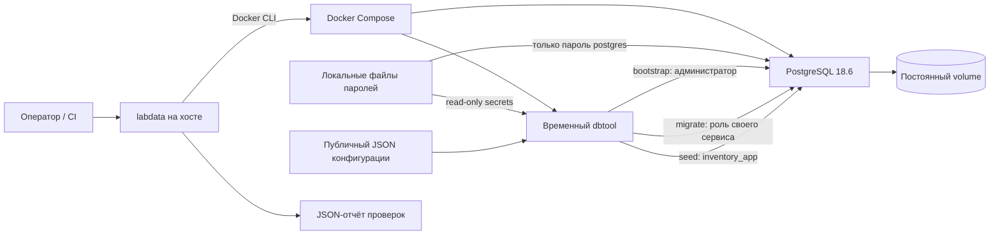
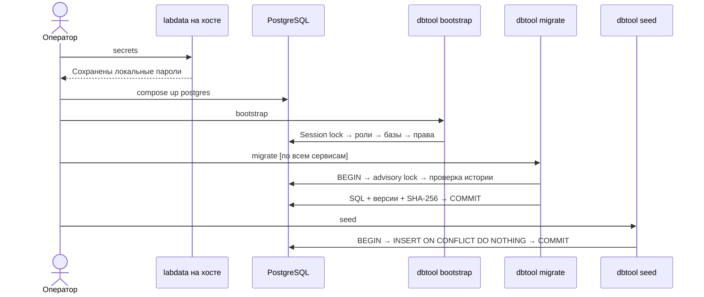

# PostgreSQL: подготовка данных и проверка изоляции

Основа данных для [задачи #12](https://github.com/Includeoyasi/faultline-lab/issues/12): один PostgreSQL, три отдельные базы, прикладная и миграционная роль для каждой базы, миграции и небольшой каталог Inventory. Команды выполняются из корня checkout. Фактические проверки и ограничения среды сохраняются в [отчёте](evidence/p02/POSTGRES.md).

## Состав и взаимодействия



`dbtool` и PostgreSQL соединены внутренней сетью `data`: порт базы на хост не публикуется. PostgreSQL работает от UID 999, dbtool — от UID 65532; файловая система контейнеров read-only, запись разрешена только в volume/tmpfs. У PostgreSQL лимит 512 MiB и 0.5 CPU; у временного dbtool — 256 MiB и 1 CPU. Это ограничения локального стенда, не измеренная производственная ёмкость.

Три бизнес-сервиса пока сохраняют свой gRPC-каркас. Подключение их бизнес-операций к базам будет следующим изменением. Kafka/Redis относятся к отдельной [задаче #16](https://github.com/Includeoyasi/faultline-lab/issues/16).

PostgreSQL добавляется через `compose.postgres.yaml`. Базовый `compose.yaml` и существующий smoke трёх сервисов запускаются независимо от подготовки паролей базы.

## Кто что может делать

| Роль | Доступ | Назначение |
| :--- | :--- | :--- |
| `postgres` | Административный доступ к выделенному экземпляру | Создание баз и ролей, настройка прав; используется только инструментом подготовки |
| `orders_migrator` / `inventory_migrator` / `payments_migrator` | Владелец только своей базы | Создание и изменение схемы, журнал миграций |
| `orders_app` / `inventory_app` / `payments_app` | CONNECT к своей базе, USAGE своей схемы, SELECT/INSERT/UPDATE/DELETE бизнес-таблиц | Будущая работа приложений; Inventory seed использует эти же ограниченные права |

У прикладных ролей нет SUPERUSER, CREATEDB, CREATEROLE, REPLICATION, BYPASSRLS, членства в миграционных ролях и DDL/TEMP/TRUNCATE. Доступ к чужим базам, `postgres`, `template1` запрещён. Стандартные права PUBLIC отозваны явно. Журнал `lab_migrations.versions` находится вне бизнес-схемы и прикладной роли недоступен. Права на будущие таблицы выдаются через `ALTER DEFAULT PRIVILEGES` от миграционной роли.

Таблица описывает SQL-подключения команд. Сам контейнер dbtool в текущей конфигурации получает все семь секретов, включая административный: разделения полномочий между его режимами на уровне контейнера нет. Это привилегированный инструмент подготовки; бизнес-сервисам эти секреты и доступ к чужим базам не передаются.

Один экземпляр PostgreSQL выбран для экономии ресурсов личного компьютера. Базы логически изолированы, но делят CPU, память и отказ экземпляра. Это позволяет проверять права и миграции; для эксперимента с независимыми отказами самих БД потребуется отдельная конфигурация.

## Подготовка стенда

Сначала собирается host-бинарник средствами контейнерного toolchain. Для Windows AMD64:

```powershell
docker compose build toolchain
docker compose run --rm -e GOOS=windows -e GOARCH=amd64 toolchain data-build
.\bin\labdata-windows-amd64.exe secrets
docker compose -f compose.yaml -f compose.postgres.yaml -p faultline-data-local build dbtool
docker compose -f compose.yaml -f compose.postgres.yaml -p faultline-data-local up -d --wait postgres
docker compose -f compose.yaml -f compose.postgres.yaml -p faultline-data-local run --rm --no-deps dbtool bootstrap
docker compose -f compose.yaml -f compose.postgres.yaml -p faultline-data-local run --rm --no-deps dbtool migrate
docker compose -f compose.yaml -f compose.postgres.yaml -p faultline-data-local run --rm --no-deps dbtool seed
```

Для macOS в команде сборки задаются `GOOS=darwin` и `GOARCH=arm64` либо `amd64`, для Linux — `GOOS=linux` и архитектура хоста. Имя результата: `bin/labdata-<os>-<arch>`; на Unix перед запуском при необходимости выполнить `chmod +x`. `data-cross-check` собирает все пять вариантов; компиляция не подтверждает работу Docker на конкретном компьютере. При установленном Go host-команды можно выполнять как `go run ./cmd/labdata secrets`, `go run ./cmd/labdata smoke` и `go run ./cmd/labdata reset ...`. Команды `bootstrap/migrate/seed/checksum` штатного профиля выполняются через dbtool внутри Docker-сети: DNS-имя `postgres` с хоста недоступно, порт базы не опубликован.

`secrets` создаёт семь криптографически случайных паролей в `.local/postgres`, без вывода значений. Повторный вызов сохраняет их; повреждённый существующий файл отклоняется. Конфигурация адреса, порта, имён баз и ролей — в [local.json](../../configs/postgres/local.json). Пароли не входят в конфигурацию. `FL_PG_SECRETS_DIR` позволяет передать Compose другой каталог; `labdata secrets -secrets <каталог>` должен использовать тот же путь. В контейнере настройки читаются через `FL_DATA_CONFIG` и `FL_DATA_SECRETS`.

На POSIX каталог паролей имеет режим 0700, файлы — явно выставленный режим 0644 независимо от umask для чтения непривилегированным контейнером; доступ с хоста ограничен каталогом. На Windows доступ зависит от ACL профиля пользователя: `chmod` не заменяет настройку Windows ACL. Эти файлы и артефакты исключены из Git, CI публикует только очищенный `report.json`.

Подготовка использует SCRAM-SHA-256. TLS отключён в конфигурации внутренней Docker-сети локального стенда. Для удалённого развёртывания потребуется отдельный профиль TLS, секретов и сетевого доступа; этот профиль для публикации PostgreSQL в интернет не предназначен. Серверное логирование SQL и параметров отключено, включая SQL при ошибках: это предотвращает попадание пароля из `ALTER ROLE` в журнал.

## Порядок подготовки



Bootstrap повторяем после частичного сбоя: создание баз не может быть одной транзакцией PostgreSQL. Session lock сериализует подготовку, существующая база с неожиданным владельцем отклоняется, данные не удаляются. Пароли не меняются при обычном повторе подготовки.

### Где читать SQL

```text
internal/database/sql/
  bootstrap/01_*.sql ... 09_*.sql   подготовка ролей, баз и базовых прав
  migrate/01_lock.sql             блокировка в своей базе
  migrate/02_journal.sql          создание служебного журнала
  migrate/03_history.sql          проверка уже применённых версий
  migrate/04_record.sql           запись каждой новой версии после её SQL
  migrate/05_application_access.sql  повторяемая выдача app-прав
  seed/inventory.sql             начальные данные, отдельная команда
migrations/
  orders/0001_schema.sql
  inventory/0001_schema.sql
  inventory/0002_catalog.sql
  payments/0001_schema.sql
```

При подготовке для каждой роли выполняются шаги `02–04`, для каждой базы — `05–08`; шаг `09` ограничивает доступ к служебным базам. При миграции после чтения истории выполняются недостающие файлы своего сервиса по номеру и запись каждой версии; затем выдаются app-права и фиксируется транзакция. Начальные данные выполняются отдельно от этой последовательности.

DDL и запросы находятся в SQL-файлах. Для имён из конфигурации PostgreSQL `format` использует `%I` (идентификатор), для пароля — `%L` (значение). Параметризованный запрос возвращает готовую DDL-команду, которую инструмент исполняет; Go управляет подключениями, транзакциями и ошибками. Это сохраняет настраиваемые имена без сборки SQL конкатенацией и без нового языка шаблонов. Команды с паролями не выводятся в отчёты или логи.

Модули Go разделены по ответственности: `bootstrap.go` — подготовка, `migration_files.go` — порядок и SHA-256 файлов, `migrate.go` — применение и история, `seed.go` — начальные данные. SQL подготовки и app-прав повторяемый; он не считается бизнес-миграцией и не получает запись версии. Уже применённые файлы в `migrations/<service>` при этом не меняются.

Миграции лежат в `migrations/<service>/NNNN_name.sql` и встроены в dbtool. Их версии, имена, SHA-256 и время применения записываются в каждой базе. Изменение уже применённого SQL останавливает команду; исправление оформляется следующей миграцией. Параллельные команды сериализуются advisory lock до чтения журнала. Все новые миграции одного сервиса и записи их истории применяются в одной транзакции; ошибка откатывает весь этот набор. Разные базы применяются независимо: ошибка Payments не откатывает уже подготовленную Inventory. Повторная команда завершает оставшуюся работу.

Это небольшой транзакционный механизм для SQL данного стенда. Миграции не должны содержать `BEGIN/COMMIT/ROLLBACK` или команды, требующие выполнения вне транзакции, например `CREATE INDEX CONCURRENTLY`. Автоматического down/удаления схемы нет. Для запуска одного сервиса: `dbtool migrate -service inventory`.

## Что такое seed и зачем повторяемость

Здесь **seed — начальные тестовые данные**, а не случайное число:

| SKU | Товар | Цена в копейках | Валюта | Начальный остаток |
| :--- | :--- | ---: | :--- | ---: |
| SKU-001 | Notebook | 19900 | RUB | 100 |
| SKU-002 | Coffee | 45000 | RUB | 50 |
| SKU-003 | Headphones | 399000 | RUB | 25 |

Фиксированные SKU и значения дают известную исходную точку: тест может проверить конкретный товар, цену и остаток. Цены хранятся целыми числами в минимальных денежных единицах. Ограничения БД запрещают отрицательные цены/остатки, формат валюты, отличный от трёх заглавных букв и остаток без товара.

Повторяемость имеет два свойства:

1. На пустой базе seed создаёт одинаковый каталог.
2. На существующей базе повтор seed не создаёт дубликаты и не возвращает изменённые значения к исходным. Например, остаток 100 → 7 остаётся 7; изменённая цена также сохраняется. Это обеспечивается первичным ключом SKU и `ON CONFLICT DO NOTHING`.

**Повтор seed не равен сбросу эксперимента.** Для новой чистой исходной точки нужен отдельный набор данных/стенд или явный reset с повторной подготовкой. Нельзя запускать seed и считать уже использованную базу начальной: это исказит сравнение решений. Добавленный вручную товар не удаляется.

Числовой seed **будущего генератора нагрузки** задаёт воспроизводимый план операций; это отдельное решение F12 из [аудита #20](https://github.com/Includeoyasi/faultline-lab/issues/20). В #12 реализованы только начальные данные Inventory.

## Остановка и явное удаление данных

Штатная остановка сохраняет volume:

```text
docker compose -f compose.yaml -f compose.postgres.yaml -p faultline-data-local down --remove-orphans
```

Reset удаляет данные **указанного** выделенного проекта. Имя должно начинаться с `faultline-data-` и быть повторено в подтверждении:

```powershell
.\bin\labdata-windows-amd64.exe reset -project faultline-data-local -confirm faultline-data-local
```

Reset удаляет контейнеры, сети, volume и локальный образ dbtool данного проекта; общий PostgreSQL, toolchain и кеши сборки сохраняются. Команда ограничена минутой. Обычная остановка никогда не вызывает reset. Каталог `.local/postgres` не удаляется reset: существующие учётные данные пригодны для следующей подготовки. Для полной смены паролей нужен отдельный согласованный порядок ротации.

## Автоматическая проверка

```powershell
.\bin\labdata-windows-amd64.exe smoke
```

Smoke создаёт свой `faultline-data-test-<случайный ID>`, временные пароли и отчёт до первого Docker-вызова. Он собирает dbtool, поднимает PostgreSQL, дважды запускает bootstrap и проверяет:

- конкурентные миграции с нуля, отсутствие повторных версий и неизменность истории при повторе;
- матрицу подключения прикладных/миграционных ролей к трём базам, запреты DDL/TEMP/SET ROLE/журнала, разрешённые DML и права будущих таблиц;
- откат ошибочного SQL вместе с записью версии и обнаружение изменённого checksum;
- исходный каталог, отсутствие дубликатов, сохранение изменённых цен и остатков при повторе seed, ограничения таблиц;
- совпадение контрольной суммы каталога, остатков и полной истории миграций до и после перезапуска и повторной подготовки.

Команда `checksum` читает журнал миграций трёх баз и пары «товар — остаток» Inventory, упорядочивает данные и выводит SHA-256. Она не изменяет данные и сама не выполняет сравнение. Пример для подготовленного стенда:

```text
docker compose -f compose.yaml -f compose.postgres.yaml -p faultline-data-local run --rm --no-deps dbtool checksum
```

Smoke сравнивает контрольные суммы до и после перезапуска. Они сравниваются внутри одного набора данных: новый стенд имеет другие времена применения миграций и может получить другую сумму. Это проверка сохранности выбранных данных; схема и права проверяются отдельно. Она не заменяет backup и не является будущей контрольной суммой плана нагрузки.

После успеха, ошибки или перехваченной отмены cleanup получает новый контекст на 60s и удаляет только ресурсы своего одноразового проекта, включая volume и образ dbtool. Для очистки явно активируется профиль `tools`: выбор dbtool в предыдущем `compose run` не переносится на следующую команду `down`. Затем проверяется отсутствие ресурсов и удаляются временные пароли. [Семантика профилей Compose](https://docs.docker.com/compose/how-tos/profiles/#stop-application-and-services-with-specific-profiles). SIGKILL, авария ОС и недоступный Docker могут помешать очистке; для такого одноразового набора восстановление означает адресное удаление оставшихся ресурсов, а не восстановление данных. Для повторного Compose cleanup можно заново создать файлы паролей в каталоге прогона командой `secrets -secrets <каталог>` и передать его через `FL_PG_SECRETS_DIR`, затем вызвать reset с точным project из отчёта.

`artifacts/postgres/<project>/report.json` содержит этапы, exit codes, очищенные stdout/stderr и причины ошибок, логи PostgreSQL, отпечатки данных, Docker resource snapshot и итог cleanup. Пароли и домашние пути скрываются. Результаты проверок прав/seed записаны в выводе реальных Go integration tests. CI выполняет тот же host smoke на Linux AMD64 и ARM64; один успешный Windows-прогон не доказывает совместимость macOS.

На личном компьютере после проверок останавливаются Docker Desktop и его WSL VM. Образы отдельных smoke-прогонов не сохраняются; закреплённый PostgreSQL, актуальный toolchain и полезные общие кеши используются повторно.
