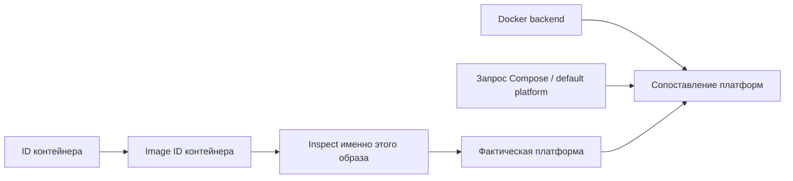

# Метаданные функционального запуска

`smoke` и оба режима `labdata smoke` сохраняют общий блок `environment` версии 1 в `report.json`. Формат smoke обновлён с версии 2 до 3; labdata получил явную версию 1. Прежние поля результатов, очистки и событий сохранены. Основание — [решение F03](../architecture/PLATFORM_EVIDENCE.md) и [ADR 0004](../adr/0004-platform-evidence.md).

| Поле `environment` | Что означает |
| :--- | :--- |
| `runner_platform` | Цель Go-бинарника; физическая архитектура компьютера этим не доказана |
| `host_platform` | Пока `UNKNOWN`: подтверждённый профиль физического хоста не собирается |
| `backend_platform`, `backend_budget` | Платформа, CPU и память Docker daemon/VM из `docker info` |
| `services.*.requested_platform` | Эффективный `service.platform`, затем `DOCKER_DEFAULT_PLATFORM`; `UNSET`, если оба отсутствуют |
| `container_id`, `image_id`, `image_digests`, `image_platform` | Контейнер, его неизменяемый image ID, доступные digest и платформа; изменяемый тег не используется |
| `backend_image_relation`, `requested_actual_relation` | Два независимых сопоставления: `MATCH`, `MISMATCH`, `UNKNOWN`; без запроса — `NOT_REQUESTED` |
| `limits` | Значения `HostConfig.Memory` в байтах и `HostConfig.NanoCpus` в миллиардных долях CPU |
| `usage_snapshot` | Один стартовый снимок `docker stats`: время, CPU в процентах и используемая память в байтах |

`KNOWN` означает полученное значение; `UNKNOWN` содержит причину отсутствия. Нулевой лимит имеет статус `NOT_CONFIGURED`: ограничение не задано **в этом поле**, но возможны quota/cpuset и ограничения родительской группы. `NOT_MEASURED` отличается от измеренного нулевого потребления. Снимок Docker stats снимается после старта, до функциональных действий; это не измерение нагрузки, RSS или capacity.

| Пример | Backend / image | Запрос / image | Вывод |
| :--- | :--- | :--- | :--- |
| Backend ARM64, image AMD64, запрос AMD64 | `MISMATCH` | `MATCH` | Запрос выполнен; способ исполнения ещё не доказан |
| Backend AMD64, image AMD64, запрос ARM64 | `MATCH` | `MISMATCH` | Образ не соответствует запросу |

Совпадение платформ не доказывает native execution. `execution_profile=UNVERIFIED` и `comparison_eligibility=NOT_EVALUATED`: полный допуск A/B по F03/F06 добавляется перед сравнительными экспериментами. Функциональный результат и пригодность измерений — разные выводы.

Покрытие: постоянные проверяемые контейнеры Orders/Inventory/Payments либо PostgreSQL/Kafka/Redis. Платформа временных `run --rm` инструментов не выводится из их тегов. Недоступный inspect и частичный запуск сохраняют известные факты и причины неизвестности; отмена прекращает новые запросы и сохраняет адресную очистку. Общий бюджет сбора — 30 секунд, на команду — пять секунд. Полный Compose config, inspect, stderr, секреты и домашние пути не сохраняются в новом блоке.

CI отдельно проверяет полноту метаданных успешных прогонов в своём известном профиле. Эта проверка читает сохранённые отчёты и не меняет функциональный exit-код обычного CLI.

Исторические отчёты сохраняют прежний формат. Старые `host_platform` и `docker_architecture` smoke обозначают GOOS runner и платформу backend соответственно; платформу образа следует читать из `environment`.

Датированные результаты Windows и ограничения проверки: [доказательства](evidence/run-metadata/VALIDATION.md).
