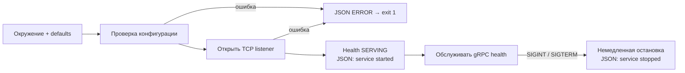

# Запуск сервисов — P01-02, P01-03, P01-04

Три независимых процесса Orders, Inventory и Payments проверяют настройки, пишут JSON в stderr и обслуживают стандартный `grpc.health.v1.Health/Check`. Health пока подтверждает только работу gRPC-каркаса. Бизнес-методов, PostgreSQL/Kafka/Redis и доменных protobuf здесь нет.

P01-01 принят владельцем и слит через [PR #6](https://github.com/Includeoyasi/faultline-lab/pull/6). [Draft PR #7](https://github.com/Includeoyasi/faultline-lab/pull/7) объединяет задачи 02–04 по прямому поручению владельца. Статус проверок и ссылка на текущий PR находятся в [P01](packets/P01.md) и [Issue #3](https://github.com/Includeoyasi/faultline-lab/issues/3).

## Как устроен запуск



[cmd/orders](../../cmd/orders/main.go), [cmd/inventory](../../cmd/inventory/main.go) и [cmd/payments](../../cmd/payments/main.go) задают имя и адрес сервиса и владеют обработкой сигналов/кодом выхода. [internal/service](../../internal/service/run.go) содержит только общие механизмы запуска; бизнес-логика одного сервиса не импортируется другим. Лаборатория и адаптеры ещё не реализованы.

## Настройки

Одинаковые имена переменных действуют в окружении каждого отдельного процесса. Файлы `.env` приложение самостоятельно не читает.

| Переменная | Default | Допустимые значения |
| :--- | :--- | :--- |
| `FL_GRPC_ADDR` | Orders `127.0.0.1:50051`, Inventory `127.0.0.1:50052`, Payments `127.0.0.1:50053` | `host:port`, порт 1–65535; IPv6 в квадратных скобках; пустой host разрешён |
| `FL_LOG_LEVEL` | `INFO` | `DEBUG`, `INFO`, `WARN`, `ERROR`, регистр не важен |
| `FL_SHUTDOWN_TIMEOUT` | `10s` | Положительная Go duration, например `500ms` или `15s` |

Отсутствующее значение использует default; явно пустое отклоняется. Адрес проверяется синтаксически без DNS-запроса. Имя host должно быть IP или DNS-именем; IPv6 zone ID пока не поддерживается. Возможность разрешить имя/открыть адрес проверяется фактическим bind. URI, имена портов и произвольный текст отклоняются. Ошибка называет переменную и правило, не повторяя введённое значение; весь конфиг в логи не выводится.

**Shutdown timeout пока только разбирается и валидируется.** В этом PR отмена контекста немедленно вызывает `grpc.Server.Stop()`. Ожидание активных RPC, наблюдаемый переход readiness и принудительное завершение по deadline относятся к P01-05 и ещё не реализованы. Наличие настройки не означает готовность graceful shutdown.

По умолчанию порты доступны только через loopback. Для контейнерной сети адрес явно меняется на `0.0.0.0:<port>`. На этом этапе gRPC работает без TLS/аутентификации для локального стенда; публичное размещение этим PR не подготавливается.

## Логи

Используется стандартный [log/slog](https://pkg.go.dev/log/slog), отдельный logger каждого сервиса. Каждая прикладная запись — одна JSON-строка с `time`, `level`, `msg`, `service`.

- `service started` (INFO): фактический `grpc_address`, `version`, `revision`, `vcs_modified`, `go_version` из Go build metadata. Неизвестное значение — `unknown`; локальный модуль может иметь версию `(devel)`. Commit не задаётся придуманной константой.
- `service stopped` (INFO): `stop_mode=immediate` после завершения Serve.
- `configuration rejected` (ERROR): безопасная причина ошибки настроек; до создания рабочего logger используется INFO logger, поэтому ошибочный уровень не скрывает диагностику.
- `service failed` (ERROR): ошибка bind или обслуживания/остановки.

Уровень фильтрует записи: при WARN/ERROR штатные старт/стоп INFO не выводятся. По умолчанию INFO они доступны. Секреты и payload не добавляются. Идентификаторы запросов/заказов появятся вместе с соответствующими операциями.

## Сборка и проверки

Основной путь требует Docker с Linux-контейнерами и Compose v2; Go/Bash на хосте не нужны. Из корня:

```text
docker compose build toolchain
docker compose run --rm toolchain check
docker compose run --rm toolchain service-smoke
```

`check` проверяет формат, модули, сборку, линтеры, unit/process tests, race detector и govulncheck. `service-smoke` собирает все три бинарника и проверяет их как отдельные процессы внутри одного временного контейнера инструментов. Это проверка изоляции процессов, а не готовых runtime-контейнеров. Прежняя команда `bootstrap-smoke` удалена: теперь программы продолжают обслуживать запросы.

[Process smoke](../../tests/smoke/services_test.go) проверяет:

- запуск всех трёх процессов и `SERVING` для общего health (`service=""`);
- `NotFound` для неизвестного имени health-сервиса;
- обязательные поля JSON и build metadata;
- для каждого бинарника — ошибки адреса, уровня, timeout и занятого порта: одна JSON-диагностика, exit 1, отсутствие готовности;
- после остановки Orders — доступность Inventory и Payments;
- на Linux — нормальный SIGINT exit и финальную JSON-запись.

Тесты синхронизируются по стартовой записи и реальному RPC с deadline, без случайных Sleep. Порты тестов выделяются динамически; unit fixture использует порт 0, публичная конфигурация его отклоняет. Под Windows smoke завершает дочерние процессы через Kill: это проверка изоляции, а не доставки Unix-сигнала. Завершение по отмене контекста и JSON stop отдельно проверяются unit-тестом на доступных ОС; Linux CI дополнительно проверяет сигнал реальному процессу. Race detector охватывает также сам сервер в unit-тесте; дочерние бинарники smoke собираются обычной сборкой.

Для ручного исследования после `toolchain build` можно запустить Orders в контейнере инструментов:

```text
docker compose run --rm toolchain build
docker compose run --rm -p 50051:50051 -e FL_GRPC_ADDR=0.0.0.0:50051 --entrypoint /workspace/bin/orders toolchain
```

Inventory и Payments аналогично используют свои бинарники и порты 50052/50053 в отдельных терминалах. Это временный путь разработки; отдельные минимальные runtime-образы и Compose-сервисы остаются P01-06. Стандартный health API описан в [документации gRPC](https://grpc.io/docs/guides/health-checking/); grpcurl/reflection в проект не добавлены.

## Границы доказательств

Нативный Windows Go smoke может подтвердить TCP/health процессов, но не Docker Desktop. Linux AMD64/ARM64 CI проверяет toolchain-контейнер и процессы на каждой архитектуре; он не доказывает запуск на личном Mac. Runtime-контейнеры, graceful drain, работа БД, бизнес-инварианты, нагрузка и потребление ресурсов ещё не проверяются. Итоговые PASS/NOT_RUN фиксируются после реального прогона, отдельно от этого описания поведения.
