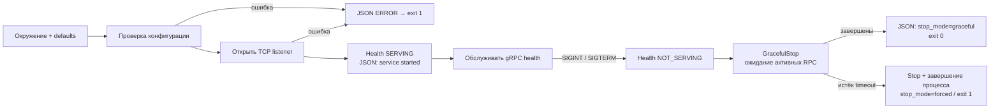

# Сервисы: конфигурация, логи и жизненный цикл

Три независимых процесса Orders, Inventory и Payments проверяют настройки, пишут JSON в stderr и обслуживают стандартный `grpc.health.v1.Health/Check`. Этот документ описывает общий жизненный цикл. [Inventory](INVENTORY.md) и [Orders](ORDERS.md) используют PostgreSQL; Orders вызывает Inventory по gRPC, а Payments сохраняет каркас. Для независимой проверки Orders и Inventory предусмотрена явная команда `health-only`, подтверждающая только работу gRPC-каркаса.

Конфигурация и базовый процесс введены в PR #6/#7; контейнерный жизненный цикл — в [PR #8](https://github.com/Includeoyasi/faultline-lab/pull/8). Это исторические источники реализации. Актуальные задачи и ревью — в [GitHub](https://github.com/Includeoyasi/faultline-lab/issues).

## Как устроен запуск



[cmd/orders](../../cmd/orders/main.go), [cmd/inventory](../../cmd/inventory/main.go) и [cmd/payments](../../cmd/payments/main.go) задают имя сервиса и владеют обработкой сигналов/кодом выхода. Адресов и портов в прикладном Go-коде нет: они поступают из окружения. [internal/service](../../internal/service/run.go) содержит только общие механизмы запуска; бизнес-логика одного сервиса не импортируется другим. Лаборатория и адаптеры ещё не реализованы.

## Настройки

Одинаковые имена переменных действуют в окружении каждого отдельного процесса. Файлы `.env` приложение самостоятельно не читает.

| Переменная | Default | Допустимые значения |
| :--- | :--- | :--- |
| `FL_GRPC_ADDR` | Нет; обязательная настройка окружения | `host:port`, порт 1–65535; IPv6 в квадратных скобках; пустой host разрешён только как явно выбранный wildcard |
| `FL_LOG_LEVEL` | `INFO` | `DEBUG`, `INFO`, `WARN`, `ERROR`, регистр не важен |
| `FL_SHUTDOWN_TIMEOUT` | `10s` | Положительная Go duration, например `500ms` или `15s` |
| `FL_HEALTH_TARGET` | Нет; обязателен только для команды `healthcheck` | Конкретный host:port, не wildcard; задаётся отдельно от listener |

Отсутствующий или пустой `FL_GRPC_ADDR` приводит к JSON-ошибке и exit 1 до открытия listener. Приложение не выбирает сеть за оператора и не имеет скрытого адреса по умолчанию. Для уровня логов и timeout действуют defaults; явно пустое значение отклоняется. Адрес проверяется синтаксически без DNS-запроса. Имя host должно быть IP или DNS-именем; IPv6 zone ID пока не поддерживается. Возможность разрешить имя/открыть адрес проверяется фактическим bind. URI, имена портов и произвольный текст отклоняются. Ошибка называет переменную и правило, не повторяя введённое значение; весь конфиг в логи не выводится.

`FL_SHUTDOWN_TIMEOUT` ограничивает ожидание активных RPC после удаления готовности. Graceful stop даёт завершиться начатой работе; по deadline запрашивается принудительный Stop и процесс завершается с кодом 1. Оставшаяся goroutine некооперативного handler прекращается вместе с процессом. Реализация и управляемые тесты описаны в [контейнерном пакете](CONTAINER_RUNTIME.md).

Адрес прослушивания, адрес подключения клиента и публикация порта на хосте — разные настройки:

| Назначение | Где задаётся | Пример / правило |
| :--- | :--- | :--- |
| Listener локального процесса | [local.env.example](../../configs/env/local.env.example) | `localhost:50051`; для нескольких процессов на одном хосте задаются разные порты |
| Listener в контейнере | [container.env.example](../../configs/env/container.env.example) | `:50051` — явный wildcard внутри сетевого пространства контейнера; разные контейнеры могут использовать один внутренний порт |
| Endpoint другого сервиса | Deployment-конфигурация Orders; `inventory_target` в его профиле | Имена Compose DNS, например `inventory:50051`; IP контейнеров не закрепляются |
| Доступ с хоста | Явная публикация при запуске | Для локальной разработки привязка только к loopback; без `-p` порт не публикуется на интерфейсах хоста |

Образцы содержат только несекретные настройки. Личные копии `*.env` игнорируются Git и исключены из Docker build context; окружение передаёт launcher, приложение не загружает dotenv самостоятельно. Loopback в тестах — изолированный fixture с динамическим портом, а в наблюдённых логах — фактический адрес запущенного тестового процесса.

Использование DNS и настройка адреса не заменяют разграничение сетевого доступа и аутентификацию. Сейчас это локальный gRPC-стенд без TLS/аутентификации; production-размещение потребует отдельной политики TLS/mTLS и доступа. Привязка wildcard в контейнере не является такой политикой. Правила публикации и разрешения имён основаны на [Docker port publishing](https://docs.docker.com/engine/network/port-publishing/) и [Compose networking](https://docs.docker.com/compose/how-tos/networking/).

## Логи

Используется стандартный [log/slog](https://pkg.go.dev/log/slog), отдельный logger каждого сервиса. Каждая прикладная запись — одна JSON-строка с `time`, `level`, `msg`, `service`.

- `service started` (INFO): фактический `grpc_address`, `version`, `revision`, `vcs_modified`, `go_version` из Go build metadata. Неизвестное значение — `unknown`; локальный модуль может иметь версию `(devel)`. Commit не задаётся придуманной константой.
- `service stopping` (INFO): health=NOT_SERVING и shutdown_timeout перед началом drain.
- `service stopped` (INFO): stop_mode=graceful; при deadline — WARN с stop_mode=forced и последующая ERROR-диагностика, exit 1.
- `configuration rejected` (ERROR): безопасная причина ошибки настроек; до создания рабочего logger используется INFO logger, поэтому ошибочный уровень не скрывает диагностику.
- `service failed` (ERROR): ошибка bind или обслуживания/остановки.

Уровень фильтрует записи: при WARN/ERROR штатные старт/стоп INFO не выводятся. По умолчанию INFO они доступны. Секреты и payload не добавляются. Идентификаторы запросов/заказов появятся вместе с соответствующими операциями.

## Наблюдаемые записи

Каждый runtime smoke сохраняет реальные JSONL-записи старта, удаления готовности и остановки. В review packet приводятся ссылка на соответствующий CI и его артефакты; [контейнерная инструкция](CONTAINER_RUNTIME.md) описывает состав отчёта. Process smoke также печатает наблюдённые JSON в лог job. Временный merge ref GitHub может отличаться от HEAD ветки; metadata не подменяются придуманным SHA.

## Сборка и проверки

Основной путь требует Docker с Linux-контейнерами и Compose v2; Go/Bash на хосте не нужны. Из корня:

```text
docker compose build toolchain
docker compose run --rm toolchain check
docker compose run --rm toolchain service-smoke
```

`check` проверяет формат, модули, сборку, линтеры, unit/process tests, race detector и govulncheck. `service-smoke` собирает все три бинарника и проверяет их как отдельные процессы внутри одного временного контейнера инструментов. Это проверка изоляции процессов, а не готовых runtime-контейнеров. Прежняя команда `bootstrap-smoke` удалена: теперь программы продолжают обслуживать запросы.

[Process smoke](../../tests/smoke/services_test.go) проверяет:

- запуск всех трёх процессов и `SERVING` для общего health (`service=""`);
- `NotFound` для неизвестного имени health-сервиса;
- обязательные поля JSON и build metadata;
- для каждого бинарника — отсутствующий/пустой адрес, ошибки адреса, уровня, timeout и занятого порта: одна JSON-диагностика, exit 1, отсутствие готовности;
- после остановки Orders — доступность Inventory и Payments;
- на Linux — нормальные SIGINT/SIGTERM exit и forced exit 1 по deadline при удерживаемом health Watch.

Тесты синхронизируются по стартовой записи и реальному RPC с deadline, без случайных Sleep. Порты тестов выделяются динамически; unit fixture использует порт 0, публичная конфигурация его отклоняет. Под Windows smoke завершает дочерние процессы через Kill: это проверка изоляции, а не доставки Unix-сигнала. Завершение по отмене контекста и JSON stop отдельно проверяются unit-тестом на доступных ОС; Linux CI дополнительно проверяет сигнал реальному процессу. Race detector охватывает также сам сервер в unit-тесте; дочерние бинарники smoke собираются обычной сборкой.

Для отдельных минимальных runtime-контейнеров используйте [контейнерную инструкцию](CONTAINER_RUNTIME.md): сборка, запуск, health, остановка и автоматический smoke без host Go. Она заменяет прежний запуск серверов внутри образа компилятора.

## Границы доказательств

Нативный Windows Go smoke может подтвердить TCP/health процессов, но не Docker Desktop. Linux AMD64/ARM64 CI проверяет toolchain-контейнер и процессы на каждой архитектуре; он не доказывает запуск на личном Mac. Graceful drain проверяется управляемыми unit/process tests; runtime-контейнеры — отдельным Docker smoke. Работа БД, бизнес-инварианты, нагрузка и потребление ресурсов ещё не проверяются. Итоговые PASS/NOT_RUN фиксируются после реального прогона, отдельно от этого описания поведения.
