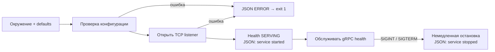

# Запуск сервисов — P01-02, P01-03, P01-04

Три независимых процесса Orders, Inventory и Payments проверяют настройки, пишут JSON в stderr и обслуживают стандартный `grpc.health.v1.Health/Check`. Health пока подтверждает только работу gRPC-каркаса. Бизнес-методов, PostgreSQL/Kafka/Redis и доменных protobuf здесь нет.

P01-01 принят владельцем и слит через [PR #6](https://github.com/Includeoyasi/faultline-lab/pull/6). [PR #7](https://github.com/Includeoyasi/faultline-lab/pull/7) объединяет задачи 02–04 по прямому поручению владельца. Статус проверок и ссылка на текущий PR находятся в [P01](packets/P01.md) и [Issue #3](https://github.com/Includeoyasi/faultline-lab/issues/3).

## Как устроен запуск



[cmd/orders](../../cmd/orders/main.go), [cmd/inventory](../../cmd/inventory/main.go) и [cmd/payments](../../cmd/payments/main.go) задают имя сервиса и владеют обработкой сигналов/кодом выхода. Адресов и портов в прикладном Go-коде нет: они поступают из окружения. [internal/service](../../internal/service/run.go) содержит только общие механизмы запуска; бизнес-логика одного сервиса не импортируется другим. Лаборатория и адаптеры ещё не реализованы.

## Настройки

Одинаковые имена переменных действуют в окружении каждого отдельного процесса. Файлы `.env` приложение самостоятельно не читает.

| Переменная | Default | Допустимые значения |
| :--- | :--- | :--- |
| `FL_GRPC_ADDR` | Нет; обязательная настройка окружения | `host:port`, порт 1–65535; IPv6 в квадратных скобках; пустой host разрешён только как явно выбранный wildcard |
| `FL_LOG_LEVEL` | `INFO` | `DEBUG`, `INFO`, `WARN`, `ERROR`, регистр не важен |
| `FL_SHUTDOWN_TIMEOUT` | `10s` | Положительная Go duration, например `500ms` или `15s` |

Отсутствующий или пустой `FL_GRPC_ADDR` приводит к JSON-ошибке и exit 1 до открытия listener. Приложение не выбирает сеть за оператора и не имеет скрытого адреса по умолчанию. Для уровня логов и timeout действуют defaults; явно пустое значение отклоняется. Адрес проверяется синтаксически без DNS-запроса. Имя host должно быть IP или DNS-именем; IPv6 zone ID пока не поддерживается. Возможность разрешить имя/открыть адрес проверяется фактическим bind. URI, имена портов и произвольный текст отклоняются. Ошибка называет переменную и правило, не повторяя введённое значение; весь конфиг в логи не выводится.

**Shutdown timeout пока только разбирается и валидируется.** В этом PR отмена контекста немедленно вызывает `grpc.Server.Stop()`. Ожидание активных RPC, наблюдаемый переход readiness и принудительное завершение по deadline относятся к P01-05 и ещё не реализованы. Наличие настройки не означает готовность graceful shutdown.

Адрес прослушивания, адрес подключения клиента и публикация порта на хосте — разные настройки:

| Назначение | Где задаётся | Пример / правило |
| :--- | :--- | :--- |
| Listener локального процесса | [local.env.example](../../configs/env/local.env.example) | `localhost:50051`; для нескольких процессов на одном хосте задаются разные порты |
| Listener в контейнере | [container.env.example](../../configs/env/container.env.example) | `:50051` — явный wildcard внутри сетевого пространства контейнера; разные контейнеры могут использовать один внутренний порт |
| Endpoint другого сервиса | Будущая deployment-конфигурация, когда появятся клиенты | Имена Compose DNS, например `inventory:50051`; IP контейнеров не закрепляются |
| Доступ с хоста | Явная публикация при запуске | Для локальной разработки привязка только к loopback; без `-p` порт не публикуется на интерфейсах хоста |

Образцы содержат только несекретные настройки. Личные копии `*.env` игнорируются Git и исключены из Docker build context; окружение передаёт launcher, приложение не загружает dotenv самостоятельно. Loopback в тестах — изолированный fixture с динамическим портом, а в наблюдённых логах — фактический адрес запущенного тестового процесса.

Использование DNS и настройка адреса не заменяют разграничение сетевого доступа и аутентификацию. Сейчас это локальный gRPC-стенд без TLS/аутентификации; production-размещение потребует отдельной политики TLS/mTLS и доступа. Привязка wildcard в контейнере не является такой политикой. Правила публикации и разрешения имён основаны на [Docker port publishing](https://docs.docker.com/engine/network/port-publishing/) и [Compose networking](https://docs.docker.com/compose/how-tos/networking/).

## Логи

Используется стандартный [log/slog](https://pkg.go.dev/log/slog), отдельный logger каждого сервиса. Каждая прикладная запись — одна JSON-строка с `time`, `level`, `msg`, `service`.

- `service started` (INFO): фактический `grpc_address`, `version`, `revision`, `vcs_modified`, `go_version` из Go build metadata. Неизвестное значение — `unknown`; локальный модуль может иметь версию `(devel)`. Commit не задаётся придуманной константой.
- `service stopped` (INFO): `stop_mode=immediate` после завершения Serve.
- `configuration rejected` (ERROR): безопасная причина ошибки настроек; до создания рабочего logger используется INFO logger, поэтому ошибочный уровень не скрывает диагностику.
- `service failed` (ERROR): ошибка bind или обслуживания/остановки.

Уровень фильтрует записи: при WARN/ERROR штатные старт/стоп INFO не выводятся. По умолчанию INFO они доступны. Секреты и payload не добавляются. Идентификаторы запросов/заказов появятся вместе с соответствующими операциями.

## Наблюдённые записи CI

Ниже реальные записи предыдущей версии из [прошедшего AMD64 job](https://github.com/Includeoyasi/faultline-lab/actions/runs/38734815221), source HEAD `4d3b235`, до удаления адреса по умолчанию. Loopback здесь — адрес тестового listener, не настройка приложения в исходнике. Порядок JSON-ключей нормализован тестом. В pull_request CI checkout собирает временный merge ref: поэтому build revision `108fabc` отличается от HEAD ветки. Это сведения о фактически собранном коде, а не подстановка SHA задачи.

```json
{"go_version":"go1.27.2","grpc_address":"127.0.0.1:34189","level":"INFO","msg":"service started","revision":"108fabc9d038d1a49f0f5025c8190d900de72ba2","service":"orders","time":"2026-10-15T12:29:40.759977921Z","vcs_modified":"false","version":"v0.0.0-20261015122747-108fabc9d038"}
{"error":"FL_LOG_LEVEL must be DEBUG, INFO, WARN or ERROR","level":"ERROR","msg":"configuration rejected","service":"orders","time":"2026-10-15T12:29:40.763519761Z"}
{"error":"listen for gRPC: listen tcp 127.0.0.1:34189: bind: address already in use","level":"ERROR","msg":"service failed","service":"orders","time":"2026-10-15T12:29:40.769974111Z"}
{"level":"INFO","msg":"service stopped","service":"orders","stop_mode":"immediate","time":"2026-10-15T12:29:40.796337143Z"}
```

## Сборка и проверки

Основной путь требует Docker с Linux-контейнерами и Compose v2; Go/Bash на хосте не нужны. Из корня:

```text
docker compose build toolchain
docker compose run --rm toolchain check
docker compose run --rm toolchain service-smoke
```

`check` проверяет формат, модули, сборку, линтеры, unit/process tests, race detector и govulncheck. `service-smoke` собирает все три бинарника и проверяет их как отдельные процессы внутри одного временного контейнера инструментов. Это проверка изоляции процессов, а не готовых runtime-контейнеров. Прежняя команда `bootstrap-smoke` удалена: теперь программы продолжают обслуживать запросы.

[Process smoke](../../tests/smoke/services_test.go) проверяет:

- запуск всех трёх процессов и `SERVING` для общего health (`service=""`);
- `NotFound` для неизвестного имени health-сервиса;
- обязательные поля JSON и build metadata;
- для каждого бинарника — отсутствующий/пустой адрес, ошибки адреса, уровня, timeout и занятого порта: одна JSON-диагностика, exit 1, отсутствие готовности;
- после остановки Orders — доступность Inventory и Payments;
- на Linux — нормальный SIGINT exit и финальную JSON-запись.

Тесты синхронизируются по стартовой записи и реальному RPC с deadline, без случайных Sleep. Порты тестов выделяются динамически; unit fixture использует порт 0, публичная конфигурация его отклоняет. Под Windows smoke завершает дочерние процессы через Kill: это проверка изоляции, а не доставки Unix-сигнала. Завершение по отмене контекста и JSON stop отдельно проверяются unit-тестом на доступных ОС; Linux CI дополнительно проверяет сигнал реальному процессу. Race detector охватывает также сам сервер в unit-тесте; дочерние бинарники smoke собираются обычной сборкой.

Для ручного исследования после `toolchain build` можно запустить Orders в контейнере инструментов:

```text
docker compose run --rm toolchain build
docker compose run --rm --env-from-file configs/env/container.env.example --entrypoint /workspace/bin/orders toolchain
```

Это запускает Orders без публикации порта на хост. Для явного локального доступа добавьте `-p 127.0.0.1:50051:50051` к команде. Привязка `127.0.0.1` здесь — политика локального доступа в конфигурации запуска, а не встроенный адрес Go-программы. Не используйте сокращённое `-p 50051:50051`: оно публикует порт на всех интерфейсах хоста. Для этой изоляции используйте актуальный Docker Engine 28+; более старые версии имели документированное ограничение публикации на localhost.

Inventory и Payments аналогично используют свои бинарники с тем же container.env.example в отдельных контейнерах. При необходимости доступа с хоста задайте разные host ports (50052/50053) при том же container port 50051. Это временный путь разработки; отдельные минимальные runtime-образы и Compose-сервисы остаются P01-06. Параметр `--env-from-file` описан в [справке Compose run](https://docs.docker.com/reference/cli/docker/compose/run/). Стандартный health API описан в [документации gRPC](https://grpc.io/docs/guides/health-checking/); grpcurl/reflection в проект не добавлены.

## Границы доказательств

Нативный Windows Go smoke может подтвердить TCP/health процессов, но не Docker Desktop. Linux AMD64/ARM64 CI проверяет toolchain-контейнер и процессы на каждой архитектуре; он не доказывает запуск на личном Mac. Runtime-контейнеры, graceful drain, работа БД, бизнес-инварианты, нагрузка и потребление ресурсов ещё не проверяются. Итоговые PASS/NOT_RUN фиксируются после реального прогона, отдельно от этого описания поведения.
